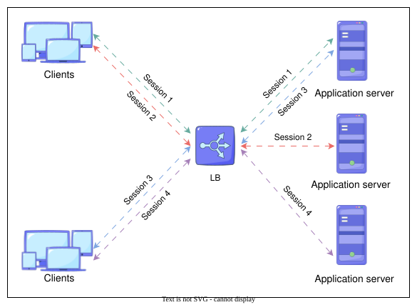
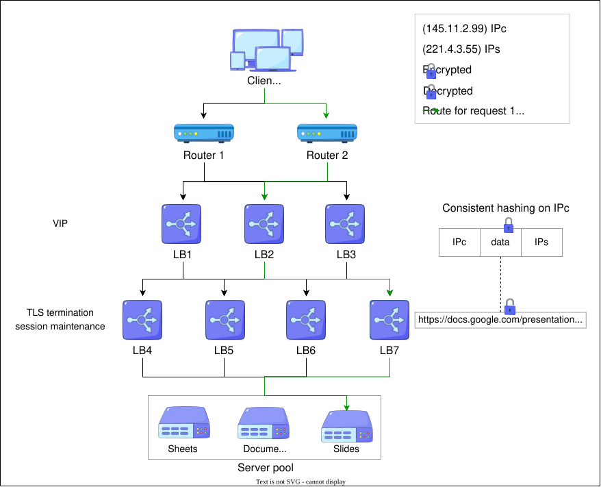
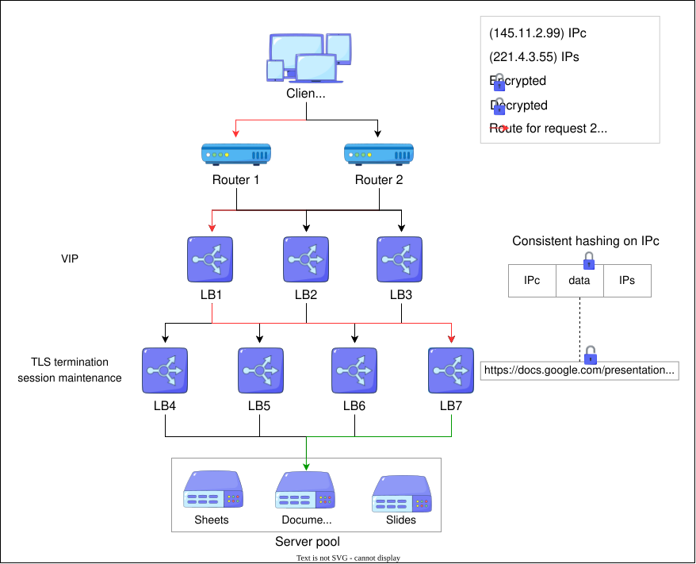

# Advanced_Details_of_Load_Balancers

Source: https://www.educative.io/courses/grokking-the-system-design-interview/advanced-details-of-load-balancers

---

[Home](https://www.educative.io/)

[Courses](https://www.educative.io/search?tab=courses)

[Grokking Modern System Design Interview](https://www.educative.io/courses/grokking-the-system-design-interview)

# Advanced Details of Load Balancers

Discover how load balancers are deployed in modern data centers using a multi-tier hierarchy. Analyze the differences between Layer 4 and Layer 7 LBs, and evaluate static vs. dynamic algorithms for optimal request distribution. Understand state management to build resilient System Design solutions.

We'll cover the following...

- [Algorithms of load balancers](https://www.educative.io/courses/grokking-the-system-design-interview/advanced-details-of-load-balancers#Algorithms-of-load-balancers)
  - [Static vs. dynamic algorithms](https://www.educative.io/courses/grokking-the-system-design-interview/advanced-details-of-load-balancers#Static-vs-dynamic-algorithms)
  - [Stateful vs. stateless LBs](https://www.educative.io/courses/grokking-the-system-design-interview/advanced-details-of-load-balancers#Stateful-vs-stateless-LBs)
    - [Stateful load balancing](https://www.educative.io/courses/grokking-the-system-design-interview/advanced-details-of-load-balancers#Stateful-load-balancing)
    - [Stateless load balancing](https://www.educative.io/courses/grokking-the-system-design-interview/advanced-details-of-load-balancers#Stateless-load-balancing)
- [Types of load balancers](https://www.educative.io/courses/grokking-the-system-design-interview/advanced-details-of-load-balancers#Types-of-load-balancers)
- [Load balancer deployment](https://www.educative.io/courses/grokking-the-system-design-interview/advanced-details-of-load-balancers#Load-balancer-deployment)
  - [Tier-0 and tier-1 LBs](https://www.educative.io/courses/grokking-the-system-design-interview/advanced-details-of-load-balancers#Tier-0-and-tier-1-LBs)
  - [Tier-2 LBs](https://www.educative.io/courses/grokking-the-system-design-interview/advanced-details-of-load-balancers#Tier-2-LBs)
  - [Tier-3 LBs](https://www.educative.io/courses/grokking-the-system-design-interview/advanced-details-of-load-balancers#Tier-3-LBs)
  - [Practical example](https://www.educative.io/courses/grokking-the-system-design-interview/advanced-details-of-load-balancers#Practical-example)
- [Implementation of load balancers](https://www.educative.io/courses/grokking-the-system-design-interview/advanced-details-of-load-balancers#Implementation-of-load-balancers)
  - [Hardware load balancers](https://www.educative.io/courses/grokking-the-system-design-interview/advanced-details-of-load-balancers#Hardware-load-balancers)
  - [Software load balancers](https://www.educative.io/courses/grokking-the-system-design-interview/advanced-details-of-load-balancers#Software-load-balancers)
  - [Cloud load balancers](https://www.educative.io/courses/grokking-the-system-design-interview/advanced-details-of-load-balancers#Cloud-load-balancers)
- [Conclusion](https://www.educative.io/courses/grokking-the-system-design-interview/advanced-details-of-load-balancers#Conclusion)

This lesson covers common load balancing algorithms and how load balancers (LBs) are organized hierarchically to distribute traffic across system tiers.

## Algorithms of load balancers[#](https://www.educative.io/courses/grokking-the-system-design-interview/advanced-details-of-load-balancers#Algorithms-of-load-balancers)

**Load balancers** use specific algorithms to distribute client requests, which include:

- **Round robin scheduling:** Requests are forwarded to servers sequentially in a repeating loop.
- **Weighted round robin:** Useful when servers have varying capacities. Each node is assigned a weight; servers with higher weights receive a larger proportion of requests.
- **Least connections:** Assigns new requests to the server with the fewest active connections. This is effective when request processing times vary significantly, preventing servers with long-running tasks from becoming overwhelmed.
- **Least response time:** Directs traffic to the server with the lowest active response time, optimizing for latency. It is useful in performance-sensitive services.
- **IP hash:** Hashes the client’s IP address to map them to a specific server. This is often used to maintain session stickiness.
- **URL hash:** Distributes requests based on the URL. This routes traffic to specific server clusters handling distinct services (e.g., separating video serving from text).

Other variations exist, such as randomized or weighted least connections algorithms.

### Static vs. dynamic algorithms[#](https://www.educative.io/courses/grokking-the-system-design-interview/advanced-details-of-load-balancers#Static-vs-dynamic-algorithms)

Algorithms are categorized based on whether they consider the machine’s state:

- **Static algorithms** (e.g., Round robin) distribute tasks based on fixed configurations. They are simple and low-overhead, but do not account for real-time server health or load.
- **Dynamic algorithms** (e.g., Least connections) monitor the current state of servers. While they add complexity and communication overhead, they improve reliability by routing around overloaded or unhealthy servers.

Dynamic algorithms require load balancers to exchange information, making them modular but complex. However, they provide better forwarding decisions by actively monitoring server health.

> **Note:** In practice, dynamic algorithms provide superior results because they maintain the state of serving hosts, justifying the added complexity.

### Stateful vs. stateless LBs[#](https://www.educative.io/courses/grokking-the-system-design-interview/advanced-details-of-load-balancers#Stateful-vs-stateless-LBs)

Load balancers may need to handle session persistence (state) between clients and hosting servers.

If session information isn’t stored in a lower layer (like a distributed cache or database), the LB itself must manage it. There are two approaches:

- Stateful
- Stateless

#### Stateful load balancing[#](https://www.educative.io/courses/grokking-the-system-design-interview/advanced-details-of-load-balancers#Stateful-load-balancing)

**Stateful load balancing** involves maintaining a record of sessions between clients and servers. The LB uses this state to guide routing decisions.

Essentially, stateful LBs maintain a mapping of incoming clients to backend servers. This approach increases complexity and limits scalability, as session information must be synchronized across all load balancers to ensure consistent forwarding.



Stateful load balancing

#### Stateless load balancing[#](https://www.educative.io/courses/grokking-the-system-design-interview/advanced-details-of-load-balancers#Stateless-load-balancing)

**Stateless load balancing** does not store session state. It typically uses consistent hashing to route requests. While faster and lighter, it handles infrastructure changes (like scaling) less gracefully than stateful LBs. To mitigate this, a local state is often combined with consistent hashing.


Stateless load balancers using hash buckets to map requests to end servers

In summary, if the state is synchronized across multiple load balancers, it is considered **stateful**. If state is maintained locally within a single load balancer or derived algorithmically, it is considered **stateless**.

AI Powered

Saved

1 attempt left

Reset

Choosing between stateful and stateless load balancer

Having familiarized yourself with load balancers, consider a scenario where you deploy a website that serves static content, such as text and images. Would you choose a stateful or stateless load balancer, and why?

This is your last attempt.

## Types of load balancers[#](https://www.educative.io/courses/grokking-the-system-design-interview/advanced-details-of-load-balancers#Types-of-load-balancers)

Load balancing can be performed at different layers of the Open Systems Interconnection (OSI) model.

- **Layer 4 load balancers**: Operate at the transport layer (TCP/UDP). They maintain connection sessions and ensure packets from the same connection reach the same backend server. While typically content-agnostic, some L4 LBs support TLS termination.
- **Layer 7 load balancers**: Operate at the application layer. They inspect HTTP headers, URLs, cookies, and other data to make intelligent routing decisions. They also handle TLS termination, rate limiting, and header rewriting.

> **Note:** Layer 7 load balancers are smarter regarding content inspection, while layer 4 load balancers are faster due to lower processing overhead.

## Load balancer deployment[#](https://www.educative.io/courses/grokking-the-system-design-interview/advanced-details-of-load-balancers#Load-balancer-deployment)

In large data centers, a single load balancer is insufficient. Instead, multiple layers coordinate to manage traffic efficiently. A traditional setup involves a three-tier hierarchy:


### Tier-0 and tier-1 LBs[#](https://www.educative.io/courses/grokking-the-system-design-interview/advanced-details-of-load-balancers#Tier-0-and-tier-1-LBs)

If DNS is Tier-0, then equal cost multipath (ECMP) routers act as **Tier-1 LBs**. This layer divides incoming traffic and distribute it across multiple paths (Tier-2 LBs) using IP hashing or round-robin, enabling horizontal scalability.

ECMP routers are critical for scaling higher-tier LBs.

### Tier-2 LBs[#](https://www.educative.io/courses/grokking-the-system-design-interview/advanced-details-of-load-balancers#Tier-2-LBs)

**Tier-2 LBs** are Layer 4 load balancers. They ensure that all packets for a specific connection reach the same Tier-3 LB, typically using consistent hashing. They act as a stable glue layer between the raw routing of Tier-1 and the intelligent processing of Tier-3.

Excluding Tier-2 LBs could lead to routing errors during failures or dynamic scaling.

### Tier-3 LBs[#](https://www.educative.io/courses/grokking-the-system-design-interview/advanced-details-of-load-balancers#Tier-3-LBs)

**Tier-3 LBs** are Layer 7 load balancers. They communicate directly with backend servers and perform HTTP-level health monitoring. They offload tasks such as TLS termination, TCP-congestion control, and Path MTU discovery. This allows application servers to focus solely on business logic.

> **To summarize:** Tier 1 balances load among load balancers. Tier 2 ensures smooth transitions and consistency. Tier 3 performs actual application load balancing and offloads network tasks.

### Practical example[#](https://www.educative.io/courses/grokking-the-system-design-interview/advanced-details-of-load-balancers#Practical-example)

Let’s examine how a client request travels through these tiers to reach an application server based on packet data.



1 / 2

Request R1 being routed to the Slides server



1 / 2

Request R2 being routed to the Documents server

The illustration above follows these steps:

1. R1R\_{1}R1​ arrives at a Tier-1 ECMP router.
2. The ECMP router forwards R1R\_{1}R1​ to a Tier-2 LB via round-robin. The Tier-2 LB hashes the source IP (IPsIP\_{s}IPs​) to select a specific Tier-3 LB.
3. The Tier-3 LB terminates TLS and inspects the HTTP request. Seeing the URL path `slides`, it forwards the request to the appropriate backend server.

R2R\_{2}R2​ follows the same path through Tier-1 and Tier-2. However, the Tier-3 LB detects `document` in the URL and routes it to a different backend server. This content-based routing is typical of Layer 7 LBs (e.g., HAProxy).

Shell

```
mode HTTP                               //define which mode the LB will work on, TCP for tier-2 LBs

acl slidesApp path_end -i /presentation //define a category of applications if the path ends in /presentation

use_backend slidesServers if slidesApp  // use a set of backend servers if the request arrives for slidesApp

backend slidesServers                   // listing servers serving slidesApp

server slides1 192.168.12.1:80          //using slides1 server to serve slidesApp.
```

⋯

HAProxy sample configuration for layer 7 load balancers

1.

After a request reaches a back-end server, should the response be routed back through each tier of the load balancers?

Show Answer

1 / 4

## Implementation of load balancers[#](https://www.educative.io/courses/grokking-the-system-design-interview/advanced-details-of-load-balancers#Implementation-of-load-balancers)

Load balancers can be implemented in various ways depending on scale and requirements:

### Hardware load balancers[#](https://www.educative.io/courses/grokking-the-system-design-interview/advanced-details-of-load-balancers#Hardware-load-balancers)

Hardware LBs are dedicated physical appliances. While they offer high performance and handle many concurrent users, they are expensive and difficult to configure. High availability is costly, as it requires redundant hardware for failover. Additionally, they often suffer from vendor lock-in and limited flexibility.

### Software load balancers[#](https://www.educative.io/courses/grokking-the-system-design-interview/advanced-details-of-load-balancers#Software-load-balancers)

Software LBs run on commodity hardware, making them flexible, programmable, and cost-effective. They scale easily as requirements grow. High availability is easier to achieve, as shadow load balancers can be deployed on commodity hardware with minimal cost. They also support predictive analysis for traffic planning.

### Cloud load balancers[#](https://www.educative.io/courses/grokking-the-system-design-interview/advanced-details-of-load-balancers#Cloud-load-balancers)

Cloud providers offer Load Balancers as a Service (LBaaS). These managed services allow users to pay based on usage or SLA. While they may not entirely replace on-premises solutions, they excel at global traffic management (GSLB). Key benefits include ease of use, metered costs, and built-in auditing and monitoring.


> **Note:** Client-side load balancing is another approach where the client selects the server instance directly. This is common in microservices (e.g., [load balancing in Twitter](https://www.educative.io/courses/grokking-the-system-design-interview/client-side-load-balancer-for-twitter)). However, this lesson focuses on traditional server-side load balancing.

## Conclusion[#](https://www.educative.io/courses/grokking-the-system-design-interview/advanced-details-of-load-balancers#Conclusion)

Load balancers have evolved from hardware appliances to flexible cloud services. A robust LB layer handles traffic distribution, health monitoring, session maintenance, and security (like TLS offloading), ensuring scalability and high availability for enterprise applications.

AI Powered

Saved

1 attempt left

Reset

How can load balancers differentiate requests?

In this chapter, we have explored various functions of load balancing. In addition to different roles, load balancers are often responsible for mitigating distributed denial-of-service (DDoS) attacks. How can they distinguish between legitimate traffic and malicious traffic during such incidents?

This is your last attempt.

Global and Local Load Balancing

Introduction to Databases

Ask

[Algorithms of load balancers](https://www.educative.io/courses/grokking-the-system-design-interview/advanced-details-of-load-balancers#Algorithms-of-load-balancers)

[Static vs. dynamic algorithms](https://www.educative.io/courses/grokking-the-system-design-interview/advanced-details-of-load-balancers#Static-vs-dynamic-algorithms)

[Stateful vs. stateless LBs](https://www.educative.io/courses/grokking-the-system-design-interview/advanced-details-of-load-balancers#Stateful-vs-stateless-LBs)

[Stateful load balancing](https://www.educative.io/courses/grokking-the-system-design-interview/advanced-details-of-load-balancers#Stateful-load-balancing)

[Stateless load balancing](https://www.educative.io/courses/grokking-the-system-design-interview/advanced-details-of-load-balancers#Stateless-load-balancing)

[Types of load balancers](https://www.educative.io/courses/grokking-the-system-design-interview/advanced-details-of-load-balancers#Types-of-load-balancers)

[Load balancer deployment](https://www.educative.io/courses/grokking-the-system-design-interview/advanced-details-of-load-balancers#Load-balancer-deployment)

[Tier-0 and tier-1 LBs](https://www.educative.io/courses/grokking-the-system-design-interview/advanced-details-of-load-balancers#Tier-0-and-tier-1-LBs)

[Tier-2 LBs](https://www.educative.io/courses/grokking-the-system-design-interview/advanced-details-of-load-balancers#Tier-2-LBs)

[Tier-3 LBs](https://www.educative.io/courses/grokking-the-system-design-interview/advanced-details-of-load-balancers#Tier-3-LBs)

[Practical example](https://www.educative.io/courses/grokking-the-system-design-interview/advanced-details-of-load-balancers#Practical-example)

[Implementation of load balancers](https://www.educative.io/courses/grokking-the-system-design-interview/advanced-details-of-load-balancers#Implementation-of-load-balancers)

[Hardware load balancers](https://www.educative.io/courses/grokking-the-system-design-interview/advanced-details-of-load-balancers#Hardware-load-balancers)

[Software load balancers](https://www.educative.io/courses/grokking-the-system-design-interview/advanced-details-of-load-balancers#Software-load-balancers)

[Cloud load balancers](https://www.educative.io/courses/grokking-the-system-design-interview/advanced-details-of-load-balancers#Cloud-load-balancers)

[Conclusion](https://www.educative.io/courses/grokking-the-system-design-interview/advanced-details-of-load-balancers#Conclusion)