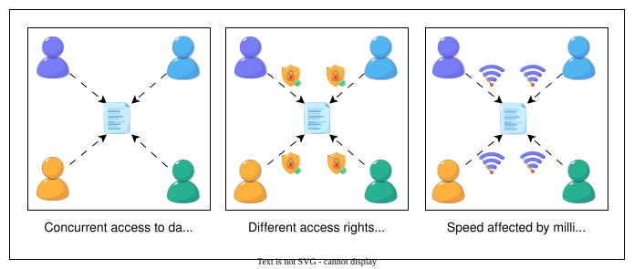
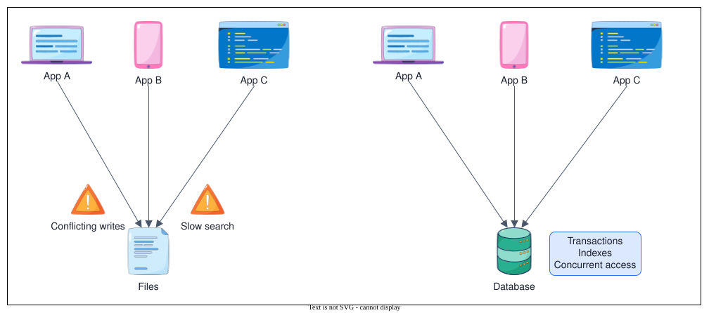

# Introduction_to_Databases

Source: https://www.educative.io/courses/grokking-the-system-design-interview/introduction-to-databases

---

[Home](https://www.educative.io/)

[Courses](https://www.educative.io/search?tab=courses)

[Grokking Modern System Design Interview](https://www.educative.io/courses/grokking-the-system-design-interview)

# Introduction to Databases

Define the fundamental role of databases in modern software applications by examining the limitations of simple file storage. Understand how databases ensure data integrity, security, availability, and scalability, which are critical requirements for complex System Design.

We'll cover the following...

- [Problem statement](https://www.educative.io/courses/grokking-the-system-design-interview/introduction-to-databases#Problem-statement)
  - [Limitations of file storage](https://www.educative.io/courses/grokking-the-system-design-interview/introduction-to-databases#Limitations-of-file-storage)
  - [Solution](https://www.educative.io/courses/grokking-the-system-design-interview/introduction-to-databases#Solution)
- [Advantages](https://www.educative.io/courses/grokking-the-system-design-interview/introduction-to-databases#Advantages)
- [How will we explain databases?](https://www.educative.io/courses/grokking-the-system-design-interview/introduction-to-databases#How-will-we-explain-databases)

## Problem statement[#](https://www.educative.io/courses/grokking-the-system-design-interview/introduction-to-databases#Problem-statement)

Consider a messaging application similar to WhatsApp. To operate reliably, the system must store and retrieve user data, such as contact lists and message history. Although this data could be stored in flat files, that approach introduces several practical limitations:

### Limitations of file storage[#](https://www.educative.io/courses/grokking-the-system-design-interview/introduction-to-databases#Limitations-of-file-storage)

- **Concurrency:** Managing concurrent access by multiple users is difficult.
- **Access control:** Granting granular access rights to different users is complex.
- **Scalability:** Performance and availability degrade as the number of entries increases.
- **Search speed:** Searching content becomes inefficient as the file size grows.

The limitations of file storage

### Solution[#](https://www.educative.io/courses/grokking-the-system-design-interview/introduction-to-databases#Solution)

Databases address these limitations. A **database** is an organized collection of data designed for efficient management. It facilitates the storage, retrieval, modification, and deletion of data for various processing needs.

Databases solve the concurrency, integrity, and search problems of plain file storage

Databases power systems ranging from banking to e-commerce, scaling to meet specific organizational needs.

> **Note:** According to a source, the World Data Center for Climate (WDCC) is the largest database in the world. It contains around 220 terabytes of web data and 6 petabytes of additional data.

Databases generally fall into two categories:

- SQL (Relational databases)
- NoSQL (Non-relational databases)

These types differ in structure, storage methods, and intended use cases.

. NoSQL databases such as document databases often have application-defined structure of data.")

Relational database has a well defined structure such as attributes (columns of the table). NoSQL databases such as document databases often have application-defined structure of data.

**Relational databases** resemble phone books with predetermined schemas (names and numbers). **Non-relational databases** are like file directories; they are unstructured and can store diverse data types with dynamic schemas. We will explore these differences in the next lesson.

## Advantages[#](https://www.educative.io/courses/grokking-the-system-design-interview/introduction-to-databases#Advantages)

Databases are critical for managing organizational data, such as personnel records and transactions. Key advantages include:

- **Managing large data:** Handles massive datasets more efficiently than file systems.
- **Data consistency:** Enforces constraints to ensure accurate data retrieval.
- **Efficient updates:** Allows easy data modification using Data Manipulation Language (DML).
- **Security:** Restricts access to authorized users.
- **Data integrity:** Maintains accuracy through defined constraints.
- **Availability:** Supports [data replication](https://www.educative.io/courses/grokking-the-system-design-interview/data-replication) across servers to ensure uptime.
- **Scalability:** Supports [data partitioning](https://www.educative.io/courses/grokking-the-system-design-interview/data-partitioning) to distribute load across nodes.

## How will we explain databases?[#](https://www.educative.io/courses/grokking-the-system-design-interview/introduction-to-databases#How-will-we-explain-databases)

This chapter covers four key lessons:

1. [**Types of databases**](https://www.educative.io/courses/grokking-the-system-design-interview/types-of-databases)**:** Discusses different database types, their advantages, and disadvantages.
2. [**Data replication**](https://www.educative.io/courses/grokking-the-system-design-interview/data-replication)**:** Explores replication models and their trade-offs.
3. [**Data partitioning**](https://www.educative.io/courses/grokking-the-system-design-interview/data-partitioning)**:** Examines partitioning strategies and their pros and cons.
4. [**Cost-benefit analysis**](https://www.educative.io/courses/grokking-the-system-design-interview/trade-offs-in-databases)**:** Analyzes sharding approaches for different database types.

Let’s begin by understanding the different types of databases and their use cases.

Advanced Details of Load Balancers

Types of Databases

Ask

[Problem statement](https://www.educative.io/courses/grokking-the-system-design-interview/introduction-to-databases#Problem-statement)

[Limitations of file storage](https://www.educative.io/courses/grokking-the-system-design-interview/introduction-to-databases#Limitations-of-file-storage)

[Solution](https://www.educative.io/courses/grokking-the-system-design-interview/introduction-to-databases#Solution)

[Advantages](https://www.educative.io/courses/grokking-the-system-design-interview/introduction-to-databases#Advantages)

[How will we explain databases?](https://www.educative.io/courses/grokking-the-system-design-interview/introduction-to-databases#How-will-we-explain-databases)