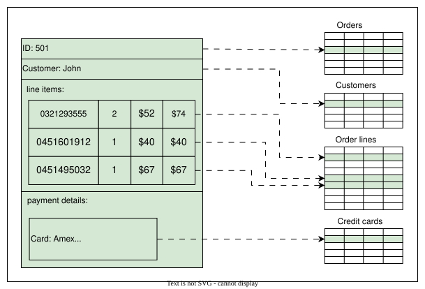

# Types_of_Databases

Source: https://www.educative.io/courses/grokking-the-system-design-interview/types-of-databases

---

[Home](https://www.educative.io/)

[Courses](https://www.educative.io/search?tab=courses)

[Grokking Modern System Design Interview](https://www.educative.io/courses/grokking-the-system-design-interview)

# Types of Databases

Understand the key differences between relational databases and NoSQL systems, including ACID guarantees and scaling approaches. Evaluate common NoSQL models, document, graph, and key-value, and their trade-offs. Choose an appropriate database architecture based on the constraints of the system design problem.

We'll cover the following...

- [Relational databases](https://www.educative.io/courses/grokking-the-system-design-interview/types-of-databases#Relational-databases)
  - [Why relational databases?](https://www.educative.io/courses/grokking-the-system-design-interview/types-of-databases#Why-relational-databases)
  - [Drawback](https://www.educative.io/courses/grokking-the-system-design-interview/types-of-databases#Drawback)
    - [Impedance mismatch](https://www.educative.io/courses/grokking-the-system-design-interview/types-of-databases#Impedance-mismatch)
- [Why non-relational (NoSQL) databases?](https://www.educative.io/courses/grokking-the-system-design-interview/types-of-databases#Why-non-relational-NoSQL-databases)
  - [Types of NoSQL databases](https://www.educative.io/courses/grokking-the-system-design-interview/types-of-databases#Types-of-NoSQL-databases)
    - [Key-value database](https://www.educative.io/courses/grokking-the-system-design-interview/types-of-databases#Key-value-database)
    - [Document database](https://www.educative.io/courses/grokking-the-system-design-interview/types-of-databases#Document-database)
    - [Graph database](https://www.educative.io/courses/grokking-the-system-design-interview/types-of-databases#Graph-database)
    - [Columnar database](https://www.educative.io/courses/grokking-the-system-design-interview/types-of-databases#Columnar-database)
  - [Drawbacks of NoSQL databases](https://www.educative.io/courses/grokking-the-system-design-interview/types-of-databases#Drawbacks-of-NoSQL-databases)
- [Choose the right database](https://www.educative.io/courses/grokking-the-system-design-interview/types-of-databases#Choose-the-right-database)
- [Quiz](https://www.educative.io/courses/grokking-the-system-design-interview/types-of-databases#Quiz)

Databases are commonly grouped into two categories: relational and NoSQL (non-relational).

## Relational databases[#](https://www.educative.io/courses/grokking-the-system-design-interview/types-of-databases#Relational-databases)

**Relational databases** enforce a predefined schema before storing data. Data is organized into **relations** (tables) composed of **tuples** (rows) and **attributes** (columns). Each tuple has a unique key. Because data is structured, a tuple in one table can link to a tuple in another using a foreign key.

**Structured Query Language (SQL)** is used to manage the database, handling data insertion, deletion, and retrieval.

Relational databases are dominant due to their simplicity, robustness, flexibility, and scalability. To maintain data integrity, relational databases provide [(ACID)](https://www.educative.io/answers/what-are-acid-properties-in-a-database) properties. ACID is a powerful abstraction that automatically handles complex anomalies (such as dirty reads, lost updates, and phantom reads), simplifying application logic.

However, ACID guarantees can be overkill for some use cases. If an application can tolerate specific anomalies, a custom solution might offer higher performance, though it adds implementation complexity.

The ACID offers the following properties:

- **Atomicity:** Transactions are atomic units. Either all statements in a transaction execute successfully, or none do. Failed transactions are aborted and rolled back.
- **Consistency:** The database remains in a consistent state before and after every transaction. It enforces rules to ensure data validity.
- **Isolation:** Concurrent transactions do not affect each other. The final state of the database is the same as if the transactions were executed sequentially.
- **Durability:** Once a transaction is committed, it survives permanently, even in the event of a system failure.

Popular database management systems (DBMS) for relational schemas include:

- MySQL
- Oracle Database
- Microsoft SQL Server
- IBM DB2
- Postgres
- SQLite

### Why relational databases?[#](https://www.educative.io/courses/grokking-the-system-design-interview/types-of-databases#Why-relational-databases)

Relational databases are the default choice for structured data storage. Their primary strengths are the abstraction of ACID transactions and the standardization of programming semantics.

- **Flexibility:** SQL’s **data definition language (DDL)** allows schema modifications, such as adding tables, renaming columns, or altering structures, even while the database server is running and processing queries.
- **Reduced redundancy:** Normalization eliminates data redundancy. Information about a specific entity is stored in one table and linked to other tables via foreign keys. This prevents inconsistent dependency and ensures data is updated in only one place.
- **Concurrency:** Enterprise applications often have many users reading and writing data simultaneously. Relational databases manage concurrency through transactions, preventing inconsistencies such as double-booking a hotel room.
- **Integration:** A shared relational database allows multiple applications to access and aggregate data from a single source. The database handles concurrency control, enabling seamless integration between different systems.
- **Backup and disaster recovery:** Relational databases guarantee consistent data states, simplifying export, import, and backup operations. Most cloud-based options offer continuous mirroring for quick restoration.

### Drawback[#](https://www.educative.io/courses/grokking-the-system-design-interview/types-of-databases#Drawback)

The relational databases have the following drawback:

#### Impedance mismatch[#](https://www.educative.io/courses/grokking-the-system-design-interview/types-of-databases#Impedance-mismatch)

**Impedance mismatch** occurs when the relational model (tables) and in-memory data structures (objects) are not aligned. Application code often uses complex, nested structures, while databases use flat tables. This requires a translation layer to map objects to rows, adding complexity and overhead.



A single aggregated value in the view is composed of several rows and tables in the relational database

## Why non-relational (NoSQL) databases?[#](https://www.educative.io/courses/grokking-the-system-design-interview/types-of-databases#Why-non-relational-NoSQL-databases)

**NoSQL databases** are designed to handle diverse data models. They excel in applications requiring large volumes of semi-structured or unstructured data, low latency, and flexible schemas. They often achieve this by relaxing strict consistency restrictions.

**Key characteristics:**

- **Simple design:** NoSQL avoids impedance mismatch. For example, a document store can save all employee data in a single document rather than splitting it across multiple joined tables. This simplifies coding and debugging.
- **Horizontal scaling:** NoSQL databases are built to run on clusters. They automatically partition (shard) data across multiple nodes, making it easy to scale out as user traffic increases. If a node fails, it can be replaced without disrupting the application.
- **Availability:** Data replication ensures high availability and disaster recovery. Node maintenance can often be performed without downtime.
- **Flexible schema:** Many NoSQL databases do not require a predefined schema. For instance, JSON documents in the same collection can have different fields, allowing the data structure to evolve dynamically.
- **Cost:** Many NoSQL databases are open source. They are typically designed to run on clusters of inexpensive commodity servers rather than on expensive, proprietary hardware.

NoSQL databases are categorized by their data models: document stores, columnar databases, key-value stores, and graph databases.

### Types of NoSQL databases[#](https://www.educative.io/courses/grokking-the-system-design-interview/types-of-databases#Types-of-NoSQL-databases)

The following sections describe the primary types of NoSQL databases.


The types of NoSQL databases

#### Key-value database[#](https://www.educative.io/courses/grokking-the-system-design-interview/types-of-databases#Key-value-database)

**Key-value databases** store data as key-value pairs, similar to a hash table. The key serves as a unique identifier, and the value can range from a simple scalar to a complex object. These databases are highly partitionable and allow for easy horizontal scaling. Popular examples include Amazon DynamoDB, Redis, and Memcached.

**Use case:** Session-oriented applications. Web applications often store user session data (profiles, preferences, shopping carts) in memory or a database. Using a unique session ID as the key allows for extremely fast retrieval of the user’s state.

The figure below illustrates a key-value store where a composite key (`Product ID` + `Type`) maps to various item attributes.

")

Data stored in the form of key-value pair in DynamoDB, where the key is the combination of two attributes (Product ID and Type)

#### Document database[#](https://www.educative.io/courses/grokking-the-system-design-interview/types-of-databases#Document-database)

Document databases store data in formats like XML, JSON, or BSON. **Documents** are hierarchical tree structures that can contain maps, collections, and scalar values. Unlike relational tables, documents within the same database can have varying structures. Examples include MongoDB and Google Cloud Firestore.

**Use case:** Suitable for unstructured catalog data. In e-commerce, products often have unique sets of attributes (e.g., a laptop has different specs than a shirt). Storing these in a relational database is inefficient. A document database stores all product attributes in a single file, improving management and read performance. They are also ideal for content management systems (such as blogs and video platforms).

The example below shows a JSON document storing a person’s attributes, such as `id`, `name`, and `email`.

JSON

```
{

"id": 1001,

"name": "Brown",

"title": "Mr.",

"email": "brown@anyEmail.com",

"cell": "123-465-9999",

"likes": [

"designing",

"cycling",

"skiing"

],

"businesses": [

{

"name": "ABC co.",

"partner": "Vike",

"status": "Bankrupt",

"date_founded": {

"$date": "2021-12-10"

}

}

]

}
```

⋯

A JSON file containing data of a businessman

#### Graph database[#](https://www.educative.io/courses/grokking-the-system-design-interview/types-of-databases#Graph-database)

**Graph databases** use graph structures to store data. **Nodes** represent entities, and **edges** represent relationships. This architecture stores data alongside its relationships, allowing for efficient traversal. Popular examples include Neo4J, OrientDB, and InfiniteGraph.

In the figure below, nodes (entities like `James`) are connected by edges (relationships). Each node contains properties like `Name`, `ID`, and `Age`.


A graph consists of nodes and links. This graph captures entities and their relationships with each other

**Use case:** These are commonly used in social networks and recommendation engines. They are optimized for querying complex relationships, such as traversing “friend-of-friend” connections or detecting patterns in user activity. They are also used in fraud detection, knowledge graph construction, and recommendation systems.

#### Columnar database[#](https://www.educative.io/courses/grokking-the-system-design-interview/types-of-databases#Columnar-database)

**Columnar databases** organize data by column rather than by row. This design optimizes the retrieval of specific fields across large datasets, making it ideal for analytics. Popular examples include Amazon Redshift and Google BigQuery.

**Use case:** Analytics and data warehousing. Operations such as calculating the average transaction amount over a year are efficient because the database reads only the “amount” column, ignoring unrelated columns like customer names.

> **Note:** Do not confuse columnar databases with wide-column stores (e.g., Apache Cassandra, HBase). Columnar databases optimize for analytics (OLAP). Wide-column stores group data into column families to optimize for high-throughput writes and flexible, semi-structured data.

The figure below contrasts column-oriented storage with traditional row-oriented storage:


Column-oriented and row-oriented database

### Drawbacks of NoSQL databases[#](https://www.educative.io/courses/grokking-the-system-design-interview/types-of-databases#Drawbacks-of-NoSQL-databases)

- **Lack of standardization:** NoSQL lacks a standard query language like SQL. Each database has its own API and syntax, making it difficult to port applications from one NoSQL system to another.
- **Consistency:** To achieve high availability and partition tolerance, many NoSQL databases sacrifice strong consistency in favor of eventual consistency. They lack the strict data-integrity guarantees (such as foreign-key constraints) found in relational databases.

AI Powered

Saved

1 attempt left

Reset

Database for personalized recommendations

Imagine we’re designing a recommendation engine for a social networking platform with millions of users. The goal is to provide personalized recommendations for users to connect with others based on their interests, activities, and connections. Which database would be a natural fit for modeling and querying the complex relationship in a social network and why?

This is your last attempt.

## Choose the right database[#](https://www.educative.io/courses/grokking-the-system-design-interview/types-of-databases#Choose-the-right-database)

The choice between relational and non-relational databases depends on your specific requirements. The table below compares the two:

## Databases

|  |  |
| --- | --- |
| **Relational Database** | **Non-Relational Database** |
| If the data to be stored is structured | If the data to be stored is unstructured |
| If ACID properties are required | If there’s a need to serialize and deserialize data |
| If the size of the data is relatively small and can fit on a node | If the size of the data to be stored is large |

**Note:** The gap between SQL and NoSQL is narrowing. Modern “NewSQL” databases, such as Google’s Cloud Spanner, combine the horizontal scalability of NoSQL with the ACID guarantees and SQL interface of relational systems.

## Quiz[#](https://www.educative.io/courses/grokking-the-system-design-interview/types-of-databases#Quiz)

Test your knowledge of database types with the following quiz.

Technical Quiz

1.

Which database should we use when we have unstructured data, and there’s a need for high performance?

A.

MongoDB

B.

MySQL

C.

Oracle

---

1 / 6

Introduction to Databases

Data Replication

Ask

[Relational databases](https://www.educative.io/courses/grokking-the-system-design-interview/types-of-databases#Relational-databases)

[Why relational databases?](https://www.educative.io/courses/grokking-the-system-design-interview/types-of-databases#Why-relational-databases)

[Drawback](https://www.educative.io/courses/grokking-the-system-design-interview/types-of-databases#Drawback)

[Impedance mismatch](https://www.educative.io/courses/grokking-the-system-design-interview/types-of-databases#Impedance-mismatch)

[Why non-relational (NoSQL) databases?](https://www.educative.io/courses/grokking-the-system-design-interview/types-of-databases#Why-non-relational-NoSQL-databases)

[Types of NoSQL databases](https://www.educative.io/courses/grokking-the-system-design-interview/types-of-databases#Types-of-NoSQL-databases)

[Key-value database](https://www.educative.io/courses/grokking-the-system-design-interview/types-of-databases#Key-value-database)

[Document database](https://www.educative.io/courses/grokking-the-system-design-interview/types-of-databases#Document-database)

[Graph database](https://www.educative.io/courses/grokking-the-system-design-interview/types-of-databases#Graph-database)

[Columnar database](https://www.educative.io/courses/grokking-the-system-design-interview/types-of-databases#Columnar-database)

[Drawbacks of NoSQL databases](https://www.educative.io/courses/grokking-the-system-design-interview/types-of-databases#Drawbacks-of-NoSQL-databases)

[Choose the right database](https://www.educative.io/courses/grokking-the-system-design-interview/types-of-databases#Choose-the-right-database)

[Quiz](https://www.educative.io/courses/grokking-the-system-design-interview/types-of-databases#Quiz)