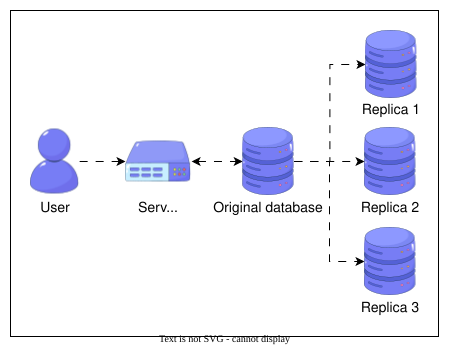

# Data_Replication

Source: https://www.educative.io/courses/grokking-the-system-design-interview/data-replication

---

[Home](https://www.educative.io/)

[Courses](https://www.educative.io/search?tab=courses)

[Grokking Modern System Design Interview](https://www.educative.io/courses/grokking-the-system-design-interview)

# Data Replication

Understand why replication is used to improve availability and read performance in distributed systems. Compare the trade-offs between synchronous and asynchronous replication. Compare single-leader, multi-leader, and leaderless replication models. Learn how quorum reads/writes can help manage consistency and concurrent updates.

We'll cover the following...

- [Replication](https://www.educative.io/courses/grokking-the-system-design-interview/data-replication#Replication)
- [Synchronous vs. asynchronous replication](https://www.educative.io/courses/grokking-the-system-design-interview/data-replication#Synchronous-vs-asynchronous-replication)
- [Data replication models](https://www.educative.io/courses/grokking-the-system-design-interview/data-replication#Data-replication-models)
  - [Single leader/primary-secondary replication](https://www.educative.io/courses/grokking-the-system-design-interview/data-replication#Single-leaderprimary-secondary-replication)
    - [Primary-secondary replication methods](https://www.educative.io/courses/grokking-the-system-design-interview/data-replication#Primary-secondary-replication-methods)
      - [Statement-based replication](https://www.educative.io/courses/grokking-the-system-design-interview/data-replication#Statement-based-replication)
      - [Write-ahead log (WAL) shipping](https://www.educative.io/courses/grokking-the-system-design-interview/data-replication#Write-ahead-log-WAL-shipping)
      - [Logical (row-based) replication](https://www.educative.io/courses/grokking-the-system-design-interview/data-replication#Logical-row-based-replication)
    - [Common problems using asynchronous primary-secondary replication](https://www.educative.io/courses/grokking-the-system-design-interview/data-replication#Common-problems-using-asynchronous-primary-secondary-replication)
  - [Multi-leader replication](https://www.educative.io/courses/grokking-the-system-design-interview/data-replication#Multi-leader-replication)
    - [Conflict](https://www.educative.io/courses/grokking-the-system-design-interview/data-replication#Conflict)
    - [Handling conflicts](https://www.educative.io/courses/grokking-the-system-design-interview/data-replication#Handling-conflicts)
      - [Conflict avoidance](https://www.educative.io/courses/grokking-the-system-design-interview/data-replication#Conflict-avoidance)
      - [Last-write-wins (LWW)](https://www.educative.io/courses/grokking-the-system-design-interview/data-replication#Last-write-wins-LWW)
      - [Custom logic](https://www.educative.io/courses/grokking-the-system-design-interview/data-replication#Custom-logic)
    - [Multi-leader replication topologies](https://www.educative.io/courses/grokking-the-system-design-interview/data-replication#Multi-leader-replication-topologies)
  - [Peer-to-peer/leaderless replication](https://www.educative.io/courses/grokking-the-system-design-interview/data-replication#Peer-to-peerleaderless-replication)
    - [Quorums](https://www.educative.io/courses/grokking-the-system-design-interview/data-replication#Quorums)

Data drives business decisions and operations. Organizations must securely and reliably store and serve client data. To run successfully, systems require timely access to data despite increasing load, hardware failures, or network outages.

We require the following characteristics from a data store:

- **Availability:** Resilience against faults (disk, node, network, or power failures).
- **Scalability:** Ability to handle increasing reads, writes, and traffic.
- **Performance:** Low latency and high throughput.

Achieving these characteristics on a single node is often impossible.

## Replication[#](https://www.educative.io/courses/grokking-the-system-design-interview/data-replication#Replication)

**Replication** refers to maintaining multiple copies of data across different nodes, often geographically distributed, to improve availability, scalability, and performance. In this lesson, we assume the entire dataset fits on a single node. This assumption no longer holds when we introduce data partitioning. In production systems, replication and partitioning are typically combined.

Replication offers several benefits in distributed systems:

- Places data closer to users, reducing latency.
- Allows the system to operate despite node failures, improving availability.
- Enables multiple nodes to serve read requests, increasing read throughput.

These benefits come with added complexity. Replication is simple when data changes infrequently. The main challenge arises when updates must be consistently propagated across replicas. For immutable data, replication is a one-time process. Mutable data requires careful handling of concurrency, failures, and inconsistencies.

Additional challenges introduced by replication include:

- How do we keep multiple copies consistent?
- How do we handle replica failures?
- Should replication be synchronous or asynchronous?

  - How do we manage replication lag in asynchronous replication?
- How do we handle concurrent writes?
- What consistency guarantees should be exposed to application developers?

We’ll explore these questions in this lesson.

Replication in action

Replication strategies generally fall into two categories based on how changes propagate:

## Synchronous vs. asynchronous replication[#](https://www.educative.io/courses/grokking-the-system-design-interview/data-replication#Synchronous-vs-asynchronous-replication)

There are two ways to disseminate changes to replica nodes:

- Synchronous replication
- Asynchronous replication

In **synchronous replication**, the primary node waits for acknowledgments from secondary nodes confirming that the data has been updated.

Only after receiving acknowledgments from all secondaries does the primary report success to the client. In **asynchronous replication**, the primary does not wait for these acknowledgments and reports success immediately after updating itself. The key advantage of synchronous replication is that all replicas remain fully up to date. However, synchronous replication has trade-offs. If a secondary fails to acknowledge a write due to a fault or network partition, the primary must wait before responding to the client. This increases write latency. In contrast, with asynchronous replication, the primary can acknowledge writes immediately, even if secondaries are temporarily unavailable. The downside is that if the primary fails, any writes that haven't been replicated will be lost.

In practice, leader-based replication is typically configured asynchronously. If the leader fails and cannot be recovered, unreplicated writes are lost, meaning durability is not guaranteed. This trade-off, between consistency, availability, and durability, must be carefully considered when designing distributed systems.

Synchronous vs. asynchronous replication

AI Powered

Saved

1 attempt left

Reset

Choose the correct option by providing a valid reason below

Imagine you’re leading the database architecture for a real-time financial trading platform that operates globally. The platform demands extremely low-latency data updates to ensure traders receive up-to-the-moment information for making split-second decisions.

The existing database infrastructure is struggling to meet the stringent latency requirements.

In this case, the low latency is paramount, and a certain degree of eventual consistency is acceptable. Which one of the following two choices would you recommend for data updates in the database, and why?

- Synchronous updates
- Asynchronous updates

This is your last attempt.

## Data replication models[#](https://www.educative.io/courses/grokking-the-system-design-interview/data-replication#Data-replication-models)

Replicating mostly static data is relatively straightforward. In contrast, frequently updated data requires stronger concurrency control and failure handling mechanisms. This includes handling node failures, network partitions, and preventing data corruption.

Common algorithms for replicating changes include:

- Single leader (primary-secondary) replication
- Multi-leader replication
- Peer-to-peer (leaderless) replication

### Single leader/primary-secondary replication[#](https://www.educative.io/courses/grokking-the-system-design-interview/data-replication#Single-leaderprimary-secondary-replication)

In **primary-secondary replication**, one node is designated as the **primary** (leader). It processes all write operations and propagates updates to **secondary** nodes (followers).

This model is ideal for read-heavy workloads. To scale, we add more followers and distribute read requests among them.

However, the primary node can become a bottleneck for writes. Additionally, if the primary fails, asynchronous replication may lead to data inconsistency, as recent updates might not have reached the secondaries before the failure.

Primary-secondary data replication model where data is replicated from primary to secondary

1.

What happens when the primary node fails?

Show Answer

Did you find this helpful?

#### Primary-secondary replication methods[#](https://www.educative.io/courses/grokking-the-system-design-interview/data-replication#Primary-secondary-replication-methods)

There are three main methods for implementing primary-secondary replication:

- Statement-based replication
- Write-ahead log (WAL) shipping
- Logical (row-based) replication

##### Statement-based replication[#](https://www.educative.io/courses/grokking-the-system-design-interview/data-replication#Statement-based-replication)

**Statement-based replication (SBR)** was standard in older MySQL versions. The primary executes SQL statements (e.g., `INSERT`, `UPDATE`) and writes them to a log file. Secondary nodes read this log and re-execute the statements.

**Best use case:** Workloads with many reads and few writes. Read requests can be distributed across multiple followers to reduce load on the leader.

**Drawback:** Nondeterministic functions like `NOW()` can generate different values on different nodes, causing data divergence.

> **Note:** The `NOW()` function returns the current system date and time.

##### Write-ahead log (WAL) shipping[#](https://www.educative.io/courses/grokking-the-system-design-interview/data-replication#Write-ahead-log-WAL-shipping)

**Write-ahead log (WAL) shipping** is used by PostgreSQL and Oracle. Transactions are written to a log file on disk before execution. This log records low-level byte changes rather than SQL statements.

WAL ensures consistency for nondeterministic functions and aids in crash recovery. However, it is tightly coupled to the database engine’s internal structure, making version upgrades across the cluster complicated.

##### Logical (row-based) replication[#](https://www.educative.io/courses/grokking-the-system-design-interview/data-replication#Logical-row-based-replication)

**Logical (row-based) replication** captures changes at the row level (e.g., specific column values changed in a specific row). This is used in PostgreSQL and MySQL.

Because it captures the logical data change rather than physical disk bytes or SQL statements, it is flexible and compatible across different engine versions.

#### Common problems using asynchronous primary-secondary replication[#](https://www.educative.io/courses/grokking-the-system-design-interview/data-replication#Common-problems-using-asynchronous-primary-secondary-replication)

Asynchronous replication creates a delay (replication lag) between the primary and secondaries, leading to potential issues:

- **Data loss:** If the primary fails before propagating writes, those updates are lost.
- **Inconsistent reads:** A user might write data and immediately read from a lagging follower, making it appear as if the data was lost.

**Solution (read-your-own-writes):** If a user is accessing data they can modify, such as their own profile, route reads to the leader to ensure strong consistency. For read-only or less consistency-sensitive data, follower replicas can serve the read requests. This approach requires a mechanism to determine whether the data may have been recently modified, without issuing an additional consistency check. For example, profile data in a social network is usually writable only by the account owner.

Thus, a simple rule is to always read the user’s own profile from the leader and to read any other users’ profiles from a follower.

**Cons:** This approach increases the load on the master node.

### Multi-leader replication[#](https://www.educative.io/courses/grokking-the-system-design-interview/data-replication#Multi-leader-replication)

Single-leader replication bottlenecks all writes to one node. **Multi-leader replication** addresses this by allowing multiple nodes to accept writes and replicate them to others.

This model improves write scalability and fault tolerance. It is particularly useful for applications that must function offline (e.g., a calendar app), where a local device acts as a leader and syncs changes when connectivity is restored.

")

Multi-leader data replication model (all-to-all topology)

**Common data distribution/migration patterns**

- **Bidirectional:** Reporting instance
- **Unidirectional:** Instant fail-over (Multi-leader replication)
- **Peer-to-peer:** Load balancing (High availability)
- **Broadcast:** Wide-level data distribution to multiple instances
- **Consolidation:** Data warehouse (data storage)

#### Conflict[#](https://www.educative.io/courses/grokking-the-system-design-interview/data-replication#Conflict)

The main disadvantage of multi-leader replication is the risk of **write conflicts**. If two clients modify the same data concurrently at different leaders, the system must resolve the discrepancy.

#### Handling conflicts[#](https://www.educative.io/courses/grokking-the-system-design-interview/data-replication#Handling-conflicts)

Conflicts must be resolved efficiently to prevent data loss. Common strategies include:

Conflict of writes

##### Conflict avoidance[#](https://www.educative.io/courses/grokking-the-system-design-interview/data-replication#Conflict-avoidance)

One straightforward strategy is to avoid write conflicts altogether. Applications can route all writes for a given record to a single leader. However, if traffic is redirected due to a client relocating or a node failure, writes may reach different leaders and result in conflicts.

##### Last-write-wins (LWW)[#](https://www.educative.io/courses/grokking-the-system-design-interview/data-replication#Last-write-wins-LWW)

Nodes assign a timestamp to every update. When a conflict occurs, the update with the latest timestamp wins. This is simple but prone to data loss due to *clock skew* in distributed systems.

##### Custom logic[#](https://www.educative.io/courses/grokking-the-system-design-interview/data-replication#Custom-logic)

The application defines custom logic to handle conflicts. This can be executed on read or write. For example, the system might merge the data or prompt the user to resolve the conflict manually.

#### Multi-leader replication topologies[#](https://www.educative.io/courses/grokking-the-system-design-interview/data-replication#Multi-leader-replication-topologies)

Topologies define how updates propagate between leaders. Common types include circular, star, and all-to-all.

**All-to-all** is the most robust; in star and circular topologies, a single node failure can interrupt the replication flow.

### Peer-to-peer/leaderless replication[#](https://www.educative.io/courses/grokking-the-system-design-interview/data-replication#Peer-to-peerleaderless-replication)

**Peer-to-peer (leaderless) replication** eliminates the primary node bottleneck entirely. All nodes have equal weight and can accept both read and write requests.

This model is used in Dynamo-style databases like Cassandra.

Peer-to-peer data replication model where all nodes apply reads and writes to all the data

Like multi-leader systems, leaderless replication allows concurrent writes, which can lead to inconsistency. To manage this, systems use quorums.

#### Quorums[#](https://www.educative.io/courses/grokking-the-system-design-interview/data-replication#Quorums)

**Quorums** ensure data consistency by requiring a minimum number of votes for operations to succeed.

In a cluster of nnn nodes:

- www: Minimum nodes that must acknowledge a write.
- rrr: Minimum nodes queried for a read.

To guarantee strong consistency (reading the latest write), we must satisfy the condition w+r>nw+r> nw+r>n. This overlap ensures that at least one node in the read set holds the most recent update. These values are configurable in Dynamo-style databases to balance latency and consistency.

Reader getting an updated value from replica 2

> For more details on Quorums, refer to these links:
>
> - [What is quorum?](https://www.educative.io/answers/what-is-a-quorum)
> - [What is quorum in distributed systems?](https://www.educative.io/answers/what-is-quorum-in-distributed-systems)

Technical Quiz

1.

Which replication mechanism is the most appropriate (high throughput, low latency to client, low implementation overhead) when our workload is read-heavy?

A.

Primary-secondary/single leader replication

B.

Multi-leader replication

C.

Peer-to-peer replication

---

1 / 1

Types of Databases

Data Partitioning

Ask

[Replication](https://www.educative.io/courses/grokking-the-system-design-interview/data-replication#Replication)

[Synchronous vs. asynchronous replication](https://www.educative.io/courses/grokking-the-system-design-interview/data-replication#Synchronous-vs-asynchronous-replication)

[Data replication models](https://www.educative.io/courses/grokking-the-system-design-interview/data-replication#Data-replication-models)

[Single leader/primary-secondary replication](https://www.educative.io/courses/grokking-the-system-design-interview/data-replication#Single-leaderprimary-secondary-replication)

[Primary-secondary replication methods](https://www.educative.io/courses/grokking-the-system-design-interview/data-replication#Primary-secondary-replication-methods)

[Statement-based replication](https://www.educative.io/courses/grokking-the-system-design-interview/data-replication#Statement-based-replication)

[Write-ahead log (WAL) shipping](https://www.educative.io/courses/grokking-the-system-design-interview/data-replication#Write-ahead-log-WAL-shipping)

[Logical (row-based) replication](https://www.educative.io/courses/grokking-the-system-design-interview/data-replication#Logical-row-based-replication)

[Common problems using asynchronous primary-secondary replication](https://www.educative.io/courses/grokking-the-system-design-interview/data-replication#Common-problems-using-asynchronous-primary-secondary-replication)

[Multi-leader replication](https://www.educative.io/courses/grokking-the-system-design-interview/data-replication#Multi-leader-replication)

[Conflict](https://www.educative.io/courses/grokking-the-system-design-interview/data-replication#Conflict)

[Handling conflicts](https://www.educative.io/courses/grokking-the-system-design-interview/data-replication#Handling-conflicts)

[Conflict avoidance](https://www.educative.io/courses/grokking-the-system-design-interview/data-replication#Conflict-avoidance)

[Last-write-wins (LWW)](https://www.educative.io/courses/grokking-the-system-design-interview/data-replication#Last-write-wins-LWW)

[Custom logic](https://www.educative.io/courses/grokking-the-system-design-interview/data-replication#Custom-logic)

[Multi-leader replication topologies](https://www.educative.io/courses/grokking-the-system-design-interview/data-replication#Multi-leader-replication-topologies)

[Peer-to-peer/leaderless replication](https://www.educative.io/courses/grokking-the-system-design-interview/data-replication#Peer-to-peerleaderless-replication)

[Quorums](https://www.educative.io/courses/grokking-the-system-design-interview/data-replication#Quorums)