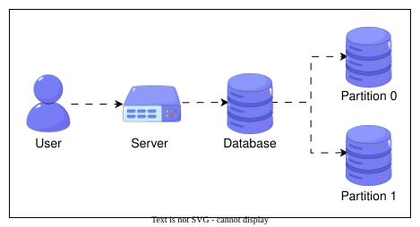

# Data_Partitioning

Source: https://www.educative.io/courses/grokking-the-system-design-interview/data-partitioning

---

[Home](https://www.educative.io/)

[Courses](https://www.educative.io/search?tab=courses)

[Grokking Modern System Design Interview](https://www.educative.io/courses/grokking-the-system-design-interview)

# Data Partitioning

Explore data partitioning and sharding techniques essential for scaling distributed databases. Analyze the trade-offs between vertical and horizontal sharding, including key-range and hash-based methods. Learn strategies for rebalancing partitions and routing requests efficiently using tools like ZooKeeper.

We'll cover the following...

- [Why do we partition data?](https://www.educative.io/courses/grokking-the-system-design-interview/data-partitioning#Why-do-we-partition-data)
- [Sharding](https://www.educative.io/courses/grokking-the-system-design-interview/data-partitioning#Sharding)
  - [Vertical sharding](https://www.educative.io/courses/grokking-the-system-design-interview/data-partitioning#Vertical-sharding)
  - [Horizontal sharding](https://www.educative.io/courses/grokking-the-system-design-interview/data-partitioning#Horizontal-sharding)
    - [Key-range-based sharding](https://www.educative.io/courses/grokking-the-system-design-interview/data-partitioning#Key-range-based-sharding)
    - [Hash-based sharding](https://www.educative.io/courses/grokking-the-system-design-interview/data-partitioning#Hash-based-sharding)
    - [Consistent hashing](https://www.educative.io/courses/grokking-the-system-design-interview/data-partitioning#Consistent-hashing)
  - [Rebalance the partitions](https://www.educative.io/courses/grokking-the-system-design-interview/data-partitioning#Rebalance-the-partitions)
    - [1. Avoid the hash mod n](https://www.educative.io/courses/grokking-the-system-design-interview/data-partitioning#1-Avoid-the-hash-mod-n)
    - [2. Fixed number of partitions](https://www.educative.io/courses/grokking-the-system-design-interview/data-partitioning#2-Fixed-number-of-partitions)
    - [3. Dynamic partitioning](https://www.educative.io/courses/grokking-the-system-design-interview/data-partitioning#3-Dynamic-partitioning)
    - [4. Partition proportionally to nodes](https://www.educative.io/courses/grokking-the-system-design-interview/data-partitioning#4-Partition-proportionally-to-nodes)
  - [Partitioning and secondary indexes](https://www.educative.io/courses/grokking-the-system-design-interview/data-partitioning#Partitioning-and-secondary-indexes)
    - [Partition secondary indexes by document](https://www.educative.io/courses/grokking-the-system-design-interview/data-partitioning#Partition-secondary-indexes-by-document)
    - [Partition secondary indexes by the term](https://www.educative.io/courses/grokking-the-system-design-interview/data-partitioning#Partition-secondary-indexes-by-the-term)
- [Request routing](https://www.educative.io/courses/grokking-the-system-design-interview/data-partitioning#Request-routing)
  - [ZooKeeper](https://www.educative.io/courses/grokking-the-system-design-interview/data-partitioning#ZooKeeper)
- [Conclusion](https://www.educative.io/courses/grokking-the-system-design-interview/data-partitioning#Conclusion)

## Why do we partition data?[#](https://www.educative.io/courses/grokking-the-system-design-interview/data-partitioning#Why-do-we-partition-data)

Data is a critical asset for any organization. As data volumes and concurrent traffic grow, traditional single-node databases reach scalability limits, leading to degraded latency and throughput. While traditional databases offer robust features, such as range queries, secondary indexes, and transactions with ACID properties, maintaining these in a distributed environment is challenging.

At some point, a single node becomes a bottleneck. We need to distribute data across multiple nodes while preserving the guarantees of the relational model. Migrating to a NoSQL system is one option, but it can be costly because many existing codebases are tightly coupled to relational databases. Similarly, adopting third-party scaling tools can add operational and architectural complexity.

**Data partitioning** (or sharding) offers a way to optimize for the specific problem. It enables us to distribute data across multiple nodes, with subsets of the data managed on each node. The goal is to achieve balanced partitions that efficiently handle increasing query rates and data volume.

In this lesson, we will discuss partitioning strategies, their challenges, and solutions.

A database with two partitions to distribute the data and associated read/write load

## Sharding[#](https://www.educative.io/courses/grokking-the-system-design-interview/data-partitioning#Sharding)

To divide the load among multiple nodes, we use **partitioning** or **sharding**. This process splits a large dataset into smaller chunks stored across different nodes in the network.

Partitioning must be balanced. If one partition receives significantly more data or queries, it becomes a bottleneck, known as a **hotspot**. This degrades the efficacy of the system, as a majority of traffic is routed to a single congested node. We generally use two methods to shard data:

- Vertical sharding
- Horizontal sharding

### Vertical sharding[#](https://www.educative.io/courses/grokking-the-system-design-interview/data-partitioning#Vertical-sharding)

**Vertical sharding** involves moving specific tables or columns to different database instances or physical servers. This is often used to separate columns containing large text or binary data (blobs) from the main table to improve retrieval speed.

For example, if an `Employee` table contains a large photo blob, we can split it into two tables: a lighter `Employee` table (metadata) and an `EmployeePicture` table (blob data). As shown in the figure below, both tables retain the primary key `EmployeeID` to allow efficient reconstruction of the data.

Vertical sharding is often manual and static. In contrast, horizontal sharding is better suited for automation and dynamic scaling.

Vertical partitioning

> **Note:** Creating shards by moving specific tables of a database around is also a form of vertical sharding. Usually, those tables are put in the same shard because they often appear together in queries, for example, for joins. We will see an example of such a use case [ahead in the course](https://www.educative.io/courses/grokking-the-system-design-interview/final-design-of-quora#Vertical-sharding-of-MySQL).

### Horizontal sharding[#](https://www.educative.io/courses/grokking-the-system-design-interview/data-partitioning#Horizontal-sharding)

**Horizontal sharding** divides a table row-wise into multiple smaller tables. Each partition is called a **shard**. There are two primary strategies:

- Key-range-based sharding
- Hash-based sharding

#### Key-range-based sharding[#](https://www.educative.io/courses/grokking-the-system-design-interview/data-partitioning#Key-range-based-sharding)

In **key-range-based sharding**, each partition is assigned a continuous range of keys.

In the figure below, the `Invoice` table is horizontally partitioned using `Customer_Id`. Specific ranges of IDs are stored in different partitions, represented by the different colored tables.

Horizontal partitioning

When a database contains multiple tables linked by foreign keys, we should shard them using the same partition key. This ensures that related data (e.g., a `Customer` and their `Orders`) resides on the same shard, optimizing data retrieval. The figure below illustrates how related tables are grouped into a single database shard:

Horizontal partitioning on a set of tables

Common design techniques for multi-table sharding include:

- **Mapping table:** A table stored on each shard that maps partition keys to specific shards. Applications create a mapping between partition keys and database shards by reading this (often using advanced algorithms) to efficiently route queries.
- **Replicated partition key:** The partition key (e.g., `Customer_Id`) is included in all related tables. This aids in data routing and isolation, though it increases storage requirements.
- **Unique primary keys:** Primary keys must be unique across all shards to prevent collisions during data migration or OLAP merging.
- **Consistency point:** A column like `Creation_date` can serve as a consistency point for merging data into a global view, assuming clock synchronization across nodes.

**Advantages:**

- Range queries are easy to implement since we know exactly which node holds a specific range of keys.
- Data can be kept in sorted order within partitions.

**Disadvantages:**

- Range queries cannot be performed using keys other than the partitioning key.
- Traffic may be unevenly distributed if keys are not selected carefully, leading to hotspots.

#### Hash-based sharding[#](https://www.educative.io/courses/grokking-the-system-design-interview/data-partitioning#Hash-based-sharding)

**Hash-based sharding** uses a hash function to determine the partition for a given key. The typical approach is to compute the hash of the key and take the modulus of the number of partitions.

In the illustration below, we computehash(key) mod n\text{hash}(\text{key}) \ \text{mod} \ nhash(key) mod n, where `n` is the number of nodes (4). Keys are allocated based on the result: keys with a mod value of 2 go to node 2, and so on. This randomizes placement to ensure uniform distribution.

Hash-based sharding

**Advantages:**

- Keys are uniformly distributed across nodes, minimizing hotspots.

**Disadvantages:**

- Range queries are inefficient because keys are scattered randomly across all partitions.

AI Powered

Saved

1 attempt left

Reset

Why do you need to use databases?

Why do you need databases? Why can’t you just use files?

This is your last attempt.

> **Note:** How many shards per database?
>
> We can estimate the required number of shards based on node capacity. For example, if a single node can handle 50 GB and the total database size is 10 TB:
>
> Database size === 10 TB
>
> Size of a single shard === 50 GB
>
> Number of shards === 10 TB / 50 GB === 200 shards

#### Consistent hashing[#](https://www.educative.io/courses/grokking-the-system-design-interview/data-partitioning#Consistent-hashing)

**Consistent hashing** maps both servers and data keys to positions on an abstract circle, or ring. This allows the system to scale nodes with minimal data movement, preserving performance.

**Advantages:**

- Facilitates easy horizontal scaling.
- Improves throughput and latency.

**Disadvantages:**

- Random node assignment can lead to non-uniform data distribution.

### Rebalance the partitions[#](https://www.educative.io/courses/grokking-the-system-design-interview/data-partitioning#Rebalance-the-partitions)

Rebalancing is necessary when query load becomes uneven, data distribution is skewed, or nodes are added/removed. Common strategies include:

#### 1. Avoid the hash mod n[#](https://www.educative.io/courses/grokking-the-system-design-interview/data-partitioning#1-Avoid-the-hash-mod-n)

Using `hash mod n` is problematic because changing `n` (the number of nodes) changes the partition index for almost every key. This forces massive data migration. For example, adding a node changes `1235 mod 5 = 0` to `1235 mod 6 = 5`, moving the key from node 0 to node 5.

#### 2. Fixed number of partitions[#](https://www.educative.io/courses/grokking-the-system-design-interview/data-partitioning#2-Fixed-number-of-partitions)

We can create a large, fixed number of partitions (e.g., 1,000) at the start and assign multiple partitions to each node. When a new node joins, it takes the entire partitions from existing nodes. This moves data in chunks rather than individual keys.

**Trade-off:** Choosing the correct number of partitions is critical. If partitions are too small, overhead increases. If they are too large, rebalancing becomes expensive. This approach is used in Elasticsearch and Riak.

#### 3. Dynamic partitioning[#](https://www.educative.io/courses/grokking-the-system-design-interview/data-partitioning#3-Dynamic-partitioning)

Partitions are split when they exceed a size threshold and merged when they shrink. This allows the number of partitions to adapt automatically to the total data volume.

**Trade-off:** Rebalancing while serving active reads and writes is complex. Moving data can cause latency and consistency issues. This approach is used in HBase and MongoDB.

#### 4. Partition proportionally to nodes[#](https://www.educative.io/courses/grokking-the-system-design-interview/data-partitioning#4-Partition-proportionally-to-nodes)

In this approach, the number of partitions scales with the number of nodes. Each node manages a fixed number of partitions. When a new node joins, it splits existing partitions to take its share. This is used by Cassandra and Ketama.

1.

How is rebalancing triggered when partitioning proportionally to nodes: automatically or manually?

Show Answer

Did you find this helpful?

### Partitioning and secondary indexes[#](https://www.educative.io/courses/grokking-the-system-design-interview/data-partitioning#Partitioning-and-secondary-indexes)

So far, we have discussed partitioning by primary key. However, we often need **secondary indexes** to query data by other attributes (e.g., searching for customers by creation year).

There are two main ways to partition secondary indexes:

#### Partition secondary indexes by document[#](https://www.educative.io/courses/grokking-the-system-design-interview/data-partitioning#Partition-secondary-indexes-by-document)

In this approach (also called **local index**), each shard maintains its own secondary index covering only the data in that shard. If we want to write anything to our database, we need to handle the partition that only contains the document ID we’re writing.

**Trade-off:** Writes are fast because they only update the local shard. However, reads are expensive because the system must query *every* partition (scatter-gather) and merge the results. If one partition is slow, the entire query is delayed.

Partitioning secondary indexes by document

#### Partition secondary indexes by the term[#](https://www.educative.io/courses/grokking-the-system-design-interview/data-partitioning#Partition-secondary-indexes-by-the-term)

In this approach (also called **global index**), a single global index covers data from all partitions. The index itself is partitioned by the indexed term.

For example, `Index 0` might store names starting with “A-M”, and `Index 1` stores “N-Z”. To find a customer named “John”, the client queries only `Index 0`.

**Trade-off:** Reads are efficient because they target specific nodes. However, writes are complex and slow because a single record update might require updating indexes on multiple different nodes (distributed transaction).

Partitioning secondary indexed by the term

## Request routing[#](https://www.educative.io/courses/grokking-the-system-design-interview/data-partitioning#Request-routing)

How does a client know which node to connect to? This is the *service discovery* problem. Common strategies include:

- **Any node:** Clients connect to any node. If that node doesn't have the data, it forwards the request to the correct node.
- **Routing tier:** A dedicated routing layer forwards requests to the appropriate node.
- **Client-aware:** The client maintains the partitioning map and connects directly to the correct node.

The challenge in all approaches is keeping the routing information up to date as the topology changes.

### ZooKeeper[#](https://www.educative.io/courses/grokking-the-system-design-interview/data-partitioning#ZooKeeper)

Distributed systems often use a coordination service like ZooKeeper to track cluster state. **ZooKeeper** maintains the mapping of partitions to nodes. When a node is added or removed, ZooKeeper updates the mapping and notifies the routing tier or clients. Systems like HBase, Kafka, and SolrCloud rely on ZooKeeper.

AI Powered

Saved

1 attempt left

Reset

Choose sharding or replication by providing valid reasons

Imagine you’re a database architect for a rapidly expanding e-commerce platform with a global user base. The platform experiences varying user activity levels across different regions, as illustrated above. The existing monolithic database struggles to handle the increasing load. Users in different regions have distinct sets of preferences and tend to interact more within their regions. Now, we’re looking for an efficient and scalable solution to optimize performance, enhance scalability, and cater to regional variations in user behavior. Regarding this, which one of the following strategies would you adopt, and why?

- Database sharding
- Database replication

This is your last attempt.

## Conclusion[#](https://www.educative.io/courses/grokking-the-system-design-interview/data-partitioning#Conclusion)

Partitioning is a standard requirement for modern distributed systems. By splitting data across multiple nodes, we improve scalability, availability, and performance, enabling the system to handle massive data volumes and concurrent traffic efficiently.

Data Replication

Trade-Offs in Databases

Ask

[Why do we partition data?](https://www.educative.io/courses/grokking-the-system-design-interview/data-partitioning#Why-do-we-partition-data)

[Sharding](https://www.educative.io/courses/grokking-the-system-design-interview/data-partitioning#Sharding)

[Vertical sharding](https://www.educative.io/courses/grokking-the-system-design-interview/data-partitioning#Vertical-sharding)

[Horizontal sharding](https://www.educative.io/courses/grokking-the-system-design-interview/data-partitioning#Horizontal-sharding)

[Key-range-based sharding](https://www.educative.io/courses/grokking-the-system-design-interview/data-partitioning#Key-range-based-sharding)

[Hash-based sharding](https://www.educative.io/courses/grokking-the-system-design-interview/data-partitioning#Hash-based-sharding)

[Consistent hashing](https://www.educative.io/courses/grokking-the-system-design-interview/data-partitioning#Consistent-hashing)

[Rebalance the partitions](https://www.educative.io/courses/grokking-the-system-design-interview/data-partitioning#Rebalance-the-partitions)

[1. Avoid the hash mod n](https://www.educative.io/courses/grokking-the-system-design-interview/data-partitioning#1-Avoid-the-hash-mod-n)

[2. Fixed number of partitions](https://www.educative.io/courses/grokking-the-system-design-interview/data-partitioning#2-Fixed-number-of-partitions)

[3. Dynamic partitioning](https://www.educative.io/courses/grokking-the-system-design-interview/data-partitioning#3-Dynamic-partitioning)

[4. Partition proportionally to nodes](https://www.educative.io/courses/grokking-the-system-design-interview/data-partitioning#4-Partition-proportionally-to-nodes)

[Partitioning and secondary indexes](https://www.educative.io/courses/grokking-the-system-design-interview/data-partitioning#Partitioning-and-secondary-indexes)

[Partition secondary indexes by document](https://www.educative.io/courses/grokking-the-system-design-interview/data-partitioning#Partition-secondary-indexes-by-document)

[Partition secondary indexes by the term](https://www.educative.io/courses/grokking-the-system-design-interview/data-partitioning#Partition-secondary-indexes-by-the-term)

[Request routing](https://www.educative.io/courses/grokking-the-system-design-interview/data-partitioning#Request-routing)

[ZooKeeper](https://www.educative.io/courses/grokking-the-system-design-interview/data-partitioning#ZooKeeper)

[Conclusion](https://www.educative.io/courses/grokking-the-system-design-interview/data-partitioning#Conclusion)