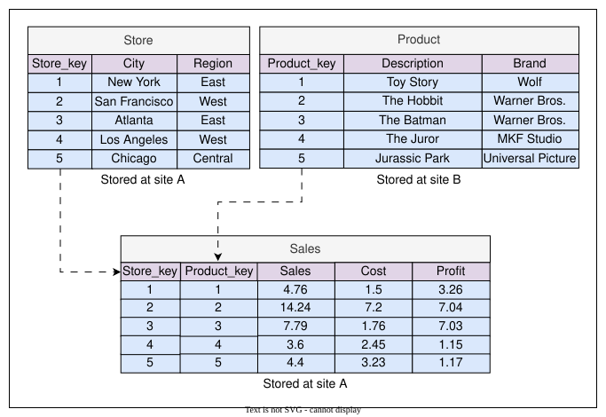

# Trade-Offs_in_Databases

Source: https://www.educative.io/courses/grokking-the-system-design-interview/trade-offs-in-databases

---

[Home](https://www.educative.io/)

[Courses](https://www.educative.io/search?tab=courses)

[Grokking Modern System Design Interview](https://www.educative.io/courses/grokking-the-system-design-interview)

# Trade-Offs in Databases

Discover the critical trade-offs between centralized and distributed databases regarding consistency, fault tolerance, and complexity in System Design. Learn to analyze query optimization strategies and calculate communication time to minimize latency and ensure high performance in distributed architectures.

We'll cover the following...

- [Which is the best database sharding approach?](https://www.educative.io/courses/grokking-the-system-design-interview/trade-offs-in-databases#Which-is-the-best-database-sharding-approach)
- [Advantages and disadvantages of a centralized database](https://www.educative.io/courses/grokking-the-system-design-interview/trade-offs-in-databases#Advantages-and-disadvantages-of-a-centralized-database)
  - [Advantages](https://www.educative.io/courses/grokking-the-system-design-interview/trade-offs-in-databases#Advantages)
  - [Disadvantages](https://www.educative.io/courses/grokking-the-system-design-interview/trade-offs-in-databases#Disadvantages)
- [Advantages and disadvantages of a distributed database](https://www.educative.io/courses/grokking-the-system-design-interview/trade-offs-in-databases#Advantages-and-disadvantages-of-a-distributed-database)
  - [Advantages](https://www.educative.io/courses/grokking-the-system-design-interview/trade-offs-in-databases#Advantages-1)
  - [Disadvantages](https://www.educative.io/courses/grokking-the-system-design-interview/trade-offs-in-databases#Disadvantages-1)
- [Query optimization and processing speed in a distributed database](https://www.educative.io/courses/grokking-the-system-design-interview/trade-offs-in-databases#Query-optimization-and-processing-speed-in-a-distributed-database)
  - [Parameters assumption](https://www.educative.io/courses/grokking-the-system-design-interview/trade-offs-in-databases#Parameters-assumption)
  - [Possible approaches](https://www.educative.io/courses/grokking-the-system-design-interview/trade-offs-in-databases#Possible-approaches)
  - [Conclusion](https://www.educative.io/courses/grokking-the-system-design-interview/trade-offs-in-databases#Conclusion)

## Which is the best database sharding approach?[#](https://www.educative.io/courses/grokking-the-system-design-interview/trade-offs-in-databases#Which-is-the-best-database-sharding-approach)

Sharding (horizontal or vertical) requires adding more nodes, while vertical scaling increases resources on existing nodes. Architects must select an approach that supports growth, maintains availability, and minimizes latency. Scaling can involve increasing CPU, memory, storage, and network bandwidth on a single node (vertical scaling) or distributing load across additional nodes (horizontal scaling). The following sections compare centralized and distributed database architectures.

## Advantages and disadvantages of a centralized database[#](https://www.educative.io/courses/grokking-the-system-design-interview/trade-offs-in-databases#Advantages-and-disadvantages-of-a-centralized-database)

### Advantages[#](https://www.educative.io/courses/grokking-the-system-design-interview/trade-offs-in-databases#Advantages)

- Maintenance (updates and backups) is straightforward.
- Stronger consistency and ACID compliance compared to distributed systems.
- Simpler programming model for developers.
- Efficient for small datasets that fit on a single node.

### Disadvantages[#](https://www.educative.io/courses/grokking-the-system-design-interview/trade-offs-in-databases#Disadvantages)

- High latency when query volume approaches single-node limits.
- A single point of failure increases the risk of total inaccessibility.

## Advantages and disadvantages of a distributed database[#](https://www.educative.io/courses/grokking-the-system-design-interview/trade-offs-in-databases#Advantages-and-disadvantages-of-a-distributed-database)

### Advantages[#](https://www.educative.io/courses/grokking-the-system-design-interview/trade-offs-in-databases#Advantages-1)

- Faster access by retrieving data from the nearest or most frequently used shard.
- Supports different levels of distribution transparency for data storage.
- Complex queries can be split into optimized subqueries for parallel processing.

### Disadvantages[#](https://www.educative.io/courses/grokking-the-system-design-interview/trade-offs-in-databases#Disadvantages-1)

- Cross-site data retrieval increases latency.
- Joins across partitioned nodes are expensive and complex to reconstruct.
- Maintaining data consistency requires additional complexity.
- Synchronization for updates and backups is slower.

## Query optimization and processing speed in a distributed database[#](https://www.educative.io/courses/grokking-the-system-design-interview/trade-offs-in-databases#Query-optimization-and-processing-speed-in-a-distributed-database)

Transaction speed depends on query type, shard count, network speed, and hardware. Consider a query accessing three tables: `Store`, `Product`, and `Sales`, across different sites.

Table attributes are distributed as follows:

Database schema consisting of three tables: Store, Product, and Sales

Assume the following distribution:

- **`Store`****:** 10,000 tuples at site A.
- **`Product`****:** 100,000 tuples at site B.
- **`Sales`****:** 1,000,000 tuples at site A.

We need to process the following query:

Ace Editor

1

2

Select Store\_key from (Store JOIN Sales JOIN Product)

where Region= 'East' AND Brand='Wolf';

הההההההההההההההההההההההההההההההההההההההההההההההההההההההההההההההההההההההההההההההההההההההההההההההההההההההההההההההההההההההההההההההההההההההההההההההההההההההההההההההההההההההההההההההההההההההההההההההההההההההההההההההההההההההההההההההההההההההההההההההההההההההההההההההההההההההההההההההההההההההההההההההההההההההההההההההההההההההההההההההההההההההההההההההההההההההההההההההההההההההההההההההההההההההההההההההההההההההההההההההההההההההההההההההההההההההההההההההההההההההההההההההההההההההההההההההההההההההההההההההההההההההההההההההההההההההההההההההה

XXXXXXXXXXXXXXXXXXXXXXXXXXXXXXXXXXXXXXXXXXXXXXXXXXXXXXXXXXXXXXXXXXXXXXXXXXXXXXXXXXXXXXXXXXXXXXXXXXXXXXXXXXXXXXXXXXXXXXXXXXXXXXXXXXXXXXXXXXXXXXXXXXXXXXXXXXXXXXXXXXXXXXXXXXXXXXXXXXXXXXXXXXXXXXXXXXXXXXXXXXXXXXXXXXXXXXXXXXXXXXXXXXXXXXXXXXXXXXXXXXXXXXXXXXXXXXXXXXXXXXXXXXXXXXXXXXXXXXXXXXXXXXXXXXXXXXXXXXXXXXXXXXXXXXXXXXXXXXXXXXXXXXXXXXXXXXXXXXXXXXXXXXXXXXXXXXXXXXXXXXXXXXXXXXXXXXXXXXXXXXXXXXXXXXXXXXXXXXXXXXXXXXXXXXXXXXXXXXXXXXXXXXXXXXXXXXXXXXXXXXXXXXXXXXXXXXXXXXXXXXXXXXXXXXXXXXXXXXXXXXXXXXXXXXXXXXXXXXXXXXXXXXXXXXXX

The query joins `Store`, `Sales`, and `Product` to retrieve `Store_key` values.

Assume a tuple size of 200 bits (25 bytes). Estimated cardinalities for intermediate results are:

- **`Wolf`** **brand count:** 10
- **`East`** **region stores:** 3,000 (out of 10,000 total)

Communication assumptions:

- Data rate === 50M bps
- Access delay === 0.1 s

### Parameters assumption[#](https://www.educative.io/courses/grokking-the-system-design-interview/trade-offs-in-databases#Parameters-assumption)

Let’s define the parameters:

a=a =a= Total access delay

b=b=b= Data rate

v=v =v= Total data volume

Total communication time TTT is calculated as:

T=a+vbT = a + \frac{v}{b}
T=a+bv​

We can execute the query using these approaches:

### Possible approaches[#](https://www.educative.io/courses/grokking-the-system-design-interview/trade-offs-in-databases#Possible-approaches)

- Move the `Product` table to Site A and process the query at A.

T=0.1+100,000×20050,000,000=0.5 seconds\text{T} = 0.1 + \frac{100,000 \times 200}{50,000,000} = 0.5 \ \text{seconds}T=0.1+50,000,000100,000×200​=0.5 seconds

**Calculation:** Here, 0.1 is the access delay of the table on site A, and 100,000 is the number of tuples in the `Product` table. The size of each tuple in bits is 200, and 50,000,000 is the data rate. The 200 and 50,000,000 figures are the same for all of the following calculations.

- Move `Store` and `Sales` to Site B and process the query at B.

T=0.2+(10,000+1,000,000)×20050,000,000=4.24 seconds \text{T} = 0.2 + \frac{(10,000 + 1,000,000) \times 200}{50,000,000} = 4.24 \ \text{seconds}T=0.2+50,000,000(10,000+1,000,000)×200​=4.24 seconds

**Calculation:** Access delay (0.2) + Transfer time (1,010,000 tuples × 200 bits / 50,000,000 bps).

- Restrict `Brand` at Site B to `Wolf` (selection) and move the result to Site A.

T=0.1+10×20050,000,000≈0.1 seconds\text{T} = 0.1 + \frac{10 \times 200}{50,000,000} \approx 0.1 \ \text{seconds}T=0.1+50,000,00010×200​≈0.1 seconds

**Calculation:** Access delay (0.1) + Transfer time (10 tuples × 200 bits / 50,000,000 bps).

Comparing the three approaches, the third option offers the lowest latency (approx 0.1s). Filtering at the source (site B) minimizes data transfer volume compared to moving full tables. This highlights the critical role of query optimization in distributed systems.

### Conclusion[#](https://www.educative.io/courses/grokking-the-system-design-interview/trade-offs-in-databases#Conclusion)

Data distribution (vertical and horizontal sharding) across multiple nodes aims to improve the following features, considering that the queries are optimized:

- Reliability (fault tolerance)
- Performance
- Balanced storage capacity and dollar costs

Centralized and distributed databases each involve trade-offs. The choice should be driven by the application’s consistency, availability, scalability, and operational requirements.

Data Partitioning

System Design: The Key-Value Store

Ask

[Which is the best database sharding approach?](https://www.educative.io/courses/grokking-the-system-design-interview/trade-offs-in-databases#Which-is-the-best-database-sharding-approach)

[Advantages and disadvantages of a centralized database](https://www.educative.io/courses/grokking-the-system-design-interview/trade-offs-in-databases#Advantages-and-disadvantages-of-a-centralized-database)

[Advantages](https://www.educative.io/courses/grokking-the-system-design-interview/trade-offs-in-databases#Advantages)

[Disadvantages](https://www.educative.io/courses/grokking-the-system-design-interview/trade-offs-in-databases#Disadvantages)

[Advantages and disadvantages of a distributed database](https://www.educative.io/courses/grokking-the-system-design-interview/trade-offs-in-databases#Advantages-and-disadvantages-of-a-distributed-database)

[Advantages](https://www.educative.io/courses/grokking-the-system-design-interview/trade-offs-in-databases#Advantages-1)

[Disadvantages](https://www.educative.io/courses/grokking-the-system-design-interview/trade-offs-in-databases#Disadvantages-1)

[Query optimization and processing speed in a distributed database](https://www.educative.io/courses/grokking-the-system-design-interview/trade-offs-in-databases#Query-optimization-and-processing-speed-in-a-distributed-database)

[Parameters assumption](https://www.educative.io/courses/grokking-the-system-design-interview/trade-offs-in-databases#Parameters-assumption)

[Possible approaches](https://www.educative.io/courses/grokking-the-system-design-interview/trade-offs-in-databases#Possible-approaches)

[Conclusion](https://www.educative.io/courses/grokking-the-system-design-interview/trade-offs-in-databases#Conclusion)