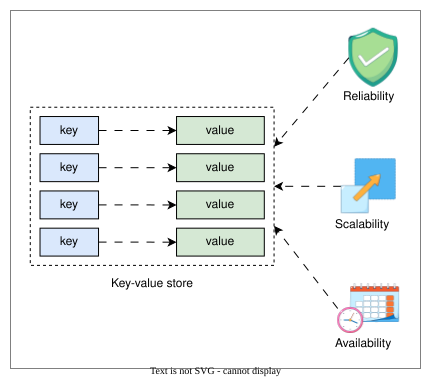

# Key_Value_Store_System_Design

Source: https://www.educative.io/courses/grokking-the-system-design-interview/system-design-the-key-value-store

---

[Home](https://www.educative.io/)

[Courses](https://www.educative.io/search?tab=courses)

[Grokking Modern System Design Interview](https://www.educative.io/courses/grokking-the-system-design-interview)

# System Design: The Key-Value Store

Define the core concept of a key-value store, explaining its function as a distributed hash table (DHT). Understand why these systems are essential for modern web-scale applications, offering high availability and scalability. Learn the foundational requirements for designing a reliable key-value system.

We'll cover the following...

- [Introduction to key-value stores](https://www.educative.io/courses/grokking-the-system-design-interview/system-design-the-key-value-store#Introduction-to-key-value-stores)
- [How will we design a key-value store?](https://www.educative.io/courses/grokking-the-system-design-interview/system-design-the-key-value-store#How-will-we-design-a-key-value-store)

## Introduction to key-value stores[#](https://www.educative.io/courses/grokking-the-system-design-interview/system-design-the-key-value-store#Introduction-to-key-value-stores)

**Key-value stores** are distributed hash tables (DHTs). A **unique key**, generated by a hash function, binds to a specific value, and the store remains agnostic to the value’s structure. **Values** can be blobs, images, server names, or any user-defined data.

Values should generally be small (KB to MB). For large datasets, we can store the content in a blob store and save a link to it in the value field. Key-value stores are useful for scenarios like storing user sessions and building NoSQL databases.

Scaling traditional databases with strong consistency and high availability is challenging in distributed environments. Many services, such as Amazon, Facebook, and Netflix, use primary-key access instead of traditional online transaction processing (OLTP) databases. The common use cases include bestseller lists, shopping carts, customer preferences, session management, sales rank, and product catalogs.

> **Note:** Many applications do not require the rich programming model of a traditional relational database management system (RDBMS). Using an RDBMS for these scenarios is often expensive in terms of cost and performance.

## How will we design a key-value store?[#](https://www.educative.io/courses/grokking-the-system-design-interview/system-design-the-key-value-store#How-will-we-design-a-key-value-store)

We divide the key-value system design into four lessons:

1. [**Design a key-value store**](https://www.educative.io/courses/grokking-the-system-design-interview/design-of-a-key-value-store)**:** Define requirements and design the API.
2. [**Ensure scalability and replication**](https://www.educative.io/courses/grokking-the-system-design-interview/ensure-scalability-and-replication)**:** Achieve scalability using consistent hashing and replicate partitioned data.
3. [**Versioning data and achieving configurability**](https://www.educative.io/courses/grokking-the-system-design-interview/versioning-data-and-achieving-configurability)**:** Resolve conflicts caused by concurrent updates and configure the system for different use cases.
4. [**Enable fault tolerance and failure detection**](https://www.educative.io/courses/grokking-the-system-design-interview/enable-fault-tolerance-and-failure-detection)**:** Implement fault tolerance and detect system failures.

Trade-Offs in Databases

Design of a Key-Value Store

Ask

[Introduction to key-value stores](https://www.educative.io/courses/grokking-the-system-design-interview/system-design-the-key-value-store#Introduction-to-key-value-stores)

[How will we design a key-value store?](https://www.educative.io/courses/grokking-the-system-design-interview/system-design-the-key-value-store#How-will-we-design-a-key-value-store)