# Ensure_Scalability_and_Replication

Source: https://www.educative.io/courses/grokking-the-system-design-interview/ensure-scalability-and-replication

---

[Home](https://www.educative.io/)

[Courses](https://www.educative.io/search?tab=courses)

[Grokking Modern System Design Interview](https://www.educative.io/courses/grokking-the-system-design-interview)

# Ensure Scalability and Replication

Explore methods to ensure key-value store scalability and high availability. Implement consistent hashing to partition data efficiently, using virtual nodes to distribute load uniformly and prevent hotspots. Define peer-to-peer replication strategies to achieve durability across multiple storage nodes.

We'll cover the following...

- [Add scalability](https://www.educative.io/courses/grokking-the-system-design-interview/ensure-scalability-and-replication#Add-scalability)
  - [Consistent hashing](https://www.educative.io/courses/grokking-the-system-design-interview/ensure-scalability-and-replication#Consistent-hashing)
    - [Use virtual nodes](https://www.educative.io/courses/grokking-the-system-design-interview/ensure-scalability-and-replication#Use-virtual-nodes)
      - [Advantages of virtual nodes](https://www.educative.io/courses/grokking-the-system-design-interview/ensure-scalability-and-replication#Advantages-of-virtual-nodes)
- [Data replication](https://www.educative.io/courses/grokking-the-system-design-interview/ensure-scalability-and-replication#Data-replication)
  - [Primary-secondary approach](https://www.educative.io/courses/grokking-the-system-design-interview/ensure-scalability-and-replication#Primary-secondary-approach)
  - [Peer-to-peer approach](https://www.educative.io/courses/grokking-the-system-design-interview/ensure-scalability-and-replication#Peer-to-peer-approach)

## Add scalability[#](https://www.educative.io/courses/grokking-the-system-design-interview/ensure-scalability-and-replication#Add-scalability)

Scalability requires distributing data across multiple storage nodes. As demand changes, we must dynamically add or remove nodes. To achieve this, we partition data to balance the load across the system.

A traditional partitioning method uses the modulus operator. For a system with 4 nodes, we want 25% of requests to go to each node. When a request arrives, we hash its key and compute the remainder modulo `m`. The result `x` (calculated as hash % `m`) determines which node processes the request.

The following slides explain this process:

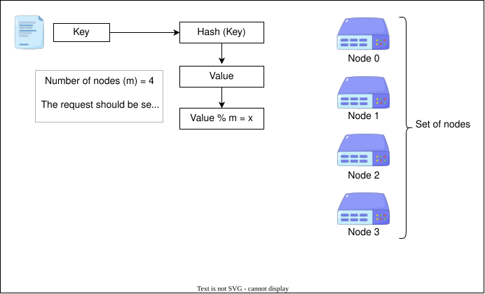

1 / 3

We get the hash of the key and take modulus with the number of nodes to find the node that should process the request

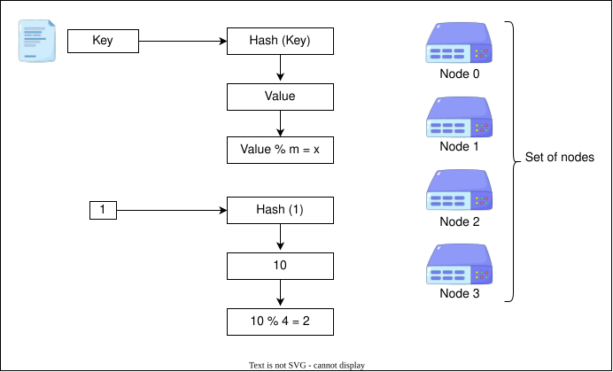

1 / 3

We perform the required operations on the key to get the node

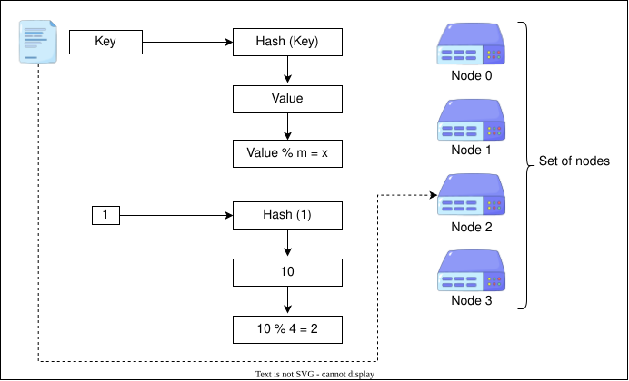

1 / 3

Node 2 will process the request

We want to scale infrastructure with minimal disruption. However, modular hashing is inefficient for dynamic scaling. Adding or removing a node changes the divisor `m`, which alters the mapping for nearly all keys.

For example, if node 2 is removed, a key previously mapped to it might shift to node 1 because 10%3=110 \% 3 = 110%3=1. Since nodes cache data locally, this shift forces massive data migration (reshuffling) to the new target nodes, causing high latency and network congestion.

Next, we will examine how to distribute data efficiently.

### Consistent hashing[#](https://www.educative.io/courses/grokking-the-system-design-interview/ensure-scalability-and-replication#Consistent-hashing)

**Consistent hashing** manages load effectively by minimizing data movement during scaling. We visualize the hash space as a ring with values from 000 to n−1n-1n−1, where nnn is the total number of available hash values.

Each node ID is hashed to assign it a position on the hash ring. Request keys are hashed using the same function to determine their position on the ring. The request is routed to the first node encountered when traversing clockwise from the key’s position on the ring.

When a new node joins the ring, it takes over a portion of the keys from its immediate successor. Other nodes remain unaffected. This ensures that only a small subset of keys moves, making scaling efficient. Since hashes are randomly distributed, the load is generally expected to be even on average.

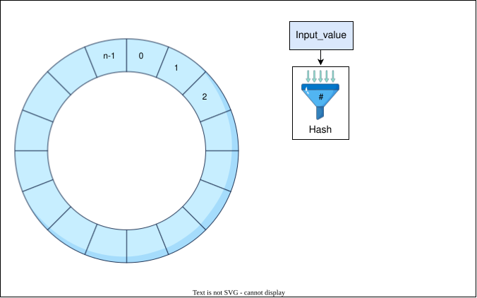

1 / 14

Consider we have a conceptual ring of hashes from 0 to n-1, where n is the total number of hash values in the ring

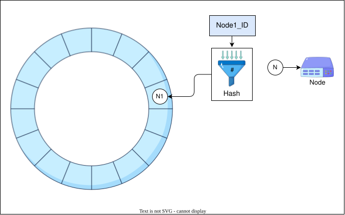

1 / 14

A hash for Node1 is calculated and Node1 is added to the ring

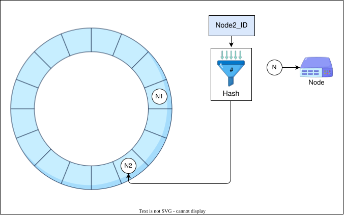

1 / 14

A hash for Node2 is calculated and Node2 is added to the ring

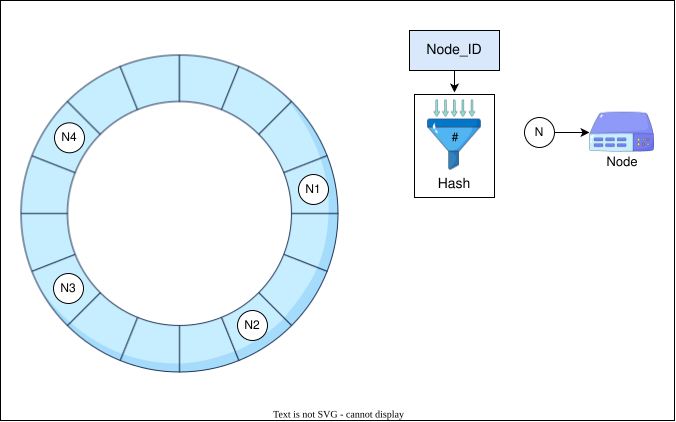

1 / 14

Hashes for other nodes are calculated and nodes are added to the ring

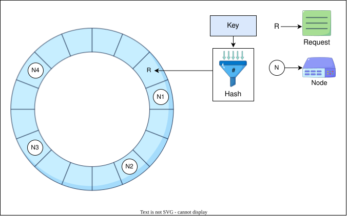

1 / 14

Similarly, a hash is calculated for the key and the request is added to the ring

The primary benefit of consistent hashing is that adding or removing nodes requires moving only a minimal number of keys. However, in practice, random distribution does not guarantee equal load. A server handling a large segment of the ring may receive a disproportionate share of storage and retrieval requests. This creates a **hotspot**, which can bottleneck the entire system.

As shown in the figure below, if the segment between nodes N4 and N1 is large, N1 handles significantly more requests than other nodes. This non-uniform distribution degrades performance.

> **Note:** It’s a good exercise to think of possible solutions to the non-uniform load distribution before reading on.

Non-uniform request distribution in the ring

#### Use virtual nodes[#](https://www.educative.io/courses/grokking-the-system-design-interview/ensure-scalability-and-replication#Use-virtual-nodes)

To distribute load more evenly, we use **virtual nodes**. Instead of mapping a physical node to a single point on the ring, we map it to multiple points using different hash functions.

For example, if we use three hash functions, each physical server appears at three distinct positions on the ring. When a request lands on the ring, it is processed by the next virtual node found clockwise, which maps back to a physical server. This interleaving makes the load distribution more uniform. Additionally, if a node has higher hardware capacity, we can assign it more virtual nodes, allowing it to serve a larger portion of requests.

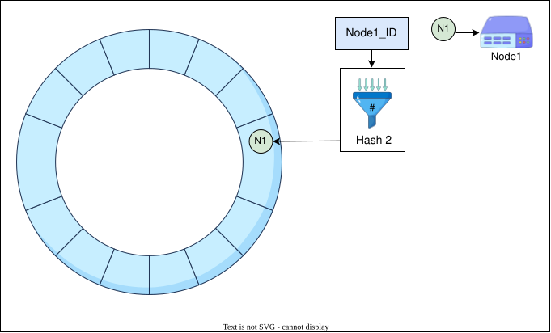

1 / 8

Calculate the hash for Node1 using Hash 1, and place the node in the ring

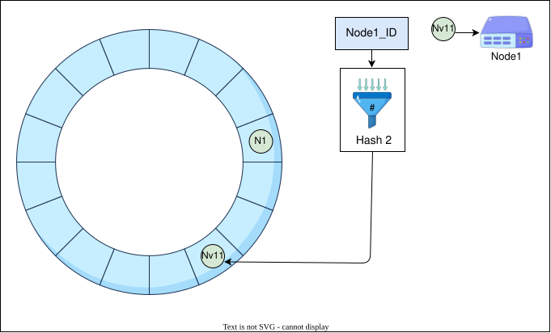

1 / 8

Calculate the hash for the first virtual node of Node1 using Hash 2, and place the node in the ring

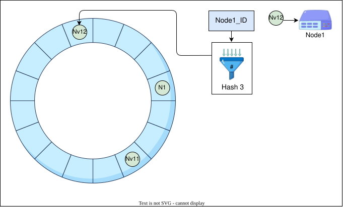

1 / 8

Calculate the hash for the second virtual node of Node1 using Hash 3, and place the node in the ring

1 / 8

Calculate the hash for Node2 using Hash 1, and place the node in the ring

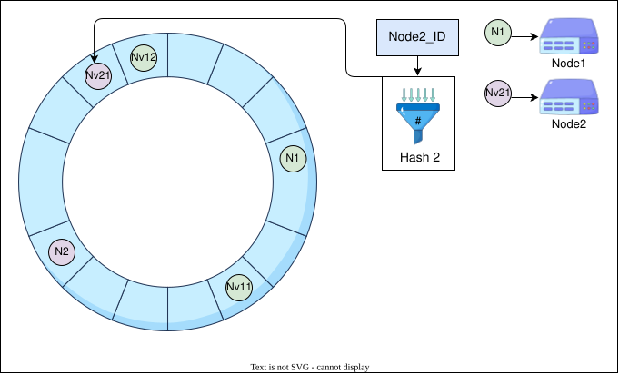

1 / 8

Calculate the hash for the first virtual node of Node2 using Hash 2, and place the node in the ring

##### Advantages of virtual nodes[#](https://www.educative.io/courses/grokking-the-system-design-interview/ensure-scalability-and-replication#Advantages-of-virtual-nodes)

Using virtual nodes offers several benefits:

- **Fault tolerance:** If a node fails or undergoes maintenance, its workload is spread uniformly across multiple other nodes rather than overwhelming a single neighbor.
- **Capacity management:** We can adjust the number of virtual nodes based on the heterogeneity of the physical infrastructure. A server with double the computational capacity can handle more virtual nodes and take on more load.

We have now made the key-value storage scalable. The next step is ensuring high availability.

AI Powered

Saved

1 attempt left

Reset

How to achieve incremental scalability?

Describe how a key-value store can support incremental scalability without disrupting service availability.

This is your last attempt.

## Data replication[#](https://www.educative.io/courses/grokking-the-system-design-interview/ensure-scalability-and-replication#Data-replication)

To ensure durability and availability, we replicate data across multiple nodes. Common strategies include primary-secondary or peer-to-peer replication.

### Primary-secondary approach[#](https://www.educative.io/courses/grokking-the-system-design-interview/ensure-scalability-and-replication#Primary-secondary-approach)

In a **primary-secondary** architecture, one node (primary) handles write requests while others (secondaries) replicate data and serve read requests. This introduces replication lag. Furthermore, if the primary fails, the system cannot accept writes until a new primary is elected, creating a single point of failure for write availability.

Primary-secondary approach

AI Powered

Saved

1 attempt left

Reset

Primary-secondary approach

Does the primary-secondary approach fulfill the requirements of the key-value store that we defined in the System Design: The Key-value Store lesson?

This is your last attempt.

### Peer-to-peer approach[#](https://www.educative.io/courses/grokking-the-system-design-interview/ensure-scalability-and-replication#Peer-to-peer-approach)

In a **peer-to-peer** approach, all nodes act as primaries. Any node can handle both read and write requests, replicating data to peers to stay updated. Replicating to all nodes is inefficient and costly; typically, we choose a replication factor of three or five nodes.

Peer-to-peer relationship

We’ll use a peer-to-peer relationship for replication. We’ll replicate the data on multiple hosts to achieve durability and high availability. Each data item will be replicated at nnn hosts, where nnn is a parameter configured per instance of the key-value store. For example, if we choose nnn to be 555, it means we want our data to be replicated to five nodes.

Each node will replicate its data to the other nodes. We’ll call a node **coordinator** that handles read or write operations. It’s directly responsible for the keys. A coordinator node is assigned the key “K.” It’s also responsible for replicating the keys to n−1n-1n−1 successors on the ring (clockwise). These lists of successor virtual nodes are called **preference lists**. To avoid putting replicas on the same physical nodes, the preference list can skip those virtual nodes whose physical node is already in the list.

In the illustration below, the replication factor nnn is 3. For key “K,” data is replicated to nodes B, C, and D. For key “L,” it is replicated to C, D, and E.

Replication in key-value store

AI Powered

Saved

1 attempt left

Reset

Synchronous and asynchronous replication

What is the impact of synchronous or asynchronous replication?

This is your last attempt.

In the context of the CAP theorem, key-value stores often prioritize Availability over Consistency (AP). If a network partition occurs, nodes continue to accept requests even if they cannot communicate with replicas. This ensures the system remains operational but may lead to temporary data inconsistencies.

When the connection is restored, nodes must sync data to resolve these conflicts. In the next lesson, we will explore how to handle these inconsistencies using data versioning.

Design of a Key-Value Store

Versioning Data and Achieving Configurability

Ask

[Add scalability](https://www.educative.io/courses/grokking-the-system-design-interview/ensure-scalability-and-replication#Add-scalability)

[Consistent hashing](https://www.educative.io/courses/grokking-the-system-design-interview/ensure-scalability-and-replication#Consistent-hashing)

[Use virtual nodes](https://www.educative.io/courses/grokking-the-system-design-interview/ensure-scalability-and-replication#Use-virtual-nodes)

[Advantages of virtual nodes](https://www.educative.io/courses/grokking-the-system-design-interview/ensure-scalability-and-replication#Advantages-of-virtual-nodes)

[Data replication](https://www.educative.io/courses/grokking-the-system-design-interview/ensure-scalability-and-replication#Data-replication)

[Primary-secondary approach](https://www.educative.io/courses/grokking-the-system-design-interview/ensure-scalability-and-replication#Primary-secondary-approach)

[Peer-to-peer approach](https://www.educative.io/courses/grokking-the-system-design-interview/ensure-scalability-and-replication#Peer-to-peer-approach)