# Versioning_Data_and_Achieving_Configurability

Source: https://www.educative.io/courses/grokking-the-system-design-interview/versioning-data-and-achieving-configurability

---

[Home](https://www.educative.io/)

[Courses](https://www.educative.io/search?tab=courses)

[Grokking Modern System Design Interview](https://www.educative.io/courses/grokking-the-system-design-interview)

# Versioning Data and Achieving Configurability

Define how vector clocks manage data versioning and resolve conflicts caused by network partitions in a key-value store. Learn to implement configurable consistency using the quorum system. Understand how r and w parameters control read/write trade-offs for performance and availability.

We'll cover the following...

- [Data versioning](https://www.educative.io/courses/grokking-the-system-design-interview/versioning-data-and-achieving-configurability#Data-versioning)
  - [Modify the API design](https://www.educative.io/courses/grokking-the-system-design-interview/versioning-data-and-achieving-configurability#Modify-the-API-design)
  - [Vector clock usage example](https://www.educative.io/courses/grokking-the-system-design-interview/versioning-data-and-achieving-configurability#Vector-clock-usage-example)
  - [Compromise with vector clocks limitations](https://www.educative.io/courses/grokking-the-system-design-interview/versioning-data-and-achieving-configurability#Compromise-with-vector-clocks-limitations)
  - [The get and put operations](https://www.educative.io/courses/grokking-the-system-design-interview/versioning-data-and-achieving-configurability#The-get-and-put-operations)
- [Usage of r and w](https://www.educative.io/courses/grokking-the-system-design-interview/versioning-data-and-achieving-configurability#Usage-of-r-and-w)

## Data versioning[#](https://www.educative.io/courses/grokking-the-system-design-interview/versioning-data-and-achieving-configurability#Data-versioning)

Network partitions and node failures can fragment an object’s version history during updates. This results in multiple, potentially divergent copies of the same data. To prevent data loss, the system must accept these concurrent versions and reconcile them to maintain consistency.

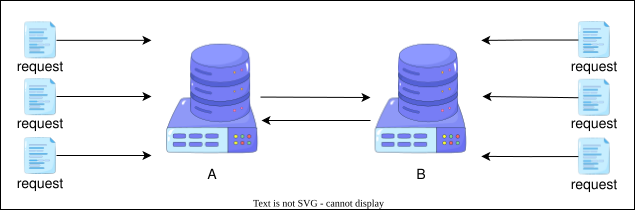

1 / 4

Two nodes replicating their data while handling requests

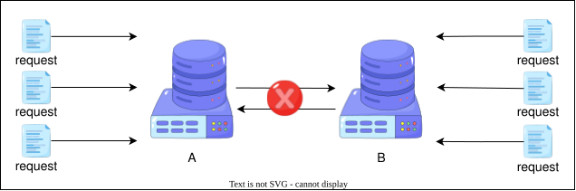

1 / 4

The network connection between two nodes breaks

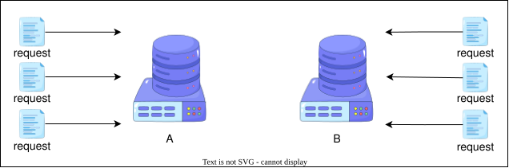

1 / 4

Both nodes continue handling the requests

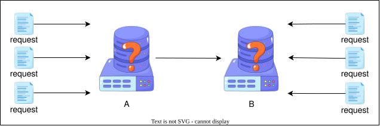

1 / 4

The connection is restored, but the data in both nodes isn’t necessarily the same

To resolve the inconsistency, the system needs to track causal relationships between events, for example by using logical clocks or version vectors. Physical timestamps are unreliable in distributed systems because clocks can drift or become unsynchronized, so they cannot safely determine which request happened last.

Instead, we use vector clocks to maintain causality. A **vector clock** is a list of (node, counter) pairs associated with every version of an object. By comparing vector clocks, we can determine if two versions are causally related or if a conflict exists that requires reconciliation.

AI Powered

Saved

1 attempt left

Reset

How do we ensure data integrity in a key-value store?

Explain how metadata like versioning and checksums, which detect data corruption, help maintain data integrity and consistency in a key-value store.

This is your last attempt.

### Modify the API design[#](https://www.educative.io/courses/grokking-the-system-design-interview/versioning-data-and-achieving-configurability#Modify-the-API-design)

To enforce causality with vector clocks, each request must include the vector clock from the previous operation along with the originating node ID. The API must be updated so clients send the prior vector clock and node ID with each write request.

The `get` API call is updated as follows:

Ace Editor

1

get(key)

הההההההההההההההההההההההההההההההההההההההההההההההההההההההההההההההההההההההההההההההההההההההההההההההההההההההההההההההההההההההההההההההההההההההההההההההההההההההההההההההההההההההההההההההההההההההההההההההההההההההההההההההההההההההההההההההההההההההההההההההההההההההההההההההההההההההההההההההההההההההההההההההההההההההההההההההההההההההההההההההההההההההההההההההההההההההההההההההההההההההההההההההההההההההההההההההההההההההההההההההההההההההההההההההההההההההההההההההההההההההההההההההההההההההההההההההההההההההההההההההההההההההההההההההההההההההההההההההה

XXXXXXXXXXXXXXXXXXXXXXXXXXXXXXXXXXXXXXXXXXXXXXXXXXXXXXXXXXXXXXXXXXXXXXXXXXXXXXXXXXXXXXXXXXXXXXXXXXXXXXXXXXXXXXXXXXXXXXXXXXXXXXXXXXXXXXXXXXXXXXXXXXXXXXXXXXXXXXXXXXXXXXXXXXXXXXXXXXXXXXXXXXXXXXXXXXXXXXXXXXXXXXXXXXXXXXXXXXXXXXXXXXXXXXXXXXXXXXXXXXXXXXXXXXXXXXXXXXXXXXXXXXXXXXXXXXXXXXXXXXXXXXXXXXXXXXXXXXXXXXXXXXXXXXXXXXXXXXXXXXXXXXXXXXXXXXXXXXXXXXXXXXXXXXXXXXXXXXXXXXXXXXXXXXXXXXXXXXXXXXXXXXXXXXXXXXXXXXXXXXXXXXXXXXXXXXXXXXXXXXXXXXXXXXXXXXXXXXXXXXXXXXXXXXXXXXXXXXXXXXXXXXXXXXXXXXXXXXXXXXXXXXXXXXXXXXXXXXXXXXXXXXXXXXXX

|  |  |
| --- | --- |
| **Parameter** | **Description** |
| `key` | This is the `key` against which we want to get `value`. |

This returns an object (or a collection of conflicting objects) along with a `context`. The `context` contains encoded metadata, such as the object’s version.

The `put` API call is updated as follows:

Ace Editor

1

put(key, context, value)

הההההההההההההההההההההההההההההההההההההההההההההההההההההההההההההההההההההההההההההההההההההההההההההההההההההההההההההההההההההההההההההההההההההההההההההההההההההההההההההההההההההההההההההההההההההההההההההההההההההההההההההההההההההההההההההההההההההההההההההההההההההההההההההההההההההההההההההההההההההההההההההההההההההההההההההההההההההההההההההההההההההההההההההההההההההההההההההההההההההההההההההההההההההההההההההההההההההההההההההההההההההההההההההההההההההההההההההההההההההההההההההההההההההההההההההההההההההההההההההההההההההההההההההההההההההההההההההההה

XXXXXXXXXXXXXXXXXXXXXXXXXXXXXXXXXXXXXXXXXXXXXXXXXXXXXXXXXXXXXXXXXXXXXXXXXXXXXXXXXXXXXXXXXXXXXXXXXXXXXXXXXXXXXXXXXXXXXXXXXXXXXXXXXXXXXXXXXXXXXXXXXXXXXXXXXXXXXXXXXXXXXXXXXXXXXXXXXXXXXXXXXXXXXXXXXXXXXXXXXXXXXXXXXXXXXXXXXXXXXXXXXXXXXXXXXXXXXXXXXXXXXXXXXXXXXXXXXXXXXXXXXXXXXXXXXXXXXXXXXXXXXXXXXXXXXXXXXXXXXXXXXXXXXXXXXXXXXXXXXXXXXXXXXXXXXXXXXXXXXXXXXXXXXXXXXXXXXXXXXXXXXXXXXXXXXXXXXXXXXXXXXXXXXXXXXXXXXXXXXXXXXXXXXXXXXXXXXXXXXXXXXXXXXXXXXXXXXXXXXXXXXXXXXXXXXXXXXXXXXXXXXXXXXXXXXXXXXXXXXXXXXXXXXXXXXXXXXXXXXXXXXXXXXXXX

|  |  |
| --- | --- |
| **Parameter** | **Description** |
| `key` | This is the `key` against which we have to store `value`. |
| `context` | This holds the metadata for each object. |
| `value` | This is the object that needs to be stored against the `key`. |

This function locates the correct node based on the `key` and stores the value. The client must provide the `context` received from a previous `get` operation to update an object. This `context` allows the system to determine version history via vector clocks. If a read request reveals divergent branches (conflicts), the system returns all objects at the leaf nodes with their version information. The client must then reconcile these versions into a single new version.

> **Note:** This is similar to how Git handles merge conflicts between branches. If the system cannot automatically merge the versions, the client must resolve the conflict at the application level and submit the resolved value.

### Vector clock usage example[#](https://www.educative.io/courses/grokking-the-system-design-interview/versioning-data-and-achieving-configurability#Vector-clock-usage-example)

Let’s consider an example. Say we have a write operation request. Node A\text{A}A handles the first version of the write request, E1\text{E1}E1; where E\text{E}E means event. The corresponding vector clock has node information and its counter that is, [A,1]\text{[A,1]}[A,1]. Node A\text{A}A handles another write for the same object on which the previous write was performed. So, for E2\text{E2}E2, we have [A,2]\text{[A,2]}[A,2]. E1\text{E1}E1 is no longer required because E2\text{E2}E2 was updated on the same node. E2\text{E2}E2 reads the changes made by E1\text{E1}E1, and then new changes are made. Suppose a network partition happens. Now, the request is handled by two different nodes, B\text{B}B and C\text{C}C. The context with updated versions, which are E3\text{E3}E3, E4\text{E4}E4, and their related clocks, which are ([A,2], [B,1])\text{([A,2], [B,1])}([A,2], [B,1]) and ([A,2],[C,1])\text{([A,2],[C,1])}([A,2],[C,1]), are now in the system.

Suppose the network partition is repaired, and the client requests a write again, but now we have conflicts. The context ([A,2],[B,1],[C,1])\text{([A,2],[B,1],[C,1])}([A,2],[B,1],[C,1]) of the conflicts are returned to the client. After the client does reconciliation and A\text{A}A coordinates the write, we have E5\text{E5}E5 with the clock ([A,3],[B,1],[C,1])\text{([A,3],[B,1],[C,1])}([A,3],[B,1],[C,1]).

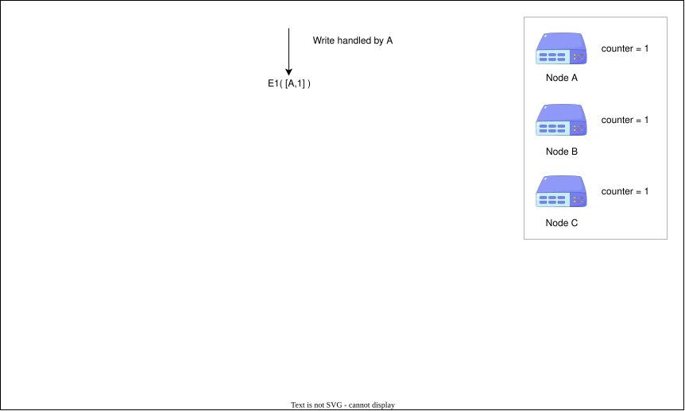

1 / 8

Let’s suppose that we have three nodes. The vector clock counter is set to 1 for all of them

1 / 8

Node A handles the first version of the write request, E1, and the vector clock counter is increased by 1

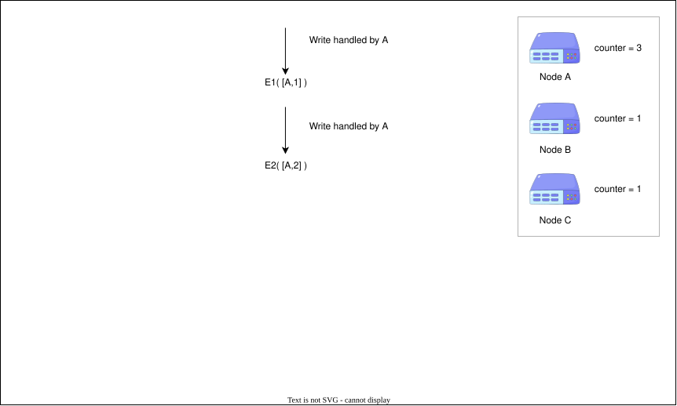

1 / 8

Node A handles the second version of the write request, E2, and the vector clock counter is increased by 2

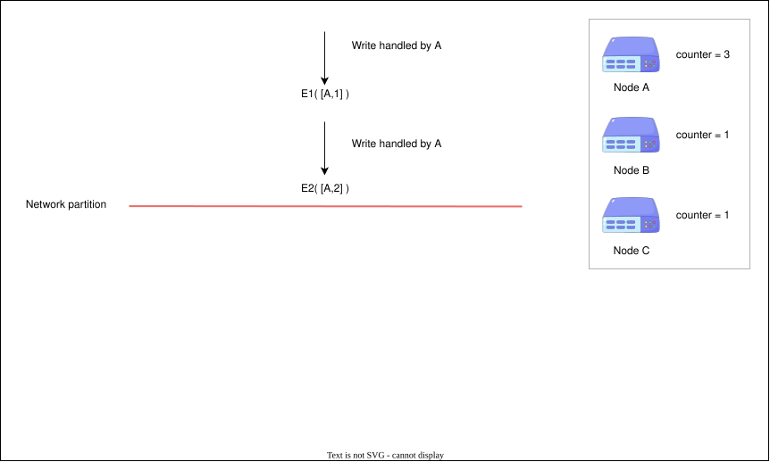

1 / 8

Let’s suppose that a network partition happens

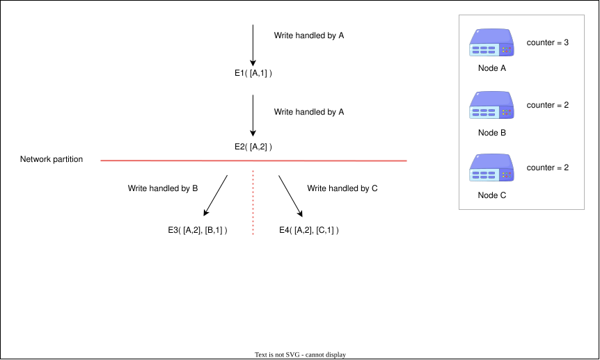

1 / 8

Now, the request is handled by Nodes B and C, and their respective vector clock counter is increased

### Compromise with vector clocks limitations[#](https://www.educative.io/courses/grokking-the-system-design-interview/versioning-data-and-achieving-configurability#Compromise-with-vector-clocks-limitations)

The size of vector clocks may increase if multiple servers write to the same object simultaneously. It’s unlikely to happen in practice because writes are typically handled by one of the top nnn nodes in a preference list.   
  
For example, if there are network partitions or multiple server failures, write requests may be processed by nodes not in the top nnn nodes in the preference list. As a result we can have a long version like this: [A,10],[B,4],[C,1],[D,2],[E,1],[F,3],[G,5],[H,7],[I,2],[J,2],[K,1],[L,1])\text{[A,10],[B,4],[C,1],[D,2],[E,1],[F,3],[G,5],[H,7],[I,2],[J,2],[K,1],[L,1])}[A,10],[B,4],[C,1],[D,2],[E,1],[F,3],[G,5],[H,7],[I,2],[J,2],[K,1],[L,1]). It’s a hassle to store and maintain such a long version history.

To prevent unbounded growth as more nodes participate, we can cap the size of the vector clock. We use clock truncation by attaching a physical timestamp to each (node, counter) entry to record the node’s last update time for the item. Entries are removed once the number of (node, counter) pairs exceeds a configured threshold (for example, 10). Since truncation can remove causal history, the system may no longer accurately determine version ancestry, which can reduce reconciliation accuracy.

### The `get` and `put` operations[#](https://www.educative.io/courses/grokking-the-system-design-interview/versioning-data-and-achieving-configurability#The-get-and-put-operations)

One of our functional requirements is that the system should be configurable. We want to control the trade-offs between availability, consistency, cost-effectiveness, and performance. So, let’s achieve configurability by implementing the basic `get` and `put` functions of the key-value store.

Every node can handle the `get` (read) and `put` (write) operations in our system. A node handling a read or write operation is known as a **coordinator**. The coordinator is the first among the top n\text{n}nnodes in the preference list.

There can be two ways for a client to select a node:

- We route the request to a generic load balancer.
- We use a partition-aware client library that routes requests directly to the appropriate coordinator nodes.

Both approaches have their benefits. The client isn’t linked to the code in the first approach, whereas lower latency is achievable in the second. The latency is lower due to the reduced number of hops because the client can directly go to a specific server.

Let’s make our service configurable by having an ability where we can control the trade-offs between availability, consistency, cost-effectiveness, and performance. We can use a consistency protocol similar to those used in quorum systems.

Let’s take an example. Say n\text{n}n in the top n\text{n}n of the preference list is equal to 3\text{3}3. This means three copies of the data need to be maintained. We assume that nodes are placed in a ring. Say A, B, C, D, and E is the clockwise order of the nodes in that ring. If the write function is performed on node A, then the copies of that data will be placed on B and C. This is because B and C are the next nodes we find while moving in a clockwise direction of the ring.

## Usage of rrr and www[#](https://www.educative.io/courses/grokking-the-system-design-interview/versioning-data-and-achieving-configurability#Usage-of-r-and-w)

Now, consider two variables, r\text{r}r and w\text{w}w. The r\text{r}r means the minimum number of nodes that need to be part of a successful read operation, while w\text{w}w is the minimum number of nodes involved in a successful write operation. So if r = 2\text{r = 2}r = 2, it means our system will read from two nodes when we have data stored in three nodes. We need to pick values of r\text{r}r and w\text{w}w such that at least one node is common between them. This ensures that readers could get the latest-written value. For that, we’ll use a quorum-like system by setting r+w>n\text{r} + \text{w} > \text{n}r+w>n.   
  
The following table gives an overview of how the values of n, r,\text{n, r,}n, r, and w\text{w}w affect the speed of reads and writes:

## Value Effects on Reads and Writes

|  |  |  |  |
| --- | --- | --- | --- |
| **n** | **r** | **w** | **Description** |
| 3 | 2 | 1 | It won't be allowed as it violates our constraint *r + w > n* . |
| 3 | 2 | 2 | It will be allowed as it fulfills constraints. |
| 3 | 3 | 1 | It will provide speedy writes and slower reads since readers need to go to all *n* replicas for a value. |
| 3 | 1 | 3 | It will provide speedy reads from any node but slow writes since we now need to write to all *n* nodes synchronously. |

Let’s say n = 3\text{n = 3}n = 3, which means we have three nodes where the data is copied to. Now, for w = 2\text{w = 2}w = 2, the operation makes sure to write in two nodes to make this request successful. For the third node, the data is updated asynchronously.

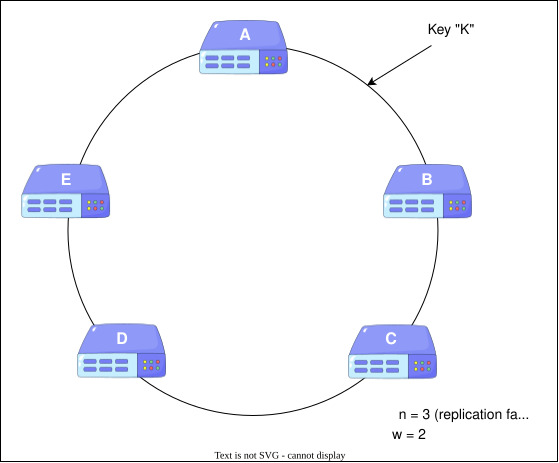

1 / 3

We have a replication factor of 3 and w is 2. The key “K” will be replicated to A, B, and C

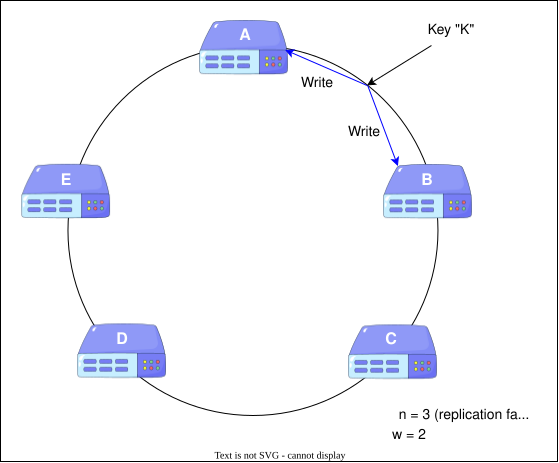

1 / 3

Since w=2, we’ll write in the first two nodes, then send an acknowledgment to the user or client

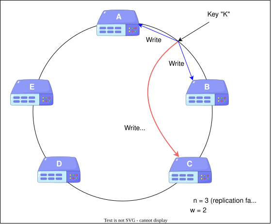

1 / 3

For the third node, we’ll write/replicate the data asynchronously

In this model, the latency of a get operation is determined by the slowest of the r\text{r}r replicas. As r\text{r}r increases, we require more replicas to complete a read, which can increase latency and decrease availability. At the same time, the system becomes more consistent, as querying more replicas increases the chance of reading the latest value.

The coordinator produces the vector clock for the new version and writes the new version locally upon receiving a `put()` request for a key. The coordinator sends n\text{n}n highest-ranking nodes with the updated version and a new vector clock. We consider a write successful if at least w-1\text{w-1}w-1 nodes respond. Remember that the coordinator writes to itself first, so we get w\text{w}w writes in total.

Requests for a `get()` operation are made to the n\text{n}n highest-ranked reachable nodes in a preference list for a key. They wait for r\text{r}r answers before returning the results to the client. Coordinators return all dataset versions that they regard as unrelated if they get several datasets from the same source (divergent histories that need reconciliation). The conflicting versions are then merged, and the resulting key’s value is rewritten to override the previous versions.

At this point, the design satisfies the scalability, availability, conflict resolution, and configurability requirements. The remaining requirement is fault tolerance. The next lesson covers how to design the system for fault tolerance.

Ensure Scalability and Replication

Enable Fault Tolerance and Failure Detection

Ask

[Data versioning](https://www.educative.io/courses/grokking-the-system-design-interview/versioning-data-and-achieving-configurability#Data-versioning)

[Modify the API design](https://www.educative.io/courses/grokking-the-system-design-interview/versioning-data-and-achieving-configurability#Modify-the-API-design)

[Vector clock usage example](https://www.educative.io/courses/grokking-the-system-design-interview/versioning-data-and-achieving-configurability#Vector-clock-usage-example)

[Compromise with vector clocks limitations](https://www.educative.io/courses/grokking-the-system-design-interview/versioning-data-and-achieving-configurability#Compromise-with-vector-clocks-limitations)

[The get and put operations](https://www.educative.io/courses/grokking-the-system-design-interview/versioning-data-and-achieving-configurability#The-get-and-put-operations)

[Usage of r and w](https://www.educative.io/courses/grokking-the-system-design-interview/versioning-data-and-achieving-configurability#Usage-of-r-and-w)