# Enable_Fault_Tolerance_and_Failure_Detection

Source: https://www.educative.io/courses/grokking-the-system-design-interview/enable-fault-tolerance-and-failure-detection

---

[Home](https://www.educative.io/)

[Courses](https://www.educative.io/search?tab=courses)

[Grokking Modern System Design Interview](https://www.educative.io/courses/grokking-the-system-design-interview)

# Enable Fault Tolerance and Failure Detection

Understand how distributed key-value stores maintain availability and durability during node failures. Design sloppy quorum and hinted handoff mechanisms to handle temporary node outages. Apply Merkle trees for anti-entropy synchronization and gossip protocols for decentralized failure detection.

We'll cover the following...

- [Handle temporary failures](https://www.educative.io/courses/grokking-the-system-design-interview/enable-fault-tolerance-and-failure-detection#Handle-temporary-failures)
- [Handle permanent failures](https://www.educative.io/courses/grokking-the-system-design-interview/enable-fault-tolerance-and-failure-detection#Handle-permanent-failures)
  - [Anti-entropy with Merkle trees](https://www.educative.io/courses/grokking-the-system-design-interview/enable-fault-tolerance-and-failure-detection#Anti-entropy-with-Merkle-trees)
- [Promote membership in the ring to detect failures](https://www.educative.io/courses/grokking-the-system-design-interview/enable-fault-tolerance-and-failure-detection#Promote-membership-in-the-ring-to-detect-failures)
- [Conclusion](https://www.educative.io/courses/grokking-the-system-design-interview/enable-fault-tolerance-and-failure-detection#Conclusion)

## Handle temporary failures[#](https://www.educative.io/courses/grokking-the-system-design-interview/enable-fault-tolerance-and-failure-detection#Handle-temporary-failures)

Many distributed systems use a strict read/write quorum, where an operation must receive responses from a minimum number of replicas before it can proceed. If enough replicas are unavailable and the quorum cannot be satisfied, the operation fails, reducing availability. To maintain availability during such failures, the system can use a *sloppy quorum*.

In a **sloppy quorum**, the firstn\text{n}nhealthy nodes from the preference list handle read and write operations. These nodes may not be the designated owners in the consistent hash ring, but they ensure the request is processed.

**Example:** Consider a configuration where n = 3\text{n = 3}n = 3. If Node A\text{A}A is unavailable during a write, the request is sent to the next healthy node, Node B\text{B}B. Node B\text{B}B processes the request and stores a hint indicating the data belongs to A\text{A}A. Once A\text{A}A recovers, B\text{B}B forwards the data to A\text{A}A and removes the local copy.

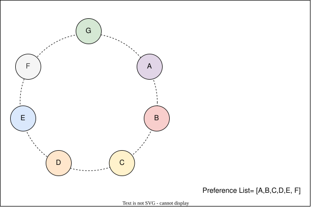

1 / 5

Suppose we have seven nodes in our ring and a preference list of the nodes

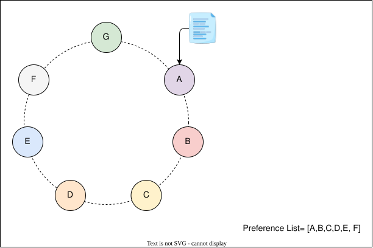

1 / 5

A request comes in, and node A processes it since it’s the next node in the ring. The node is processed while moving in the clockwise direction

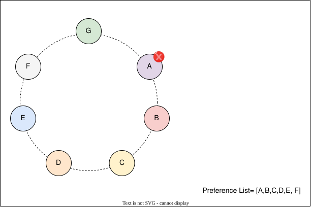

1 / 5

Node A becomes down due to some failure

1 / 5

A request comes in. Node A has to process it but is unable to, so we check the next node in the preference list

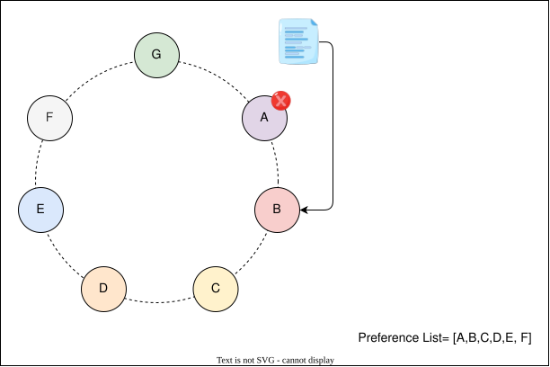

1 / 5

Request is sent to node D as node A is down

This approach is called **hinted handoff**. It ensures that reads and writes are fulfilled even if a node faces temporary failure.

> **Note:** To handle catastrophic data center failures (e.g., power outages or natural disasters), you must ensure replication extends across distinct data centers.

AI Powered

Saved

1 attempt left

Reset

The limitations of hinted handoff

Hinted handoff helps maintain availability when nodes fail temporarily. But what happens when the system experiences prolonged failures?

This is your last attempt.

## Handle permanent failures[#](https://www.educative.io/courses/grokking-the-system-design-interview/enable-fault-tolerance-and-failure-detection#Handle-permanent-failures)

When a node fails and is replaced or recovers after a long outage, replicas must synchronize to restore full durability. **Merkle trees** are used to detect inconsistencies between replicas and limit data transfer during **anti-entropy** synchronization.

A Merkle tree (or hash tree) organizes data hashes hierarchically:

- **Leaves:** Contain hashes of individual key values.
- **Parent nodes:** Contain hashes of their children.

A Merkle tree allows nodes to verify subtrees independently. If the root hashes match, the datasets represented by the trees are identical. If the root hashes differ, the nodes recursively compare child hashes to identify the specific key ranges that diverge. This avoids transferring the entire dataset during comparison.

The following slides explain how Merkle trees work:

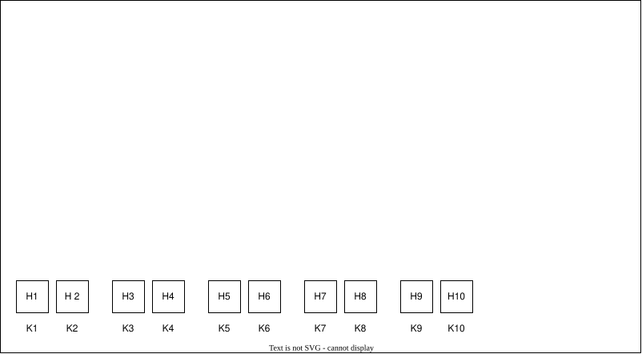

1 / 14

Calculate the hashes for all keys. The hashes will be leaf nodes

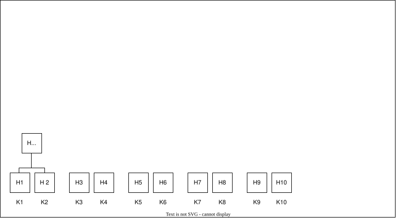

1 / 14

The hashes of the H1 and H2 nodes are calculated and stored as their parent node

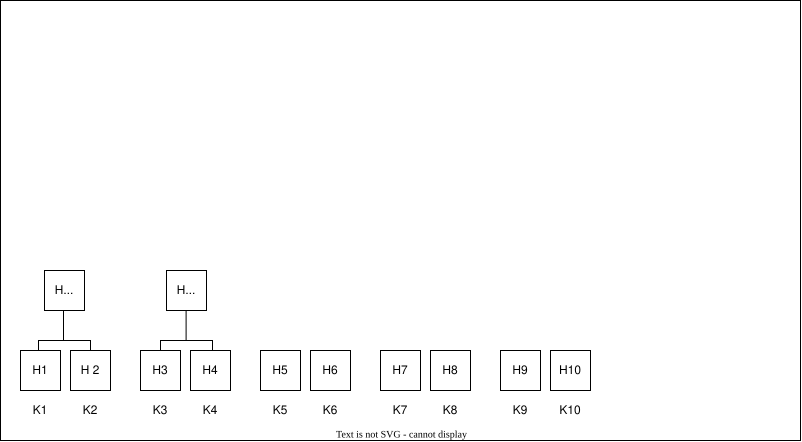

1 / 14

The hashes of the H3 and H4 nodes are calculated and stored as their parent node

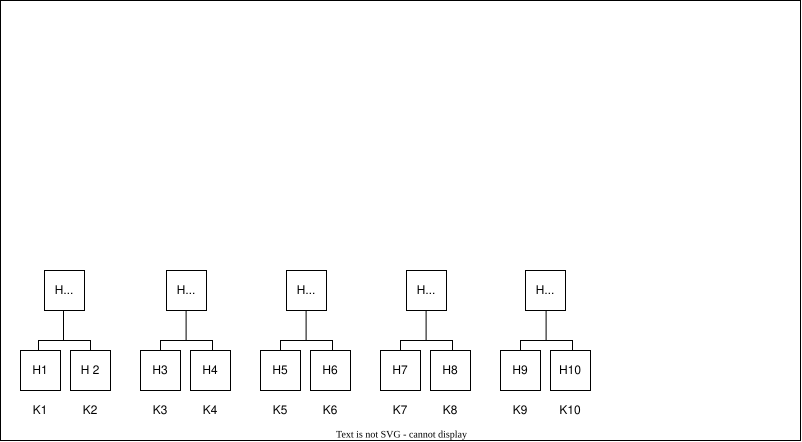

1 / 14

The hashes of all other nodes are calculated and stored as their parent node

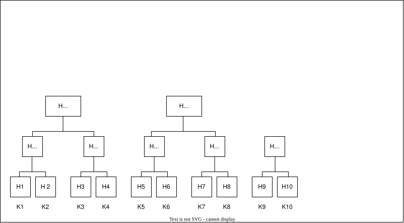

1 / 14

The hashes of the nodes H 1 2 and H 3 4 is calculated and stored as their parent node. The same thing is done for H 5 6 and H 7 8

### Anti-entropy with Merkle trees[#](https://www.educative.io/courses/grokking-the-system-design-interview/enable-fault-tolerance-and-failure-detection#Anti-entropy-with-Merkle-trees)

Each node maintains a Merkle tree for the key ranges it hosts. To synchronize, two nodes exchange the root hashes of their trees:

1. **Compare root hashes:** If they match, the data is consistent, and no further action is needed.
2. **Traverse tree:** If hashes differ, the nodes recurse down the left and right children.
3. **Synchronize:** The nodes identify the specific leaves that differ and synchronize only the missing or inconsistent data.

The following slides illustrate this process.

> **Note:** The ranges defined in the slides are hypothetical for illustration purposes.

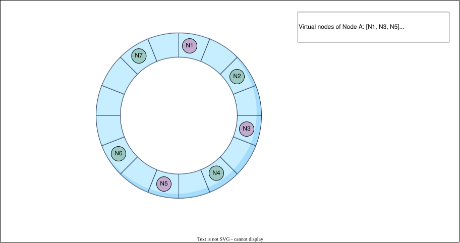

1 / 9

Let’s suppose we have the virtual nodes A and B in the ring

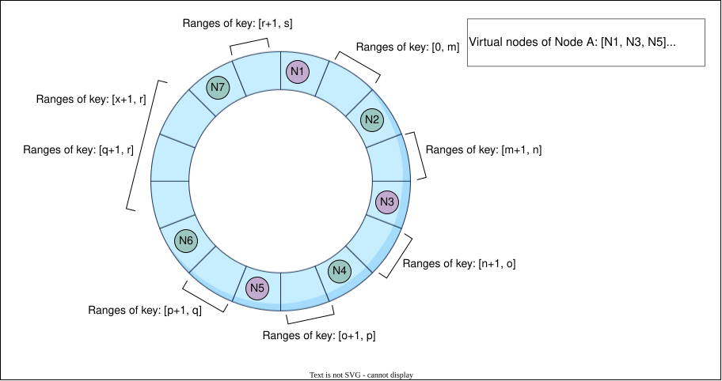

1 / 9

The ranges that each virtual node covers are defined

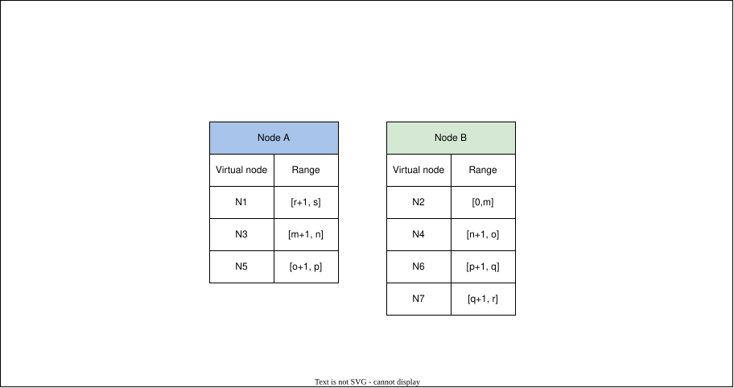

1 / 9

The ranges that each virtual node covers are defined in table form

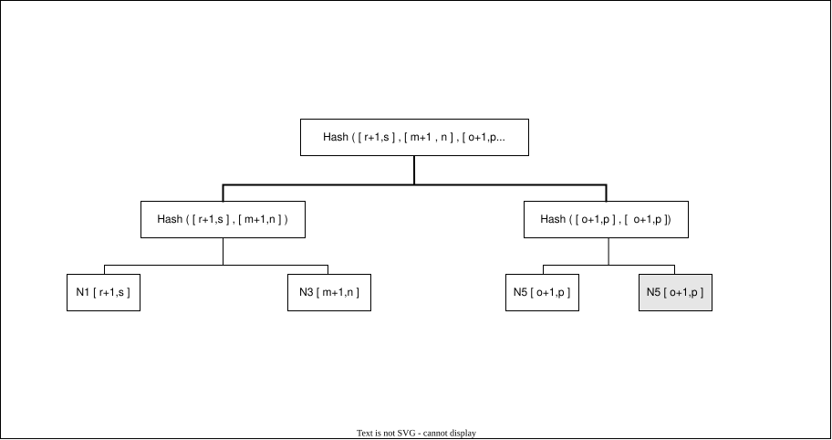

1 / 9

Merkle tree for Node A

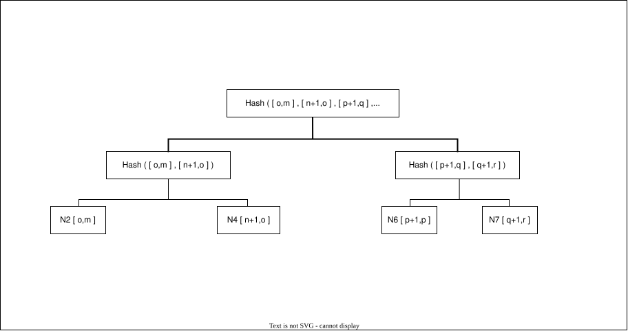

1 / 9

Merkle tree for Node B

- **Advantages:** Merkle trees minimize disk I/O and network bandwidth because only inconsistent data is transferred.
- **Disadvantages:** When a node joins or leaves the system, key ranges change, requiring the tree hashes to be recalculated.

Next, we need a mechanism to detect when nodes fail so the system can react.

AI Powered

Saved

8 attempts left

Reset

Consistent Hashing

Hi, I’m Ed. In this session, we will focus on some questions related to a social media system. Do you want to be mentored or evaluated?

You have 8 attempts to answer.

## Promote membership in the ring to detect failures[#](https://www.educative.io/courses/grokking-the-system-design-interview/enable-fault-tolerance-and-failure-detection#Promote-membership-in-the-ring-to-detect-failures)

Nodes may go offline temporarily, and in some cases may not return. The system should not immediately rebalance partitions or repair replicas when a single node fails, since most outages are transient. Node addition and removal in the consistent hashing ring should be performed only after confirming a sustained failure or a planned membership change.

Planned commissioning and decommissioning of nodes result in membership changes. These changes are recorded as membership history. Each node persists this membership history locally, and the ring reconciles it across nodes using a gossip protocol. A **gossip-based protocol** also maintains an eventually consistent view of membership. When two nodes randomly choose one another as their peer, both nodes can efficiently synchronize their persisted membership histories.

Let’s learn how a gossip-based protocol works by considering the following example. Say node A\text{A}A starts up for the first time, and it randomly adds nodes B\text{B}B and E\text{E}E to its token set. The token set has virtual nodes in the consistent hash space and maps nodes to their respective token sets. This information is stored locally on the disk space of the node.

Now, node AAA handles a request that results in a change, so it communicates this to B\text{B}B and E\text{E}E. Another node, D\text{D}D, has C\text{C}C and E\text{E}E in its token set. It makes a change and tells C\text{C}C and E\text{E}E. The other nodes do the same process. This way, every node eventually knows about every other node’s information. It’s an efficient way to share information asynchronously, and it doesn’t take up a lot of bandwidth.

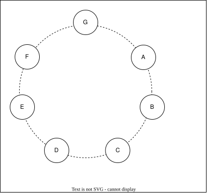

1 / 5

A set of nodes in a ring

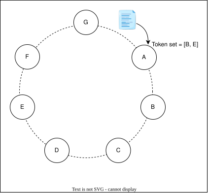

1 / 5

Node A processes the request. Its token set has B and E in it

1 / 5

Node A gossips membership information to Node B and E after few requests

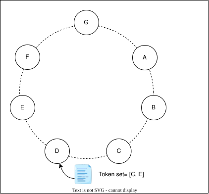

1 / 5

Node D processes the request. Its token set has C and E in it

1 / 5

Node D gossips membership information to Node C and E after a few requests

Test your knowledge!

1.

Can the gossip-based protocol fail in a system using consistent hashing, and if so, why?

A.

No, the gossip-based protocol never fails as long as nodes are part of the consistent hashing ring.

B.

Yes, it can fail if virtual nodes from the same physical server join the ring independently, causing logical partitioning and inconsistent updates.

C.

Yes, it can fail if the hash function used in consistent hashing produces duplicate keys.

D.

Yes, it can fail if the system uses a single physical node for all virtual nodes.

---

1 / 2

In this decentralized model, nodes explicitly broadcast when they join or leave the ring. If a node fails to communicate with its peers for a predefined time, the peers mark it as dead.

## Conclusion[#](https://www.educative.io/courses/grokking-the-system-design-interview/enable-fault-tolerance-and-failure-detection#Conclusion)

A fault-tolerant key-value store must handle both temporary and permanent failures. The system uses hinted handoff to preserve availability during brief outages and Merkle trees to synchronize replicas after long-term failures. A gossip protocol maintains a decentralized, eventually consistent view of node membership and health, without introducing a single point of failure.

Versioning Data and Achieving Configurability

System Design: The Content Delivery Network (CDN)

Ask

[Handle temporary failures](https://www.educative.io/courses/grokking-the-system-design-interview/enable-fault-tolerance-and-failure-detection#Handle-temporary-failures)

[Handle permanent failures](https://www.educative.io/courses/grokking-the-system-design-interview/enable-fault-tolerance-and-failure-detection#Handle-permanent-failures)

[Anti-entropy with Merkle trees](https://www.educative.io/courses/grokking-the-system-design-interview/enable-fault-tolerance-and-failure-detection#Anti-entropy-with-Merkle-trees)

[Promote membership in the ring to detect failures](https://www.educative.io/courses/grokking-the-system-design-interview/enable-fault-tolerance-and-failure-detection#Promote-membership-in-the-ring-to-detect-failures)

[Conclusion](https://www.educative.io/courses/grokking-the-system-design-interview/enable-fault-tolerance-and-failure-detection#Conclusion)