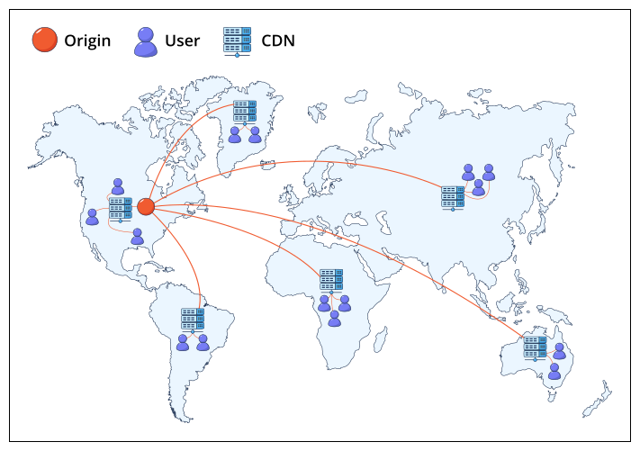

# Introduction_to_a_CDN

Source: https://www.educative.io/courses/grokking-the-system-design-interview/introduction-to-a-cdn

---

[Home](https://www.educative.io/)

[Courses](https://www.educative.io/search?tab=courses)

[Grokking Modern System Design Interview](https://www.educative.io/courses/grokking-the-system-design-interview)

# Introduction to a CDN

Define a CDN as a distributed system that uses edge servers to minimize latency and reduce origin server load. Formalize the critical functional requirements, such as content retrieval and delivery, alongside non-functional requirements, including high performance, availability, and scalability.

We'll cover the following...

- [Requirements](https://www.educative.io/courses/grokking-the-system-design-interview/introduction-to-a-cdn#Requirements)
  - [Functional requirements](https://www.educative.io/courses/grokking-the-system-design-interview/introduction-to-a-cdn#Functional-requirements)
  - [Non-functional requirements](https://www.educative.io/courses/grokking-the-system-design-interview/introduction-to-a-cdn#Non-functional-requirements)
- [Building blocks](https://www.educative.io/courses/grokking-the-system-design-interview/introduction-to-a-cdn#Building-blocks)

A **content delivery network (CDN)** is a distributed system of servers strategically placed across various geographic locations to improve the speed and reliability of online content delivery. Instead of relying on a single origin server, a CDN uses a network of proxy servers positioned closer to the end users.

These proxy servers operate at the network edge and are often referred to as **edge servers**. By caching content near users, edge servers reduce latency, conserve bandwidth, and protect the origin server from traffic spikes.

CDNs minimize the physical distance data travels by storing copies of both static and dynamic content in local data centers. This proximity significantly reduces propagation delay and ensures sufficient bandwidth is available along the delivery path.

> **Note:** A cache and a CDN serve different purposes. A cache stores frequently accessed data closer to the application or user to reduce latency and backend load. A CDN distributes content across geographically dispersed edge servers to reduce network latency for end users.

CDNs address several key performance issues:

- **High latency:** Edge servers shorten the physical distance between the content and the user, reducing network congestion and propagation delays.
- **Data-intensive loads:** The origin server sends data to the CDN once. The CDN then distributes it to many users. This prevents the origin from having to send a copy to every individual user.

> **Note:** CDN providers use various streaming protocols to deliver dynamic content, such as Real-Time Messaging Protocol (RTMP), HTTP Live Streaming (HLS), and Real-Time Streaming Protocol (RTSP).

- **Resource scarcity:** CDNs handle the majority of traffic for popular content, offloading the burden from origin servers. This allows distributed CDN components to share the load.

Dissemination of content to a geographically distributed CDN

> **Note:** Well-known CDN providers include Akamai, StackPath, Cloudflare, Rackspace, Amazon CloudFront, and Google Cloud CDN.

1.

Does a CDN cache all content from the origin server?

Show Answer

Did you find this helpful?

## Requirements[#](https://www.educative.io/courses/grokking-the-system-design-interview/introduction-to-a-cdn#Requirements)

We must design the CDN to meet specific functional and non-functional requirements.

### Functional requirements[#](https://www.educative.io/courses/grokking-the-system-design-interview/introduction-to-a-cdn#Functional-requirements)

The system should support the following operations:

- **Retrieve:** The CDN must fetch content from origin servers, depending on the type of CDN models (discussed in the next lesson).
- **Request:** Proxy servers must accept and respond to user requests for content.
- **Deliver:** In a push model, the system must allow origin servers to send content directly to CDN proxies.
- **Search:** The system must efficiently query its infrastructure to locate cached or stored content.
- **Update:** The system must propagate content updates to peer proxy servers in a PoP. This is often handled by a replication script.
- **Delete:** The system must support removing cached entries (e.g., via TTL or purge requests) for both static and dynamic content.

Functional requirements of a CDN

### Non-functional requirements[#](https://www.educative.io/courses/grokking-the-system-design-interview/introduction-to-a-cdn#Non-functional-requirements)

- **Performance:** Minimize latency to ensure the fastest possible response times.
- **Availability:** Ensure the system remains operational during traffic spikes or attacks, such as DDoS.
- **Scalability:** Support horizontal scaling to handle increasing user load.
- **Reliability and security:** Eliminate single points of failure and protect hosted content from malicious attacks.

Non-functional requirements of CDN

## Building blocks[#](https://www.educative.io/courses/grokking-the-system-design-interview/introduction-to-a-cdn#Building-blocks)

The design utilizes the following components:

The building blocks used in CDN design

- [**DNS**](https://www.educative.io/courses/grokking-the-system-design-interview/introduction-to-domain-name-system-dns)**:** Maps human-friendly domain names to the IP address of the appropriate proxy server.
- [**Load balancers**](https://www.educative.io/courses/grokking-the-system-design-interview/introduction-to-load-balancers)**:** Distribute requests among operational proxy servers.

In the next lesson, we will discuss the detailed design of the CDN.

System Design: The Content Delivery Network (CDN)

Design of a CDN

Ask

[Requirements](https://www.educative.io/courses/grokking-the-system-design-interview/introduction-to-a-cdn#Requirements)

[Functional requirements](https://www.educative.io/courses/grokking-the-system-design-interview/introduction-to-a-cdn#Functional-requirements)

[Non-functional requirements](https://www.educative.io/courses/grokking-the-system-design-interview/introduction-to-a-cdn#Non-functional-requirements)

[Building blocks](https://www.educative.io/courses/grokking-the-system-design-interview/introduction-to-a-cdn#Building-blocks)