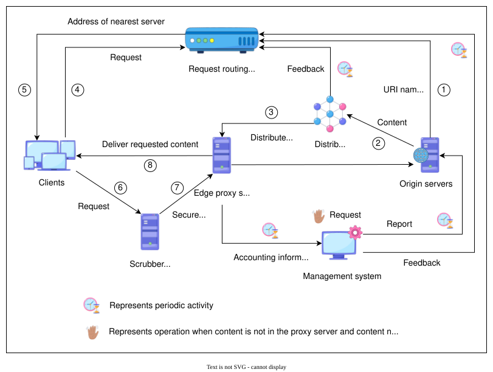

# Design_of_a_CDN

Source: https://www.educative.io/courses/grokking-the-system-design-interview/design-of-a-cdn

---

[Home](https://www.educative.io/)

[Courses](https://www.educative.io/search?tab=courses)

[Grokking Modern System Design Interview](https://www.educative.io/courses/grokking-the-system-design-interview)

# Design of a CDN

Define the foundational System Design of a CDN by detailing its essential components and their interactions. Understand the complete content delivery workflow, from origin servers to edge proxies, and analyze the required APIs for client requests and content distribution.

We'll cover the following...

- [CDN design](https://www.educative.io/courses/grokking-the-system-design-interview/design-of-a-cdn#CDN-design)
  - [CDN components](https://www.educative.io/courses/grokking-the-system-design-interview/design-of-a-cdn#CDN-components)
  - [Workflow](https://www.educative.io/courses/grokking-the-system-design-interview/design-of-a-cdn#Workflow)
- [API design](https://www.educative.io/courses/grokking-the-system-design-interview/design-of-a-cdn#API-design)
  - [Retrieve (proxy server to origin server)](https://www.educative.io/courses/grokking-the-system-design-interview/design-of-a-cdn#Retrieve-proxy-server-to-origin-server)
  - [Deliver (origin server to proxy servers)](https://www.educative.io/courses/grokking-the-system-design-interview/design-of-a-cdn#Deliver-origin-server-to-proxy-servers)
  - [Request (clients to proxy servers)](https://www.educative.io/courses/grokking-the-system-design-interview/design-of-a-cdn#Request-clients-to-proxy-servers)
  - [Search (proxy server to peer proxy servers)](https://www.educative.io/courses/grokking-the-system-design-interview/design-of-a-cdn#Search-proxy-server-to-peer-proxy-servers)
  - [Update (proxy server to peer proxy servers)](https://www.educative.io/courses/grokking-the-system-design-interview/design-of-a-cdn#Update-proxy-server-to-peer-proxy-servers)

## CDN design[#](https://www.educative.io/courses/grokking-the-system-design-interview/design-of-a-cdn#CDN-design)

We will design the CDN in two phases: first, we will define the core components, and second, we will examine the workflow of their interactions.

### CDN components[#](https://www.educative.io/courses/grokking-the-system-design-interview/design-of-a-cdn#CDN-components)

The CDN consists of the following components:

- **Clients:** End user devices, such as browsers and smartphones, that request content from the CDN.
- **Routing system:** Directs clients to the optimal CDN facility. It uses input regarding content placement, request volume, server load, and URI namespaces to determine the nearest available server.
- **Scrubber servers:** Separate legitimate traffic from malicious traffic (e.g., DDoS attacks). These are typically engaged when an attack is detected to clean traffic before routing it to the destination.
- **Proxy servers:** Edge servers that serve content to users. They store hot data in RAM and cold data on SSDs or hard drives. They also provide accounting information to the management system.
- **Distribution system:** Distributes content from origin servers to edge proxy servers across the network using intelligent broadcast mechanisms.
- **Origin servers:** The source of truth for data. They serve content unavailable in the CDN and store mapping metadata.
- **Management system:** Monitors business and operational metrics, such as latency, downtime, packet loss, and server load. It also tracks resource usage for billing purposes.

CDN components

### Workflow[#](https://www.educative.io/courses/grokking-the-system-design-interview/design-of-a-cdn#Workflow)

The abstract design workflow is as follows:

1. The content provider delegates a URI namespace or domain to the CDN request-routing system so it can resolve incoming content requests.
2. The origin servers publish content to the CDN distribution system.
3. The distribution system distributes content to edge proxy servers and may send feedback to the request-routing system about content availability and location.
4. A client queries the request-routing system to find a suitable server for the requested content.
5. The request-routing system returns the address of the optimal edge server, based on factors such as proximity, latency, load, availability, and cache state.
6. If security scrubbing is enabled, the client request may first pass through scrubber servers that filter malicious traffic, such as DDoS or bad requests.
7. After validation, the scrubber servers forward the safe request to the selected edge proxy server.
8. The edge proxy serves the requested content to the client. If the content is not available in its cache, it retrieves it from a parent cache, distribution system, or origin server.

## API design[#](https://www.educative.io/courses/grokking-the-system-design-interview/design-of-a-cdn#API-design)

This section outlines the CDN API design. It defines how the CDN handles client requests, retrieves content from origin servers, and coordinates internal components. The primary APIs include:

- Retrieve content
- Deliver content
- Request content
- Search content
- Update content
- Delete content

In this context, “content” refers to any web object, such as files, videos, or audio. Privacy parameters (e.g., encryption, access control) are omitted for brevity.

### Retrieve (proxy server to origin server)[#](https://www.educative.io/courses/grokking-the-system-design-interview/design-of-a-cdn#Retrieve-proxy-server-to-origin-server)

Proxy servers use the `GET` method to fetch content from origin servers via the `/retrieveContent` API:

Ace Editor

1

retrieveContent(proxyserver\_id, content\_type, content\_version, description)

הההההההההההההההההההההההההההההההההההההההההההההההההההההההההההההההההההההההההההההההההההההההההההההההההההההההההההההההההההההההההההההההההההההההההההההההההההההההההההההההההההההההההההההההההההההההההההההההההההההההההההההההההההההההההההההההההההההההההההההההההההההההההההההההההההההההההההההההההההההההההההההההההההההההההההההההההההההההההההההההההההההההההההההההההההההההההההההההההההההההההההההההההההההההההההההההההההההההההההההההההההההההההההההההההההההההההההההההההההההההההההההההההההההההההההההההההההההההההההההההההההההההההההההההההההההההההההההההה

XXXXXXXXXXXXXXXXXXXXXXXXXXXXXXXXXXXXXXXXXXXXXXXXXXXXXXXXXXXXXXXXXXXXXXXXXXXXXXXXXXXXXXXXXXXXXXXXXXXXXXXXXXXXXXXXXXXXXXXXXXXXXXXXXXXXXXXXXXXXXXXXXXXXXXXXXXXXXXXXXXXXXXXXXXXXXXXXXXXXXXXXXXXXXXXXXXXXXXXXXXXXXXXXXXXXXXXXXXXXXXXXXXXXXXXXXXXXXXXXXXXXXXXXXXXXXXXXXXXXXXXXXXXXXXXXXXXXXXXXXXXXXXXXXXXXXXXXXXXXXXXXXXXXXXXXXXXXXXXXXXXXXXXXXXXXXXXXXXXXXXXXXXXXXXXXXXXXXXXXXXXXXXXXXXXXXXXXXXXXXXXXXXXXXXXXXXXXXXXXXXXXXXXXXXXXXXXXXXXXXXXXXXXXXXXXXXXXXXXXXXXXXXXXXXXXXXXXXXXXXXXXXXXXXXXXXXXXXXXXXXXXXXXXXXXXXXXXXXXXXXXXXXXXXXXX

Parameter details:

## Details of Parameters

|  |  |
| --- | --- |
| **Parameter** | **Description** |
| `proxyserver_id` | This is a unique ID of the requesting proxy server. |
| `content_type` | This data structure will contain information about the requested content. Specifically, it will contain the category (audio, video, document, script, and so on), the type of clients it’s requested for, and the requested quality (if any). |
| `content_version` | This represents the version number of the content. For the `/retrieveContent` API, the `content_version` will contain the current version of the content residing in the proxy server. The `content_version` will be `NULL` if no previous version is available at the proxy server. |
| `description` | This specifies the content detail—for example, the video's extension, resolution detail, and so on if the `content_type` is video. |

The API returns a JSON object containing the text, content type, and links to embedded media.

### Deliver (origin server to proxy servers)[#](https://www.educative.io/courses/grokking-the-system-design-interview/design-of-a-cdn#Deliver-origin-server-to-proxy-servers)

Origin servers use the `/deliverContent` API to push new or updated content to proxy servers via the distribution system:

Ace Editor

1

deliverContent(origin\_id, server\_list, content\_type, content\_version, description)

הההההההההההההההההההההההההההההההההההההההההההההההההההההההההההההההההההההההההההההההההההההההההההההההההההההההההההההההההההההההההההההההההההההההההההההההההההההההההההההההההההההההההההההההההההההההההההההההההההההההההההההההההההההההההההההההההההההההההההההההההההההההההההההההההההההההההההההההההההההההההההההההההההההההההההההההההההההההההההההההההההההההההההההההההההההההההההההההההההההההההההההההההההההההההההההההההההההההההההההההההההההההההההההההההההההההההההההההההההההההההההההההההההההההההההההההההההההההההההההההההההההההההההההההההההההההההההההההה

XXXXXXXXXXXXXXXXXXXXXXXXXXXXXXXXXXXXXXXXXXXXXXXXXXXXXXXXXXXXXXXXXXXXXXXXXXXXXXXXXXXXXXXXXXXXXXXXXXXXXXXXXXXXXXXXXXXXXXXXXXXXXXXXXXXXXXXXXXXXXXXXXXXXXXXXXXXXXXXXXXXXXXXXXXXXXXXXXXXXXXXXXXXXXXXXXXXXXXXXXXXXXXXXXXXXXXXXXXXXXXXXXXXXXXXXXXXXXXXXXXXXXXXXXXXXXXXXXXXXXXXXXXXXXXXXXXXXXXXXXXXXXXXXXXXXXXXXXXXXXXXXXXXXXXXXXXXXXXXXXXXXXXXXXXXXXXXXXXXXXXXXXXXXXXXXXXXXXXXXXXXXXXXXXXXXXXXXXXXXXXXXXXXXXXXXXXXXXXXXXXXXXXXXXXXXXXXXXXXXXXXXXXXXXXXXXXXXXXXXXXXXXXXXXXXXXXXXXXXXXXXXXXXXXXXXXXXXXXXXXXXXXXXXXXXXXXXXXXXXXXXXXXXXXXXX

## Details of Parameters

|  |  |
| --- | --- |
| **Parameter** | **Description** |
| `origin_id` | This recognizes each origin server uniquely. |
| `server_list` | This identifies the list of servers the content will be pushed to by the distribution system. |
| `content_version` | This represents the updated version of the content at the origin server. The proxy server receiving the content will discard the previous version. |

Common parameters function as described previously.

### Request (clients to proxy servers)[#](https://www.educative.io/courses/grokking-the-system-design-interview/design-of-a-cdn#Request-clients-to-proxy-servers)

Clients use the `/requestContent` API to fetch content from proxy servers:

Ace Editor

1

requestContent(user\_id, content\_type, description)

הההההההההההההההההההההההההההההההההההההההההההההההההההההההההההההההההההההההההההההההההההההההההההההההההההההההההההההההההההההההההההההההההההההההההההההההההההההההההההההההההההההההההההההההההההההההההההההההההההההההההההההההההההההההההההההההההההההההההההההההההההההההההההההההההההההההההההההההההההההההההההההההההההההההההההההההההההההההההההההההההההההההההההההההההההההההההההההההההההההההההההההההההההההההההההההההההההההההההההההההההההההההההההההההההההההההההההההההההההההההההההההההההההההההההההההההההההההההההההההההההההההההההההההההההההההההההההההההה

XXXXXXXXXXXXXXXXXXXXXXXXXXXXXXXXXXXXXXXXXXXXXXXXXXXXXXXXXXXXXXXXXXXXXXXXXXXXXXXXXXXXXXXXXXXXXXXXXXXXXXXXXXXXXXXXXXXXXXXXXXXXXXXXXXXXXXXXXXXXXXXXXXXXXXXXXXXXXXXXXXXXXXXXXXXXXXXXXXXXXXXXXXXXXXXXXXXXXXXXXXXXXXXXXXXXXXXXXXXXXXXXXXXXXXXXXXXXXXXXXXXXXXXXXXXXXXXXXXXXXXXXXXXXXXXXXXXXXXXXXXXXXXXXXXXXXXXXXXXXXXXXXXXXXXXXXXXXXXXXXXXXXXXXXXXXXXXXXXXXXXXXXXXXXXXXXXXXXXXXXXXXXXXXXXXXXXXXXXXXXXXXXXXXXXXXXXXXXXXXXXXXXXXXXXXXXXXXXXXXXXXXXXXXXXXXXXXXXXXXXXXXXXXXXXXXXXXXXXXXXXXXXXXXXXXXXXXXXXXXXXXXXXXXXXXXXXXXXXXXXXXXXXXXXXXX

## Details of Parameter

|  |  |
| --- | --- |
| **Parameter** | **Description** |
| `user_id` | This is the unique ID of the user who requested the content. |

The proxy server returns the requested content to the client.

### Search (proxy server to peer proxy servers)[#](https://www.educative.io/courses/grokking-the-system-design-interview/design-of-a-cdn#Search-proxy-server-to-peer-proxy-servers)

Proxy servers use the `/searchContent` API to probe peer proxies in the same PoP before falling back to the origin. This can be implemented by broadcasting a query or checking a shared data store.

The `/searchContent` API is shown below:

Ace Editor

1

searchContent(proxyserver\_id, content\_type, description)

הההההההההההההההההההההההההההההההההההההההההההההההההההההההההההההההההההההההההההההההההההההההההההההההההההההההההההההההההההההההההההההההההההההההההההההההההההההההההההההההההההההההההההההההההההההההההההההההההההההההההההההההההההההההההההההההההההההההההההההההההההההההההההההההההההההההההההההההההההההההההההההההההההההההההההההההההההההההההההההההההההההההההההההההההההההההההההההההההההההההההההההההההההההההההההההההההההההההההההההההההההההההההההההההההההההההההההההההההההההההההההההההההההההההההההההההההההההההההההההההההההההההההההההההההההההההההההההההה

XXXXXXXXXXXXXXXXXXXXXXXXXXXXXXXXXXXXXXXXXXXXXXXXXXXXXXXXXXXXXXXXXXXXXXXXXXXXXXXXXXXXXXXXXXXXXXXXXXXXXXXXXXXXXXXXXXXXXXXXXXXXXXXXXXXXXXXXXXXXXXXXXXXXXXXXXXXXXXXXXXXXXXXXXXXXXXXXXXXXXXXXXXXXXXXXXXXXXXXXXXXXXXXXXXXXXXXXXXXXXXXXXXXXXXXXXXXXXXXXXXXXXXXXXXXXXXXXXXXXXXXXXXXXXXXXXXXXXXXXXXXXXXXXXXXXXXXXXXXXXXXXXXXXXXXXXXXXXXXXXXXXXXXXXXXXXXXXXXXXXXXXXXXXXXXXXXXXXXXXXXXXXXXXXXXXXXXXXXXXXXXXXXXXXXXXXXXXXXXXXXXXXXXXXXXXXXXXXXXXXXXXXXXXXXXXXXXXXXXXXXXXXXXXXXXXXXXXXXXXXXXXXXXXXXXXXXXXXXXXXXXXXXXXXXXXXXXXXXXXXXXXXXXXXXXX

### Update (proxy server to peer proxy servers)[#](https://www.educative.io/courses/grokking-the-system-design-interview/design-of-a-cdn#Update-proxy-server-to-peer-proxy-servers)

Proxy servers use the `/updateContent` API to update content on peer proxies. This is often triggered by serverless scripts performing tasks like image resizing or format conversion.

The `/updateContent` API is shown below:

Ace Editor

1

updateContent(proxyserver\_id, content\_type, description)

הההההההההההההההההההההההההההההההההההההההההההההההההההההההההההההההההההההההההההההההההההההההההההההההההההההההההההההההההההההההההההההההההההההההההההההההההההההההההההההההההההההההההההההההההההההההההההההההההההההההההההההההההההההההההההההההההההההההההההההההההההההההההההההההההההההההההההההההההההההההההההההההההההההההההההההההההההההההההההההההההההההההההההההההההההההההההההההההההההההההההההההההההההההההההההההההההההההההההההההההההההההההההההההההההההההההההההההההההההההההההההההההההההההההההההההההההההההההההההההההההההההההההההההההההההההההההההההההה

XXXXXXXXXXXXXXXXXXXXXXXXXXXXXXXXXXXXXXXXXXXXXXXXXXXXXXXXXXXXXXXXXXXXXXXXXXXXXXXXXXXXXXXXXXXXXXXXXXXXXXXXXXXXXXXXXXXXXXXXXXXXXXXXXXXXXXXXXXXXXXXXXXXXXXXXXXXXXXXXXXXXXXXXXXXXXXXXXXXXXXXXXXXXXXXXXXXXXXXXXXXXXXXXXXXXXXXXXXXXXXXXXXXXXXXXXXXXXXXXXXXXXXXXXXXXXXXXXXXXXXXXXXXXXXXXXXXXXXXXXXXXXXXXXXXXXXXXXXXXXXXXXXXXXXXXXXXXXXXXXXXXXXXXXXXXXXXXXXXXXXXXXXXXXXXXXXXXXXXXXXXXXXXXXXXXXXXXXXXXXXXXXXXXXXXXXXXXXXXXXXXXXXXXXXXXXXXXXXXXXXXXXXXXXXXXXXXXXXXXXXXXXXXXXXXXXXXXXXXXXXXXXXXXXXXXXXXXXXXXXXXXXXXXXXXXXXXXXXXXXXXXXXXXXXXX

## Details of Parameter

|  |  |
| --- | --- |
| **Parameter** | **Description** |
| `proxyserver_id` | This recognizes the proxy server uniquely in the PoP to update the content. |

Common parameters function as described previously.

> **Note:** The Delete API is not detailed in this section. Although cache eviction policies typically remove stale entries automatically, explicit deletion may be required to maintain consistency across edge nodes. Consistency mechanisms are covered in '[In-Depth Investigation of CDN: Part 2](https://www.educative.io/courses/grokking-the-system-design-interview/in-depth-investigation-of-cdn-part-2)'.

In the upcoming lessons, we’ll dive deep into the characteristics of CDNs.

Introduction to a CDN

In-Depth Investigation of CDN: Part 1

Ask

[CDN design](https://www.educative.io/courses/grokking-the-system-design-interview/design-of-a-cdn#CDN-design)

[CDN components](https://www.educative.io/courses/grokking-the-system-design-interview/design-of-a-cdn#CDN-components)

[Workflow](https://www.educative.io/courses/grokking-the-system-design-interview/design-of-a-cdn#Workflow)

[API design](https://www.educative.io/courses/grokking-the-system-design-interview/design-of-a-cdn#API-design)

[Retrieve (proxy server to origin server)](https://www.educative.io/courses/grokking-the-system-design-interview/design-of-a-cdn#Retrieve-proxy-server-to-origin-server)

[Deliver (origin server to proxy servers)](https://www.educative.io/courses/grokking-the-system-design-interview/design-of-a-cdn#Deliver-origin-server-to-proxy-servers)

[Request (clients to proxy servers)](https://www.educative.io/courses/grokking-the-system-design-interview/design-of-a-cdn#Request-clients-to-proxy-servers)

[Search (proxy server to peer proxy servers)](https://www.educative.io/courses/grokking-the-system-design-interview/design-of-a-cdn#Search-proxy-server-to-peer-proxy-servers)

[Update (proxy server to peer proxy servers)](https://www.educative.io/courses/grokking-the-system-design-interview/design-of-a-cdn#Update-proxy-server-to-peer-proxy-servers)