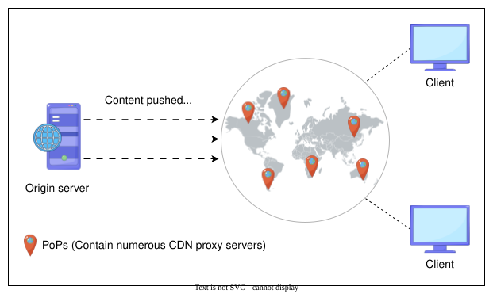
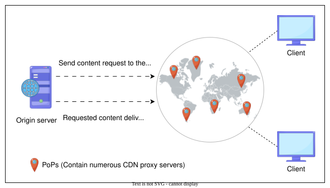
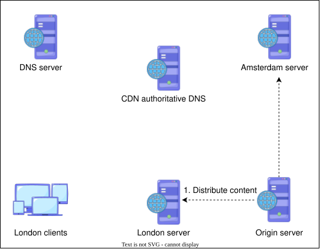
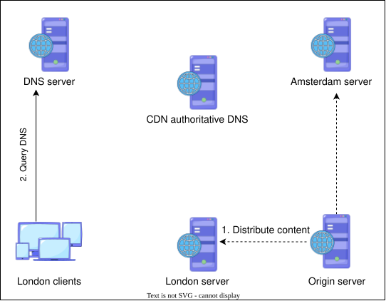
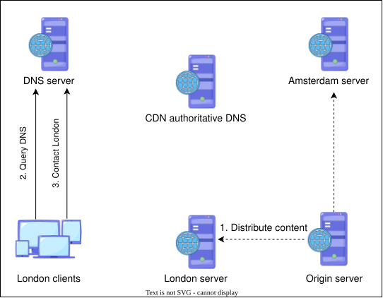
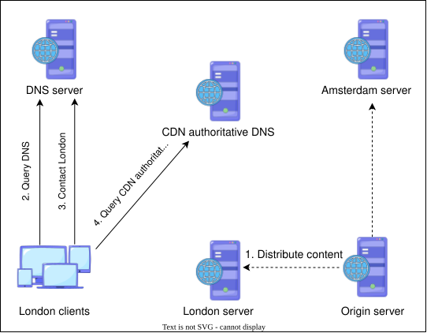
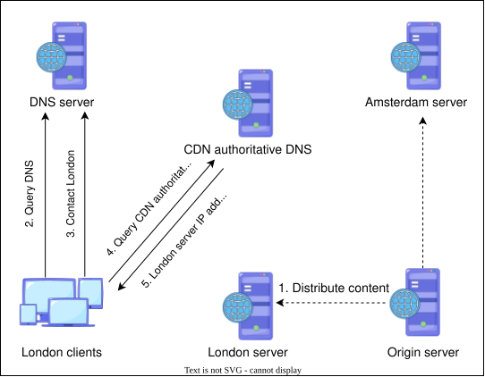

# In-Depth_Investigation_of_CDN_Part_1

Source: https://www.educative.io/courses/grokking-the-system-design-interview/in-depth-investigation-of-cdn-part-1

---

[Home](https://www.educative.io/)

[Courses](https://www.educative.io/search?tab=courses)

[Grokking Modern System Design Interview](https://www.educative.io/courses/grokking-the-system-design-interview)

# In-Depth Investigation of CDN: Part 1

Compare Push and Pull CDN models and evaluate which is appropriate for static vs. dynamic content delivery. Explain how multi-tier CDN architectures scale content distribution. Describe how DNS-based routing and Anycast direct client requests to a nearby edge node to reduce latency.

We'll cover the following...

- [Content caching strategies in CDN](https://www.educative.io/courses/grokking-the-system-design-interview/in-depth-investigation-of-cdn-part-1#Content-caching-strategies-in-CDN)
  - [Push CDN](https://www.educative.io/courses/grokking-the-system-design-interview/in-depth-investigation-of-cdn-part-1#Push-CDN)
  - [Pull CDN](https://www.educative.io/courses/grokking-the-system-design-interview/in-depth-investigation-of-cdn-part-1#Pull-CDN)
- [Dynamic content caching optimization](https://www.educative.io/courses/grokking-the-system-design-interview/in-depth-investigation-of-cdn-part-1#Dynamic-content-caching-optimization)
- [Multi-tier CDN architecture](https://www.educative.io/courses/grokking-the-system-design-interview/in-depth-investigation-of-cdn-part-1#Multi-tier-CDN-architecture)
- [Find the nearest proxy server to fetch the data](https://www.educative.io/courses/grokking-the-system-design-interview/in-depth-investigation-of-cdn-part-1#Find-the-nearest-proxy-server-to-fetch-the-data)
  - [Important factors that affect the proximity of the proxy server](https://www.educative.io/courses/grokking-the-system-design-interview/in-depth-investigation-of-cdn-part-1#Important-factors-that-affect-the-proximity-of-the-proxy-server)
  - [DNS redirection](https://www.educative.io/courses/grokking-the-system-design-interview/in-depth-investigation-of-cdn-part-1#DNS-redirection)
  - [Anycast](https://www.educative.io/courses/grokking-the-system-design-interview/in-depth-investigation-of-cdn-part-1#Anycast)
  - [Client multiplexing](https://www.educative.io/courses/grokking-the-system-design-interview/in-depth-investigation-of-cdn-part-1#Client-multiplexing)
  - [HTTP redirection](https://www.educative.io/courses/grokking-the-system-design-interview/in-depth-investigation-of-cdn-part-1#HTTP-redirection)

This lesson details CDN models, multi-tier architectures, and strategies for optimizing dynamic content.

## Content caching strategies in CDN[#](https://www.educative.io/courses/grokking-the-system-design-interview/in-depth-investigation-of-cdn-part-1#Content-caching-strategies-in-CDN)

To ensure timely updates, CDNs use two primary classifications to retrieve content from origin servers.

### Push CDN[#](https://www.educative.io/courses/grokking-the-system-design-interview/in-depth-investigation-of-cdn-part-1#Push-CDN)

In the **Push CDN** model, the origin server automatically sends content to the proxy servers. The content provider is responsible for managing this delivery.

- **Best for:** Static content where the origin server decides exactly what to deliver.
- **Drawback:** Inefficient for rapidly changing content, often resulting in redundant pushes.



Push content to PoPs

### Pull CDN[#](https://www.educative.io/courses/grokking-the-system-design-interview/in-depth-investigation-of-cdn-part-1#Pull-CDN)

In the **Pull CDN** model, the CDN fetches data from the origin server only when a user requests it. Proxy servers cache the file for a specified duration (time-to-live) to balance capacity and cost.

This model is ideal for serving dynamic content or high-traffic sites where pre-loading all assets is inefficient.



Content pull from origin server to the CDN PoPs

In short:

- **Push CDN:** Maintains more replicas, improving availability for static content.
- **Pull CDN:** Favored for frequently changing content and high traffic loads due to lower storage consumption.

AI Powered

Saved

1 attempt left

Reset

Choosing between types of CDN

Consider managing a website with two distinct content types:

- **News Feed:** Frequently updated articles and blog posts with varying popularity.
- **Static Assets:** These items change infrequently, such as the company logo, website design elements, and product images.

Choose between a push CDN and a pull CDN for each content type. Justify your choices.

This is your last attempt.

> **Note:** Most content providers use a hybrid of Pull and Push CDN caching approaches.

## Dynamic content caching optimization[#](https://www.educative.io/courses/grokking-the-system-design-interview/in-depth-investigation-of-cdn-part-1#Dynamic-content-caching-optimization)

Dynamic content changes frequently, requiring specific optimization strategies:

- **Edge scripting:** Scripts run on proxy servers (instead of the origin) to generate content based on parameters like user location, time of day, or third-party APIs (e.g., weather).
- **Compression:** Tools like Cloudflare’s Railgun compress dynamic content to reduce bandwidth usage between the origin and proxy servers.
- **Edge Side Includes (ESI):** This markup language defines which parts of a web page are dynamic. The CDN assembles the final response by combining cached static assets with dynamic fragments retrieved from the origin. Although ESI is not a W3C standard, it is widely used to avoid re-fetching entire pages when only small fragments change.

> **Note:** Dynamic Adaptive Streaming over HTTP (DASH) uses a manifest file with URIs for different video resolutions. This allows the client to fetch the appropriate quality based on network conditions. Netflix uses a proprietary version of DASH for optimization.

## Multi-tier CDN architecture[#](https://www.educative.io/courses/grokking-the-system-design-interview/in-depth-investigation-of-cdn-part-1#Multi-tier-CDN-architecture)

A content provider distributes content to a large number of clients through a CDN. Distributing content to all CDN proxy servers simultaneously is resource-intensive and can overload the origin server. To reduce origin load, CDNs often use a hierarchical distribution model. Edge proxy servers operate within a hierarchy of parent and peer nodes. These nodes fetch content from upstream parent nodes, which in turn obtain it from the origin. Content propagates from the origin to proxy servers along multiple paths in the hierarchy.

The tree structure for data distribution allows us to scale our system for increasing users by adding more server nodes to the tree. It also reduces the burden on the origin server for data distribution. A CDN typically has one or two tiers of proxy servers (caches). The following illustration shows the two tiers of proxy servers:


Data distribution among CDN proxy servers

Whenever a new proxy server enters the tree of a CDN, it requests the control core, which maintains information on all the proxy servers in the CDN and provides initial content with the configuration data.

Research shows that many contents have long-tail distribution. This means that, at some point, only a handful of content is very popular, and then we have a long tail of less popular content. Here, a **multi-layer cache** might be used to handle long-tail content.


Many kinds of data exhibit the long-tailed phenomenon

1.

What happens if a child or parent proxy server fails or if the origin server fails?

Show Answer

Did you find this helpful?

To minimize latency, the CDN must route users to the optimal proxy server. This section explores how that selection occurs.

## Find the nearest proxy server to fetch the data[#](https://www.educative.io/courses/grokking-the-system-design-interview/in-depth-investigation-of-cdn-part-1#Find-the-nearest-proxy-server-to-fetch-the-data)

To minimize user-perceived latency, clients should be routed to the nearest proxy server. The remaining challenge is determining how clients worldwide are routed to their nearest proxy. This section explains the routing mechanisms that enable this behavior.

### Important factors that affect the proximity of the proxy server[#](https://www.educative.io/courses/grokking-the-system-design-interview/in-depth-investigation-of-cdn-part-1#Important-factors-that-affect-the-proximity-of-the-proxy-server)

There are two important factors that are relevant to finding the nearest proxy server to the user:

- **Network distance** between the user and the proxy server is crucial. This is a function of the following two things:

  - The first is the length of the network path.
  - The second is the capacity (bandwidth) limits along the network path.  
    The shortest network path with the highest capacity (bandwidth) is the nearest proxy server to the user in question. This path helps the user download content more quickly.
- **Requests load** refers to the load a proxy server handles at any point in time. If a set of proxy servers are overloaded, the request routing system should forward the request to a location with a lesser load. This action balances out the proxy server load and, consequently, reduces the response latency.

Let’s look at the techniques that can be used to route users to the nearest proxy server.

### DNS redirection[#](https://www.educative.io/courses/grokking-the-system-design-interview/in-depth-investigation-of-cdn-part-1#DNS-redirection)

In a typical DNS resolution, we use a **DNS system** to get an IP against a human-readable name. However, the DNS can also return another URI (instead of an IP) to the client. Such a mechanism is called **DNS redirect**.

Content providers can use DNS redirect to send a client to a specific CDN. As an example, if the client tries to resolve a name that has the word “video” in it, the authoritative DNS server provides another URL (for example, cdn.xyz.comcdn.xyz.comcdn.xyz.com). The client does another DNS resolution, and the CDN’s authoritative DNS provides an IP address of an appropriate CDN proxy server to fetch the required content.

Depending on the location of the user, the response of the DNS can be different. Let’s see the slides below to understand how DNS redirection works:



1 / 7

The origin server distributes content to the London server in this example



1 / 7

The client requests the proxy server that’s nearest to the local DNS



1 / 7

The DNS gives the URL of the CDN authoritative DNS server to the requested clients



1 / 7

The client requests the proxy server that’s nearest to the CDN authoritative DNS



1 / 7

The CDN authoritative DNS gives the IP address of the nearest proxy server to the requested clients

> **Note:** The nearest proxy server doesn’t necessarily mean the one that’s geographically the closest. It could be, but it’s not only the geography that matters. Other factors like network distance, bandwidth, and traffic load already on that route also matter.

There are two steps in the DNS redirection approach:

1. In the first step, it maps the clients to the appropriate network location.
2. In the second step, it distributes the load over the proxy servers in that location to balance the load among the proxy servers (see [DNS](https://www.educative.io/courses/grokking-the-system-design-interview/introduction-to-domain-name-system-dns) and [Load Balancers](https://www.educative.io/courses/grokking-the-system-design-interview/introduction-to-load-balancers) building blocks for more details on this).

Within each location or point of presence (PoP), such as the London data center, intra-PoP load balancing decides which proxy server handles each incoming request. This ensures traffic is evenly distributed among local servers and maintains high availability even if one proxy becomes overloaded or temporarily unavailable.

DNS redirection considers both network distance and request load when selecting a proxy, which helps reduce latency.

To shift a client from one machine in a cluster to another, the DNS replies at the second step are given with short TTLs so that the client repeats the resolution after a short while. DNS keeps delivering the content by routing requests to other active servers in case of hardware failures and network congestion. It does so by load balancing the traffic, using intelligent failover, and maintaining servers across many data centers, which achieves good reliability and performance.

Since the load at proxy servers changes over time, the content provider needs to make appropriate changes in the DNS to make the DNS redirection effective. Many CDN providers like Akamai use DNS redirection in their routing system.

### Anycast[#](https://www.educative.io/courses/grokking-the-system-design-interview/in-depth-investigation-of-cdn-part-1#Anycast)

**Anycast** is a routing methodology in which all the edge servers located in multiple locations share the same single IP address. It employs the **Border Gateway Protocol** **(BGP)** to route clients based on the Internet’s natural network flow. A CDN provider can use the anycast mechanism so that clients are directed to the nearest proxy servers for content.

### Client multiplexing[#](https://www.educative.io/courses/grokking-the-system-design-interview/in-depth-investigation-of-cdn-part-1#Client-multiplexing)

**Client multiplexing** involves sending a client a list of candidate servers. The client then chooses one server from the list to send the request to. This approach is inefficient because the client lacks the overall information to choose the most suitable server for their request. This may result in sending requests to an already-loaded server and experiencing higher access latency.

### HTTP redirection[#](https://www.educative.io/courses/grokking-the-system-design-interview/in-depth-investigation-of-cdn-part-1#HTTP-redirection)

**HTTP redirection** is the simplest of all approaches. With this scheme, the client requests content from the origin server. The origin server responds with an HTTP redirect status code (e.g., 302) and a `Location` header pointing to the CDN URL. The client then follows this redirect and fetches the content directly from the CDN.

Below is an example of this flow. The client requests the Facebook logo from the origin server, which responds with a redirect to the CDN at `static.xx.fbcdn.net`:

HTML

```
Client request:

GET /logo.svg HTTP/1.1

Host: www.facebook.com

Server response:

HTTP/1.1 302 Found

Location: https://static.xx.fbcdn.net/rsrc.php/y8/r/dF5SId3UHWd.svg
```

⋯

HTTP redirection

The client automatically follows the redirect and downloads the logo from the CDN.

In the next lesson, we will discuss the different details of content consistency and proxy server deployment in CDN.

Design of a CDN

In-Depth Investigation of CDN: Part 2

Ask

[Content caching strategies in CDN](https://www.educative.io/courses/grokking-the-system-design-interview/in-depth-investigation-of-cdn-part-1#Content-caching-strategies-in-CDN)

[Push CDN](https://www.educative.io/courses/grokking-the-system-design-interview/in-depth-investigation-of-cdn-part-1#Push-CDN)

[Pull CDN](https://www.educative.io/courses/grokking-the-system-design-interview/in-depth-investigation-of-cdn-part-1#Pull-CDN)

[Dynamic content caching optimization](https://www.educative.io/courses/grokking-the-system-design-interview/in-depth-investigation-of-cdn-part-1#Dynamic-content-caching-optimization)

[Multi-tier CDN architecture](https://www.educative.io/courses/grokking-the-system-design-interview/in-depth-investigation-of-cdn-part-1#Multi-tier-CDN-architecture)

[Find the nearest proxy server to fetch the data](https://www.educative.io/courses/grokking-the-system-design-interview/in-depth-investigation-of-cdn-part-1#Find-the-nearest-proxy-server-to-fetch-the-data)

[Important factors that affect the proximity of the proxy server](https://www.educative.io/courses/grokking-the-system-design-interview/in-depth-investigation-of-cdn-part-1#Important-factors-that-affect-the-proximity-of-the-proxy-server)

[DNS redirection](https://www.educative.io/courses/grokking-the-system-design-interview/in-depth-investigation-of-cdn-part-1#DNS-redirection)

[Anycast](https://www.educative.io/courses/grokking-the-system-design-interview/in-depth-investigation-of-cdn-part-1#Anycast)

[Client multiplexing](https://www.educative.io/courses/grokking-the-system-design-interview/in-depth-investigation-of-cdn-part-1#Client-multiplexing)

[HTTP redirection](https://www.educative.io/courses/grokking-the-system-design-interview/in-depth-investigation-of-cdn-part-1#HTTP-redirection)