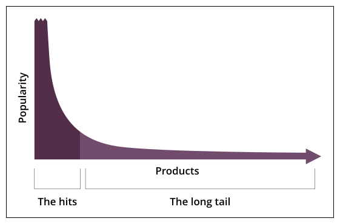

# Evaluation_of_CDN’s_Design

Source: https://www.educative.io/courses/grokking-the-system-design-interview/evaluation-of-cdns-design

---

[Home](https://www.educative.io/)

[Courses](https://www.educative.io/search?tab=courses)

[Grokking Modern System Design Interview](https://www.educative.io/courses/grokking-the-system-design-interview)

# Evaluation of CDN’s Design

Analyze how a CDN design meets essential non-functional requirements like performance, availability, and scalability. Understand the role of distributed proxy servers, intelligent routing, and redundancy in achieving reliable, low-latency content delivery for web-scale systems.

We'll cover the following...

- [Requirements compliance](https://www.educative.io/courses/grokking-the-system-design-interview/evaluation-of-cdns-design#Requirements-compliance)
  - [Performance](https://www.educative.io/courses/grokking-the-system-design-interview/evaluation-of-cdns-design#Performance)
    - [Availability](https://www.educative.io/courses/grokking-the-system-design-interview/evaluation-of-cdns-design#Availability)
    - [Scalability](https://www.educative.io/courses/grokking-the-system-design-interview/evaluation-of-cdns-design#Scalability)
    - [Reliability and security](https://www.educative.io/courses/grokking-the-system-design-interview/evaluation-of-cdns-design#Reliability-and-security)
  - [Conclusion](https://www.educative.io/courses/grokking-the-system-design-interview/evaluation-of-cdns-design#Conclusion)

## Requirements compliance[#](https://www.educative.io/courses/grokking-the-system-design-interview/evaluation-of-cdns-design#Requirements-compliance)

We will now evaluate how our design fulfills the core requirements: high performance, availability, scalability, reliability, and security.

### Performance[#](https://www.educative.io/courses/grokking-the-system-design-interview/evaluation-of-cdns-design#Performance)

The CDN achieves high performance by minimizing latency through the following design decisions:

- Proxy servers serve frequently accessed content directly from RAM.
- Proxy servers are geographically distributed to sit closer to users.
- Deploying proxy servers within ISPs or **internet exchange points (IXPs)** handles high traffic efficiently.
- The request routing system directs users to the nearest proxy server, as [discussed earlier](https://www.educative.io/courses/grokking-the-system-design-interview/design-of-a-cdn#CDN-components).
- Proxy servers store long-tail content on nonvolatile storage (SSD or HDD). Serving from local storage is significantly faster than fetching from origin servers.

Many kinds of data exhibit the long-tailed phenomenon

- A layered proxy architecture allows edge servers to request missing content from parent servers. This hierarchy improves efficiency, especially when specific ISP regions generate high traffic.

#### Availability[#](https://www.educative.io/courses/grokking-the-system-design-interview/evaluation-of-cdns-design#Availability)

The distributed nature of a CDN handles massive traffic loads. Cached content acts as a backup if origin servers fail. Redundancy ensures that if a proxy server goes down, traffic is rerouted to operational servers. Additionally, load balancers distribute user requests to nearby active proxies to prevent overloading.

#### Scalability[#](https://www.educative.io/courses/grokking-the-system-design-interview/evaluation-of-cdns-design#Scalability)

The design facilitates scalability in three ways:

- Offloading traffic to edge servers reduces bandwidth requirements on the origin.
- Horizontal scaling is achieved by adding more edge proxy servers.
- A layered proxy architecture overcomes the storage and scaling limitations of individual servers.

#### Reliability and security[#](https://www.educative.io/courses/grokking-the-system-design-interview/evaluation-of-cdns-design#Reliability-and-security)

A CDN reduces single points of failure through redundancy and load distribution. Scrubbing infrastructure mitigates DDoS attacks, and **heartbeat-based health checks** detect and isolate unhealthy nodes. Sensitive real-time applications may use private CDNs to improve traffic isolation and strengthen access control.

### Conclusion[#](https://www.educative.io/courses/grokking-the-system-design-interview/evaluation-of-cdns-design#Conclusion)

Since the 1990s, CDNs have played a central role in delivering content with high availability and low latency. They continue to support the scalability and performance requirements of modern large-scale systems.

In-Depth Investigation of CDN: Part 2

Quiz on CDN's Design

Ask

[Requirements compliance](https://www.educative.io/courses/grokking-the-system-design-interview/evaluation-of-cdns-design#Requirements-compliance)

[Performance](https://www.educative.io/courses/grokking-the-system-design-interview/evaluation-of-cdns-design#Performance)

[Availability](https://www.educative.io/courses/grokking-the-system-design-interview/evaluation-of-cdns-design#Availability)

[Scalability](https://www.educative.io/courses/grokking-the-system-design-interview/evaluation-of-cdns-design#Scalability)

[Reliability and security](https://www.educative.io/courses/grokking-the-system-design-interview/evaluation-of-cdns-design#Reliability-and-security)

[Conclusion](https://www.educative.io/courses/grokking-the-system-design-interview/evaluation-of-cdns-design#Conclusion)