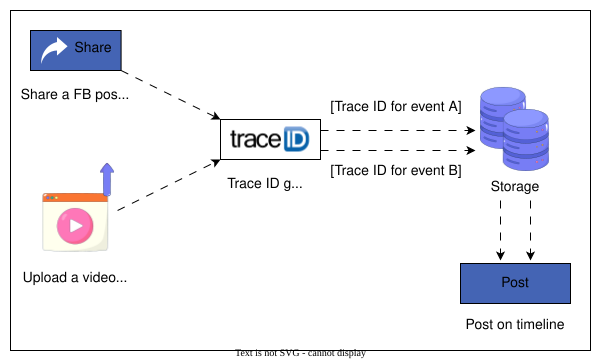

# System_Design_Sequencer

Source: https://www.educative.io/courses/grokking-the-system-design-interview/system-design-sequencer

---

[Home](https://www.educative.io/)

[Courses](https://www.educative.io/search?tab=courses)

[Grokking Modern System Design Interview](https://www.educative.io/courses/grokking-the-system-design-interview)

# System Design: Sequencer

Explore the necessity of globally unique identifiers UIDs in large distributed systems for event tracing and primary key assignment. Understand why traditional auto-increment features fail in sharded database environments.

We'll cover the following...

- [Motivation](https://www.educative.io/courses/grokking-the-system-design-interview/system-design-sequencer#Motivation)
- [How do we design a sequencer?](https://www.educative.io/courses/grokking-the-system-design-interview/system-design-sequencer#How-do-we-design-a-sequencer)

## Motivation[#](https://www.educative.io/courses/grokking-the-system-design-interview/system-design-sequencer#Motivation)

Large distributed systems can process millions of events per second, such as user posts or financial transactions. Each event must be assigned a globally unique identifier. These identifiers typically serve as primary keys in storage systems. Single-node databases often use auto-increment columns, but this approach does not scale in distributed systems where multiple nodes generate identifiers independently. Distributed environments, including horizontally sharded tables, require a coordinated or decentralized strategy for generating a unique ID.

Additionally, unique IDs facilitate debugging and tracing. For example, Facebook’s Canopy uses a TraceID to track events across the hundreds of microservices involved in a single user request.

Assigning a unique TraceID to each event

AI Powered

Saved

1 attempt left

Reset

Why do we prefer time-sortable UIDs?

Why do we need to design a unique ID generator that is time-sortable?

This is your last attempt.

## How do we design a sequencer?[#](https://www.educative.io/courses/grokking-the-system-design-interview/system-design-sequencer#How-do-we-design-a-sequencer)

We divide the comprehensive design of a sequencer into two lessons:

1. [**Design of a unique ID generator:**](https://www.educative.io/courses/grokking-the-system-design-interview/design-of-a-unique-id-generator) Define system requirements and discuss three generation methods: UUIDs, databases, and range handlers.
2. [**Unique IDs with causality:**](https://www.educative.io/courses/grokking-the-system-design-interview/unique-ids-with-causality) Incorporate time as a factor in ID generation to handle causality.

Designing a unique ID generator for a distributed system is challenging. The next lesson examines the specific requirements for this system.

Quiz on CDN's Design

Design of a Unique ID Generator

Ask

[Motivation](https://www.educative.io/courses/grokking-the-system-design-interview/system-design-sequencer#Motivation)

[How do we design a sequencer?](https://www.educative.io/courses/grokking-the-system-design-interview/system-design-sequencer#How-do-we-design-a-sequencer)