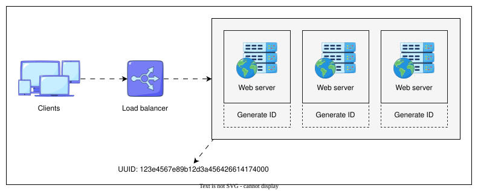
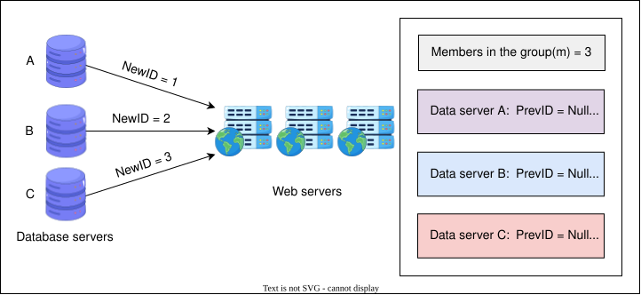
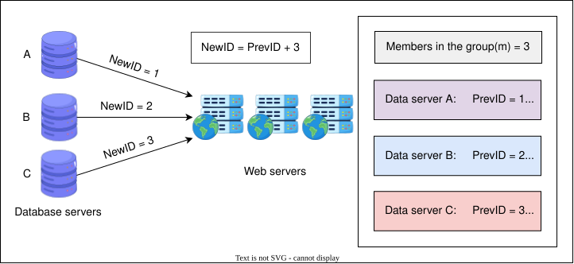

# Design_of_a_Unique_ID_Generator

Source: https://www.educative.io/courses/grokking-the-system-design-interview/design-of-a-unique-id-generator

---

[Home](https://www.educative.io/)

[Courses](https://www.educative.io/search?tab=courses)

[Grokking Modern System Design Interview](https://www.educative.io/courses/grokking-the-system-design-interview)

# Design of a Unique ID Generator

Define the requirements for a high-throughput, 64-bit unique ID generator in distributed systems. Analyze the architectural trade-offs of UUIDs, database sequencing, and the range handler pattern. Learn to choose a scalable solution that ensures uniqueness and availability in complex System Design.

We'll cover the following...

- [Requirements for unique identifiers](https://www.educative.io/courses/grokking-the-system-design-interview/design-of-a-unique-id-generator#Requirements-for-unique-identifiers)
- [First solution: UUID](https://www.educative.io/courses/grokking-the-system-design-interview/design-of-a-unique-id-generator#First-solution-UUID)
  - [Cons of using the UUID approach](https://www.educative.io/courses/grokking-the-system-design-interview/design-of-a-unique-id-generator#Cons-of-using-the-UUID-approach)
- [Second solution: Using a database](https://www.educative.io/courses/grokking-the-system-design-interview/design-of-a-unique-id-generator#Second-solution-Using-a-database)
  - [Pros of using a database](https://www.educative.io/courses/grokking-the-system-design-interview/design-of-a-unique-id-generator#Pros-of-using-a-database)
  - [Cons of using a database](https://www.educative.io/courses/grokking-the-system-design-interview/design-of-a-unique-id-generator#Cons-of-using-a-database)
- [Third solution: Using a range handler](https://www.educative.io/courses/grokking-the-system-design-interview/design-of-a-unique-id-generator#Third-solution-Using-a-range-handler)
  - [Pros of using a range handler](https://www.educative.io/courses/grokking-the-system-design-interview/design-of-a-unique-id-generator#Pros-of-using-a-range-handler)
  - [Cons of using a range handler](https://www.educative.io/courses/grokking-the-system-design-interview/design-of-a-unique-id-generator#Cons-of-using-a-range-handler)

The [previous](https://www.educative.io/courses/grokking-the-system-design-interview/system-design-sequencer) lesson discussed use cases for unique identifiers, such as labeling tweets or tracking execution flow. This lesson explores system designs for generating these IDs. We will compare UUIDs, databases, and range handlers against the requirements defined below.

## Requirements for unique identifiers[#](https://www.educative.io/courses/grokking-the-system-design-interview/design-of-a-unique-id-generator#Requirements-for-unique-identifiers)

Our proposed system must meet the following requirements:

- **Uniqueness:** Assign distinct identifiers to every event.
- **Scalability:** Generate at least one billion unique IDs per day.
- **Availability:** As multiple events can occur at the nanosecond level, the system should generate IDs for all events.
- **64-bit numeric ID:** Restrict length to 64 bits for efficient storage and indexing. This size provides sufficient capacity for many years, for example:

Total numbers available=264=1.8446744×1019\text{Total numbers available} = 2^{64} = 1.8446744 \times 10^{19}Total numbers available=264=1.8446744×1019

Estimated number of events per day=1 billion=109\text{Estimated number of events per day} = 1 \ \text{billion} = 10^{9}Estimated number of events per day=1 billion=109

Number of events per year=365 billion=365×109\text{Number of events per year} = 365 \ \text{billion} = 365 \times 10^{9}Number of events per year=365 billion=365×109

Number of years to deplete identifier range=264365×109≈50.54 Million years\text{Number of years to deplete identifier range} = \frac{2^{64}}{365 \times 10^{9}} \approx 50{.}54 \ \text{Million years}Number of years to deplete identifier range=365×109264​≈50.54 Million years

64 bits provide sufficient longevity for the system.

Let’s evaluate different approaches (solutions) for generating IDs.

## First solution: UUID[#](https://www.educative.io/courses/grokking-the-system-design-interview/design-of-a-unique-id-generator#First-solution-UUID)

A straw man solution uses **UUIDs (universally unique IDs)**. These are 128-bit hexadecimal numbers (e.g., 123e4567e89b12d3a456426614174000\text{123e4567e89b12d3a456426614174000}123e4567e89b12d3a456426614174000) offering approximately 103810^{38}1038 combinations. We use version 4, which relies on pseudorandom generation.

Servers generate UUIDs independently, requiring no coordination. This approach is scalable, highly available, and has a low collision probability. The design is shown below:

Generating a unique ID using the UUID approach

Point to ponder

1.

What are the pros of using the UUID approach?

A.

It doesn’t require synchronization between servers.

B.

It’s scalable.

C.

It’s available.

D.

All of the above.

---

1 / 1

### Cons of using the UUID approach[#](https://www.educative.io/courses/grokking-the-system-design-interview/design-of-a-unique-id-generator#Cons-of-using-the-UUID-approach)

UUIDs present several drawbacks:

- **Performance:** 128-bit non-numeric keys slow down primary key indexing and inserts.
- **Size:** They exceed the 64-bit size limit.
- **Format:** Non-numeric strings are unsuitable for some use cases.
- **Uniqueness:** There is a small chance of duplication. While minimal, UUIDs are not deterministically unique.
- **Ordering:** IDs are not monotonically increasing.

## Requirements Filled with UUID

|  |  |  |  |  |
| --- | --- | --- | --- | --- |
|  | **Unique** | **Scalable** | **Available** | **64-bit Numeric ID** |
| **Using UUID** | ✖️ | ✔️ | ✔️ | ✖️ |

## Second solution: Using a database[#](https://www.educative.io/courses/grokking-the-system-design-interview/design-of-a-unique-id-generator#Second-solution-Using-a-database)

We can use a central database with an auto-increment feature. The database provides the current ID and increments the value by one for each new request. This ID serves as the unique identifier.

Using a central database to generate unique IDs

1.

What can be a potential problem of using a central database?

Show Answer

Did you find this helpful?

To avoid a **single point of failure (SPOF)**, we modify the standard auto-increment approach. Instead of incrementing by one, we use `m` database servers. Each server generates an ID and increments the next value by `m` (the number of servers). This ensures unique IDs across different servers without immediate collisions.

1 / 2

Generating IDs using the value of m

1 / 2

Generating IDs using the value of m

### Pros of using a database[#](https://www.educative.io/courses/grokking-the-system-design-interview/design-of-a-unique-id-generator#Pros-of-using-a-database)

This approach is scalable; as we add more servers, we update the value of `m` accordingly.

### Cons of using a database[#](https://www.educative.io/courses/grokking-the-system-design-interview/design-of-a-unique-id-generator#Cons-of-using-a-database)

Scaling across multiple data centers is difficult. Adding or removing servers causes ID misalignment and potential duplicates.

For example, suppose `m=3`. Server A generates 1, 4, 7; Server B generates 2, 5, 8; Server C generates 3, 6, 9. If Server B fails, we update `m` to 2. Server A's next ID would be 7 + 2 = 9. However, Server C has already generated ID 9. Uniqueness is lost.

This solution is risky because a unique ID system must not be a SPOF and must maintain strict uniqueness while scaling.

## Requirements Filled by UUID vs. Using a Database

|  |  |  |  |  |
| --- | --- | --- | --- | --- |
|  | **Unique** | **Scalable** | **Available** | **64-bit Numeric ID** |
| **Using UUID** | ✖️ | ✔️ | ✔️ | ✖️ |
| **Using Database Servers** | ✖️ | ✔️ | ✔️ | ✔️ |

## Third solution: Using a range handler[#](https://www.educative.io/courses/grokking-the-system-design-interview/design-of-a-unique-id-generator#Third-solution-Using-a-range-handler)

To address the previous limitations, we can use a central microservice (Range Handler) to manage ID ranges (e.g., 1–1,000,000; 1,000,001–2,000,000).

Application servers request a range from the central handler. The server stores the range start and end points locally. When an ID is needed, the server assigns the current value and increments it locally. When the range is exhausted, the server requests a new range.

**Example:** Server 1 claims the range 300,001–400,000. It assigns 300,001 to the first request, then 300,002, and so on. This continues until ID 400,000 is assigned. The server then queries the central handler for the next available range.

This prevents duplicates and allows concurrent responses. A load balancer distributes requests across servers to manage load.

The **range handler** tracks range status (available vs. taken) in replicated storage. A **failover server** ensures availability if the main handler fails, recovering state from the storage checkpoint.

Design of the range handler microservice

Let’s test your understanding with the help of the following AI assessment.

AI Powered

Saved

1 attempt left

Reset

Adjusting range allocation for new data center

Imagine a scenario where you’re planning to bring a new data center online to accommodate increasing user requests. How would you modify your range allocation strategy to accommodate this change?

This is your last attempt.

### Pros of using a range handler[#](https://www.educative.io/courses/grokking-the-system-design-interview/design-of-a-unique-id-generator#Pros-of-using-a-range-handler)

This system is scalable, available, and guarantees unique IDs. It also satisfies the requirement for 64-bit numeric IDs.

### Cons of using a range handler[#](https://www.educative.io/courses/grokking-the-system-design-interview/design-of-a-unique-id-generator#Cons-of-using-a-range-handler)

If an application server fails, its unassigned range is lost, creating gaps in the ID sequence. We can mitigate this by allocating smaller ranges, though they must be large enough to minimize network requests to the central handler.

## Requirements Filled by These Three Options

|  |  |  |  |  |
| --- | --- | --- | --- | --- |
|  | **Unique** | **Scalable** | **Available** | **64-bit Numeric ID** |
| **Using UUID** | ✖️ | ✔️ | ✔️ | ✖️ |
| **Using Database Servers** | ✖️ | ✔️ | ✔️ | ✔️ |
| **Using a Range Handler** | ✔️ | ✔️ | ✔️ | ✔️ |

The solution generates unique 64-bit numeric IDs suitable for use as primary keys. However, these IDs do not guarantee time-based ordering. The next lesson discusses how to generate time-ordered identifiers.

System Design: Sequencer

Unique IDs with Causality

Ask

[Requirements for unique identifiers](https://www.educative.io/courses/grokking-the-system-design-interview/design-of-a-unique-id-generator#Requirements-for-unique-identifiers)

[First solution: UUID](https://www.educative.io/courses/grokking-the-system-design-interview/design-of-a-unique-id-generator#First-solution-UUID)

[Cons of using the UUID approach](https://www.educative.io/courses/grokking-the-system-design-interview/design-of-a-unique-id-generator#Cons-of-using-the-UUID-approach)

[Second solution: Using a database](https://www.educative.io/courses/grokking-the-system-design-interview/design-of-a-unique-id-generator#Second-solution-Using-a-database)

[Pros of using a database](https://www.educative.io/courses/grokking-the-system-design-interview/design-of-a-unique-id-generator#Pros-of-using-a-database)

[Cons of using a database](https://www.educative.io/courses/grokking-the-system-design-interview/design-of-a-unique-id-generator#Cons-of-using-a-database)

[Third solution: Using a range handler](https://www.educative.io/courses/grokking-the-system-design-interview/design-of-a-unique-id-generator#Third-solution-Using-a-range-handler)

[Pros of using a range handler](https://www.educative.io/courses/grokking-the-system-design-interview/design-of-a-unique-id-generator#Pros-of-using-a-range-handler)

[Cons of using a range handler](https://www.educative.io/courses/grokking-the-system-design-interview/design-of-a-unique-id-generator#Cons-of-using-a-range-handler)