# Unique_IDs_with_Causality

Source: https://www.educative.io/courses/grokking-the-system-design-interview/unique-ids-with-causality

---

[Home](https://www.educative.io/)

[Courses](https://www.educative.io/search?tab=courses)

[Grokking Modern System Design Interview](https://www.educative.io/courses/grokking-the-system-design-interview)

# Unique IDs with Causality

Design a distributed sequencer capable of generating unique IDs while preserving event causality. Compare physical clock solutions like Twitter Snowflake and Google TrueTime with logical clocks. Evaluate the trade-offs between consistency, scalability, and complexity in System Design.

We'll cover the following...

- [Causality](https://www.educative.io/courses/grokking-the-system-design-interview/unique-ids-with-causality#Causality)
- [Use UNIX time stamps](https://www.educative.io/courses/grokking-the-system-design-interview/unique-ids-with-causality#Use-UNIX-time-stamps)
  - [Pros](https://www.educative.io/courses/grokking-the-system-design-interview/unique-ids-with-causality#Pros)
  - [Cons](https://www.educative.io/courses/grokking-the-system-design-interview/unique-ids-with-causality#Cons)
- [Twitter Snowflake](https://www.educative.io/courses/grokking-the-system-design-interview/unique-ids-with-causality#Twitter-Snowflake)
  - [Pros](https://www.educative.io/courses/grokking-the-system-design-interview/unique-ids-with-causality#Pros-1)
  - [Cons](https://www.educative.io/courses/grokking-the-system-design-interview/unique-ids-with-causality#Cons-1)
- [Using logical clocks](https://www.educative.io/courses/grokking-the-system-design-interview/unique-ids-with-causality#Using-logical-clocks)
  - [Lamport clocks](https://www.educative.io/courses/grokking-the-system-design-interview/unique-ids-with-causality#Lamport-clocks)
  - [Vector clocks](https://www.educative.io/courses/grokking-the-system-design-interview/unique-ids-with-causality#Vector-clocks)
- [TrueTime API](https://www.educative.io/courses/grokking-the-system-design-interview/unique-ids-with-causality#TrueTime-API)
  - [Pros](https://www.educative.io/courses/grokking-the-system-design-interview/unique-ids-with-causality#Pros-2)
  - [Cons](https://www.educative.io/courses/grokking-the-system-design-interview/unique-ids-with-causality#Cons-2)
- [Summary](https://www.educative.io/courses/grokking-the-system-design-interview/unique-ids-with-causality#Summary)

## Causality[#](https://www.educative.io/courses/grokking-the-system-design-interview/unique-ids-with-causality#Causality)

In the [previous](https://www.educative.io/courses/grokking-the-system-design-interview/design-of-a-unique-id-generator) lesson, we generated unique IDs. Beyond uniqueness, systems often need to reason about event ordering and causality. Consider two users on a social media platform. One user posts a comment (Event A), and another user replies (Event B). Event B depends on Event A and must occur after it. These two events are causally related.

Conversely, concurrent events occur independently. If Peter and John comment on two different Tweets simultaneously, there is no causal relationship between them. We need to identify dependencies where they exist.

> **Note:** Causality can be modeled by encoding dependencies in a graph structure or by maintaining a separate logical time mechanism. In many designs, it is preferable to use an identifier that both guarantees uniqueness and preserves event ordering.

The following slides visualize concurrent and non-concurrent events.


1 / 5

Non-concurrent events: TA 1 publishes a post. Any reply to this post will causally depend on it.


1 / 5

John starts replying to TA 1’s post. His comment can only exist after the post it responds to.


1 / 5

John’s comment is published. Because it was caused by TA 1’s post, the post happened-before the comment, and any ordering must preserve this.

, so all three events must be ordered in this sequence.")

1 / 5

Peter replies to John’s comment. This forms a causal chain (TA 1’s post → John’s comment → Peter’s reply), so all three events must be ordered in this sequence.


1 / 5

Concurrent events: Peter comments on TA 3’s post while John comments on TA 2’s post. Neither event depends on the other, so they are concurrent and can be ordered either way without breaking causality.

Some applications require identifiers to encode ordering or causality information. For example, a key-value store can use time-ordered identifiers to implement a “last-write-wins” policy for resolving concurrent writes.

We can use logical or physical clocks to infer causality. Some systems, like financial applications under MiFID regulations, require strict wall-clock synchronization (within 100 microseconds of UTC) to detect anomalies in high-speed trading.

> **Note:** Logical and physical clocks involve several non-trivial design trade-offs. Review the section titled “Time in a Distributed System” for a recap of these concepts.

Timestamps are commonly used to determine event ordering. For example, if one event occurs at 6:00 a.m. and another at 7:00 a.m., their timestamps establish the order. However, relying on physical clocks in distributed systems is challenging due to clock drift, skew, and synchronization limits.

## Use UNIX time stamps[#](https://www.educative.io/courses/grokking-the-system-design-interview/unique-ids-with-causality#Use-UNIX-time-stamps)

UNIX timestamps offer millisecond granularity. An **ID-generating server** producing one ID per millisecond yields 1,000 identifiers per second. This results in 24 (hour)×60 (min/hour)×60 (sec/min)×1000 (ID/sec)=86,400,000 IDs24 \ (\text{hour}) \times 60 \ (\text{min/hour}) \times 60 \ (\text{sec/min}) \times 1000 \ (\text{ID/sec}) = 86{,}400{,}000 \ \text{IDs}24 (hour)×60 (min/hour)×60 (sec/min)×1000 (ID/sec)=86,400,000 IDs in a day, less than a billion per day.

> **Note:** Connect to the following terminal to view the UNIX time stamp in milliseconds.

Terminal 1

Terminal

Loading...

A single ID generation server introduces a single point of failure (SPOF). This can be mitigated by deploying multiple ID generation servers behind a load balancer. To guarantee system-wide uniqueness, each identifier combines the server ID with a Unix timestamp.


Using the time stamp as an ID

### Pros[#](https://www.educative.io/courses/grokking-the-system-design-interview/unique-ids-with-causality#Pros)

Simple, scalable, and supports multiple servers handling concurrent requests.

### Cons[#](https://www.educative.io/courses/grokking-the-system-design-interview/unique-ids-with-causality#Cons)

Concurrent events within the same millisecond may receive the same timestamp, resulting in duplicate IDs.

## Requirements Fulfilled by Each Approach

|  |  |  |  |  |  |
| --- | --- | --- | --- | --- | --- |
|  | **Unique** | **Scalable** | **Available** | **64-bit Numeric ID** | **Causality Maintained** |
| **Using UUID** | ✖️ | ✔️ | ✔️ | ✖️ | ✖️ |
| **Using a Database** | ✖️ | ✖️ | ✔️ | ✔️ | ✖️ |
| **Using a Range Handler** | ✔️ | ✔️ | ✔️ | ✔️ | ✖️ |
| **Using UNIX Timestamps** | ✖️ | **weak** | ✔️ | ✔️ | **weak** |

## Twitter Snowflake[#](https://www.educative.io/courses/grokking-the-system-design-interview/unique-ids-with-causality#Twitter-Snowflake)

To use time efficiently, we can allocate specific bits of the 64-bit ID for the timestamp and use the remaining bits for other information. This is the approach used by Twitter Snowflake:


Overview of the division of bits in Twitter Snowflake

The bit division is as follows:

- **Sign bit:** 1 bit. Always set to zero to ensure the ID is interpreted as a positive integer.
- **Time stamp:** 41 bits for milliseconds. Snowflake uses a default epoch (1288834974657\text{1288834974657}1288834974657, Nov 4, 2010), but systems can define a custom epoch (e.g., Jan 1, 2022).

Time to range depletion=241 identifiers365 (days/year)×24 (hours/day)×60 (minutes/hour)×60 (seconds/minute)×1000 (identifiers/sec)≈69 years\text{Time to range depletion} = \frac{2^{41} \ \text{identifiers}}{365 \ (\text{days/year}) \times 24 \ (\text{hours/day}) \times 60 \ (\text{minutes/hour}) \times 60 \ (\text{seconds/minute}) \times 1000 \ (\text{identifiers/sec})} \approx \text{69 years}
Time to range depletion=365 (days/year)×24 (hours/day)×60 (minutes/hour)×60 (seconds/minute)×1000 (identifiers/sec)241 identifiers​≈69 years

This 41-bit range allows for 69 years of IDs. Snowflake also includes:

- **Worker number:** 10 bits. Supports 2102^{10}210 = 1,024 worker IDs.
- **Sequence number:** 12 bits. Incremented for every ID generated in the same millisecond. This allows 212=4,0962^{12} = 4,096212=4,096 unique sequence numbers per millisecond per worker. The sequence resets to zero every millisecond.

AI Powered

Saved

1 attempt left

Reset

What happens if the ID limit is exceeded?

How can we ensure uniqueness in ID generation when a machine is hit with more than 4,096 requests within the same millisecond, given that the sequence number in the ID structure ensures uniqueness within the same millisecond?

This is your last attempt.

The following slides show the conversion of the time stamp to UTC.

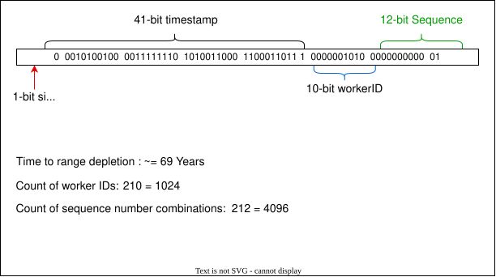

1 / 5

Overview of the division of bits

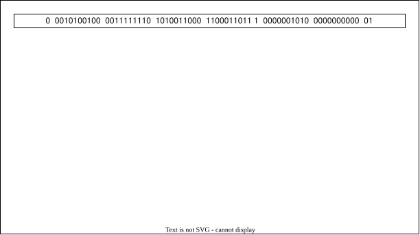

1 / 5

Convert the time to UTC

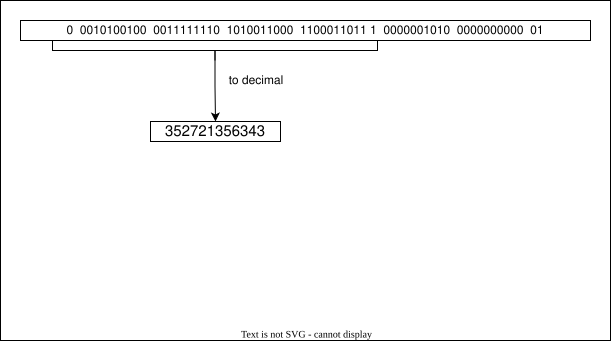

1 / 5

Convert the bits to decimal

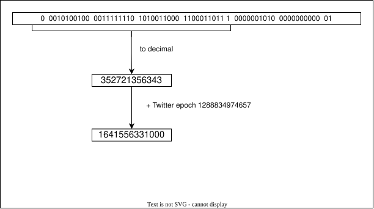

1 / 5

Convert the decimal to epoch

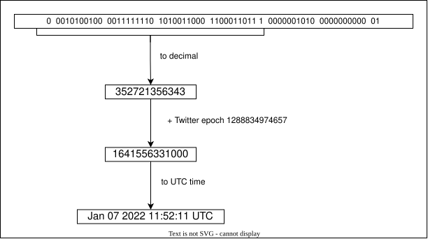

1 / 5

Convert milliseconds to UTC

### Pros[#](https://www.educative.io/courses/grokking-the-system-design-interview/unique-ids-with-causality#Pros-1)

IDs are time-sortable and the generator is highly available.

### Cons[#](https://www.educative.io/courses/grokking-the-system-design-interview/unique-ids-with-causality#Cons-1)

The 41-bit timestamp limits the system's lifespan (approx. 69 years). This range is consumed by the passage of time, regardless of how many IDs are actually generated.

1.

Can you find another shortcoming in the design shown above?

Show Answer

Did you find this helpful?

Reliance on physical time is a weakness. If a server's clock drifts, it may generate IDs for a future time. When the Network Time Protocol (NTP) recalibrates the clock, the system might generate duplicate timestamps or violate causality.

> **Note:** The Network Time Protocol (NTP) synchronizes clocks over variable-latency networks. It aims to keep computers within milliseconds of UTC but is susceptible to network latency and security issues.

Even with high-resolution clocks, the risks of NTP persist. Since physical clocks are unreliable for strict ordering, we often use logical clocks.

The following table compares requirements fulfilled by different design approaches.

## Requirements Fulfilled by Each Approach

|  |  |  |  |  |  |
| --- | --- | --- | --- | --- | --- |
|  | **Unique** | **Scalable** | **Available** | **64-bit Numeric ID** | **Causality Maintained** |
| **Using UUID** | ✖️ | ✔️ | ✔️ | ✖️ | ✖️ |
| **Using a Database** | ✖️ | ✖️ | ✔️ | ✔️ | ✖️ |
| **Using a Range Handler** | ✔️ | ✔️ | ✔️ | ✔️ | ✖️ |
| **Using UNIX Timestamps** | ✖️ | **weak** | ✔️ | ✔️ | **weak** |
| **Using Twitter Snowflake** | ✔️ | ✔️ | ✔️ | ✔️ | **weak** |

## Using logical clocks[#](https://www.educative.io/courses/grokking-the-system-design-interview/unique-ids-with-causality#Using-logical-clocks)

Logical clocks, such as Lamport clocks and vector clocks, rely on monotonically increasing counters rather than wall-clock time.

### Lamport clocks[#](https://www.educative.io/courses/grokking-the-system-design-interview/unique-ids-with-causality#Lamport-clocks)

**Lamport clocks** are a logical time mechanism used to establish a partial ordering of events in a distributed system. Each process maintains a counter, initialized to zero, which is incremented before every local event. When a process sends a message, it includes its current counter value as a timestamp. Upon receiving a message, the recipient process sets its clock to max(local clock, received timestamp) + 1\text{max(local clock, received timestamp) + 1}max(local clock, received timestamp) + 1 before recording the message-receipt event. This mechanism guarantees that if event `a` causally precedes event `b`, then the logical timestamp assigned to `a` will be less than that of `b`.

Lamport clocks provide a partial ordering of events that is consistent with the happened-before relationship. A total order can be derived by breaking ties with node or process identifiers, but the resulting order depends on the chosen identifier assignment. However, Lamport clocks cannot fully capture causality across all events in the system. As a result, comparing two Lamport timestamps alone is insufficient to determine whether a happened-before relationship exists. Vector clocks address this limitation by explicitly tracking causal dependencies.

### Vector clocks[#](https://www.educative.io/courses/grokking-the-system-design-interview/unique-ids-with-causality#Vector-clocks)

Vector clocks maintain causal history, meaning they capture happened-before relationships between events. An efficient data structure is required to represent the causal history of each event. Consider the following design. The identifier is generated by concatenating relevant fields, similar to the Snowflake format, using the following bit allocation:

- **Sign bit:** A single bit is assigned as a sign bit, and its value will always be zero.
- **Vector clock:** This is 53 bits, and the counters of each node.
- **Worker number:** This is 10 bits. It gives us 210=1,0242^{10} = 1,024210=1,024 worker IDs.

The following slides explain the unique ID generation using vector clocks, where the nodes A, B, and C reside in a data center.

> **Note:** In the following slides, we haven’t converted the data to bits for the sake of understanding. The pattern we’ll use for the unique ID is the following:
>
> ```
> [vector-clock][worker-id]
> ```

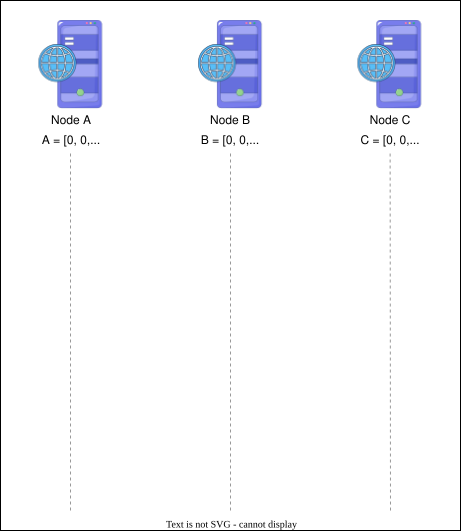

1 / 14

No event is currently in progress

![Unique ID for A1: [1,0,0][A]](https://www.educative.io/api/collection/10370001/4941429335392256/page/5836711686307840/image/5377420538478592?page_type=collection_lesson&get_optimised=true&slide_id=5311417863438336&collection_token=vxC7RH00gFj9nkl254oZpx "Unique ID for A1: [1,0,0][A]")

1 / 14

Unique ID for A1: [1,0,0][A]

![Unique ID for C1: [0,0,1][C]](https://www.educative.io/api/collection/10370001/4941429335392256/page/5836711686307840/image/5156417258455040?page_type=collection_lesson&get_optimised=true&slide_id=5311417863438336&collection_token=vxC7RH00gFj9nkl254oZpx "Unique ID for C1: [0,0,1][C]")

1 / 14

Unique ID for C1: [0,0,1][C]

![Unique ID for B1: [1,1,0][B]](https://www.educative.io/api/collection/10370001/4941429335392256/page/5836711686307840/image/4834959525216256?page_type=collection_lesson&get_optimised=true&slide_id=5311417863438336&collection_token=vxC7RH00gFj9nkl254oZpx "Unique ID for B1: [1,1,0][B]")

1 / 14

Unique ID for B1: [1,1,0][B]

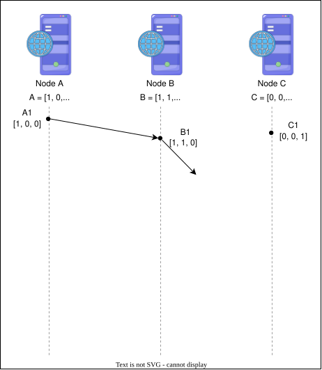

1 / 14

No new ID needs to be assigned

Vector clocks capture full causal history but require a vector size of nnn (where nnn is the number of nodes). In large systems, or systems where every client (e.g., web browser) is a node, the storage and bandwidth requirements become prohibitive.

## Requirements Fulfilled by Each Approach

|  |  |  |  |  |  |
| --- | --- | --- | --- | --- | --- |
|  | **Unique** | **Scalable** | **Available** | **64-bit Numeric ID** | **Causality Maintained** |
| **Using UUID** | ✖️ | ✔️ | ✔️ | ✖️ | ✖️ |
| **Using a Database** | ✖️ | ✖️ | ✔️ | ✔️ | ✖️ |
| **Using a Range Handler** | ✔️ | ✔️ | ✔️ | ✔️ | ✖️ |
| **Using UNIX timestamps** | ✖️ | **weak** | ✔️ | ✔️ | **weak** |
| **Using Twitter Snowflake** | ✔️ | ✔️ | ✔️ | ✔️ | **weak** |
| **Using Vector Clocks** | ✔️ | **weak** | ✔️ | **can exceed** | ✔️ |

1.

Would a global clock help solve our problem?

Show Answer

Did you find this helpful?

## TrueTime API[#](https://www.educative.io/courses/grokking-the-system-design-interview/unique-ids-with-causality#TrueTime-API)

Google’s TrueTime API in Spanner offers an alternative. Instead of a specific timestamp, the API returns a time interval `[earliest, latest]`.

The system guarantees that the actual time lies within this interval. Google uses GPS receivers and atomic clocks in data centers to keep the uncertainty (epsilon) minimal (typically < 7ms).

The following slides explain how TrueTime’s time master servers work with GPS and atomic clocks.

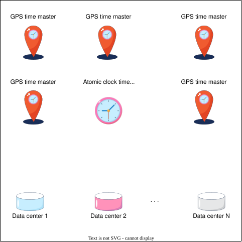

1 / 5

In every data center, we have time handlers. GPS timemasters have GPS receivers attached, and few of them have atomic clocks

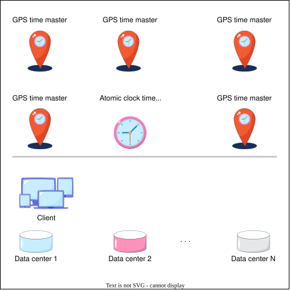

1 / 5

A client needs a TrueTime

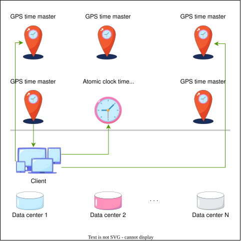

1 / 5

A client runs a daemon. The daemon contacts mostly GPS time masters and sometimes will contact atomic clock time masters to get the redundancy of different time references

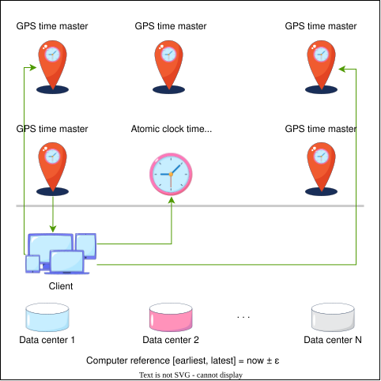

1 / 5

We run Marzullo's algorithm, which intersects time intervals to determine a time reference. The API gives an interval from earliest to latest


1 / 5

The time reference will express a given interval as plus or minus epsilon

The following slides explain how time is calculated when the client asks to give TrueTime.

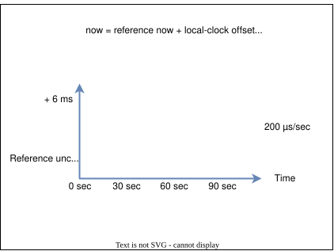

1 / 7

Before the client asks for TrueTime

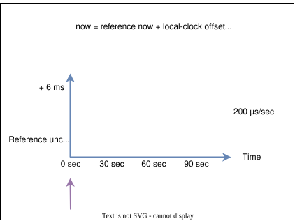

1 / 7

Compute epsilon at time zero

 on to the value of epsilon over 30 seconds")

1 / 7

We’ll assume that the clock drifts at most, 200 microseconds per second. This means we’ll roughly add 6 milliseconds (ms) on to the value of epsilon over 30 seconds

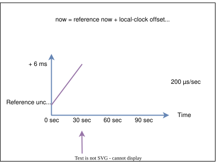

1 / 7

Compute epsilon at 30 seconds

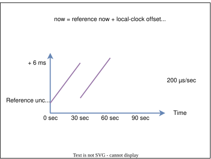

1 / 7

In the next 30 seconds, we communicate to the time master as reference uncertainty is computed, and it increases at the rate of 200 microseconds per second

Spanner guarantees order if intervals do not overlap. If Aearliest\text{A}\_\text{{earliest}}Aearliest​ < Alatest\text{A}\_\text{{latest}}Alatest​< Bearliest\text{B}\_\text{{earliest}}Bearliest​ < Blatest\text{B}\_\text{{latest}}Blatest​), then B definitely happened after A.

We can generate unique IDs using TrueTime intervals:

- **Time stamp:** 41 bits, uses the earliest time (TE​\text{T}\_\text{{E​}}TE​​) of the interval.
- **Uncertainty:** 4 bits, stores the interval width (epsilon).
- **Worker number:** 10 bits, supports 2102^{10}210 = 1,024 worker IDs.
- **Sequence number:** 8 bits, supports 282^{8}28 = 256 combinations, resetting to zero when the limit is reached.


Node B generating a unique ID for its event using TrueTime

### Pros[#](https://www.educative.io/courses/grokking-the-system-design-interview/unique-ids-with-causality#Pros-2)

Generates globally unique, 64-bit identifiers that maintain causality. The system is scalable and highly available.

### Cons[#](https://www.educative.io/courses/grokking-the-system-design-interview/unique-ids-with-causality#Cons-2)

If clock uncertainty intervals overlap, the relative order of events cannot be determined with confidence. The required infrastructure, such as atomic clocks and GPS receivers, is costly and operationally complex. The updated table compares different system designs for unique ID generation.

## Requirements Fulfilled by Each Approach

|  |  |  |  |  |  |
| --- | --- | --- | --- | --- | --- |
|  | **Unique** | **Scalable** | **Available** | **64-bit numeric ID** | **Causality maintained** |
| **Using UUID** | ✖️ | ✔️ | ✔️ | ✖️ | ✖️ |
| **Using a database** | ✖️ | ✖️ | ✔️ | ✔️ | ✖️ |
| **Using a range handler** | ✔️ | ✔️ | ✔️ | ✔️ | ✖️ |
| **Using UNIX time stamps** | ✖️ | **weak** | ✔️ | ✔️ | **weak** |
| **Using Twitter Snowflake** | ✔️ | ✔️ | ✔️ | ✔️ | **weak** |
| **Using vector clocks** | ✔️ | **weak** | ✔️ | **can exceed** | ✔️ |
| **Using TrueTime** | ✔️ | ✔️ | ✔️ | ✔️ | **weak** |

AI Powered

Saved

10 attempts left

Reset

Clock drift issues

Hi, I’m Ed. In this session, we will focus on some questions related to clock drift issues. Do you want to be mentored or evaluated?

You have 10 attempts to answer.

## Summary[#](https://www.educative.io/courses/grokking-the-system-design-interview/unique-ids-with-causality#Summary)

- Duplicate identifiers can cause critical errors (e.g., duplicate payments).
- UUIDs offer probabilistic uniqueness; deterministic uniqueness often requires slower consensus mechanisms.
- Large keys slow down database updates; identifiers should be compact.
- Random bits in IDs prevent external parties from guessing business metrics (e.g., order volume).
- Simple counters are faster than timestamps but require persistent storage, creating potential bottlenecks and SPOFs.
- Monotonically increasing IDs can create “hotspots” in distributed databases like Spanner, reducing performance.

> **Note:** Enforcing a strict global order on events is costly in distributed systems. Centralized auto-increment ID generation is simple in a single-node database but requires distributed consensus in multi-node systems, which increases latency and coordination overhead. Google Spanner reports that single-row read-modify-write transactions can limit sequence generation to approximately 100 operations per second. Relaxing strict global ordering constraints can significantly improve throughput and reduce coordination costs.

Design of a Unique ID Generator

System Design: Distributed Monitoring

Ask

[Causality](https://www.educative.io/courses/grokking-the-system-design-interview/unique-ids-with-causality#Causality)

[Use UNIX time stamps](https://www.educative.io/courses/grokking-the-system-design-interview/unique-ids-with-causality#Use-UNIX-time-stamps)

[Pros](https://www.educative.io/courses/grokking-the-system-design-interview/unique-ids-with-causality#Pros)

[Cons](https://www.educative.io/courses/grokking-the-system-design-interview/unique-ids-with-causality#Cons)

[Twitter Snowflake](https://www.educative.io/courses/grokking-the-system-design-interview/unique-ids-with-causality#Twitter-Snowflake)

[Pros](https://www.educative.io/courses/grokking-the-system-design-interview/unique-ids-with-causality#Pros-1)

[Cons](https://www.educative.io/courses/grokking-the-system-design-interview/unique-ids-with-causality#Cons-1)

[Using logical clocks](https://www.educative.io/courses/grokking-the-system-design-interview/unique-ids-with-causality#Using-logical-clocks)

[Lamport clocks](https://www.educative.io/courses/grokking-the-system-design-interview/unique-ids-with-causality#Lamport-clocks)

[Vector clocks](https://www.educative.io/courses/grokking-the-system-design-interview/unique-ids-with-causality#Vector-clocks)

[TrueTime API](https://www.educative.io/courses/grokking-the-system-design-interview/unique-ids-with-causality#TrueTime-API)

[Pros](https://www.educative.io/courses/grokking-the-system-design-interview/unique-ids-with-causality#Pros-2)

[Cons](https://www.educative.io/courses/grokking-the-system-design-interview/unique-ids-with-causality#Cons-2)

[Summary](https://www.educative.io/courses/grokking-the-system-design-interview/unique-ids-with-causality#Summary)