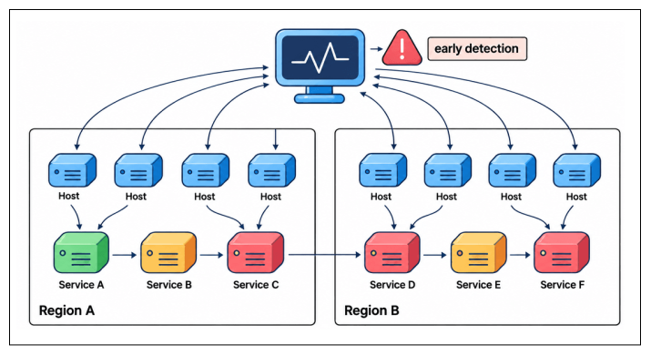

# System_Design_Distributed_Monitoring

Source: https://www.educative.io/courses/grokking-the-system-design-interview/system-design-distributed-monitoring

---

[Home](https://www.educative.io/)

[Courses](https://www.educative.io/search?tab=courses)

[Grokking Modern System Design Interview](https://www.educative.io/courses/grokking-the-system-design-interview)

# System Design: Distributed Monitoring

Discover why distributed monitoring is essential for maintaining complex, distributed IT infrastructure and meeting service-level agreements. Learn the strategic high-level plan for designing a robust System Design solution to gather data, debug failures, and ensure continuous operation.

We'll cover the following...

- [Monitoring](https://www.educative.io/courses/grokking-the-system-design-interview/system-design-distributed-monitoring#Monitoring)
- [How will we design a distributed monitoring system?](https://www.educative.io/courses/grokking-the-system-design-interview/system-design-distributed-monitoring#How-will-we-design-a-distributed-monitoring-system)

## Monitoring[#](https://www.educative.io/courses/grokking-the-system-design-interview/system-design-distributed-monitoring#Monitoring)

Modern IT infrastructure depends on the continuous availability of hardware, distributed services, and network resources. The interdependencies between these components make it difficult to maintain service reliability and avoid application downtime.

Observability becomes challenging when infrastructure spans multiple regions and hosts. Common issues include component failures, elevated latency, resource saturation, and container-level exhaustion. In complex, multi-service environments, failures are inevitable.

One failed service can cascade; monitoring detects it before users are affected

A single service failure can trigger cascading crashes, rendering the application unavailable. Without early detection, manual debugging becomes time-consuming and costly. Furthermore, large-scale systems must operate within agreed service level agreements (SLAs). We need to identify trends and warning signals early to address issues before they escalate. Monitoring provides visibility into complex infrastructure where failures are frequent. In distributed systems, monitoring involves gathering, interpreting, and displaying data on process interactions. This facilitates debugging and performance evaluation and provides a comprehensive view across multiple services.

## How will we design a distributed monitoring system?[#](https://www.educative.io/courses/grokking-the-system-design-interview/system-design-distributed-monitoring#How-will-we-design-a-distributed-monitoring-system)

We have organized the System Design for distributed monitoring into the following chapters and lessons:

1. **Distributed monitoring:**

   1. [**Introduction to distributed monitoring**](https://www.educative.io/courses/grokking-the-system-design-interview/introduction-to-distributed-monitoring)**:** Understand the importance of monitoring, the cost of downtime, and monitoring types.
   2. [**Prerequisites for a monitoring system**](https://www.educative.io/courses/grokking-the-system-design-interview/prerequisites-of-a-monitoring-system)**:** Explore essential concepts regarding metrics and alerting.
2. **Monitoring server-side errors:**

   1. [**Designing a monitoring system**](https://www.educative.io/courses/grokking-the-system-design-interview/design-of-a-monitoring-system)**:** Define requirements and the high-level design.
   2. [**A detailed design of the monitoring system**](https://www.educative.io/courses/grokking-the-system-design-interview/detailed-design-of-a-monitoring-system)**:** Examine the detailed design and components involved.
   3. [**Visualize data in a monitoring system**](https://www.educative.io/courses/grokking-the-system-design-interview/visualize-data-in-a-monitoring-system)**:** Learn methods to visualize massive amounts of monitoring data.
3. **Monitor client-side errors:**

   1. [**Focus on client-side errors**](https://www.educative.io/courses/grokking-the-system-design-interview/focus-on-client-side-errors-in-a-monitoring-system)**:** Introduction to client-side errors and the importance of monitoring them.
   2. [**Design a client-side monitoring system**](https://www.educative.io/courses/grokking-the-system-design-interview/design-of-a-client-side-monitoring-system)**:** Design a system for monitoring client-side errors.

The next lesson explains the role of monitoring in distributed systems using a concrete example. It also covers the costs of downtime and the different types of monitoring.

Unique IDs with Causality

Introduction to Distributed Monitoring

Ask

[Monitoring](https://www.educative.io/courses/grokking-the-system-design-interview/system-design-distributed-monitoring#Monitoring)

[How will we design a distributed monitoring system?](https://www.educative.io/courses/grokking-the-system-design-interview/system-design-distributed-monitoring#How-will-we-design-a-distributed-monitoring-system)