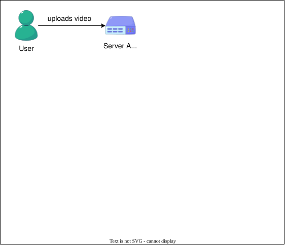
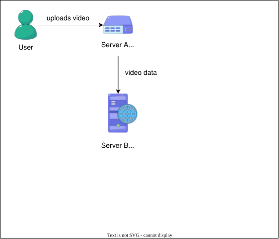
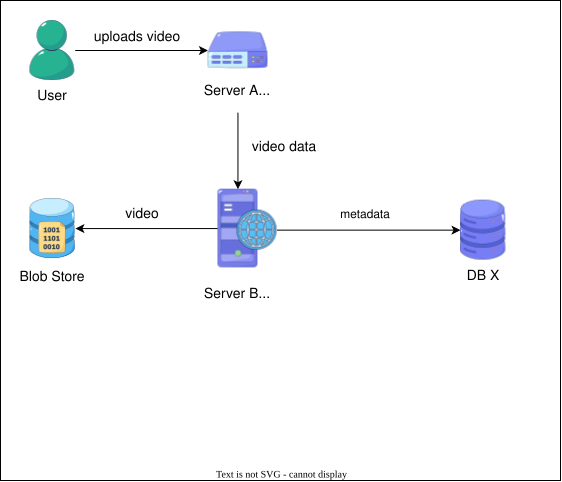
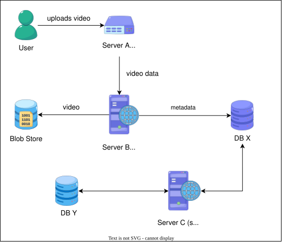
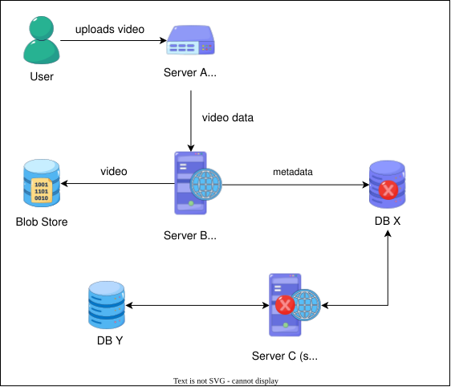
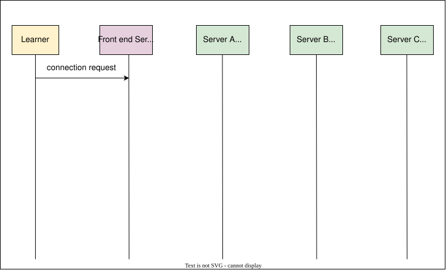
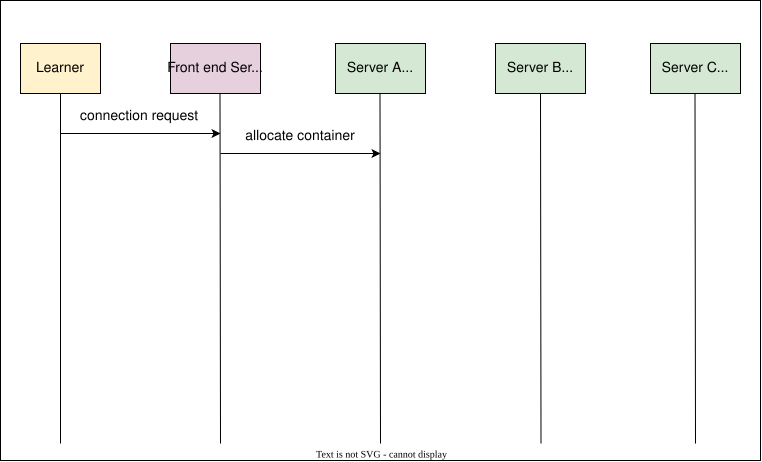
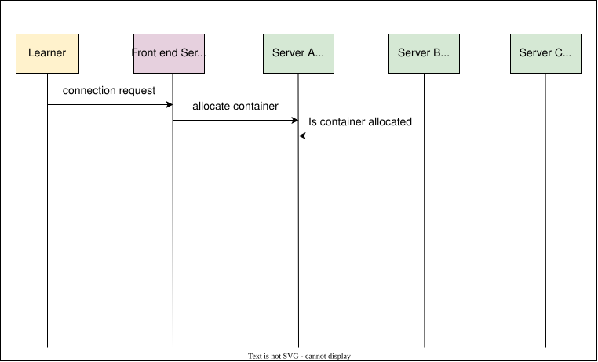
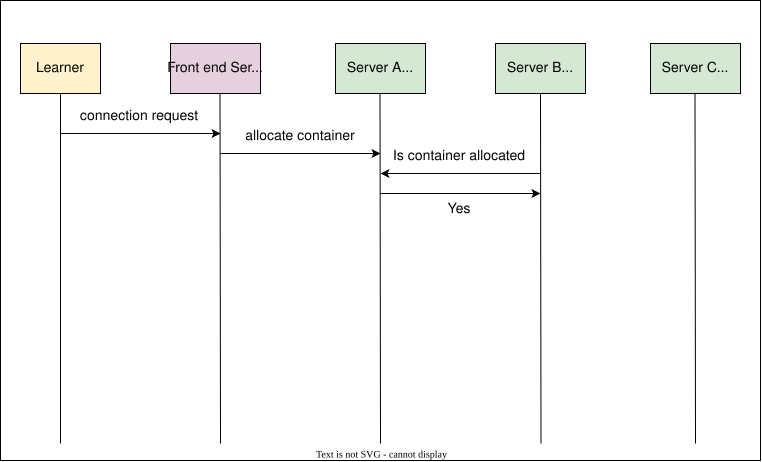
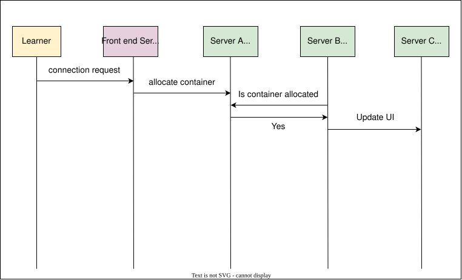

# Introduction_to_Distributed_Monitoring

Source: https://www.educative.io/courses/grokking-the-system-design-interview/introduction-to-distributed-monitoring

---

[Home](https://www.educative.io/)

[Courses](https://www.educative.io/search?tab=courses)

[Grokking Modern System Design Interview](https://www.educative.io/courses/grokking-the-system-design-interview)

# Introduction to Distributed Monitoring

Explain the role of distributed monitoring in system design for preventing cascading failures and outages. Define the two primary fault categories: server-side errors and client-side errors. Describe how effective monitoring reduces operational costs and improves system reliability.

We'll cover the following...

- [Need for monitoring](https://www.educative.io/courses/grokking-the-system-design-interview/introduction-to-distributed-monitoring#Need-for-monitoring)
  - [Downtime cost](https://www.educative.io/courses/grokking-the-system-design-interview/introduction-to-distributed-monitoring#Downtime-cost)
  - [Types of monitoring](https://www.educative.io/courses/grokking-the-system-design-interview/introduction-to-distributed-monitoring#Types-of-monitoring)

## Need for monitoring[#](https://www.educative.io/courses/grokking-the-system-design-interview/introduction-to-distributed-monitoring#Need-for-monitoring)

A single service failure can disrupt the execution of dependent systems. To prevent cascading failures, monitoring provides early warnings and helps identify the root cause of faults.

Consider a scenario where a user uploads a video, `intro-to-system-design`, to YouTube:

- The `UI` service (server A) receives the video and passes data to service 2 (server B).
- Service 2 writes to the database and stores the video in blob storage.
- Service 3 (server C) manages replication between database X and database Y.

If service 3 fails, the replication pipeline is interrupted. Service 2 continues to write data to database X. If database X subsequently crashes, read requests are redirected to database Y. Because replication was interrupted, database Y does not contain the latest data, resulting in a “Video not found” error.

1 / 15

The user uploads a video on YouTube

1 / 15

The UI service in server A takes the video information and gives the data to service 2 in server B

1 / 15

Service 2 makes an entry in the database and stores the video in blob storage

1 / 15

Service 3 in server C manages the synchronization of databases X and Y

1 / 15

Service 3 fails due to an error, and service 2 makes an entry in the database X

Modern production systems span global data centers and can include millions of servers. As the administrator-to-server ratio decreases, manual debugging does not scale. Automated monitoring is required to control operational costs and detect failures at scale.

### Downtime cost[#](https://www.educative.io/courses/grokking-the-system-design-interview/introduction-to-distributed-monitoring#Downtime-cost)

Although fault-tolerant designs mask certain failures from end users, engineers must detect and remediate issues before they escalate. Unplanned outages can result in significant financial and reputational costs. For example, in October 2021, a major social media platform experienced an outage of nearly nine hours, with reported losses of approximately $13 million per hour.

Modern IT infrastructure connects geo-separated data centers via private or public networks. Monitoring these distributed connections is critical to maintaining availability.

On December 7, 2021, an AWS outage highlighted the cost of cascading network failures. An automated scaling activity triggered unexpected client behavior, causing a surge in connection attempts. This overwhelmed network devices, increased latency, and triggered a retry storm that congested the network. Estimates place the cost of this outage at $66,240 per minute.

Approximate locations of globally distributed data centers operated by AWS, Azure, and Google

### Types of monitoring[#](https://www.educative.io/courses/grokking-the-system-design-interview/introduction-to-distributed-monitoring#Types-of-monitoring)

To understand what to monitor, consider an example at Educative. When a learner connects to an executable environment:

- Service 1 (server A) allocates a container.
- Service 2 (server B) relays this information to the UI service.
- The UI service (server C) updates the learner's interface.

If service 2 fails, the learner sees a “Cannot connect” error. How do developers identify that a learner is facing this specific issue?

1 / 14

The learner initiates a connection request to Educative

1 / 14

Educative's front-end server initiates allocate container request

1 / 14

Service 2 in server B allocates a container and informs service 1 in server A

1 / 14

Service 1 in server A acknowledges the allocation

1 / 14

Service 3 in server C receives the request to update the UI for the learner

Furthermore, if a learner's request never reaches the servers due to network issues, the server logs will show nothing. How does the system detect this?

We categorize monitoring focus into two broad types:

- **Server-side errors:** Errors that occur on the server and are visible to monitoring services. These are typically reported as `5xx` HTTP response codes.
- **Client-side errors:** Errors originating on the client side, such as network failures or bad requests. These are reported as `4xx` HTTP response codes. Some client-side errors are invisible to the service if the request fails to reach the backend.

AI Powered

Saved

15 attempts left

Reset

Distributed monitoring

Hi, I’m Ed. In this session, we will focus on some questions related to distributed monitoring. Do you want to be mentored or evaluated?”

You have 15 attempts to answer.

We will explore the design of monitoring services for these scenarios in the upcoming chapters: [Monitor Server-side Errors](https://www.educative.io/courses/grokking-the-system-design-interview/design-of-a-monitoring-system) and [Monitor Client-side Errors](https://www.educative.io/courses/grokking-the-system-design-interview/focus-on-client-side-errors-in-a-monitoring-system). A robust monitoring system analyzes globally distributed services to provide deep visibility and the agility to respond to faults.

System Design: Distributed Monitoring

Prerequisites of a Monitoring System

Ask

[Need for monitoring](https://www.educative.io/courses/grokking-the-system-design-interview/introduction-to-distributed-monitoring#Need-for-monitoring)

[Downtime cost](https://www.educative.io/courses/grokking-the-system-design-interview/introduction-to-distributed-monitoring#Downtime-cost)

[Types of monitoring](https://www.educative.io/courses/grokking-the-system-design-interview/introduction-to-distributed-monitoring#Types-of-monitoring)