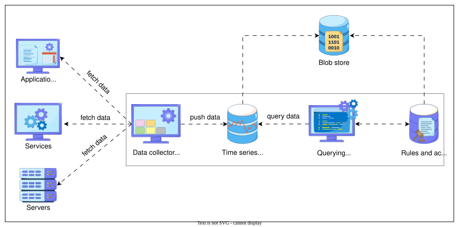
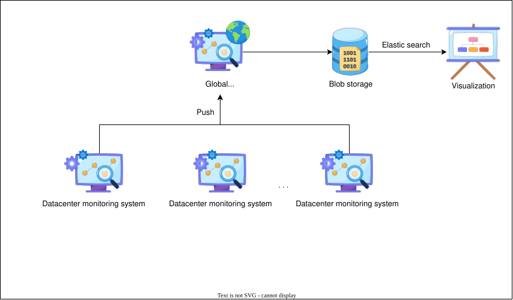
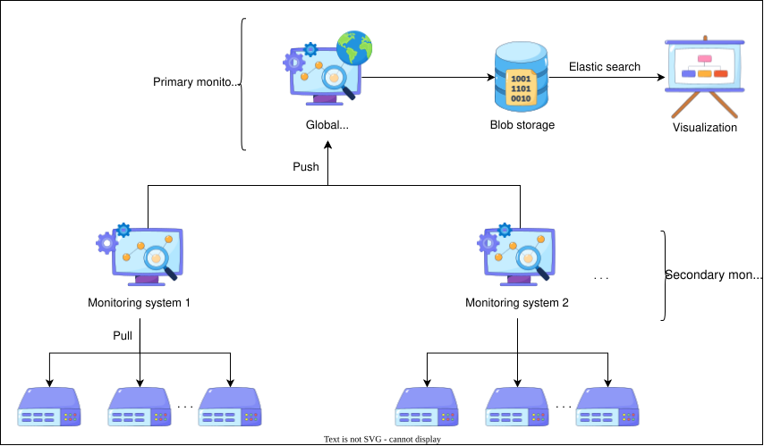

# Detailed_Design_of_a_Monitoring_System

Source: https://www.educative.io/courses/grokking-the-system-design-interview/detailed-design-of-a-monitoring-system

---

[Home](https://www.educative.io/)

[Courses](https://www.educative.io/search?tab=courses)

[Grokking Modern System Design Interview](https://www.educative.io/courses/grokking-the-system-design-interview)

# Detailed Design of a Monitoring System

Define the core components of a distributed monitoring system, such as the data collector, service discoverer, and alert manager. Analyze the drawbacks of simple pull-based architectures, like SPOF and scaling limits. Implement a hybrid pull/push hierarchical pattern to ensure the monitoring System Design scales globally.

We'll cover the following...

- [Storage](https://www.educative.io/courses/grokking-the-system-design-interview/detailed-design-of-a-monitoring-system#Storage)
- [Data collector](https://www.educative.io/courses/grokking-the-system-design-interview/detailed-design-of-a-monitoring-system#Data-collector)
  - [Service discoverer](https://www.educative.io/courses/grokking-the-system-design-interview/detailed-design-of-a-monitoring-system#Service-discoverer)
- [Querying Service](https://www.educative.io/courses/grokking-the-system-design-interview/detailed-design-of-a-monitoring-system#Querying-Service)
  - [Alert Manager](https://www.educative.io/courses/grokking-the-system-design-interview/detailed-design-of-a-monitoring-system#Alert-Manager)
  - [Dashboard](https://www.educative.io/courses/grokking-the-system-design-interview/detailed-design-of-a-monitoring-system#Dashboard)
- [Pros](https://www.educative.io/courses/grokking-the-system-design-interview/detailed-design-of-a-monitoring-system#Pros)
- [Cons](https://www.educative.io/courses/grokking-the-system-design-interview/detailed-design-of-a-monitoring-system#Cons)
- [Improving our design](https://www.educative.io/courses/grokking-the-system-design-interview/detailed-design-of-a-monitoring-system#Improving-our-design)

This section defines the core storage components of the monitoring system, identifies design limitations, and refines the architecture to meet the stated requirements.

## Storage[#](https://www.educative.io/courses/grokking-the-system-design-interview/detailed-design-of-a-monitoring-system#Storage)

The system requires three distinct storage mechanisms:

- **Time series database (TSDB):** Stores metrics locally on the monitoring server for fast write and read operations.
- **Blob storage:** Serves as a separate storage node for long-term retention of metric data.
- **Rules database:** We also need to store alert configurations. For example, if CPU usage exceeds 90%, the system must trigger an alert to the administrator. This requires a rules database to store rules and their corresponding actions.

In summary, we have added a rules database for actionable logic and a blob store for data persistence.

Adding blob storage and a rules and action database

## Data collector[#](https://www.educative.io/courses/grokking-the-system-design-interview/detailed-design-of-a-monitoring-system#Data-collector)

The **data collector** gathers metrics from services across various data centers using a pull strategy. It extracts relevant metrics from application logs via a [distributed messaging queue](https://www.educative.io/courses/grokking-the-system-design-interview/system-design-the-distributed-messaging-queue). Each message contains the service name, ID, and a log description, allowing the collector to identify and store specific metrics in the time series database.

A real-world example of this pull-based approach is DigitalOcean, which monitors millions of globally dispersed machines.

1.

What are some drawbacks of using a push-based approach?

Show Answer

Did you find this helpful?

### Service discoverer[#](https://www.educative.io/courses/grokking-the-system-design-interview/detailed-design-of-a-monitoring-system#Service-discoverer)

To pull metrics, the data collector must discover the network endpoints of active service instances. Because services scale dynamically, static target lists are insufficient. A service discovery component tracks active instances by integrating with platforms such as EC2, Kubernetes, or Consul. The data collector queries this component to determine which targets to scrape, ensuring newly provisioned instances are monitored automatically.

We add this component to the design to automate target discovery.

Adding the service discoverer

## Querying Service[#](https://www.educative.io/courses/grokking-the-system-design-interview/detailed-design-of-a-monitoring-system#Querying-Service)

The querying service fetches data from the database to support visualization and alerting. It allows users to view specific metrics, such as memory usage on a node, or check if values exceed defined limits.

### Alert Manager[#](https://www.educative.io/courses/grokking-the-system-design-interview/detailed-design-of-a-monitoring-system#Alert-Manager)

The alert manager monitors metrics against the rules defined in the rules database. If a rule is violated, it triggers notifications via channels like email or Slack.

### Dashboard[#](https://www.educative.io/courses/grokking-the-system-design-interview/detailed-design-of-a-monitoring-system#Dashboard)

Dashboards visualize collected metrics, providing a high-level view of system health (e.g., request counts over the current week).

These components complete the functional design of the monitoring system.

Detailed design of monitoring system

This comprehensive monitoring service tracks systems actively, stores data, and supports search, visualization, and alerting.

## Pros[#](https://www.educative.io/courses/grokking-the-system-design-interview/detailed-design-of-a-monitoring-system#Pros)

- Ensures smooth operations by detecting signs of impending problems early.
- Prevents network congestion by controlling data flow via the pull model.
- Provides high availability for monitoring data.

## Cons[#](https://www.educative.io/courses/grokking-the-system-design-interview/detailed-design-of-a-monitoring-system#Cons)

- A dedicated monitoring server creates a single point of failure (SPOF). While a failover server improves reliability, a single server cannot scale indefinitely as the number of monitored nodes increases.
- Storing high-resolution data indefinitely is resource-intensive. The system requires retention policies to periodically delete or downsample old data.

We must address these scalability and storage issues.

## Improving our design[#](https://www.educative.io/courses/grokking-the-system-design-interview/detailed-design-of-a-monitoring-system#Improving-our-design)

The design must scale efficiently and implement clear data retention policies. The following section describes the push-based approach. In this model, applications send metrics directly to the monitoring system.

Push-based monitoring system

We initially used a pull-based strategy to avoid network congestion and decouple applications from the monitoring logic. To scale effectively, we will adopt a **hybrid approach** that combines pull and push strategies in a hierarchy:

1. **Local pull:** We assign “secondary” monitoring servers to specific clusters (e.g., one server monitoring 5,000 nodes). These servers pul**l** data from local nodes.
2. **Global push:** The secondary servers push aggregated data to a primary data center server. This primary server then pushes data to a global monitoring service responsible for all data centers.

This hierarchy distributes the load. We use blob storage for bulk data, Elasticsearch for search, and a visualizer for analytics. As the number of servers increases, we simply add more secondary monitoring nodes.

> **Note:** Using a hierarchy of systems is a common pattern for scalability. Increasing nodes at a specific level or adding new levels allows the system to adapt to growing demand.

1 / 2

The data center monitoring systems push the data to the global monitoring system

1 / 2

The data center monitoring systems push the data to the global monitoring system

1.

What happens if a local or global monitoring system is down?

Show Answer

1 / 2

Even with summarization, the volume of monitoring data is massive. Next, we will discuss how to effectively present this data to human administrators.

Design of a Monitoring System

Visualize Data in a Monitoring System

Ask

[Storage](https://www.educative.io/courses/grokking-the-system-design-interview/detailed-design-of-a-monitoring-system#Storage)

[Data collector](https://www.educative.io/courses/grokking-the-system-design-interview/detailed-design-of-a-monitoring-system#Data-collector)

[Service discoverer](https://www.educative.io/courses/grokking-the-system-design-interview/detailed-design-of-a-monitoring-system#Service-discoverer)

[Querying Service](https://www.educative.io/courses/grokking-the-system-design-interview/detailed-design-of-a-monitoring-system#Querying-Service)

[Alert Manager](https://www.educative.io/courses/grokking-the-system-design-interview/detailed-design-of-a-monitoring-system#Alert-Manager)

[Dashboard](https://www.educative.io/courses/grokking-the-system-design-interview/detailed-design-of-a-monitoring-system#Dashboard)

[Pros](https://www.educative.io/courses/grokking-the-system-design-interview/detailed-design-of-a-monitoring-system#Pros)

[Cons](https://www.educative.io/courses/grokking-the-system-design-interview/detailed-design-of-a-monitoring-system#Cons)

[Improving our design](https://www.educative.io/courses/grokking-the-system-design-interview/detailed-design-of-a-monitoring-system#Improving-our-design)