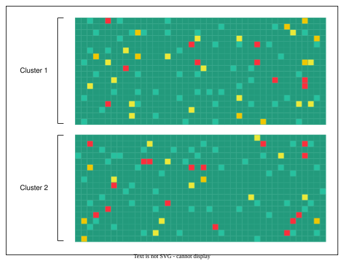

# Visualize_Data_in_a_Monitoring_System

Source: https://www.educative.io/courses/grokking-the-system-design-interview/visualize-data-in-a-monitoring-system

---

[Home](https://www.educative.io/)

[Courses](https://www.educative.io/search?tab=courses)

[Grokking Modern System Design Interview](https://www.educative.io/courses/grokking-the-system-design-interview)

# Visualize Data in a Monitoring System

Define the visualization challenges of monitoring millions of servers in large-scale System Design. Learn to implement heat maps as a compact, color-coded method for displaying the operational state of thousands of components. Use this technique to identify and troubleshoot nonresponsive servers rapidly.

We'll cover the following...

- [Using heat maps to troubleshoot](https://www.educative.io/courses/grokking-the-system-design-interview/visualize-data-in-a-monitoring-system#Using-heat-maps-to-troubleshoot)
- [Summary](https://www.educative.io/courses/grokking-the-system-design-interview/visualize-data-in-a-monitoring-system#Summary)

Large data centers can contain millions of servers, making health visualization difficult at scale. Operators must quickly determine which servers are healthy and which are unreachable. Heat maps address this challenge by visualizing the status of thousands of servers in a compact format.

A **heat map** visualizes data magnitude in two dimensions using color intensity.

## Using heat maps to troubleshoot[#](https://www.educative.io/courses/grokking-the-system-design-interview/visualize-data-in-a-monitoring-system#Using-heat-maps-to-troubleshoot)

Heat maps help identify downed servers efficiently. We sort servers by data center, cluster, and row. This hierarchy makes problems at specific physical or logical levels immediately apparent.

In this matrix, each cell represents the health of a component. Green cells indicate normal operation, while red cells indicate nodes that are non-responsive after multiple attempts. The heat map below displays the state of these servers.

Viewing servers in a data center using heat maps

Heat maps are effective for visualizing globally distributed systems. Using a single bit to represent server health (1 for healthy, 0 for unreachable), 1,000,000 servers require approximately 125 KB of storage `(1,000,000 bits ÷ 8 bits per byte)`. This compact representation enables operators to quickly identify unhealthy regions and isolate failures.

This visualization technique extends to other resources, including filesystems, network switches, and links.

AI Powered

Saved

12 attempts left

Reset

Visualize data in a monitoring system

Hi, I’m Ed. In this session, we will focus on some questions related to visualizing data in monitoring systems. Do you want to be mentored or evaluated?

You have 12 attempts to answer.

## Summary[#](https://www.educative.io/courses/grokking-the-system-design-interview/visualize-data-in-a-monitoring-system#Summary)

- Monitoring systems are critical for analyzing distributed systems and alerting operators when problems occur.
- Scalable monitoring systems often use a hybrid of push and pull data collection methods.
- Heat maps provide compact visualization, allowing engineers to assess the health of thousands of servers at a glance.

Detailed Design of a Monitoring System

Focus on Client-Side Errors in a Monitoring System

Ask

[Using heat maps to troubleshoot](https://www.educative.io/courses/grokking-the-system-design-interview/visualize-data-in-a-monitoring-system#Using-heat-maps-to-troubleshoot)

[Summary](https://www.educative.io/courses/grokking-the-system-design-interview/visualize-data-in-a-monitoring-system#Summary)