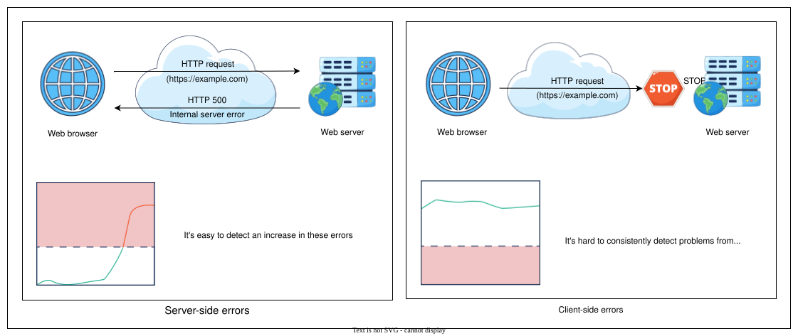
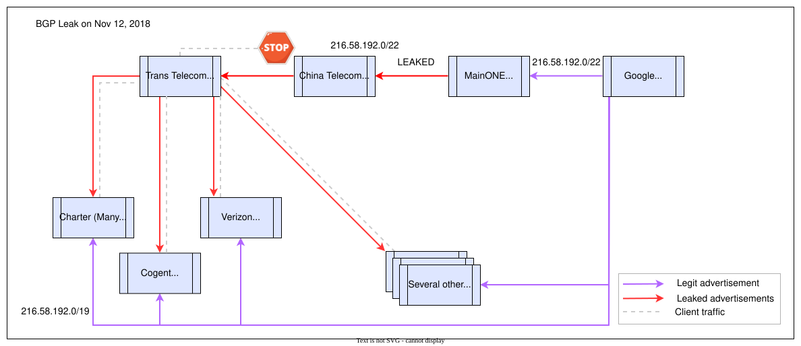

# Focus_on_Client-Side_Errors_in_a_Monitoring_System

Source: https://www.educative.io/courses/grokking-the-system-design-interview/focus-on-client-side-errors-in-a-monitoring-system

---

[Home](https://www.educative.io/)

[Courses](https://www.educative.io/search?tab=courses)

[Grokking Modern System Design Interview](https://www.educative.io/courses/grokking-the-system-design-interview)

# Focus on Client-Side Errors in a Monitoring System

Understand the critical difference between internal server errors and client-side failures, such as routing bugs or DNS issues. Learn why these external problems are often invisible to standard server monitoring, necessitating specialized System Design approaches for full availability.

We'll cover the following...

- [Client-side errors](https://www.educative.io/courses/grokking-the-system-design-interview/focus-on-client-side-errors-in-a-monitoring-system#Client-side-errors)
- [Failures due to a routing bug](https://www.educative.io/courses/grokking-the-system-design-interview/focus-on-client-side-errors-in-a-monitoring-system#Failures-due-to-a-routing-bug)

## Client-side errors[#](https://www.educative.io/courses/grokking-the-system-design-interview/focus-on-client-side-errors-in-a-monitoring-system#Client-side-errors)

In distributed systems, clients commonly interact with services over HTTP. Server-side failures can be identified by monitoring web and application server logs for elevated rates of HTTP 500 errors.

However, client-side errors are difficult to detect because the service lacks insight into the client’s environment. While engineers might look for dips in traffic load, this metric is unreliable. It often produces false positives or negatives due to natural load variability or when issues affect only a small segment of users.

Several factors can prevent clients from reaching the server, including:

- DNS resolution failures.
- Routing failures between the client and the service provider.
- Third-party infrastructure failures (e.g., middleboxes or CDNs).

Server-side errors vs. client-side errors

## Failures due to a routing bug[#](https://www.educative.io/courses/grokking-the-system-design-interview/focus-on-client-side-errors-in-a-monitoring-system#Failures-due-to-a-routing-bug)

Consider a real-world case where a service was unaware of a major outage impacting its users. A peer ISP mistakenly announced incorrect BGP routes for a major service provider. This BGP leak redirected customer traffic through unintended networks, preventing it from reaching the intended destination. Although users could not access the service, the provider was not immediately aware of the outage because it originated outside its own infrastructure.

BGP leak

GP route leaks are not isolated incidents. On April 16, 2021, an autonomous system (AS) mistakenly announced more than 30,000 BGP prefixes, resulting in a 13× increase in inbound traffic. Network operators detected the surge and mitigated the misconfiguration. Since traditional infrastructure monitoring may not capture these external routing events, engineers must implement dedicated external connectivity monitoring. The following lessons examine techniques for monitoring client-side connectivity.

Visualize Data in a Monitoring System

Design of a Client-Side Monitoring System

Ask

[Client-side errors](https://www.educative.io/courses/grokking-the-system-design-interview/focus-on-client-side-errors-in-a-monitoring-system#Client-side-errors)

[Failures due to a routing bug](https://www.educative.io/courses/grokking-the-system-design-interview/focus-on-client-side-errors-in-a-monitoring-system#Failures-due-to-a-routing-bug)