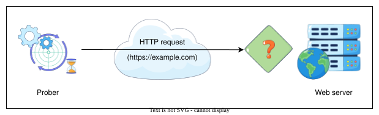
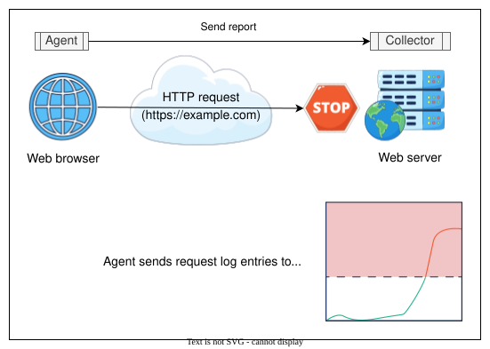

# Design_of_a_Client-Side_Monitoring_System

Source: https://www.educative.io/courses/grokking-the-system-design-interview/design-of-a-client-side-monitoring-system

---

[Home](https://www.educative.io/)

[Courses](https://www.educative.io/search?tab=courses)

[Grokking Modern System Design Interview](https://www.educative.io/courses/grokking-the-system-design-interview)

# Design of a Client-Side Monitoring System

Explore the System Design required to monitor client-side errors outside the service infrastructure. Design an independent agent and collector system that ensures fault tolerance and rapid error detection. Learn to implement user consent and privacy controls for diagnostic data collection.

We'll cover the following...

- [Initial design](https://www.educative.io/courses/grokking-the-system-design-interview/design-of-a-client-side-monitoring-system#Initial-design)
  - [Issues with probers](https://www.educative.io/courses/grokking-the-system-design-interview/design-of-a-client-side-monitoring-system#Issues-with-probers)
- [Improve the design](https://www.educative.io/courses/grokking-the-system-design-interview/design-of-a-client-side-monitoring-system#Improve-the-design)
- [Activate and deactivate reports](https://www.educative.io/courses/grokking-the-system-design-interview/design-of-a-client-side-monitoring-system#Activate-and-deactivate-reports)
- [Reach collectors under faulty conditions](https://www.educative.io/courses/grokking-the-system-design-interview/design-of-a-client-side-monitoring-system#Reach-collectors-under-faulty-conditions)
- [Protect user privacy](https://www.educative.io/courses/grokking-the-system-design-interview/design-of-a-client-side-monitoring-system#Protect-user-privacy)
- [Conclusion](https://www.educative.io/courses/grokking-the-system-design-interview/design-of-a-client-side-monitoring-system#Conclusion)

Servers cannot observe failures that occur before a request reaches their infrastructure. Failures such as DNS resolution errors or ISP outages affect users directly, who may rely on external channels to confirm the issue. This reactive feedback loop is insufficient for timely incident response. Service providers require external monitoring to detect these issues in near real time.

## Initial design[#](https://www.educative.io/courses/grokking-the-system-design-interview/design-of-a-client-side-monitoring-system#Initial-design)

To verify reachability, we can act as clients. We can deploy a service, called a **prober**, that periodically sends requests from various global vantage points to check availability. This allows us to monitor service reachability from different geographic locations.

Prober checking the availability of the website

### Issues with probers[#](https://www.educative.io/courses/grokking-the-system-design-interview/design-of-a-client-side-monitoring-system#Issues-with-probers)

External probers face several limitations:

- **Incomplete coverage:** The internet consists of over 100,000 autonomous systems (AS). Placing probes in every AS is cost-prohibitive and logistically difficult due to varying regulations and maintenance requirements.
- **Synthetic traffic:** Probes generate synthetic traffic, which may not accurately represent real user behavior or complex interaction patterns.

> **Note:** The initial design is based on active probing.

## Improve the design[#](https://www.educative.io/courses/grokking-the-system-design-interview/design-of-a-client-side-monitoring-system#Improve-the-design)

Instead of external vantage points, we can embed monitoring directly into the client application. This approach uses two components:

- **Agent:** A module embedded in the client application that sends reports when failures occur.
- **Collector:** A standalone service that receives error reports. It must be independent of the primary service to ensure it remains reachable even when the main service fails. We analyze these reports to detect spikes in client-side errors.

The following illustration shows how an agent reaches an independent collector when the primary service is unreachable:

Evaluating the agent's report to see a spike in errors

Collectors are organized in a hierarchical aggregation architecture. Deploying collectors close to client networks reduces latency, and stream processing enables near real-time analysis. To control costs, the system may sample reports, for example collecting data from 1% of users, instead of capturing every event. A system that ingests and processes every event would require substantially more infrastructure and cost.

We must address three key concerns:

- Can a user activate and deactivate client-side reports?
- How do agents reach collectors under faulty conditions?
- How do we protect user privacy?

## Activate and deactivate reports[#](https://www.educative.io/courses/grokking-the-system-design-interview/design-of-a-client-side-monitoring-system#Activate-and-deactivate-reports)

We’ll use a custom HTTP header to send appropriate information to the collectors. Though a client accesses the service via a browser, a specific browser should know about this feature to appropriately fill in the header information in the HTTP requests. For organizations that make browsers and provide services (for example, Chromium-based browsers), such features can be incorporated and standardized over time.

Another solution is to use a client-side application that the service controls, and then we can easily include these headers over HTTP.

The client can fill in the request header if they have already consented to it. The service can then reply with appropriate values for the policy and collection endpoints.

Activate and deactivate reports

## Reach collectors under faulty conditions[#](https://www.educative.io/courses/grokking-the-system-design-interview/design-of-a-client-side-monitoring-system#Reach-collectors-under-faulty-conditions)

Collectors must reside in a different failure domain than the monitored service. If the main service fails, the collector must remain accessible. This concept is often referred to as keeping the collector outside the “blast radius” of a fault.

We apply this pattern at multiple levels:

- **IP reachability:** Host the collector on a different IP address.
- **Domain availability:** Use a different domain for the collector.
- **AS hijacking:** Host the collector in a different autonomous system (AS).

For last-mile connectivity errors (where the user has no internet access), the agent accumulates events locally and reports them once connectivity is restored.

## Reaching Collectors Under Faulty Conditions

|  |  |
| --- | --- |
| 1.2.3.4 unreachable | Different server IP |
| Can't resolve example.com | Different domain |
| AS 1234 hijacked | Different ASN |
| CDN available | Different/no CDN |
| Last-mile problems | No readily available fall-back for the service |

## Protect user privacy[#](https://www.educative.io/courses/grokking-the-system-design-interview/design-of-a-client-side-monitoring-system#Protect-user-privacy)

Users must have full control over what data is collected and the ability to opt out at any time. While custom client applications offer flexibility in diagnostic data, browser-based clients require strict data minimization to prevent fingerprinting or location leaks:

- **No traceroute:** Avoid traceroute hops, which can reveal geographic location.
- **No DNS details:** Exclude DNS resolver information to prevent location leakage.
- **Limited metrics:** Avoid round-trip time (RTT) and packet loss data if it risks identifying the user.

> **Note:** Collect the minimum amount of information necessary, and use it only for the specific purpose consented to by the user.

Ideally, web-based clients should only report information that would already appear in the server's weblogs during a successful request.

We should avoid active probing beyond standard service functionality. End-to-end encryption ensures that intermediaries (like ISPs or middleboxes) cannot tamper with the error reporting mechanism.

AI Powered

Saved

15 attempts left

Reset

Client-side monitoring system

Hi, I’m Ed. In this session, we will focus on some questions related to the client-side monitoring system. Do you want to be mentored or evaluated?”

You have 15 attempts to answer.

## Conclusion[#](https://www.educative.io/courses/grokking-the-system-design-interview/design-of-a-client-side-monitoring-system#Conclusion)

- Detecting client-side errors in distributed systems is difficult but essential to maintaining a good user experience.
- We solve this by using an embedded agent to report failures to a collector. The collector must be deployed on infrastructure independent of the primary service to ensure reliability during outages.

Focus on Client-Side Errors in a Monitoring System

System Design: The Distributed Cache

Ask

[Initial design](https://www.educative.io/courses/grokking-the-system-design-interview/design-of-a-client-side-monitoring-system#Initial-design)

[Issues with probers](https://www.educative.io/courses/grokking-the-system-design-interview/design-of-a-client-side-monitoring-system#Issues-with-probers)

[Improve the design](https://www.educative.io/courses/grokking-the-system-design-interview/design-of-a-client-side-monitoring-system#Improve-the-design)

[Activate and deactivate reports](https://www.educative.io/courses/grokking-the-system-design-interview/design-of-a-client-side-monitoring-system#Activate-and-deactivate-reports)

[Reach collectors under faulty conditions](https://www.educative.io/courses/grokking-the-system-design-interview/design-of-a-client-side-monitoring-system#Reach-collectors-under-faulty-conditions)

[Protect user privacy](https://www.educative.io/courses/grokking-the-system-design-interview/design-of-a-client-side-monitoring-system#Protect-user-privacy)

[Conclusion](https://www.educative.io/courses/grokking-the-system-design-interview/design-of-a-client-side-monitoring-system#Conclusion)