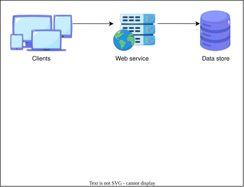
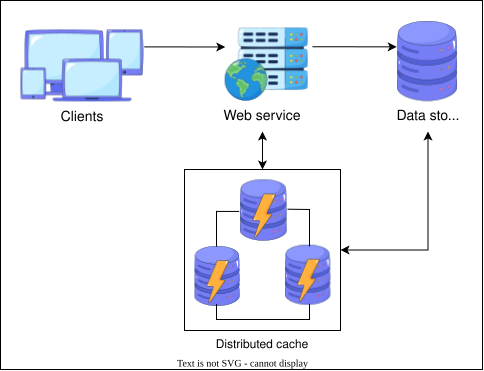
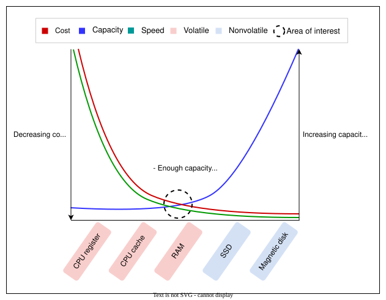

# Distributed_Cache_System_Design

Source: https://www.educative.io/courses/grokking-the-system-design-interview/system-design-the-distributed-cache

---

[Home](https://www.educative.io/)

[Courses](https://www.educative.io/search?tab=courses)

[Grokking Modern System Design Interview](https://www.educative.io/courses/grokking-the-system-design-interview)

# System Design: The Distributed Cache

Explore the foundational role of caching in modern System Design to improve performance and reduce database load. Define a distributed cache and explain why distribution is essential for scalability and high availability. Identify common use cases and industry-standard solutions like Redis and Memcached.

We'll cover the following...

- [Problem statement](https://www.educative.io/courses/grokking-the-system-design-interview/system-design-the-distributed-cache#Problem-statement)
- [What is a distributed cache?](https://www.educative.io/courses/grokking-the-system-design-interview/system-design-the-distributed-cache#What-is-a-distributed-cache)
- [Why distributed cache?](https://www.educative.io/courses/grokking-the-system-design-interview/system-design-the-distributed-cache#Why-distributed-cache)
- [How does distributed caching work?](https://www.educative.io/courses/grokking-the-system-design-interview/system-design-the-distributed-cache#How-does-distributed-caching-work)
- [Cache management best practices](https://www.educative.io/courses/grokking-the-system-design-interview/system-design-the-distributed-cache#Cache-management-best-practices)
- [Use cases for distributed caching](https://www.educative.io/courses/grokking-the-system-design-interview/system-design-the-distributed-cache#Use-cases-for-distributed-caching)
- [Popular distributed caching solutions](https://www.educative.io/courses/grokking-the-system-design-interview/system-design-the-distributed-cache#Popular-distributed-caching-solutions)
- [How will we design a distributed cache?](https://www.educative.io/courses/grokking-the-system-design-interview/system-design-the-distributed-cache#How-will-we-design-a-distributed-cache)

## Problem statement[#](https://www.educative.io/courses/grokking-the-system-design-interview/system-design-the-distributed-cache#Problem-statement)

A typical system consists of three core components:

- Theclientwho requests the service.
- The service host processes client requests.
- The database that stores the service’s data.

While this abstraction works for low traffic, scaling up the number of users increases database query volume. This overloads the database and causes high latency. To resolve this, we add a cache to the system.

A cache is a high-speed storage layer that temporarily holds data in memory to serve requests faster.

1 / 2

Service before using caching

1 / 2

Service using caching to improve performance.

Caches store only the most frequently accessed data. When a request reaches the serving host, it retrieves data from the cache (cache hit) and serves the user. However, if the data is not in the cache (a cache miss), it will be retrieved from the database.

After a miss, the cache is populated with the new value to prevent future misses.

A cache stores transient, frequently accessed data to reduce latency for the end user. Therefore, the storage hardware must be fast, large enough to hold the working set, and cost-effective. RAM is the standard building block for caching due to its speed and efficiency.

The following illustration highlights the suitability of RAM for caching:

An approximation that depicts how RAM is the optimal choice for serving cached data

We understand the need for caching hardware, but scaling requires a distributed system.

## What is a distributed cache?[#](https://www.educative.io/courses/grokking-the-system-design-interview/system-design-the-distributed-cache#What-is-a-distributed-cache)

A **distributed cache** is a caching system where multiple cache servers coordinate to store frequently accessed data. This is necessary when the dataset is too large for a single server.

Distributed caches offer scalability and high availability. They rely on the locality of reference principle, which assumes programs access specific data subsets repeatedly.

Key benefits include:

- **Reduced latency:** Serves pre-calculated or frequently accessed data from local resources.
- **Database offloading:** Prevents expensive queries from hitting the database.
- **Session storage:** Temporarily stores user session data.
- **Availability:** Serves data even if the primary data store is temporarily down.
- **Scalability:** Supports horizontal scaling (adding more servers) for high traffic.

## Why distributed cache?[#](https://www.educative.io/courses/grokking-the-system-design-interview/system-design-the-distributed-cache#Why-distributed-cache)

Storing the entire dataset on a single system is often impractical. Distributed caching addresses three main limitations:

- **Single point of failure (SPOF):** Distribution prevents total system failure if one node crashes.
- **Modular design:** Each architectural layer can have its own caching mechanism, decoupling sensitive data.
- **Latency:** Caching at different locations places data closer to the request source.

We describe how caching is performed at different layers using various technologies in the table below.

## Caching at different layers of a system

|  |  |  |
| --- | --- | --- |
| **System Layer** | **Technology in Use** | **Usage** |
| **Web** | HTTP cache headers, web accelerators, key-value store, CDNs, and so on | Accelerate retrieval of static web content, and manage sessions |
| **Application** | Local cache and key-value data store | Accelerate application-level computations and data retrieval |
| **Database** | Database cache, buffers, and key-value data store | Reduce data retrieval latency and I/O load from database |

Understanding where to implement caching is only part of the equation. We must also understand the practices for managing a distributed cache.

## How does distributed caching work?[#](https://www.educative.io/courses/grokking-the-system-design-interview/system-design-the-distributed-cache#How-does-distributed-caching-work)

The typical workflow for a web application using a distributed cache is:

1. The application requests data from the distributed cache.
2. If the data exists in the cache, the server returns it immediately.
3. If the data is missing, the cache server retrieves it from the backend database.
4. The new data is stored in the cache for future requests.
5. The data is returned to the application.

Distributed cache servers are often deployed in a cluster to improve performance and scalability. This setup allows the web server to avoid retrieving data from the database for every request.

## Cache management best practices[#](https://www.educative.io/courses/grokking-the-system-design-interview/system-design-the-distributed-cache#Cache-management-best-practices)

To maximize the benefits of distributed caching, adhere to these best practices, which we will discuss in the coming lesson in detail:

- **Cache eviction:** Implement cache eviction policies, such as Least Recently Used (LRU) or Time to Live (TTL), to maintain a refreshed and relevant cache.
- **Data consistency:** Ensure data consistency between the cache and the primary data source, especially for frequently updated data.
- **Monitoring:** Regularly monitor cache performance metrics, such as hit and miss rates, to identify areas for improvement.
- **Scalability:** Design the cache infrastructure to be scalable, allowing for easy addition of cache nodes as the application grows.

Implementing distributed caching involves selecting the right solution, installing and configuring it on all nodes, defining data partitioning and replication strategies, integrating the cache with the application, and continuously monitoring and fine-tuning performance.

With these benefits in mind, let’s examine some of the industry-standard tools available for implementing distributed caching.

## Use cases for distributed caching[#](https://www.educative.io/courses/grokking-the-system-design-interview/system-design-the-distributed-cache#Use-cases-for-distributed-caching)

Distributed caching can be used in a variety of scenarios, including:

- **Web applications:** Distributed caches can be used to store frequently accessed web pages, images, and other resources. This can improve the performance and scalability of web applications.
- **E-commerce applications:** Distributed caches can store product catalogs, shopping carts, and other customer data. This can improve the performance and scalability of e-commerce applications.
- [**Content delivery networks (CDNs)**](https://how.dev/answers/what-is-a-content-delivery-network)**:** Distributed caches are often used in CDNs to store static content, such as images, CSS, and JavaScript files. This can improve the performance of websites and web applications.
- **Gaming applications:** Distributed caches can store game state data, including player inventory, map data, and leaderboard information. This can improve the performance and scalability of gaming applications.

## Popular distributed caching solutions[#](https://www.educative.io/courses/grokking-the-system-design-interview/system-design-the-distributed-cache#Popular-distributed-caching-solutions)

There are a number of popular distributed caching solutions available, including:

- **Redis** is an open-source in-memory data structure store that can be used as a distributed cache. It is known for its speed and scalability.
- **Memcached** is another popular open-source distributed cache. It is simple to use and easily scalable.
- **Hazelcast** is a commercial distributed caching solution that offers several advanced features, including data replication and eventing.
- **Apache Ignite** is an open-source distributed caching and computing platform. It offers several features, including in-memory data processing and distributed SQL queries.

Distributed caching is a powerful way to improve application performance, scalability, and availability.

To use it effectively, focus on caching data that is frequently accessed and rarely changes, set appropriate expiration times to keep data fresh, monitor cache performance regularly, and consider using a cache management library to handle eviction and synchronization efficiently.

## How will we design a distributed cache?[#](https://www.educative.io/courses/grokking-the-system-design-interview/system-design-the-distributed-cache#How-will-we-design-a-distributed-cache)

We’ll divide the task of designing and reinforcing the learning of major concepts of distributed cache into five lessons:

1. [**Background of Distributed Cache**](https://www.educative.io/courses/grokking-the-system-design-interview/background-of-distributed-cache)**:** It’s imperative to build the background knowledge necessary to make critical decisions when designing distributed caches. This lesson will revisit some fundamental yet essential concepts.
2. [**High-level Design of a Distributed Cache**](https://www.educative.io/courses/grokking-the-system-design-interview/high-level-design-of-a-distributed-cache)**:** We’ll build a high-level design of a distributed cache in this lesson.
3. [**Detailed Design of a Distributed Cache**](https://www.educative.io/courses/grokking-the-system-design-interview/detailed-design-of-a-distributed-cache)**:** We’ll identify some limitations of our high-level design and work toward a scalable, affordable, and performant solution.
4. [**Evaluation of a Distributed Cache Design**](https://www.educative.io/courses/grokking-the-system-design-interview/evaluation-of-a-distributed-caches-design)**:** This lesson will assess our design against various non-functional requirements, including scalability, consistency, and availability.
5. [**Memcached versus Redis**](https://www.educative.io/courses/grokking-the-system-design-interview/memcached-versus-redis)**:** We’ll discuss well-known industrial solutions, namely Memcached and Redis. We’ll also go through their details and compare their features to help us understand their potential use cases and how they relate to our design.

Let’s begin by exploring the background of the distributed cache in the next lesson.

Design of a Client-Side Monitoring System

Background of Distributed Cache

Ask

[Problem statement](https://www.educative.io/courses/grokking-the-system-design-interview/system-design-the-distributed-cache#Problem-statement)

[What is a distributed cache?](https://www.educative.io/courses/grokking-the-system-design-interview/system-design-the-distributed-cache#What-is-a-distributed-cache)

[Why distributed cache?](https://www.educative.io/courses/grokking-the-system-design-interview/system-design-the-distributed-cache#Why-distributed-cache)

[How does distributed caching work?](https://www.educative.io/courses/grokking-the-system-design-interview/system-design-the-distributed-cache#How-does-distributed-caching-work)

[Cache management best practices](https://www.educative.io/courses/grokking-the-system-design-interview/system-design-the-distributed-cache#Cache-management-best-practices)

[Use cases for distributed caching](https://www.educative.io/courses/grokking-the-system-design-interview/system-design-the-distributed-cache#Use-cases-for-distributed-caching)

[Popular distributed caching solutions](https://www.educative.io/courses/grokking-the-system-design-interview/system-design-the-distributed-cache#Popular-distributed-caching-solutions)

[How will we design a distributed cache?](https://www.educative.io/courses/grokking-the-system-design-interview/system-design-the-distributed-cache#How-will-we-design-a-distributed-cache)