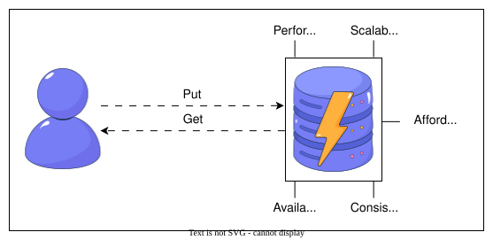

# High-Level_Design_of_a_Distributed_Cache

Source: https://www.educative.io/courses/grokking-the-system-design-interview/high-level-design-of-a-distributed-cache

---

[Home](https://www.educative.io/)

[Courses](https://www.educative.io/search?tab=courses)

[Grokking Modern System Design Interview](https://www.educative.io/courses/grokking-the-system-design-interview)

# High-Level Design of a Distributed Cache

Design the architecture for a highly scalable distributed cache system. Define essential functional and non-functional requirements like high performance, consistency, and availability. Explore critical design choices, including storage hardware, eviction policies, and the roles of cache clients and servers in the high-level System Design.

We'll cover the following...

- [Requirements](https://www.educative.io/courses/grokking-the-system-design-interview/high-level-design-of-a-distributed-cache#Requirements)
  - [Functional](https://www.educative.io/courses/grokking-the-system-design-interview/high-level-design-of-a-distributed-cache#Functional)
  - [Non-functional requirements](https://www.educative.io/courses/grokking-the-system-design-interview/high-level-design-of-a-distributed-cache#Non-functional-requirements)
- [API design](https://www.educative.io/courses/grokking-the-system-design-interview/high-level-design-of-a-distributed-cache#API-design)
  - [Insertion](https://www.educative.io/courses/grokking-the-system-design-interview/high-level-design-of-a-distributed-cache#Insertion)
  - [Retrieval](https://www.educative.io/courses/grokking-the-system-design-interview/high-level-design-of-a-distributed-cache#Retrieval)
- [Design considerations](https://www.educative.io/courses/grokking-the-system-design-interview/high-level-design-of-a-distributed-cache#Design-considerations)
  - [Storage hardware](https://www.educative.io/courses/grokking-the-system-design-interview/high-level-design-of-a-distributed-cache#Storage-hardware)
  - [Data structures](https://www.educative.io/courses/grokking-the-system-design-interview/high-level-design-of-a-distributed-cache#Data-structures)
  - [Cache client](https://www.educative.io/courses/grokking-the-system-design-interview/high-level-design-of-a-distributed-cache#Cache-client)
  - [Writing policy](https://www.educative.io/courses/grokking-the-system-design-interview/high-level-design-of-a-distributed-cache#Writing-policy)
  - [Eviction policy](https://www.educative.io/courses/grokking-the-system-design-interview/high-level-design-of-a-distributed-cache#Eviction-policy)
- [High-level design](https://www.educative.io/courses/grokking-the-system-design-interview/high-level-design-of-a-distributed-cache#High-level-design)

In this lesson, we will design a distributed cache. We will also discuss the trade-offs and design choices involved in developing the solution.

## Requirements[#](https://www.educative.io/courses/grokking-the-system-design-interview/high-level-design-of-a-distributed-cache#Requirements)

Let’s start by defining the requirements.

### Functional[#](https://www.educative.io/courses/grokking-the-system-design-interview/high-level-design-of-a-distributed-cache#Functional)

The system must support the following operations:

- **Insert data:** Users must be able to add an entry to the cache.
- **Retrieve data:** Users must be able to retrieve data associated with a specific key.

Functional and non-functional requirements of a distributed cache

### Non-functional requirements[#](https://www.educative.io/courses/grokking-the-system-design-interview/high-level-design-of-a-distributed-cache#Non-functional-requirements)

We must meet the following non-functional requirements:

- **High performance:** The primary goal is fast data retrieval. Both `insert` and `retrieve` operations must be low-latency.
- **Scalability:** The system should scale horizontally to handle increasing request loads without bottlenecks.
- **High availability:** Cache downtime increases load on the database, potentially causing cascading failures during peak traffic. The system must survive component failures, network issues, and power outages.
- **Consistency:** Data must remain consistent across cache servers. Clients retrieving the same key from different servers (primary or secondary) should see up-to-date data.
- **Affordability:** The system should use commodity hardware to minimize costs.

## API design[#](https://www.educative.io/courses/grokking-the-system-design-interview/high-level-design-of-a-distributed-cache#API-design)

The API requires two basic operations.

### Insertion[#](https://www.educative.io/courses/grokking-the-system-design-interview/high-level-design-of-a-distributed-cache#Insertion)

The API call to perform insertion looks like this:

Ace Editor

1

insert(key, value)

הההההההההההההההההההההההההההההההההההההההההההההההההההההההההההההההההההההההההההההההההההההההההההההההההההההההההההההההההההההההההההההההההההההההההההההההההההההההההההההההההההההההההההההההההההההההההההההההההההההההההההההההההההההההההההההההההההההההההההההההההההההההההההההההההההההההההההההההההההההההההההההההההההההההההההההההההההההההההההההההההההההההההההההההההההההההההההההההההההההההההההההההההההההההההההההההההההההההההההההההההההההההההההההההההההההההההההההההההההההההההההההההההההההההההההההההההההההההההההההההההההההההההההההההההההההההההההההההה

XXXXXXXXXXXXXXXXXXXXXXXXXXXXXXXXXXXXXXXXXXXXXXXXXXXXXXXXXXXXXXXXXXXXXXXXXXXXXXXXXXXXXXXXXXXXXXXXXXXXXXXXXXXXXXXXXXXXXXXXXXXXXXXXXXXXXXXXXXXXXXXXXXXXXXXXXXXXXXXXXXXXXXXXXXXXXXXXXXXXXXXXXXXXXXXXXXXXXXXXXXXXXXXXXXXXXXXXXXXXXXXXXXXXXXXXXXXXXXXXXXXXXXXXXXXXXXXXXXXXXXXXXXXXXXXXXXXXXXXXXXXXXXXXXXXXXXXXXXXXXXXXXXXXXXXXXXXXXXXXXXXXXXXXXXXXXXXXXXXXXXXXXXXXXXXXXXXXXXXXXXXXXXXXXXXXXXXXXXXXXXXXXXXXXXXXXXXXXXXXXXXXXXXXXXXXXXXXXXXXXXXXXXXXXXXXXXXXXXXXXXXXXXXXXXXXXXXXXXXXXXXXXXXXXXXXXXXXXXXXXXXXXXXXXXXXXXXXXXXXXXXXXXXXXXXX

|  |  |
| --- | --- |
| **Parameter** | **Description** |
| `key` | This is a unique identifier. |
| `value` | This is the data stored against a unique `key`. |

This function returns an acknowledgment or an error indicating the status of the operation.

### Retrieval[#](https://www.educative.io/courses/grokking-the-system-design-interview/high-level-design-of-a-distributed-cache#Retrieval)

The API call to retrieve data looks like this:

Ace Editor

1

retrieve(key)

הההההההההההההההההההההההההההההההההההההההההההההההההההההההההההההההההההההההההההההההההההההההההההההההההההההההההההההההההההההההההההההההההההההההההההההההההההההההההההההההההההההההההההההההההההההההההההההההההההההההההההההההההההההההההההההההההההההההההההההההההההההההההההההההההההההההההההההההההההההההההההההההההההההההההההההההההההההההההההההההההההההההההההההההההההההההההההההההההההההההההההההההההההההההההההההההההההההההההההההההההההההההההההההההההההההההההההההההההההההההההההההההההההההההההההההההההההההההההההההההההההההההההההההההההההההההההההההההה

XXXXXXXXXXXXXXXXXXXXXXXXXXXXXXXXXXXXXXXXXXXXXXXXXXXXXXXXXXXXXXXXXXXXXXXXXXXXXXXXXXXXXXXXXXXXXXXXXXXXXXXXXXXXXXXXXXXXXXXXXXXXXXXXXXXXXXXXXXXXXXXXXXXXXXXXXXXXXXXXXXXXXXXXXXXXXXXXXXXXXXXXXXXXXXXXXXXXXXXXXXXXXXXXXXXXXXXXXXXXXXXXXXXXXXXXXXXXXXXXXXXXXXXXXXXXXXXXXXXXXXXXXXXXXXXXXXXXXXXXXXXXXXXXXXXXXXXXXXXXXXXXXXXXXXXXXXXXXXXXXXXXXXXXXXXXXXXXXXXXXXXXXXXXXXXXXXXXXXXXXXXXXXXXXXXXXXXXXXXXXXXXXXXXXXXXXXXXXXXXXXXXXXXXXXXXXXXXXXXXXXXXXXXXXXXXXXXXXXXXXXXXXXXXXXXXXXXXXXXXXXXXXXXXXXXXXXXXXXXXXXXXXXXXXXXXXXXXXXXXXXXXXXXXXXXX

|  |  |
| --- | --- |
| **Parameter** | **Description** |
| `key` | This returns the data stored against the `key.` |

This call returns the requested object to the caller.

1.

The API design of the distributed cache looks exactly like the key-value store. What are the possible differences between a key-value store and a distributed cache?

Show Answer

Did you find this helpful?

## Design considerations[#](https://www.educative.io/courses/grokking-the-system-design-interview/high-level-design-of-a-distributed-cache#Design-considerations)

We must evaluate several design choices based on application requirements before building the system.

### Storage hardware[#](https://www.educative.io/courses/grokking-the-system-design-interview/high-level-design-of-a-distributed-cache#Storage-hardware)

Large datasets require sharding across multiple servers. We must decide between specialized or commodity hardware. Specialized hardware offers better performance but costs more. Alternatively, we can build a large cache from commodity servers. Generally, the number of shard servers depends on cache size and access frequency.

We can also persist data to secondary storage while serving it from RAM. Secondary storage aids recovery if a reboot occurs, as rebuilding the cache from scratch takes time. However, persistence may not be necessary if a dedicated persistence layer (like a database) already exists.

### Data structures[#](https://www.educative.io/courses/grokking-the-system-design-interview/high-level-design-of-a-distributed-cache#Data-structures)

Data access speed is critical. Hash tables provide `constant time (O(1))` average complexity for storage and retrieval. However, we also need a structure to enforce eviction algorithms. Linked lists are a suitable option for tracking entry order.

We must also determine what data types the cache will store. While we use strings here for simplicity, caches can store various formats like hash maps, arrays, or sets. The next lesson covers a practical example of complex data storage.

### Cache client[#](https://www.educative.io/courses/grokking-the-system-design-interview/high-level-design-of-a-distributed-cache#Cache-client)

The client library or process handles `insert` and `retrieve` calls. It can reside on the service host (for internal use) or exist as a dedicated client for external services.

### Writing policy[#](https://www.educative.io/courses/grokking-the-system-design-interview/high-level-design-of-a-distributed-cache#Writing-policy)

The strategy for writing to the cache and database affects consistency. There is no single optimal choice; the policy depends on application requirements.

### Eviction policy[#](https://www.educative.io/courses/grokking-the-system-design-interview/high-level-design-of-a-distributed-cache#Eviction-policy)

Caches provide low-latency access by serving data from RAM. As cache size is limited compared to the full dataset, we cannot store everything. We need a policy to decide which data to keep and which to remove.

When the cache is full, an eviction policy determines which entry to remove to make room for new data. The choice depends on the application. For example, least recently used (LRU) is effective for social media services where recent content attracts the most views.

Additionally, optimizing the time-to-live (TTL) value is essential for reducing cache misses.

AI Powered

Saved

1 attempt left

Reset

How can sharding help eliminate SPOFs?

How does sharding help mitigate single points of failure (SPOF) in a distributed cache system?

This is your last attempt.

## High-level design[#](https://www.educative.io/courses/grokking-the-system-design-interview/high-level-design-of-a-distributed-cache#High-level-design)

The following figure depicts our high-level design:

High-level design of distributed cache

The main components are:

- **Cache client:** This library resides in the service application servers and maintains metadata about cache servers. For every `insert` or `retrieve` request, the client selects a server using a hashing algorithm. All clients must share a consistent view of the server list and hashing strategy to ensure they route requests for the same data to the same server.
- **Cache servers:** These servers store the cached data. Each server is accessible by all clients and connects to the database. Clients communicate via TCP or UDP. If a server fails, clients treat requests to it as cache misses.

Background of Distributed Cache

Detailed Design of a Distributed Cache

Ask

[Requirements](https://www.educative.io/courses/grokking-the-system-design-interview/high-level-design-of-a-distributed-cache#Requirements)

[Functional](https://www.educative.io/courses/grokking-the-system-design-interview/high-level-design-of-a-distributed-cache#Functional)

[Non-functional requirements](https://www.educative.io/courses/grokking-the-system-design-interview/high-level-design-of-a-distributed-cache#Non-functional-requirements)

[API design](https://www.educative.io/courses/grokking-the-system-design-interview/high-level-design-of-a-distributed-cache#API-design)

[Insertion](https://www.educative.io/courses/grokking-the-system-design-interview/high-level-design-of-a-distributed-cache#Insertion)

[Retrieval](https://www.educative.io/courses/grokking-the-system-design-interview/high-level-design-of-a-distributed-cache#Retrieval)

[Design considerations](https://www.educative.io/courses/grokking-the-system-design-interview/high-level-design-of-a-distributed-cache#Design-considerations)

[Storage hardware](https://www.educative.io/courses/grokking-the-system-design-interview/high-level-design-of-a-distributed-cache#Storage-hardware)

[Data structures](https://www.educative.io/courses/grokking-the-system-design-interview/high-level-design-of-a-distributed-cache#Data-structures)

[Cache client](https://www.educative.io/courses/grokking-the-system-design-interview/high-level-design-of-a-distributed-cache#Cache-client)

[Writing policy](https://www.educative.io/courses/grokking-the-system-design-interview/high-level-design-of-a-distributed-cache#Writing-policy)

[Eviction policy](https://www.educative.io/courses/grokking-the-system-design-interview/high-level-design-of-a-distributed-cache#Eviction-policy)

[High-level design](https://www.educative.io/courses/grokking-the-system-design-interview/high-level-design-of-a-distributed-cache#High-level-design)