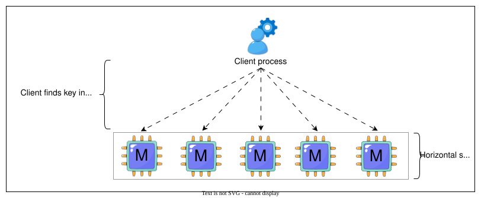

# Memcached_versus_Redis

Source: https://www.educative.io/courses/grokking-the-system-design-interview/memcached-versus-redis

---

[Home](https://www.educative.io/)

[Courses](https://www.educative.io/search?tab=courses)

[Grokking Modern System Design Interview](https://www.educative.io/courses/grokking-the-system-design-interview)

# Memcached versus Redis

Compare Memcached and Redis, two widely adopted distributed cache implementations. Analyze their architectural differences, including data structures, persistence capabilities, and the complexity of cluster management. Determine which caching solution best fits specific system requirements, such as read-heavy vs. complex read/write loads.

We'll cover the following...

- [Introduction](https://www.educative.io/courses/grokking-the-system-design-interview/memcached-versus-redis#Introduction)
- [Memcached](https://www.educative.io/courses/grokking-the-system-design-interview/memcached-versus-redis#Memcached)
  - [Facebook and Memcached](https://www.educative.io/courses/grokking-the-system-design-interview/memcached-versus-redis#Facebook-and-Memcached)
- [Redis](https://www.educative.io/courses/grokking-the-system-design-interview/memcached-versus-redis#Redis)
  - [Redis Cluster](https://www.educative.io/courses/grokking-the-system-design-interview/memcached-versus-redis#Redis-Cluster)
  - [Pipelining in Redis](https://www.educative.io/courses/grokking-the-system-design-interview/memcached-versus-redis#Pipelining-in-Redis)
- [Memcached vs. Redis](https://www.educative.io/courses/grokking-the-system-design-interview/memcached-versus-redis#Memcached-vs-Redis)
- [Conclusion](https://www.educative.io/courses/grokking-the-system-design-interview/memcached-versus-redis#Conclusion)

## Introduction[#](https://www.educative.io/courses/grokking-the-system-design-interview/memcached-versus-redis#Introduction)

This lesson explores two widely used open-source caching frameworks: Memcached and Redis. Both use a client–server architecture and provide sub-millisecond latency.

## Memcached[#](https://www.educative.io/courses/grokking-the-system-design-interview/memcached-versus-redis#Memcached)

Introduced in 2003, **Memcached** is a high-performance distributed key-value store. It stores data as string-based key-value pairs. Because it only supports strings, complex objects must be serialized before storage. Memcached uses a shared-nothing architecture. Servers operate independently without synchronization or data sharing. System logic is divided between the client and server: the client performs routing and hashing, while the server manages storage.

This disconnected design allows Memcached to achieve deterministic query speeds ofO(1)\text{O(1)}O(1) and high throughput, serving millions of keys per second on high-end hardware.

Design of a typical Memcached cluster

Memcached scales horizontally with ease. The client process typically resides on the service host and manages interaction with the backend storage.

### Facebook and Memcached[#](https://www.educative.io/courses/grokking-the-system-design-interview/memcached-versus-redis#Facebook-and-Memcached)

Facebook generates user content views dynamically, which requires frequent read and write operations. Memcached was chosen for its simplicity during Facebook’s early development in 2004. Over time, Facebook engineers and the Memcached community collaborated to optimize the system for large-scale deployments.

Common Memcached commands include:

Ace Editor

1

2

3

get <key\_1> <key\_2> <key\_3> ...

set <key> <value> ...

delete <key>[<time>] ...

הההההההההההההההההההההההההההההההההההההההההההההההההההההההההההההההההההההההההההההההההההההההההההההההההההההההההההההההההההההההההההההההההההההההההההההההההההההההההההההההההההההההההההההההההההההההההההההההההההההההההההההההההההההההההההההההההההההההההההההההההההההההההההההההההההההההההההההההההההההההההההההההההההההההההההההההההההההההההההההההההההההההההההההההההההההההההההההההההההההההההההההההההההההההההההההההההההההההההההההההההההההההההההההההההההההההההההההההההההההההההההההההההההההההההההההההההההההההההההההההההההההההההההההההההההההההההההההההה

XXXXXXXXXXXXXXXXXXXXXXXXXXXXXXXXXXXXXXXXXXXXXXXXXXXXXXXXXXXXXXXXXXXXXXXXXXXXXXXXXXXXXXXXXXXXXXXXXXXXXXXXXXXXXXXXXXXXXXXXXXXXXXXXXXXXXXXXXXXXXXXXXXXXXXXXXXXXXXXXXXXXXXXXXXXXXXXXXXXXXXXXXXXXXXXXXXXXXXXXXXXXXXXXXXXXXXXXXXXXXXXXXXXXXXXXXXXXXXXXXXXXXXXXXXXXXXXXXXXXXXXXXXXXXXXXXXXXXXXXXXXXXXXXXXXXXXXXXXXXXXXXXXXXXXXXXXXXXXXXXXXXXXXXXXXXXXXXXXXXXXXXXXXXXXXXXXXXXXXXXXXXXXXXXXXXXXXXXXXXXXXXXXXXXXXXXXXXXXXXXXXXXXXXXXXXXXXXXXXXXXXXXXXXXXXXXXXXXXXXXXXXXXXXXXXXXXXXXXXXXXXXXXXXXXXXXXXXXXXXXXXXXXXXXXXXXXXXXXXXXXXXXXXXXXXX

At Facebook, Memcached sits between the MySQL database and the web layer. It utilizes approximately 28 TB of RAM across more than 800 servers (as of 2013). Using an approximate Least Recently Used (LRU) eviction policy, Facebook achieves a 95% cache hit rate.

The illustration below depicts the high-level caching architecture. Out of 50 million requests from the web layer, the cache filters traffic, allowing only 2.5 million to reach the persistence layer.

Facebook using a layer of Memcached sitting between persistence and web layer

## Redis[#](https://www.educative.io/courses/grokking-the-system-design-interview/memcached-versus-redis#Redis)

**Redis** is a data structure store used as a cache, database, and message broker. It offers richer features than Memcached but introduces additional complexity.

- **Data structure store:** Redis natively understands the data structures it stores. You can manipulate data directly in the store (e.g., appending to a list) without the overhead of retrieving, deserializing, modifying, and re-storing objects.
- **Database:** Redis can persist in-memory data to secondary storage.
- **Message broker:** Redis facilitates high-throughput asynchronous communication between system components.

Redis provides built-in replication, automatic failover, and persistence. Redis separates the control plane (cluster management) from the data plane (data access), which improves operational reliability. However, because replication is asynchronous, Redis does not guarantee strong consistency.

Redis structure supporting automatic failover using redundant secondary replicas

### Redis Cluster[#](https://www.educative.io/courses/grokking-the-system-design-interview/memcached-versus-redis#Redis-Cluster)

Redis supports high availability via **Redis Sentinel** and automatic partitioning via **Redis Cluster**. In a Redis Cluster, data is automatically sharded across multiple nodes. Each shard consists of a primary node and secondary replicas. The number of shards is configurable to meet application requirements.

A cluster manager detects failures and performs automatic failovers. The management layer includes monitoring and configuration components.

Architecture of Redis clusters

### Pipelining in Redis[#](https://www.educative.io/courses/grokking-the-system-design-interview/memcached-versus-redis#Pipelining-in-Redis)

In the standard client-server model, the client blocks while waiting for the server’s response. If a client sends requests sequentially, the overall latency increases due to the wait time between each request.

Redis uses **pipelining** to accelerate this process. Pipelining allows the client to send multiple requests without waiting for individual responses, significantly reducing the total RTT for the batch.

Redis client-server communication without pipelining versus Redis client-server communication with pipelining

Pipelining reduces latency by minimizing round-trip time (RTT) and socket-level I/O. It also reduces CPU overhead caused by frequent system calls. Although the server processes requests sequentially, the client can batch commands to increase throughput. For example, if a client pipelines two commands and the second is invalid, the server returns a result for the first and an error for the second. The client is responsible for managing the batching logic.

> **Note:** Pipelining can improve throughput by a factor of five or more, even when the client and server are on the same machine (loopback address `127.0.0.1`). The benefits are even more pronounced when communicating with distant machines.

## Memcached vs. Redis[#](https://www.educative.io/courses/grokking-the-system-design-interview/memcached-versus-redis#Memcached-vs-Redis)

Even though Memcached and Redis both belong to the NoSQL family, there are subtle aspects that set them apart:

- **Simplicity:** Memcached is simple, but it leaves most of the effort for managing clusters left to the developers of the cluster. This, however, means finer control using Memcached. Redis, on the other hand, automates most of the scalability and data division tasks.
- **Persistence:** Redis provides persistence through features such as the append-only log (AOF) and database snapshots (RDB). There’s no persistence support in Memcached. But this limitation can be addressed with third-party tools.
- **Data types:** Memcached stores objects as key-value pairs, both of which are strings, whereas Redis supports strings, sorted sets, hash maps, bitmaps, and hyper logs. However, the maximum key or value size is configurable.
- **Memory usage:** Both tools allow us to set a maximum cache size. Memcached uses the slab allocation method for reducing fragmentation. However, when we update the existing entries’ size or store many small objects, there may be a wastage of memory. Nonetheless, there are configuration workarounds to resolve such issues.
- **Multithreading:** Redis runs as a single process using one core, whereas Memcached can efficiently use multicore systems with multithreading technology. We could argue that Redis was designed to be a single-threaded process that reduces the complexity of multithreaded systems. Nonetheless, multiple Redis processes can be executed for concurrency. At the same time, Redis has improved over the years by tweaking its performance. Therefore, Redis can store small data items efficiently. Memcached can be the right choice for file sizes above 100 K.
- **Replication:** As stated before, Redis automates the replication process via a few commands, whereas replication in Memcached is again subject to the usage of third-party tools. Architecturally, Memcached can scale well horizontally due to its simplicity. Redis provides scalability through clustering that’s considerably complex.

The table below summarizes some of the main differences and common features between Memcached and Redis:

## Features Offered by Memcached and Redis

|  |  |  |
| --- | --- | --- |
| **Feature** | **Memcached** | **Redis** |
| Low latency | Yes | Yes |
| Persistence | Possible via third-party tools | Multiple options |
| Multilanguage support | Yes | Yes |
| Data sharding | Possible via third-party tools | Built-in solution |
| Ease of use | Yes | Yes |
| Multithreading support | Yes | No |
| Support for data structure | Objects | Multiple data structures |
| Support for transaction | No | Yes |
| Eviction policy | LRU | Multiple algorithms |
| Lua scripting support | No | Yes |
| Geospatial support | No | Yes |

Memcached is well suited for simpler, read-heavy workloads that benefit from multithreaded performance. Redis is suited for systems that require advanced data structures, persistence, and built-in replication.

1.

Based on the implementation details, which framework (Memcached vs. Redis) has a striking similarity with the distributed cache that we designed in the previous lesson?

Show Answer

1 / 3

## Conclusion[#](https://www.educative.io/courses/grokking-the-system-design-interview/memcached-versus-redis#Conclusion)

High-speed, large-scale solutions rely heavily on caching. In this chapter, we explored the fundamentals of distributed caching and compared the design and features of Memcached and Redis. Understanding these trade-offs is critical for designing efficient distributed systems.

Evaluation of a Distributed Cache's Design

Distributed Cache System Design

Ask

[Introduction](https://www.educative.io/courses/grokking-the-system-design-interview/memcached-versus-redis#Introduction)

[Memcached](https://www.educative.io/courses/grokking-the-system-design-interview/memcached-versus-redis#Memcached)

[Facebook and Memcached](https://www.educative.io/courses/grokking-the-system-design-interview/memcached-versus-redis#Facebook-and-Memcached)

[Redis](https://www.educative.io/courses/grokking-the-system-design-interview/memcached-versus-redis#Redis)

[Redis Cluster](https://www.educative.io/courses/grokking-the-system-design-interview/memcached-versus-redis#Redis-Cluster)

[Pipelining in Redis](https://www.educative.io/courses/grokking-the-system-design-interview/memcached-versus-redis#Pipelining-in-Redis)

[Memcached vs. Redis](https://www.educative.io/courses/grokking-the-system-design-interview/memcached-versus-redis#Memcached-vs-Redis)

[Conclusion](https://www.educative.io/courses/grokking-the-system-design-interview/memcached-versus-redis#Conclusion)