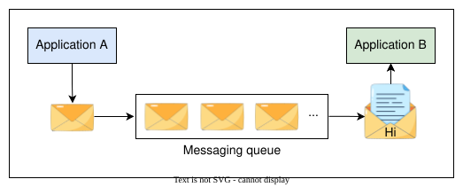

# Distributed_Message_Queue_System_Design

Source: https://www.educative.io/courses/grokking-the-system-design-interview/system-design-the-distributed-messaging-queue

---

[Home](https://www.educative.io/)

[Courses](https://www.educative.io/search?tab=courses)

[Grokking Modern System Design Interview](https://www.educative.io/courses/grokking-the-system-design-interview)

# System Design: The Distributed Messaging Queue

Define the core concepts and components of distributed messaging queues. Explain how messaging queues enable asynchronous communication and decouple services to improve scalability and reliability in System Design. Compare common architectural patterns, such as point-to-point and publish/subscribe.

We'll cover the following...

- [What is a messaging queue?](https://www.educative.io/courses/grokking-the-system-design-interview/system-design-the-distributed-messaging-queue#What-is-a-messaging-queue)
  - [Key components of a messaging queue](https://www.educative.io/courses/grokking-the-system-design-interview/system-design-the-distributed-messaging-queue#Key-components-of-a-messaging-queue)
    - [Producers](https://www.educative.io/courses/grokking-the-system-design-interview/system-design-the-distributed-messaging-queue#Producers)
    - [Consumers](https://www.educative.io/courses/grokking-the-system-design-interview/system-design-the-distributed-messaging-queue#Consumers)
    - [Queues](https://www.educative.io/courses/grokking-the-system-design-interview/system-design-the-distributed-messaging-queue#Queues)
    - [Messages](https://www.educative.io/courses/grokking-the-system-design-interview/system-design-the-distributed-messaging-queue#Messages)
- [Why use a messaging queue](https://www.educative.io/courses/grokking-the-system-design-interview/system-design-the-distributed-messaging-queue#Why-use-a-messaging-queue)
  - [Common messaging queue patterns](https://www.educative.io/courses/grokking-the-system-design-interview/system-design-the-distributed-messaging-queue#Common-messaging-queue-patterns)
  - [Popular messaging queue technologies](https://www.educative.io/courses/grokking-the-system-design-interview/system-design-the-distributed-messaging-queue#Popular-messaging-queue-technologies)
  - [Messaging queue use cases](https://www.educative.io/courses/grokking-the-system-design-interview/system-design-the-distributed-messaging-queue#Messaging-queue-use-cases)
- [Best practices for implementing messaging queues](https://www.educative.io/courses/grokking-the-system-design-interview/system-design-the-distributed-messaging-queue#Best-practices-for-implementing-messaging-queues)
  - [Message idempotency](https://www.educative.io/courses/grokking-the-system-design-interview/system-design-the-distributed-messaging-queue#Message-idempotency)
  - [Monitoring and logging](https://www.educative.io/courses/grokking-the-system-design-interview/system-design-the-distributed-messaging-queue#Monitoring-and-logging)
  - [Error handling](https://www.educative.io/courses/grokking-the-system-design-interview/system-design-the-distributed-messaging-queue#Error-handling)
- [How do we design a distributed messaging queue?](https://www.educative.io/courses/grokking-the-system-design-interview/system-design-the-distributed-messaging-queue#How-do-we-design-a-distributed-messaging-queue)

## What is a messaging queue?[#](https://www.educative.io/courses/grokking-the-system-design-interview/system-design-the-distributed-messaging-queue#What-is-a-messaging-queue)

A **messaging queue** acts as an intermediary buffer between producers and consumers.

**Producers** create messages and place them in the queue. **Consumers** retrieve and process these messages. Multiple producers and consumers can interact with the queue simultaneously.

The following illustration shows two applications interacting via a single messaging queue:

An example of two applications interacting via a single messaging queue

### Key components of a messaging queue[#](https://www.educative.io/courses/grokking-the-system-design-interview/system-design-the-distributed-messaging-queue#Key-components-of-a-messaging-queue)

A messaging system consists of four main parts:

#### Producers[#](https://www.educative.io/courses/grokking-the-system-design-interview/system-design-the-distributed-messaging-queue#Producers)

These are entities or applications that create and send messages. They generate data or events and push them to the queue for asynchronous processing.

#### Consumers[#](https://www.educative.io/courses/grokking-the-system-design-interview/system-design-the-distributed-messaging-queue#Consumers)

Consumers are entities or applications that receive and process messages. They subscribe to the queue and pull messages, handling tasks independently of the producers.

#### Queues[#](https://www.educative.io/courses/grokking-the-system-design-interview/system-design-the-distributed-messaging-queue#Queues)

A **queue** is a data structure that temporarily holds messages until they are consumed. Queues ensure that messages are stored in a first in, first out (FIFO) order. It acts as a buffer, decoupling producers from consumers.

#### Messages[#](https://www.educative.io/courses/grokking-the-system-design-interview/system-design-the-distributed-messaging-queue#Messages)

**Messages** are data packets sent from producers to consumers via the queue. Each message contains a payload (actual data) and metadata (headers, priority) to provide context, such as its type, priority, or routing information.

Let’s examine the advantages of using a messaging queue.

## Why use a messaging queue[#](https://www.educative.io/courses/grokking-the-system-design-interview/system-design-the-distributed-messaging-queue#Why-use-a-messaging-queue)

Messaging queues offer several benefits for distributed systems:

- **Performance and scalability:** It enables asynchronous communication. Producers send messages without waiting for consumers, reducing latency. Queues buffer data during traffic spikes, preventing loss.
- **Decoupling:** Messaging queue allows components to operate, scale, and fail independently. This simplifies maintenance and supports agile development.
- **Fault tolerance:** Persistence, retries, and dead-letter queues ensure reliable delivery. If a consumer fails, the message remains in the queue for another worker.
- **Rate limiting and priority:** Queues absorb bursts to protect downstream services and can prioritize critical tasks using specific routing rules.

Messaging queues act as an intermediary layer that buffers traffic and helps applications handle variable load.

### Common messaging queue patterns[#](https://www.educative.io/courses/grokking-the-system-design-interview/system-design-the-distributed-messaging-queue#Common-messaging-queue-patterns)

The following messaging patterns can be used for queues:

- **Point-to-point** is a one-to-one pattern where a message is delivered to exactly one consumer. This ensures that a specific task is delivered to a single worker, typically with at-least-once processing semantics. The queue tracks acknowledgments to confirm successful processing and to retry unacknowledged tasks. This model is well suited for task queues and worker-based systems that require isolated task processing.
- **Publish/subscribe (pub/sub)** is a one-to-many pattern where a publisher sends messages to a topic accessible by all subscribers. This decouples producers from consumers, allowing the system to scale as subscribers change. It is widely used in event-driven architectures for real-time updates (e.g., newsfeeds) and notifications.
- **Request/reply** supports synchronous, two-way communication. A client sends a request and waits for a response. This pattern is used when immediate feedback is required, such as in APIs or transactional operations (e.g., checking product availability).

The three common messaging patterns and how messages flow in each

AI Powered

Saved

1 attempt left

Reset

Message prioritization

How can message prioritization be implemented in a way that avoids starving lower-priority tasks?

This is your last attempt.

### Popular messaging queue technologies[#](https://www.educative.io/courses/grokking-the-system-design-interview/system-design-the-distributed-messaging-queue#Popular-messaging-queue-technologies)

Several technologies implement these principles with distinct strengths:

- **RabbitMQ:** An open-source broker supporting multiple protocols (like AMQP) and complex routing.
- **Apache Kafka:** A high-throughput distributed streaming platform for real-time pipelines and log aggregation.
- **Amazon Simple Queue Service (SQS):** A fully managed AWS service offering reliable, scalable queues.

Next, we examine the motivation behind designing a message queue.

### Messaging queue use cases[#](https://www.educative.io/courses/grokking-the-system-design-interview/system-design-the-distributed-messaging-queue#Messaging-queue-use-cases)

Messaging queues facilitate communication in both single-server and distributed environments. Common use cases include:

1. **Email dispatch:** Applications often send emails for verification, marketing, or alerts. These do not require immediate processing. A queue coordinates these tasks between senders and receivers without blocking the main system.
2. **Data post-processing:** Multimedia apps often process uploads (e.g., transcoding for mobile/TV) asynchronously. Queues schedule this resource-intensive work for offline processing or off-peak hours, reducing user-perceived latency.
3. **Recommender systems:** Generating personalized predictions is computationally expensive. A queue decouples the recommender engine from user requests, ensuring the interface remains responsive while data is processed in the background.

## Best practices for implementing messaging queues[#](https://www.educative.io/courses/grokking-the-system-design-interview/system-design-the-distributed-messaging-queue#Best-practices-for-implementing-messaging-queues)

The following best practices can be considered to implement a messaging queue:

### Message idempotency[#](https://www.educative.io/courses/grokking-the-system-design-interview/system-design-the-distributed-messaging-queue#Message-idempotency)

**Idempotency** ensures that processing a message multiple times yields the same result as a single execution. This is critical in distributed systems where network issues or failures trigger retries. Idempotent design prevents duplicate actions and data corruption, simplifying error recovery.

### Monitoring and logging[#](https://www.educative.io/courses/grokking-the-system-design-interview/system-design-the-distributed-messaging-queue#Monitoring-and-logging)

Monitoring and logging provide visibility into message flow and are essential for system health. **Monitoring** detects bottlenecks and latency spikes in real time. **Logging** captures events and errors for auditing and debugging. Together, they enable proactive intervention and faster troubleshooting.

Retries, dead-letter queues, and circuit breakers keep failures from stalling the system

### Error handling[#](https://www.educative.io/courses/grokking-the-system-design-interview/system-design-the-distributed-messaging-queue#Error-handling)

Robust error handling maintains system stability during failures. Common strategies include **automatic retries** for transient issues, **dead-letter queues** for messages that repeatedly fail, and **circuit breakers** to prevent cascading failures.

AI Powered

Saved

1 attempt left

Reset

Producer-consumer imbalance

How would a system behave if producers were much faster than consumers and no messaging queue existed? What risks would emerge?

This is your last attempt.

## How do we design a distributed messaging queue?[#](https://www.educative.io/courses/grokking-the-system-design-interview/system-design-the-distributed-messaging-queue#How-do-we-design-a-distributed-messaging-queue)

We break down the design process into five lessons:

1. [**Requirements:**](https://www.educative.io/courses/grokking-the-system-design-interview/requirements-of-a-distributed-messaging-queues-design) Define functional and non-functional requirements. We also analyze the limitations of a single-server messaging queue.
2. [**Design considerations:**](https://www.educative.io/courses/grokking-the-system-design-interview/considerations-of-a-distributed-messaging-queues-design) Explore key factors affecting design, including message ordering, extraction, visibility, and concurrency.
3. [**Design:**](https://www.educative.io/courses/grokking-the-system-design-interview/design-of-a-distributed-messaging-queue-part-1) Architect the distributed messaging queue, detailing queue replication and component interactions.
4. [**Evaluation:**](https://www.educative.io/courses/grokking-the-system-design-interview/evaluation-of-a-distributed-messaging-queues-design) Assess the design against the initial functional and non-functional requirements.
5. [**Quiz:**](https://www.educative.io/courses/grokking-the-system-design-interview/quiz-on-the-distributed-messaging-queues-design) Test your understanding of distributed messaging queue design.

Let’s start by defining the requirements.

Distributed Cache System Design

Requirements of a Distributed Messaging Queue’s Design

Ask

[What is a messaging queue?](https://www.educative.io/courses/grokking-the-system-design-interview/system-design-the-distributed-messaging-queue#What-is-a-messaging-queue)

[Key components of a messaging queue](https://www.educative.io/courses/grokking-the-system-design-interview/system-design-the-distributed-messaging-queue#Key-components-of-a-messaging-queue)

[Producers](https://www.educative.io/courses/grokking-the-system-design-interview/system-design-the-distributed-messaging-queue#Producers)

[Consumers](https://www.educative.io/courses/grokking-the-system-design-interview/system-design-the-distributed-messaging-queue#Consumers)

[Queues](https://www.educative.io/courses/grokking-the-system-design-interview/system-design-the-distributed-messaging-queue#Queues)

[Messages](https://www.educative.io/courses/grokking-the-system-design-interview/system-design-the-distributed-messaging-queue#Messages)

[Why use a messaging queue](https://www.educative.io/courses/grokking-the-system-design-interview/system-design-the-distributed-messaging-queue#Why-use-a-messaging-queue)

[Common messaging queue patterns](https://www.educative.io/courses/grokking-the-system-design-interview/system-design-the-distributed-messaging-queue#Common-messaging-queue-patterns)

[Popular messaging queue technologies](https://www.educative.io/courses/grokking-the-system-design-interview/system-design-the-distributed-messaging-queue#Popular-messaging-queue-technologies)

[Messaging queue use cases](https://www.educative.io/courses/grokking-the-system-design-interview/system-design-the-distributed-messaging-queue#Messaging-queue-use-cases)

[Best practices for implementing messaging queues](https://www.educative.io/courses/grokking-the-system-design-interview/system-design-the-distributed-messaging-queue#Best-practices-for-implementing-messaging-queues)

[Message idempotency](https://www.educative.io/courses/grokking-the-system-design-interview/system-design-the-distributed-messaging-queue#Message-idempotency)

[Monitoring and logging](https://www.educative.io/courses/grokking-the-system-design-interview/system-design-the-distributed-messaging-queue#Monitoring-and-logging)

[Error handling](https://www.educative.io/courses/grokking-the-system-design-interview/system-design-the-distributed-messaging-queue#Error-handling)

[How do we design a distributed messaging queue?](https://www.educative.io/courses/grokking-the-system-design-interview/system-design-the-distributed-messaging-queue#How-do-we-design-a-distributed-messaging-queue)