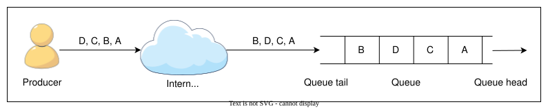

# Considerations_of_a_Distributed_Messaging_Queue’s_Design

Source: https://www.educative.io/courses/grokking-the-system-design-interview/considerations-of-a-distributed-messaging-queues-design

---

[Home](https://www.educative.io/)

[Courses](https://www.educative.io/search?tab=courses)

[Grokking Modern System Design Interview](https://www.educative.io/courses/grokking-the-system-design-interview)

# Considerations of a Distributed Messaging Queue’s Design

Discover the essential design considerations for distributed messaging queues, focusing on message ordering and concurrency. Define strict and best-effort ordering techniques, analyzing how sorting impacts performance and latency. Learn effective strategies for managing concurrent queue access.

We'll cover the following...

- [Ordering of messages](https://www.educative.io/courses/grokking-the-system-design-interview/considerations-of-a-distributed-messaging-queues-design#Ordering-of-messages)
  - [Best-effort ordering](https://www.educative.io/courses/grokking-the-system-design-interview/considerations-of-a-distributed-messaging-queues-design#Best-effort-ordering)
  - [Strict ordering](https://www.educative.io/courses/grokking-the-system-design-interview/considerations-of-a-distributed-messaging-queues-design#Strict-ordering)
    - [Sorting](https://www.educative.io/courses/grokking-the-system-design-interview/considerations-of-a-distributed-messaging-queues-design#Sorting)
- [Effect on performance](https://www.educative.io/courses/grokking-the-system-design-interview/considerations-of-a-distributed-messaging-queues-design#Effect-on-performance)
  - [Managing concurrency](https://www.educative.io/courses/grokking-the-system-design-interview/considerations-of-a-distributed-messaging-queues-design#Managing-concurrency)

Designing a distributed messaging queue requires evaluating three key factors: message ordering, its impact on performance, and concurrency control.

## Ordering of messages[#](https://www.educative.io/courses/grokking-the-system-design-interview/considerations-of-a-distributed-messaging-queues-design#Ordering-of-messages)

A messaging queue accepts messages from producers and delivers them to consumers. Some workloads require strict message ordering. For example, a chat application must deliver messages in sequence to preserve conversation context. In contrast, an email system can tolerate messages arriving out of order. Strict ordering is required for some use cases but unnecessary for others.

We categorize message ordering into two types:

- Best-effort ordering
- Strict ordering

### Best-effort ordering[#](https://www.educative.io/courses/grokking-the-system-design-interview/considerations-of-a-distributed-messaging-queues-design#Best-effort-ordering)

In **best-effort ordering**, the system places messages in the queue in the order they arrive, regardless of their production sequence.

For example, a producer sends messages A, B, C, and D. If network congestion causes message B to arrive after message D, the server receives them in the order A, C, D, B. With best-effort ordering, the queue stores them in the order of their arrivals rather than correcting the order.

Best-effort ordering: Messages are placed in a queue in the same order that they’re received and not in the order they were sent

### Strict ordering[#](https://www.educative.io/courses/grokking-the-system-design-interview/considerations-of-a-distributed-messaging-queues-design#Strict-ordering)

**Strict ordering** ensures that messages are queued in the exact sequence in which they were produced. To achieve this, the system must identify the production order, typically using a unique identifier or timestamp assigned by the producer.

1.

Who is responsible for providing the sequence numbers?

Show Answer

Did you find this helpful?

There are three common approaches to ordering incoming messages:

1. **Monotonically increasing numbers:** The server assigns sequential numbers (1, 2, 3...) to messages as they arrive.  
   **Drawbacks:** This creates a bottleneck during traffic bursts. Furthermore, it does not account for network delays; a message produced earlier but arriving late will receive a higher sequence number, violating the true production order.
2. **Causality-based sorting:** Messages are sorted by timestamps generated on the client side.  
   **Drawbacks:** While this respects production time, it is difficult to determine the correct order across multiple client sessions due to clock skew (differences in wall-clock time between machines).
3. **Using time stamps based on synchronized clocks:** This approach assigns unique, sequential timestamps that reflect the global order. A unique process identifier can be tagged to the timestamp to handle concurrent requests.  
   This allows the server to identify and wait for delayed messages. As discussed in the [sequencer](https://www.educative.io/courses/grokking-the-system-design-interview/system-design-sequencer) building block, these numbers serve as both sequence IDs and globally synchronized wall-clock timestamps.

Among these options, synchronized clocks provide the most robust mechanism for generating unique, ordered IDs.

#### Sorting[#](https://www.educative.io/courses/grokking-the-system-design-interview/considerations-of-a-distributed-messaging-queues-design#Sorting)

To enforce strict ordering, the server must sort messages by their timestamps before processing. We use an online sorting algorithm to maintain order as new messages arrive.

1.

Suppose that a message sent earlier arrives late due to a network delay. What would be the proper approach to handle such a situation?

Show Answer

Did you find this helpful?

## Effect on performance[#](https://www.educative.io/courses/grokking-the-system-design-interview/considerations-of-a-distributed-messaging-queues-design#Effect-on-performance)

Queues are designed for first in, first out (FIFO) operations. However, maintaining strict FIFO in distributed systems is challenging. Even if message A is produced before message B, network latency may cause B to arrive first.

Strict ordering requires the system to perform online sorting or wait for delayed messages, which increases latency. To minimize this, we can use a **time-window** approach, limiting sorting to a specific timeframe.

Due to these trade-offs, many distributed messaging queues either do not guarantee strict ordering or accept lower throughput to maintain it.

### Managing concurrency[#](https://www.educative.io/courses/grokking-the-system-design-interview/considerations-of-a-distributed-messaging-queues-design#Managing-concurrency)

Concurrency management is necessary in the following scenarios:

- When multiple messages arrive simultaneously.
- When multiple consumers request messages concurrently.

**Locking mechanism:** A process acquires a lock to place or consume messages. This approach is often non-scalable and degrades performance.

**Serialization:** The system queues requests in a buffer, and a single thread processes them sequentially. This lock-free solution avoids race conditions and provides higher throughput.

Alternatively, applications can use multiple queues with dedicated producers and consumers to isolate ordering costs, though this increases application complexity.

Avoiding race conditions: Producers and consumers are serialized at both ends of the queue

In this lesson, we discussed key considerations for designing a messaging queue:

- The importance of message ordering and methods to enforce it.
- The trade-offs between ordering and performance, and techniques for handling concurrency.

We are now ready to design the distributed messaging queue.

Requirements of a Distributed Messaging Queue’s Design

Design of a Distributed Messaging Queue: Part 1

Ask

[Ordering of messages](https://www.educative.io/courses/grokking-the-system-design-interview/considerations-of-a-distributed-messaging-queues-design#Ordering-of-messages)

[Best-effort ordering](https://www.educative.io/courses/grokking-the-system-design-interview/considerations-of-a-distributed-messaging-queues-design#Best-effort-ordering)

[Strict ordering](https://www.educative.io/courses/grokking-the-system-design-interview/considerations-of-a-distributed-messaging-queues-design#Strict-ordering)

[Sorting](https://www.educative.io/courses/grokking-the-system-design-interview/considerations-of-a-distributed-messaging-queues-design#Sorting)

[Effect on performance](https://www.educative.io/courses/grokking-the-system-design-interview/considerations-of-a-distributed-messaging-queues-design#Effect-on-performance)

[Managing concurrency](https://www.educative.io/courses/grokking-the-system-design-interview/considerations-of-a-distributed-messaging-queues-design#Managing-concurrency)