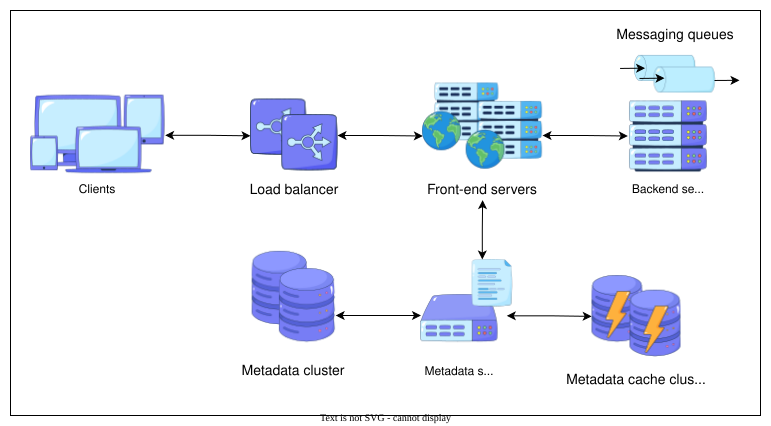

# Design_of_a_Distributed_Messaging_Queue_Part_1

Source: https://www.educative.io/courses/grokking-the-system-design-interview/design-of-a-distributed-messaging-queue-part-1

---

[Home](https://www.educative.io/)

[Courses](https://www.educative.io/search?tab=courses)

[Grokking Modern System Design Interview](https://www.educative.io/courses/grokking-the-system-design-interview)

# Design of a Distributed Messaging Queue: Part 1

Define a high-level design for a fault-tolerant distributed messaging queue. Describe the role of the load balancer and stateless frontends, including request deduplication. Explain how to scale queue metadata with sharding and replication to improve availability and performance.

We'll cover the following...

- [Distributed messaging queue](https://www.educative.io/courses/grokking-the-system-design-interview/design-of-a-distributed-messaging-queue-part-1#Distributed-messaging-queue)
  - [High-level design](https://www.educative.io/courses/grokking-the-system-design-interview/design-of-a-distributed-messaging-queue-part-1#High-level-design)
    - [Load balancer](https://www.educative.io/courses/grokking-the-system-design-interview/design-of-a-distributed-messaging-queue-part-1#Load-balancer)
    - [Frontend service](https://www.educative.io/courses/grokking-the-system-design-interview/design-of-a-distributed-messaging-queue-part-1#Frontend-service)
    - [Metadata service](https://www.educative.io/courses/grokking-the-system-design-interview/design-of-a-distributed-messaging-queue-part-1#Metadata-service)

We have discussed the requirements and design considerations. Now, let’s examine the high-level design of a distributed messaging queue.

## Distributed messaging queue[#](https://www.educative.io/courses/grokking-the-system-design-interview/design-of-a-distributed-messaging-queue-part-1#Distributed-messaging-queue)

Unlike a single-server queue, a distributed queue runs across multiple servers. This adds operational complexity but addresses the scalability and fault-tolerance limitations of a single-node design. The next sections explain how the architecture achieves scalability, availability, and durability using replication and fault-tolerant design patterns.

### High-level design[#](https://www.educative.io/courses/grokking-the-system-design-interview/design-of-a-distributed-messaging-queue-part-1#High-level-design)

To simplify the design discussion, we assume the following:

1. **Replication:** Queue data is replicated within a cluster using primary-secondary or quorum-like systems (see [data replication](https://www.educative.io/courses/grokking-the-system-design-interview/data-replication)). If a queue exceeds single-server capacity, we use data partitioning. This can be achieved via consistent hashing or by using a key-value store with message sequence numbers as keys. Each shard is then replicated (see [partition](https://www.educative.io/courses/grokking-the-system-design-interview/data-partitioning)).
2. **Elasticity:** The system automatically scales resources in response to demand.

The figure below illustrates the high-level design.

High-level architecture of a distributed messaging queue

The core components are described below.

#### Load balancer[#](https://www.educative.io/courses/grokking-the-system-design-interview/design-of-a-distributed-messaging-queue-part-1#Load-balancer)

The load balancer layer distributes requests from producers and consumers to frontend servers. This minimizes latency and ensures high availability.

#### Frontend service[#](https://www.educative.io/courses/grokking-the-system-design-interview/design-of-a-distributed-messaging-queue-part-1#Frontend-service)

This service consists of stateless machines distributed across data centers. It performs the following functions:

- **Request validation:** Verifies that requests contain all necessary information.
- **Authentication and authorization:** Confirms user identity and permissions.
- **Caching:** Stores metadata for frequently accessed queues and user data to reduce latency.
- **Request dispatching:** Routes calls to the back-end or metadata store.
- **Request deduplication:** Prevents identical requests from entering the queue. It checks a hash key store; if a duplicate is found, the request is rejected.
- **Usage data collection:** Aggregates real-time data for auditing.

#### Metadata service[#](https://www.educative.io/courses/grokking-the-system-design-interview/design-of-a-distributed-messaging-queue-part-1#Metadata-service)

This component manages queue metadata in the metadata store and cache. It updates both whenever a queue is created or deleted. Acting as middleware between front-end servers and the data layer, it prioritizes cache lookups. On a cache miss, it retrieves information from the store and updates the cache.

There are two approaches to organizing metadata cache clusters:

1. **Small metadata:** If it fits on a single machine, replicate it across all cluster servers. Requests can be served by any server. A load balancer can sit between front-end servers and metadata services.

A load balancer is introduced between the front-end servers and metadata services

2. **Large metadata:** If metadata is too large for a single machine, use one of the following sharding strategies:

- **Frontend mapping:** Shard data based on a partition key or hash (see [database partitioning](https://www.educative.io/courses/grokking-the-system-design-interview/data-partitioning)). Each shard resides on a specific host and is replicated for availability. The front-end server maintains a mapping table to route requests to the correct host.

Mapping table resides on the front-end servers

- **Host-based mapping:** Similar to the previous approach, but the mapping table is stored on each host. Any host can receive a request and forward it to the correct data node. This suits read-intensive applications.

Mapping table resides on each metadata server

We have outlined the high-level design of a distributed messaging queue and its core components:

- Frontend servers and their services
- Load balancers
- Metadata services
- Metadata clusters and their organization

The next lesson details back-end server organization, queue management, and message delivery operations.

Considerations of a Distributed Messaging Queue’s Design

Design of a Distributed Messaging Queue: Part 2

Ask

[Distributed messaging queue](https://www.educative.io/courses/grokking-the-system-design-interview/design-of-a-distributed-messaging-queue-part-1#Distributed-messaging-queue)

[High-level design](https://www.educative.io/courses/grokking-the-system-design-interview/design-of-a-distributed-messaging-queue-part-1#High-level-design)

[Load balancer](https://www.educative.io/courses/grokking-the-system-design-interview/design-of-a-distributed-messaging-queue-part-1#Load-balancer)

[Frontend service](https://www.educative.io/courses/grokking-the-system-design-interview/design-of-a-distributed-messaging-queue-part-1#Frontend-service)

[Metadata service](https://www.educative.io/courses/grokking-the-system-design-interview/design-of-a-distributed-messaging-queue-part-1#Metadata-service)