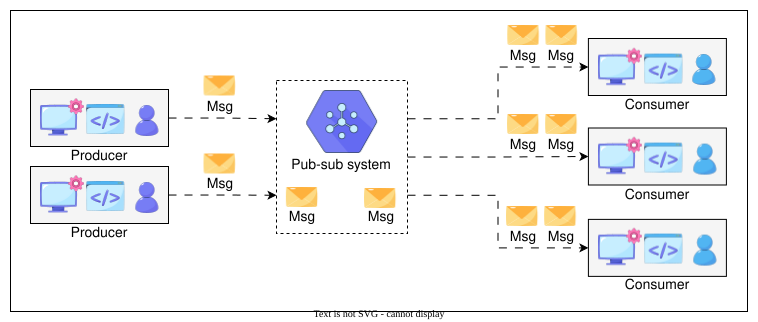

# System_Design_The_Pub-Sub_Abstraction

Source: https://www.educative.io/courses/grokking-the-system-design-interview/system-design-the-pub-sub-abstraction

---

[Home](https://www.educative.io/)

[Courses](https://www.educative.io/search?tab=courses)

[Grokking Modern System Design Interview](https://www.educative.io/courses/grokking-the-system-design-interview)

# System Design: The Pub-Sub Abstraction

Define the pub-sub abstraction, a core asynchronous communication pattern used in microservices and distributed systems. Understand how this pattern decouples producers and consumers, enabling greater scalability and independent development of system components.

We'll cover the following...

- [What is a pub-sub system?](https://www.educative.io/courses/grokking-the-system-design-interview/system-design-the-pub-sub-abstraction#What-is-a-pub-sub-system)
- [Motivation](https://www.educative.io/courses/grokking-the-system-design-interview/system-design-the-pub-sub-abstraction#Motivation)
- [How do we design a pub-sub system?](https://www.educative.io/courses/grokking-the-system-design-interview/system-design-the-pub-sub-abstraction#How-do-we-design-a-pub-sub-system)

## What is a pub-sub system?[#](https://www.educative.io/courses/grokking-the-system-design-interview/system-design-the-pub-sub-abstraction#What-is-a-pub-sub-system)

**Publish-subscribe (pub-sub) messaging** is an asynchronous communication method popular in serverless and microservices architectures. It enables a system to send messages to multiple subsystems simultaneously. Services subscribed to a specific `topic` receive any message pushed to that topic.

For example, when a user posts on a social media platform, the platform delivers that post to their followers. In this scenario, the user acts as the publisher, the post is the message, and the followers are the subscribers.

The pub-sub system

## Motivation[#](https://www.educative.io/courses/grokking-the-system-design-interview/system-design-the-pub-sub-abstraction#Motivation)

Distributed systems often rely on vast hardware infrastructure. Pub-sub systems enhance scalability by enabling asynchronous communication. This pattern decouples producers from consumers, allowing them to operate and scale independently. Consequently, engineers can add or remove components without disrupting the wider system.

## How do we design a pub-sub system?[#](https://www.educative.io/courses/grokking-the-system-design-interview/system-design-the-pub-sub-abstraction#How-do-we-design-a-pub-sub-system)

We divide the System Design process for a pub-sub system into the following lessons:

1. [**Introduction**](https://www.educative.io/courses/grokking-the-system-design-interview/introduction-to-pub-sub)**:** Explore use cases, define requirements, and design the API.
2. [**Design**](https://www.educative.io/courses/grokking-the-system-design-interview/design-of-a-pub-sub-system)**:** Discuss two architectural approaches: one using message queues and the other using a broker.

Quiz on the Distributed Messaging Queue’s Design

Introduction to Pub-Sub

Ask

[What is a pub-sub system?](https://www.educative.io/courses/grokking-the-system-design-interview/system-design-the-pub-sub-abstraction#What-is-a-pub-sub-system)

[Motivation](https://www.educative.io/courses/grokking-the-system-design-interview/system-design-the-pub-sub-abstraction#Motivation)

[How do we design a pub-sub system?](https://www.educative.io/courses/grokking-the-system-design-interview/system-design-the-pub-sub-abstraction#How-do-we-design-a-pub-sub-system)