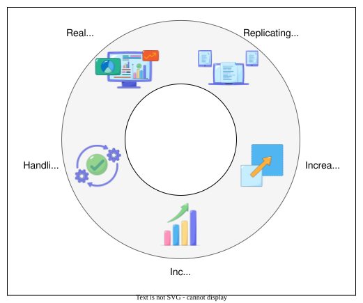

# Introduction_to_Pub-Sub

Source: https://www.educative.io/courses/grokking-the-system-design-interview/introduction-to-pub-sub

---

[Home](https://www.educative.io/)

[Courses](https://www.educative.io/search?tab=courses)

[Grokking Modern System Design Interview](https://www.educative.io/courses/grokking-the-system-design-interview)

# Introduction to Pub-Sub

Learn the essential use cases for implementing pub-sub systems in large-scale distributed applications. Define the strict functional and non-functional requirements, with a focus on durability and availability. Design the foundational API structure needed before building the complete System Design.

We'll cover the following...

- [Use cases of pub-sub](https://www.educative.io/courses/grokking-the-system-design-interview/introduction-to-pub-sub#Use-cases-of-pub-sub)
- [Requirements](https://www.educative.io/courses/grokking-the-system-design-interview/introduction-to-pub-sub#Requirements)
  - [Functional requirements](https://www.educative.io/courses/grokking-the-system-design-interview/introduction-to-pub-sub#Functional-requirements)
  - [Non-functional requirements](https://www.educative.io/courses/grokking-the-system-design-interview/introduction-to-pub-sub#Non-functional-requirements)
- [API design](https://www.educative.io/courses/grokking-the-system-design-interview/introduction-to-pub-sub#API-design)
  - [Create a topic](https://www.educative.io/courses/grokking-the-system-design-interview/introduction-to-pub-sub#Create-a-topic)
  - [Write a message](https://www.educative.io/courses/grokking-the-system-design-interview/introduction-to-pub-sub#Write-a-message)
  - [Read a message](https://www.educative.io/courses/grokking-the-system-design-interview/introduction-to-pub-sub#Read-a-message)
  - [Subscribe to a topic](https://www.educative.io/courses/grokking-the-system-design-interview/introduction-to-pub-sub#Subscribe-to-a-topic)
  - [Unsubscribe from a topic](https://www.educative.io/courses/grokking-the-system-design-interview/introduction-to-pub-sub#Unsubscribe-from-a-topic)
  - [Delete a topic](https://www.educative.io/courses/grokking-the-system-design-interview/introduction-to-pub-sub#Delete-a-topic)
- [Building blocks we will use](https://www.educative.io/courses/grokking-the-system-design-interview/introduction-to-pub-sub#Building-blocks-we-will-use)

Publish–subscribe messaging enables asynchronous communication between producers and consumers. This decoupling improves scalability, fault isolation, and independent service evolution.

## Use cases of pub-sub[#](https://www.educative.io/courses/grokking-the-system-design-interview/introduction-to-pub-sub#Use-cases-of-pub-sub)

Common use cases include:

- **Improved performance:** Push-based distribution eliminates the need for recipients to poll for updates. This reduces latency and improves response times.
- **Handling ingestion:** Pub-sub efficiently handles log ingestion. It buffers large data streams (such as user interactions) before delivering them to analytical systems. Services like Meta’s Scribe use this pattern to route logs to specific consumers or archive them, effectively managing enormous data volumes.
- **Real-time monitoring:** Raw or processed messages can feed multiple monitoring applications simultaneously for real-time system oversight.
- **Replicating data:** Pub-sub distributes state changes asynchronously. For example, a leader node can push updates to followers or distributed caches. It also synchronizes state across multiple client views (e.g., web and mobile) in real-time apps like WhatsApp.



Motivation and use cases of the pub-sub system

1.

What are the similarities and differences between a pub-sub system and queues?

Show Answer

1 / 2

## Requirements[#](https://www.educative.io/courses/grokking-the-system-design-interview/introduction-to-pub-sub#Requirements)

We will design a pub-sub system with the following requirements.

### Functional requirements[#](https://www.educative.io/courses/grokking-the-system-design-interview/introduction-to-pub-sub#Functional-requirements)

The system must support:

- **Topic creation:** Producers can create a topic to group related messages.
- **Write messages:** Producers can publish messages to a topic.
- **Subscription:** Consumers can subscribe to a topic to receive updates.
- **Read messages:** Consumers can read messages from subscribed topics.
- **Retention policy:** Users can specify a retention period for messages.
- **Message deletion:** The system automatically deletes messages after the retention period expires.

AI Powered

Saved

1 attempt left

Reset

How you would use a pub-sub system in a chat application?

You’re designing a real-time chat application that has channels for different discussions. Explain how you would use a pub-sub system for its messaging component.

Describe the mapping of the chatting application onto the following pub-sub components:

- Topics
- Subscribers
- How message delivery would work

This is your last attempt.

### Non-functional requirements[#](https://www.educative.io/courses/grokking-the-system-design-interview/introduction-to-pub-sub#Non-functional-requirements)

The design must meet the following criteria:

- **Scalability:** The system must handle increasing numbers of topics, producers, and consumers.
- **Availability:**Producers and consumers must be able to access the system at all times.
- **Durability:** Accepted messages must persist until delivered to all intended subscribers.
- **Fault tolerance:** The system must continue operating despite component failures.
- **Concurrency:** The system must safely handle simultaneous read and write operations.

## API design[#](https://www.educative.io/courses/grokking-the-system-design-interview/introduction-to-pub-sub#API-design)

We assume parameters like producer or consumer IDs are available from the underlying connection context.

### Create a topic[#](https://www.educative.io/courses/grokking-the-system-design-interview/introduction-to-pub-sub#Create-a-topic)

The API call to create a topic is as follows:

```
create(topic_ID, topic_name)
```

This API call returns an acknowledgment on success or an error on failure.

|  |  |
| --- | --- |
| **Parameter** | **Description** |
| `topic_ID` | It uniquely identifies the topic. |
| `topic_name` | It contains the name of the topic. |

### Write a message[#](https://www.educative.io/courses/grokking-the-system-design-interview/introduction-to-pub-sub#Write-a-message)

The API call to write into the pub-sub system is as follows:

```
write(topic_ID, message)
```

This API call writes a `message` to the specified `topic_ID`. Messages have a maximum size of 1 MB. It returns an acknowledgment or error.

|  |  |
| --- | --- |
| **Parameter** | **Description** |
| `message` | The message to be written in the system. |

### Read a message[#](https://www.educative.io/courses/grokking-the-system-design-interview/introduction-to-pub-sub#Read-a-message)

The API call to read data from the system is as follows:

```
read(topic_ID)
```

This API call retrieves a message object from the specified `topic_ID`.

|  |  |
| --- | --- |
| **Parameter** | **Description** |
| `topic_ID` | It is the ID of the topic against which the message will be read. |

### Subscribe to a topic[#](https://www.educative.io/courses/grokking-the-system-design-interview/introduction-to-pub-sub#Subscribe-to-a-topic)

The API call to subscribe to a topic is as follows:

```
subscribe(topic_ID)
```

This API call registers the consumer as a subscriber to the specified `topic_ID`.

|  |  |
| --- | --- |
| **Parameter** | **Description** |
| `topic_ID` | The ID of the topic to which the consumer will be subscribed. |

### Unsubscribe from a topic[#](https://www.educative.io/courses/grokking-the-system-design-interview/introduction-to-pub-sub#Unsubscribe-from-a-topic)

The API call to unsubscribe from a topic is as follows:

```
unsubscribe(topic_ID)
```

This API call removes the consumer’s subscription to the specified `topic_ID`.

|  |  |
| --- | --- |
| **Parameter** | **Description** |
| `topic_ID` | The ID of the topic against which the consumers will be unsubscribed. |

### Delete a topic[#](https://www.educative.io/courses/grokking-the-system-design-interview/introduction-to-pub-sub#Delete-a-topic)

The API call to delete a topic is as follows:

```
delete_topic(topic_ID)
```

This API call deletes the topic identified by `topic_ID`.

|  |  |
| --- | --- |
| **Parameter** | **Description** |
| `topic_ID` | The ID of the topic which is to be deleted. |

## Building blocks we will use[#](https://www.educative.io/courses/grokking-the-system-design-interview/introduction-to-pub-sub#Building-blocks-we-will-use)

We will utilize the following building blocks discussed in previous chapters:


The building blocks we’ll use

- [**Database**](https://www.educative.io/courses/grokking-the-system-design-interview/introduction-to-databases)**:** Stores metadata, such as subscription details.
- [**Distributed messaging queue**](https://www.educative.io/courses/grokking-the-system-design-interview/system-design-the-distributed-messaging-queue)**:** Buffers messages sent by producers.
- [**Key-value**](https://www.educative.io/courses/grokking-the-system-design-interview/system-design-the-key-value-store)**:** Stores transient consumer state.

In the next lesson, we will design the pub-sub system.

System Design: The Pub-Sub Abstraction

Design of a Pub-Sub System

Ask

[Use cases of pub-sub](https://www.educative.io/courses/grokking-the-system-design-interview/introduction-to-pub-sub#Use-cases-of-pub-sub)

[Requirements](https://www.educative.io/courses/grokking-the-system-design-interview/introduction-to-pub-sub#Requirements)

[Functional requirements](https://www.educative.io/courses/grokking-the-system-design-interview/introduction-to-pub-sub#Functional-requirements)

[Non-functional requirements](https://www.educative.io/courses/grokking-the-system-design-interview/introduction-to-pub-sub#Non-functional-requirements)

[API design](https://www.educative.io/courses/grokking-the-system-design-interview/introduction-to-pub-sub#API-design)

[Create a topic](https://www.educative.io/courses/grokking-the-system-design-interview/introduction-to-pub-sub#Create-a-topic)

[Write a message](https://www.educative.io/courses/grokking-the-system-design-interview/introduction-to-pub-sub#Write-a-message)

[Read a message](https://www.educative.io/courses/grokking-the-system-design-interview/introduction-to-pub-sub#Read-a-message)

[Subscribe to a topic](https://www.educative.io/courses/grokking-the-system-design-interview/introduction-to-pub-sub#Subscribe-to-a-topic)

[Unsubscribe from a topic](https://www.educative.io/courses/grokking-the-system-design-interview/introduction-to-pub-sub#Unsubscribe-from-a-topic)

[Delete a topic](https://www.educative.io/courses/grokking-the-system-design-interview/introduction-to-pub-sub#Delete-a-topic)

[Building blocks we will use](https://www.educative.io/courses/grokking-the-system-design-interview/introduction-to-pub-sub#Building-blocks-we-will-use)