# Design_of_a_Pub-Sub_System

Source: https://www.educative.io/courses/grokking-the-system-design-interview/design-of-a-pub-sub-system

---

[Home](https://www.educative.io/)

[Courses](https://www.educative.io/search?tab=courses)

[Grokking Modern System Design Interview](https://www.educative.io/courses/grokking-the-system-design-interview)

# Design of a Pub-Sub System

Define a scalable pub–sub architecture using partitioned topics and dedicated brokers instead of a single queue. Explain how cluster managers coordinate replication and how consumer managers track offsets to support reliable delivery semantics.

We'll cover the following...

- [First design](https://www.educative.io/courses/grokking-the-system-design-interview/design-of-a-pub-sub-system#First-design)
- [Second design](https://www.educative.io/courses/grokking-the-system-design-interview/design-of-a-pub-sub-system#Second-design)
  - [High-level design](https://www.educative.io/courses/grokking-the-system-design-interview/design-of-a-pub-sub-system#High-level-design)
- [Broker](https://www.educative.io/courses/grokking-the-system-design-interview/design-of-a-pub-sub-system#Broker)
- [Cluster manager](https://www.educative.io/courses/grokking-the-system-design-interview/design-of-a-pub-sub-system#Cluster-manager)
- [Consumer manager](https://www.educative.io/courses/grokking-the-system-design-interview/design-of-a-pub-sub-system#Consumer-manager)
- [Finalized design](https://www.educative.io/courses/grokking-the-system-design-interview/design-of-a-pub-sub-system#Finalized-design)
- [Conclusion](https://www.educative.io/courses/grokking-the-system-design-interview/design-of-a-pub-sub-system#Conclusion)

## First design[#](https://www.educative.io/courses/grokking-the-system-design-interview/design-of-a-pub-sub-system#First-design)

Producers write to topics, and consumers subscribe to topics to read messages. As new messages are appended to the end, we can use [distributed messaging queues](https://www.educative.io/courses/grokking-the-system-design-interview/system-design-the-distributed-messaging-queue).

The system requires the following components:

- **Topic queue:** A distributed messaging queue where producers write their messages.
- **Database:** A relational database stores subscription details. For example, we need to store which consumer has subscribed to which topic so we can deliver the messages they want. We use a relational model to maintain structured data and ensure integrity.
- **Message director:** Reads messages from the topic queue, fetches subscriber details from the database, and forwards messages to the appropriate consumer queues.
- **Consumer queue:** A dedicated distributed queue for each consumer. Messages are copied here from the topic queue for consumption.
- **Subscriber:** Handles subscription requests and adds entries to the database.

When a consumer subscribes, the subscription metadata is persisted to the system store. The message dispatcher reads from the topic, resolves the list of subscribed consumers, and appends the message to each consumer’s queue. Consumers read messages from their assigned queues.

> **Note:** We use failover services for the message director and subscriber to ensure reliability.

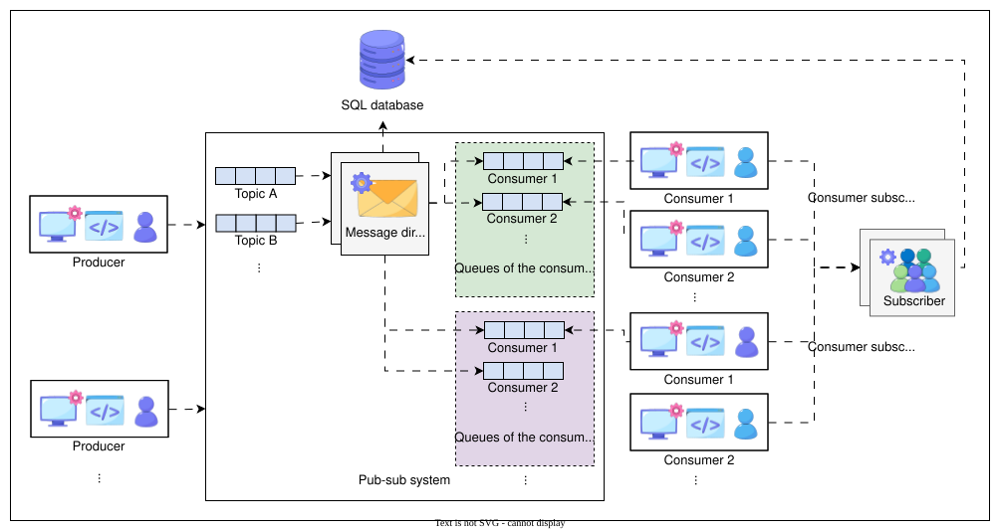

Using the distributed messaging queue

A distributed messaging queue simplifies message delivery logic but introduces scalability challenges. Maintaining a separate queue for each of millions of subscribers consumes significant memory and metadata overhead. Copying the same message into each subscriber queue leads to storage amplification and redundant data replication.

1.

Is there a way to avoid maintaining a separate queue for each reader?

Show Answer

1 / 2

## Second design[#](https://www.educative.io/courses/grokking-the-system-design-interview/design-of-a-pub-sub-system#Second-design)

Let’s consider an alternative approach.

### High-level design[#](https://www.educative.io/courses/grokking-the-system-design-interview/design-of-a-pub-sub-system#High-level-design)

The pub-sub system includes the following components:

- **Broker:** Handles message storage and read/write requests.
- **Cluster manager:** Monitors broker health and manages the cluster, notifying the system of any failures.
- **Storage:** A relational database stores consumer metadata, subscription info, and retention policies.
- **Consumer manager:** Manages consumer authorization and access.

Key design considerations include:

- **Acknowledgment:** Confirms successful message storage (producer side) or consumption (consumer side).
- **Retention time:** This is a configurable message lifespan. The default is seven days, but requirements vary; banking applications may need weeks, while analytical applications may discard data immediately after use.

High-level design of a pub-sub system

Let’s examine the role of each component.

## Broker[#](https://www.educative.io/courses/grokking-the-system-design-interview/design-of-a-pub-sub-system#Broker)

The broker is the core component handling read and write requests. Each broker hosts multiple topics. To ensure persistence and availability, topics are divided into partitions stored locally. A **partition** consists of messages encapsulated in segments.

**Segments** define the start and end of a message using an offset address. Consumers read from a specific partition offset. The illustration below depicts this concept.

A depiction of how messages are stored within segments inside a partition

A **topic** is a persistent, immutable sequence of messages. As disk I/O limits scaling, we split topics into partitions. Data for a single topic is distributed across multiple partitions.

Producers send messages to a topic, and the system distributes them to partitions using the round robin algorithm. We use a variation called weighted round robin. The following slides illustrate message storage in various partitions.

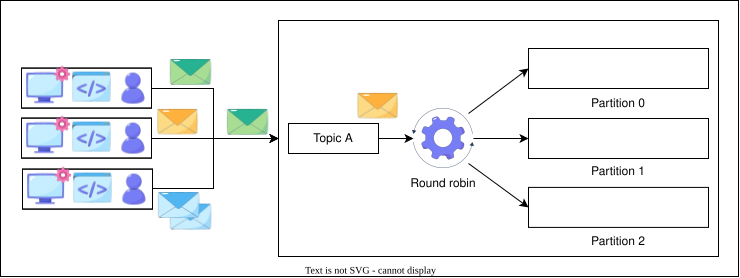

1 / 9

The round-robin algorithm decides the partition where we need to store the message.

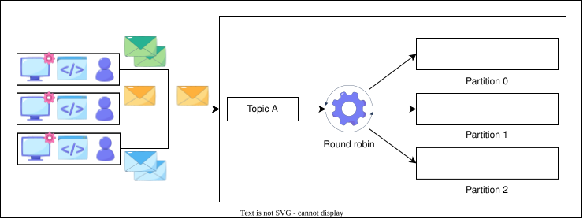

1 / 9

The messages are added to the relative partitions.

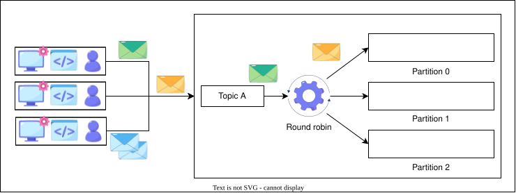

1 / 9

The round-robin algorithm sends the message to Partition 0 and decides the partition for the incoming message.

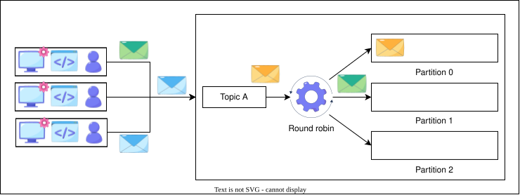

1 / 9

The round-robin algorithm sends the message to Partition 1 and decides the partition for the incoming message.

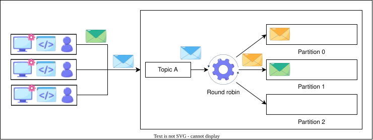

1 / 9

The round-robin algorithm sends the message to Partition 1 and decides the partition for the incoming message.

1.

Strict ordering ensures that the messages are stored in the order in which they are produced. How can we ensure strict message ordering?

Show Answer

1 / 4

Partitions are distributed across different brokers in the cluster. Within a partition, strict ordering is maintained by appending new content to the end of the log.

The following slides illustrate the distribution of partitions across brokers.

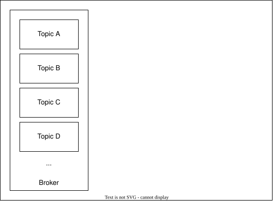

1 / 3

A broker contains multiple topics.

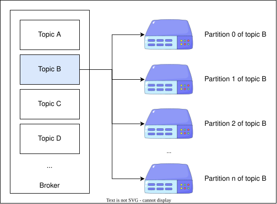

1 / 3

Physical view: A topic is split into numerous partitions that are stored on other brokers.

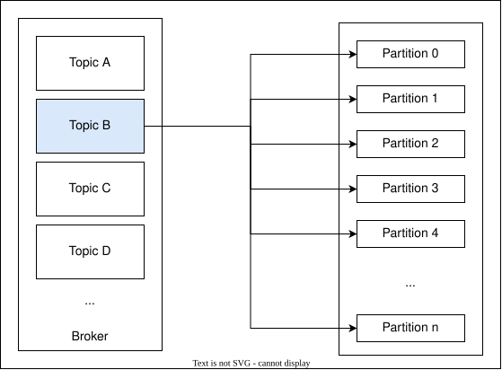

1 / 3

Logical view: We can represent the partitions in another way. Here, Topic B is split into multiple partitions.

Messages are stored in segments and identified by an offset. Because records are immutable, readers can access messages independently from any point in the file using the API. The following slides detail the segment structure.

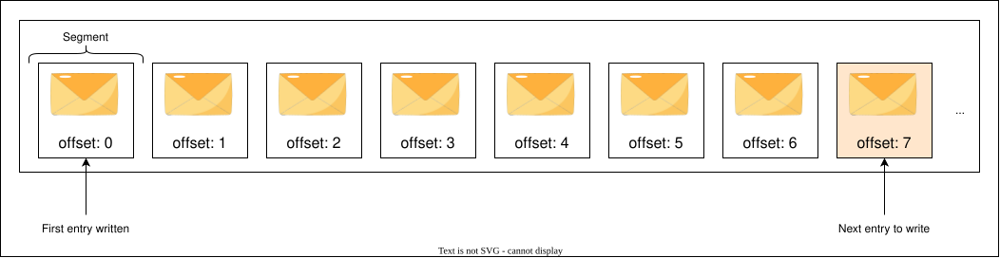

1 / 2

A new entry will be added at the end of the file.

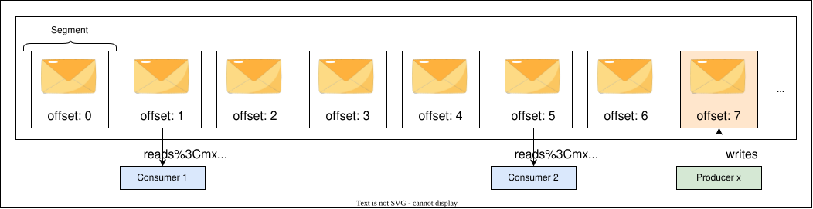

1 / 2

The consumers can read anywhere from the file. Producers add to the end of file.

The broker architecture resolves the scalability issues of the first design. Partitioning avoids the need for millions of queues and introduces parallelism to prevent bottlenecks.

AI Powered

Saved

1 attempt left

Reset

How do we ensure message order in a pub-sub?

How would you design a pub-sub system to ensure consumers receive messages in the correct order, even when subscribing to multiple topics or partitions, assuming messages have different time stamps?

This is your last attempt.

## Cluster manager[#](https://www.educative.io/courses/grokking-the-system-design-interview/design-of-a-pub-sub-system#Cluster-manager)

The cluster manager oversees the brokers and performs the following tasks:

- **Broker and topics registry:** Maintains the list of topics per broker.
- **Manage replication:** Uses a leader-follower approach. If a leader fails, the manager elects a new one. It ensures three replicas per partition exist across different brokers.
- **Authorization:** Controls access to brokers and topics, as well as message replication across clusters.

Replication at the partitioning level

## Consumer manager[#](https://www.educative.io/courses/grokking-the-system-design-interview/design-of-a-pub-sub-system#Consumer-manager)

The consumer manager handles consumer interactions:

- **Verify the consumer:** Checks if a consumer is authorized to read from a specific topic.
- **Retention time management:** Enforces retention policies to prevent access to expired messages.
- **Message delivery options:** Supports both Push (system sends data) and Pull (consumer requests data) models. This flexibility prevents consumer overload while supporting real-time needs. Preferences are stored in the database.
- **Offset management:** Stores each consumer’s offset in a key-value store. This allows consumers to resume reading from where they left off.

## Finalized design[#](https://www.educative.io/courses/grokking-the-system-design-interview/design-of-a-pub-sub-system#Finalized-design)

The diagram below illustrates the finalized pub-sub system design.

High-level design of a pub-sub system

## Conclusion[#](https://www.educative.io/courses/grokking-the-system-design-interview/design-of-a-pub-sub-system#Conclusion)

This lesson compared two pub–sub designs: a queue-based model and a custom storage model optimized for small messages. Publish–subscribe systems decouple producers and consumers, which enables independent scaling and isolates failures between components. This architecture is well suited for large-scale systems that require controlled delivery semantics and high throughput.

Introduction to Pub-Sub

Pub-Sub System Design

Ask

[First design](https://www.educative.io/courses/grokking-the-system-design-interview/design-of-a-pub-sub-system#First-design)

[Second design](https://www.educative.io/courses/grokking-the-system-design-interview/design-of-a-pub-sub-system#Second-design)

[High-level design](https://www.educative.io/courses/grokking-the-system-design-interview/design-of-a-pub-sub-system#High-level-design)

[Broker](https://www.educative.io/courses/grokking-the-system-design-interview/design-of-a-pub-sub-system#Broker)

[Cluster manager](https://www.educative.io/courses/grokking-the-system-design-interview/design-of-a-pub-sub-system#Cluster-manager)

[Consumer manager](https://www.educative.io/courses/grokking-the-system-design-interview/design-of-a-pub-sub-system#Consumer-manager)

[Finalized design](https://www.educative.io/courses/grokking-the-system-design-interview/design-of-a-pub-sub-system#Finalized-design)

[Conclusion](https://www.educative.io/courses/grokking-the-system-design-interview/design-of-a-pub-sub-system#Conclusion)