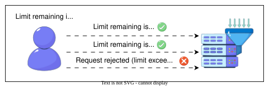
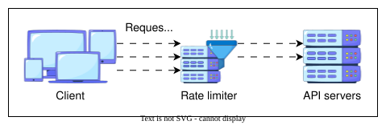

# System_Design_The_Rate_Limiter

Source: https://www.educative.io/courses/grokking-the-system-design-interview/system-design-the-rate-limiter

---

[Home](https://www.educative.io/)

[Courses](https://www.educative.io/search?tab=courses)

[Grokking Modern System Design Interview](https://www.educative.io/courses/grokking-the-system-design-interview)

# System Design: The Rate Limiter

Explore the fundamental role of a rate limiter in modern System Design. Learn how this defensive layer throttles requests to prevent resource starvation, mitigate denial-of-service attacks, and enforce fair usage policies. Understand the core purpose before designing the system requirements.

We'll cover the following...

- [What is a rate limiter?](https://www.educative.io/courses/grokking-the-system-design-interview/system-design-the-rate-limiter#What-is-a-rate-limiter)
- [Why do we need a rate limiter?](https://www.educative.io/courses/grokking-the-system-design-interview/system-design-the-rate-limiter#Why-do-we-need-a-rate-limiter)
- [How will we design a rate limiter?](https://www.educative.io/courses/grokking-the-system-design-interview/system-design-the-rate-limiter#How-will-we-design-a-rate-limiter)

## What is a rate limiter?[#](https://www.educative.io/courses/grokking-the-system-design-interview/system-design-the-rate-limiter#What-is-a-rate-limiter)

A **rate limiter** limits the number of requests a service can fulfill within a specific timeframe. It throttles traffic that exceeds a predefined limit. For example, if an API is configured to allow 500 requests per minute, the rate limiter blocks any additional requests from a client once that threshold is reached.

## Why do we need a rate limiter?[#](https://www.educative.io/courses/grokking-the-system-design-interview/system-design-the-rate-limiter#Why-do-we-need-a-rate-limiter)

Rate limiters act as a defensive layer to prevent excessive usage, whether intended or unintended. They protect services against application-layer abuse, such as denial-of-service (DoS) attacks and brute-force password attempts.

Rate limiters improve service reliability in several scenarios:

- **Preventing resource starvation:** Software errors or misconfigurations can trigger “friendly-fire” denial of service incidents. Rate limiters prevent these events from exhausting system resources.
- **Managing policies and quotas:** Rate limiters ensure fair resource usage in multi-tenant environments. They enforce policies based on time duration or allocated quotas.
- **Controlling data flow:** In systems processing large data volumes, rate limiters regulate flow to prevent overloading specific machines, helping distribute the workload evenly.
- **Avoiding excess costs:** Rate limiting controls operational costs by preventing runaway experiments or processes. Cloud providers often use this to limit freemium tiers or cap billable usage.

Throttling the number of requests to API servers via a rate limiter

## How will we design a rate limiter?[#](https://www.educative.io/courses/grokking-the-system-design-interview/system-design-the-rate-limiter#How-will-we-design-a-rate-limiter)

We will explore the design of a rate limiter through the following sections:

1. [**Requirements:**](https://www.educative.io/courses/grokking-the-system-design-interview/requirements-of-a-rate-limiters-design) Define functional and non-functional requirements, types of throttling, and placement strategies.
2. [**High-level design:**](https://www.educative.io/courses/grokking-the-system-design-interview/design-of-a-rate-limiter) Discuss an overview of the rate limiter architecture.
3. [**Detailed design:**](https://www.educative.io/courses/grokking-the-system-design-interview/design-of-a-rate-limiter#Detailed-design) Take a deep dive into the specific building blocks and components.
4. [**Rate limiter algorithms:**](https://www.educative.io/courses/grokking-the-system-design-interview/rate-limiter-algorithms) Get an explanation of the algorithms that drive rate-limiting logic.
5. [**Quiz**](https://www.educative.io/courses/grokking-the-system-design-interview/quiz-on-the-rate-limiters-design)**:** Complete a self-assessment to test your understanding.

Let’s begin by defining the requirements.

Pub-Sub System Design

Requirements of a Rate Limiter’s Design

Ask

[What is a rate limiter?](https://www.educative.io/courses/grokking-the-system-design-interview/system-design-the-rate-limiter#What-is-a-rate-limiter)

[Why do we need a rate limiter?](https://www.educative.io/courses/grokking-the-system-design-interview/system-design-the-rate-limiter#Why-do-we-need-a-rate-limiter)

[How will we design a rate limiter?](https://www.educative.io/courses/grokking-the-system-design-interview/system-design-the-rate-limiter#How-will-we-design-a-rate-limiter)