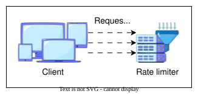
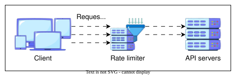

# Requirements_of_a_Rate_Limiter’s_Design

Source: https://www.educative.io/courses/grokking-the-system-design-interview/requirements-of-a-rate-limiters-design

---

[Home](https://www.educative.io/)

[Courses](https://www.educative.io/search?tab=courses)

[Grokking Modern System Design Interview](https://www.educative.io/courses/grokking-the-system-design-interview)

# Requirements of a Rate Limiter’s Design

Define the functional and non-functional requirements for designing a highly available and scalable rate limiter. Analyze critical architectural decisions like placement, throttling types, and the trade-offs of using centralized vs. distributed counter storage models.

We'll cover the following...

- [Requirements](https://www.educative.io/courses/grokking-the-system-design-interview/requirements-of-a-rate-limiters-design#Requirements)
  - [Functional requirements](https://www.educative.io/courses/grokking-the-system-design-interview/requirements-of-a-rate-limiters-design#Functional-requirements)
  - [Non-functional requirements](https://www.educative.io/courses/grokking-the-system-design-interview/requirements-of-a-rate-limiters-design#Non-functional-requirements)
- [Types of throttling](https://www.educative.io/courses/grokking-the-system-design-interview/requirements-of-a-rate-limiters-design#Types-of-throttling)
- [Where to place the rate limiter](https://www.educative.io/courses/grokking-the-system-design-interview/requirements-of-a-rate-limiters-design#Where-to-place-the-rate-limiter)
- [Two models for implementing a rate limiter](https://www.educative.io/courses/grokking-the-system-design-interview/requirements-of-a-rate-limiters-design#Two-models-for-implementing-a-rate-limiter)
- [Building blocks we will use](https://www.educative.io/courses/grokking-the-system-design-interview/requirements-of-a-rate-limiters-design#Building-blocks-we-will-use)

## Requirements[#](https://www.educative.io/courses/grokking-the-system-design-interview/requirements-of-a-rate-limiters-design#Requirements)

This lesson focuses on designing a rate limiter with the following functional and non-functional requirements.

### Functional requirements[#](https://www.educative.io/courses/grokking-the-system-design-interview/requirements-of-a-rate-limiters-design#Functional-requirements)

- Limit the number of requests a client can send within a time window.
- Ensure request limits per window are configurable.
- Notify the client (via error or notification) when a threshold is crossed.

### Non-functional requirements[#](https://www.educative.io/courses/grokking-the-system-design-interview/requirements-of-a-rate-limiters-design#Non-functional-requirements)

- **Availability:** The rate limiter must protect the system and be highly available.
- **Low latency:** Checks must occur with minimal latency to avoid impacting user experience.
- **Scalability:** The design must support an increasing number of requests and clients.

## Types of throttling[#](https://www.educative.io/courses/grokking-the-system-design-interview/requirements-of-a-rate-limiters-design#Types-of-throttling)

Rate limiters generally perform three types of throttling:

1. **Hard throttling:** This enforces a strict limit. Any request exceeding the threshold is discarded.
2. **Soft throttling:** This allows requests to exceed the limit by a specific percentage. For example, a limit of 500 with a 5% buffer allows 525 requests.
3. **Elastic or dynamic throttling:** Allows requests to exceed the limit if the system has free resources, without a fixed upper cap.

## Where to place the rate limiter[#](https://www.educative.io/courses/grokking-the-system-design-interview/requirements-of-a-rate-limiters-design#Where-to-place-the-rate-limiter)

There are three common placement strategies:

1. **On the client side:** It is easy to place the rate limiter on the client side. It is easy to implement, but vulnerable to tampering and difficult to configure securely.
2. **On the server side:** The rate limiter runs directly on the server, checking requests as they arrive.

Rate limiter placed at the server side

3. **As middleware:** The rate limiter acts as an intermediary, throttling requests before they reach API servers.

Rate limiter as middleware

> **Note:** API endpoints are ideal vantage points for rate limiting because all traffic passes through them.

Placement is a subjective decision based on the organization’s technology stack, engineering resources, and goals.

AI Powered

Saved

1 attempt left

Reset

Global vs. Per User Rate Limiting

When designing a system that tracks usage or limits access, how would you choose between a single counter shared by all users and separate counters maintained for each user? What does this choice suggest about tradeoffs between fairness, resource control, and added system complexity?

This is your last attempt.

## Two models for implementing a rate limiter[#](https://www.educative.io/courses/grokking-the-system-design-interview/requirements-of-a-rate-limiters-design#Two-models-for-implementing-a-rate-limiter)

A single rate limiter cannot handle traffic for millions of users. We need a cluster of independent nodes. There are two ways to manage the state (counters) across these nodes:

1. **A rate limiter with a centralized database:** In this approach, rate limiters connect to a central store like Redis or PostgreSQL. This ensures strict limits but increases latency and may cause race conditions or lock contention in highly concurrent requests.
2. **A rate limiter with a distributed database:** In this approach, each node tracks limits locally or in a distributed store. This is faster but less accurate; clients may momentarily exceed limits while state synchronizes. Sticky sessions in the load balancer can enforce limits per node (by sending consumers to exactly one node) but reduce fault tolerance and scalability.

Beyond storage architecture, we must decide between global counters shared by all requests or individual counters per user. For example, the [token bucket algorithm](https://www.educative.io/courses/grokking-the-system-design-interview/rate-limiter-algorithms#Token-bucket-algorithm) can use a single bucket for total traffic or assign specific buckets to users. This choice depends on the use case and rate limiting rules.

1.

Can a load balancer be used as a rate limiter?

Show Answer

1 / 2

## Building blocks we will use[#](https://www.educative.io/courses/grokking-the-system-design-interview/requirements-of-a-rate-limiters-design#Building-blocks-we-will-use)

This design utilizes the following building blocks:

Building blocks in the design of a rate limiter

- [**Databases**](https://www.educative.io/courses/grokking-the-system-design-interview/introduction-to-databases) store service rules and user metadata.
- [**Caches**](https://www.educative.io/courses/grokking-the-system-design-interview/system-design-the-distributed-cache) provide fast access to rules and user data.
- [**Queues**](https://www.educative.io/courses/grokking-the-system-design-interview/requirements-of-a-distributed-messaging-queues-design) buffer incoming requests allowed by the rate limiter.

The next lesson covers the high-level and detailed design of the rate limiter.

System Design: The Rate Limiter

Design of a Rate Limiter

Ask

[Requirements](https://www.educative.io/courses/grokking-the-system-design-interview/requirements-of-a-rate-limiters-design#Requirements)

[Functional requirements](https://www.educative.io/courses/grokking-the-system-design-interview/requirements-of-a-rate-limiters-design#Functional-requirements)

[Non-functional requirements](https://www.educative.io/courses/grokking-the-system-design-interview/requirements-of-a-rate-limiters-design#Non-functional-requirements)

[Types of throttling](https://www.educative.io/courses/grokking-the-system-design-interview/requirements-of-a-rate-limiters-design#Types-of-throttling)

[Where to place the rate limiter](https://www.educative.io/courses/grokking-the-system-design-interview/requirements-of-a-rate-limiters-design#Where-to-place-the-rate-limiter)

[Two models for implementing a rate limiter](https://www.educative.io/courses/grokking-the-system-design-interview/requirements-of-a-rate-limiters-design#Two-models-for-implementing-a-rate-limiter)

[Building blocks we will use](https://www.educative.io/courses/grokking-the-system-design-interview/requirements-of-a-rate-limiters-design#Building-blocks-we-will-use)