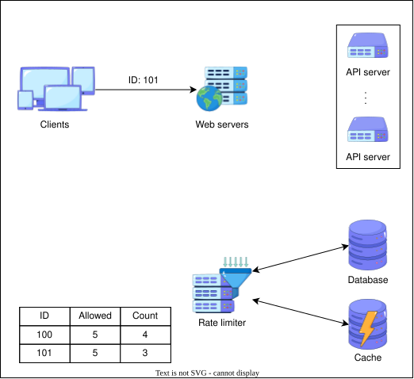
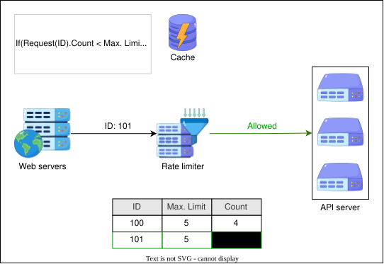
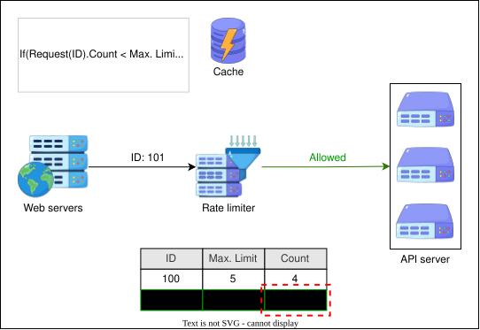
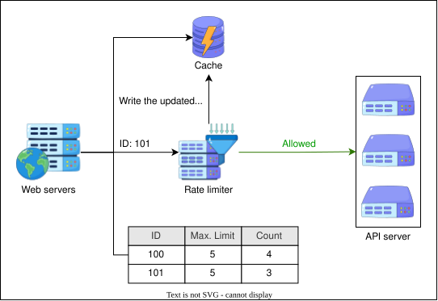
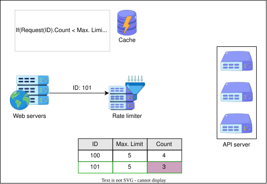

# Design_of_a_Rate_Limiter

Source: https://www.educative.io/courses/grokking-the-system-design-interview/design-of-a-rate-limiter

---

[Home](https://www.educative.io/)

[Courses](https://www.educative.io/search?tab=courses)

[Grokking Modern System Design Interview](https://www.educative.io/courses/grokking-the-system-design-interview)

# Design of a Rate Limiter

Discover the detailed System Design required to build a highly available rate limiter. Learn how to structure components such as the decision-maker and the cache to manage traffic and mitigate race conditions. Implement online and offline updates to ensure low latency and system stability.

We'll cover the following...

- [High-level design](https://www.educative.io/courses/grokking-the-system-design-interview/design-of-a-rate-limiter#High-level-design)
- [Detailed design](https://www.educative.io/courses/grokking-the-system-design-interview/design-of-a-rate-limiter#Detailed-design)
  - [Request processing](https://www.educative.io/courses/grokking-the-system-design-interview/design-of-a-rate-limiter#Request-processing)
  - [Race condition](https://www.educative.io/courses/grokking-the-system-design-interview/design-of-a-rate-limiter#Race-condition)
  - [Optimizing the client’s critical path](https://www.educative.io/courses/grokking-the-system-design-interview/design-of-a-rate-limiter#Optimizing-the-clients-critical-path)
- [Conclusion](https://www.educative.io/courses/grokking-the-system-design-interview/design-of-a-rate-limiter#Conclusion)

## High-level design[#](https://www.educative.io/courses/grokking-the-system-design-interview/design-of-a-rate-limiter#High-level-design)

A rate limiter is a dedicated service that sits between the client and the web server. It evaluates incoming requests against defined rules to decide whether to forward them to the server or block them. The figure below illustrates this interaction. [Lyft’s](https://github.com/envoyproxy/ratelimit) rate-limiting service provides a practical example of how these rules are structured.

YAML

Ace Editor

1

2

3

4

5

6

7

domain: messaging

descriptors:

- key: message\_type

value: marketing

rate\_limit:

unit: day

requests\_per\_unit: 5

הההההההההההההההההההההההההההההההההההההההההההההההההההההההההההההההההההההההההההההההההההההההההההההההההההההההההההההההההההההההההההההההההההההההההההההההההההההההההההההההההההההההההההההההההההההההההההההההההההההההההההההההההההההההההההההההההההההההההההההההההההההההההההההההההההההההההההההההההההההההההההההההההההההההההההההההההההההההההההההההההההההההההההההההההההההההההההההההההההההההההההההההההההההההההההההההההההההההההההההההההההההההההההההההההההההההההההההההההההההההההההההההההההההההההההההההההההההההההההההההההההההההההההההההההההההההההההההההה

XXXXXXXXXXXXXXXXXXXXXXXXXXXXXXXXXXXXXXXXXXXXXXXXXXXXXXXXXXXXXXXXXXXXXXXXXXXXXXXXXXXXXXXXXXXXXXXXXXXXXXXXXXXXXXXXXXXXXXXXXXXXXXXXXXXXXXXXXXXXXXXXXXXXXXXXXXXXXXXXXXXXXXXXXXXXXXXXXXXXXXXXXXXXXXXXXXXXXXXXXXXXXXXXXXXXXXXXXXXXXXXXXXXXXXXXXXXXXXXXXXXXXXXXXXXXXXXXXXXXXXXXXXXXXXXXXXXXXXXXXXXXXXXXXXXXXXXXXXXXXXXXXXXXXXXXXXXXXXXXXXXXXXXXXXXXXXXXXXXXXXXXXXXXXXXXXXXXXXXXXXXXXXXXXXXXXXXXXXXXXXXXXXXXXXXXXXXXXXXXXXXXXXXXXXXXXXXXXXXXXXXXXXXXXXXXXXXXXXXXXXXXXXXXXXXXXXXXXXXXXXXXXXXXXXXXXXXXXXXXXXXXXXXXXXXXXXXXXXXXXXXXXXXXXXXX

⋯

Rate limiting rules from Lyft

In this example, the `unit` is set to `day` and `requests_per_unit` is `5`. This rule limits the client to five marketing messages per day.

1 / 6

A request with ID 101, received by one of the web servers

1 / 6

The request is forwarded to the rate limiter

1 / 6

If the request is allowed, the corresponding count is incremented

1 / 6

The web server forwards the request to one of the API servers

1 / 6

The response is sent back to the web server after serving the request

## Detailed design[#](https://www.educative.io/courses/grokking-the-system-design-interview/design-of-a-rate-limiter#Detailed-design)

The high-level design leaves key questions unanswered:

- Where are the rules stored?
- How do we handle rate-limited requests?

Let’s expand the architecture to address these components and explain their roles in detail:

The rate limiter accepts or rejects requests based on throttle rules

The detailed design consists of the following components:

- **Rule database:** Stores rules defined by the service owner, such as request limits per time unit.
- **Rules retriever:** A background process that monitors the database for changes and updates the cache to ensure rules are current.
- **Throttle rules cache:** Stores rules in memory for low-latency access. The rate limiter checks incoming request IDs against this cache.
- **Decision-maker:** Evaluates requests against cached rules using a rate-limiting algorithm.
- **Client identifier builder:** Generates a unique ID for each request (e.g., IP address, login ID) to serve as the key for the decision maker to track usage.

If a request exceeds the limit, the API returns HTTP `429 Too Many Requests`. The system may then:

- Drop the request and return an error message (e.g., “Service unavailable”).
- Queue the request for later processing if the limit is due to a temporary system overload.

### Request processing[#](https://www.educative.io/courses/grokking-the-system-design-interview/design-of-a-rate-limiter#Request-processing)

When a request arrives, the *client identifier builder* extracts the client key and forwards it to the *decision-maker.* The decision-maker checks the cache for rules and current usage counts. If the request is within the configured limits, it is passed to the request processor.

The decision-maker makes decisions based on the throttling algorithms: hard, soft, or elastic. With soft or elastic throttling, requests are either served beyond the defined limit or placed in the queue and served later, as resources become available. Similarly, if hard throttling is used, requests are rejected, and an error response is sent to the client.

AI Powered

Saved

1 attempt left

Reset

Should requests be rejected or accepted in face of failures?

In the event of a failure, a rate limiter is unable to perform the task of throttling. In these scenarios, should the request be accepted or rejected? Give your answer along with proper reasoning.

This is your last attempt.

### Race condition[#](https://www.educative.io/courses/grokking-the-system-design-interview/design-of-a-rate-limiter#Race-condition)

In high-concurrency environments, race conditions can occur when the system uses a “read-modify-write” approach (read the counter, increment, write back). If two requests read the counter simultaneously, they may both write the same incremented value back, leading to undercounting.

Locking prevents this but creates performance bottlenecks. A better approach is to use `atomic operations` (like Redis `INCR`) which increment and return the value in a single step. Sharded counters can also be used to distribute write contention across multiple keys.

> **Note:** Sharded counters reduce write contention by splitting the counter into multiple parts. However, reading the total count requires summing all shards, which may slightly increase read latency.

### Optimizing the client’s critical path[#](https://www.educative.io/courses/grokking-the-system-design-interview/design-of-a-rate-limiter#Optimizing-the-clients-critical-path)

Synchronously retrieving, updating, and writing back counters for every request can introduce latency. To optimize the client’s critical path, we can separate the decision from the update.

- **Online check:** When a request arrives, the system checks the cache. If the current count is below the limit, the request is allowed immediately.
- **Offline update:** The system updates the counter and cache asynchronously. While this significantly improves performance, it introduces eventual consistency, meaning a small number of excess requests might be allowed before the counter updates. Let’s illustrate this with an example where the rate limiter checks if `request(ID).Count <= Max Limit` using cached data. For simplicity, assume that one of the request ID is 101, that is, `request(ID) = 101`.

The following table shows the number of requests made by each client and the maximum number of requests per unit time that a client can make.

|  |  |  |
| --- | --- | --- |
| **Request ID** | **Maximum Limit** | **Count** |
| 100 | 5 | 4 |
| 101 | 5 | 3 |

If the condition is true, the rate limiter immediately sends an `Allowed` signal to the front-end server. The usage counters are then updated asynchronously (offline). This approach reduces latency and contention on the critical path.

1 / 4

The request is allowed, since 3 is less than 5 for ID 101

1 / 4

In the next step, the Count and other relevant data is updated for the client with ID 101

1 / 4

After specific intervals the data is written back to the cache

1 / 4

A request with ID:101 is received. The count for this is 3

> **Note:** TCP flow control uses a similar mechanism. The receiver throttles the sender by advertising a "window size" (the amount of data it is willing to receive).

## Conclusion[#](https://www.educative.io/courses/grokking-the-system-design-interview/design-of-a-rate-limiter#Conclusion)

We have designed a distributed rate limiter that meets our non-functional requirements:

- **Availability:** Multiple rate limiter instances eliminate single points of failure.
- **Low latency:** Caching rules and counters ensure fast decision-making. Decisions are made first; updates can happen asynchronously.
- **Scalability:** The system can scale by adding more rate limiters to handle increased traffic.

This design ensures high availability, low latency, and scalability.

Requirements of a Rate Limiter’s Design

Rate Limiter Algorithms

Ask

[High-level design](https://www.educative.io/courses/grokking-the-system-design-interview/design-of-a-rate-limiter#High-level-design)

[Detailed design](https://www.educative.io/courses/grokking-the-system-design-interview/design-of-a-rate-limiter#Detailed-design)

[Request processing](https://www.educative.io/courses/grokking-the-system-design-interview/design-of-a-rate-limiter#Request-processing)

[Race condition](https://www.educative.io/courses/grokking-the-system-design-interview/design-of-a-rate-limiter#Race-condition)

[Optimizing the client’s critical path](https://www.educative.io/courses/grokking-the-system-design-interview/design-of-a-rate-limiter#Optimizing-the-clients-critical-path)

[Conclusion](https://www.educative.io/courses/grokking-the-system-design-interview/design-of-a-rate-limiter#Conclusion)