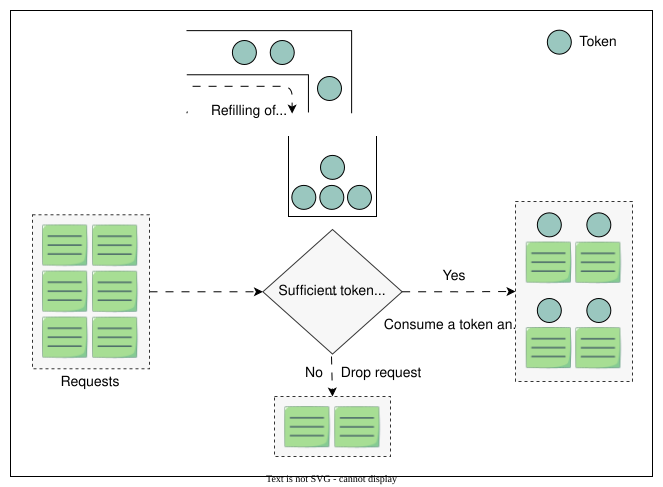
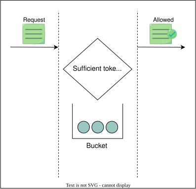
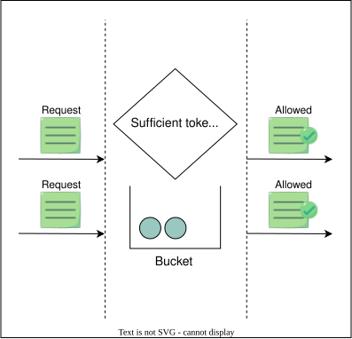
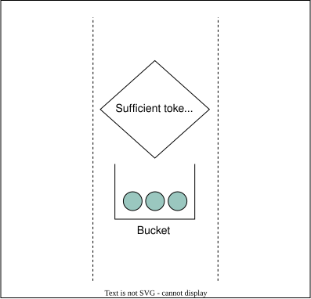

# Rate_Limiter_Algorithms

Source: https://www.educative.io/courses/grokking-the-system-design-interview/rate-limiter-algorithms

---

[Home](https://www.educative.io/)

[Courses](https://www.educative.io/search?tab=courses)

[Grokking Modern System Design Interview](https://www.educative.io/courses/grokking-the-system-design-interview)

# Rate Limiter Algorithms

Review five common rate limiting algorithms: token bucket, leaky bucket, fixed window counter, sliding window log, and sliding window counter. For each algorithm, define the key parameters and trade-offs, particularly around burst tolerance and memory usage. Select the appropriate algorithm based on traffic patterns and stability requirements.

We'll cover the following...

- [Algorithms for rate limiting](https://www.educative.io/courses/grokking-the-system-design-interview/rate-limiter-algorithms#Algorithms-for-rate-limiting)
  - [Token bucket algorithm](https://www.educative.io/courses/grokking-the-system-design-interview/rate-limiter-algorithms#Token-bucket-algorithm)
    - [Essential parameters](https://www.educative.io/courses/grokking-the-system-design-interview/rate-limiter-algorithms#Essential-parameters)
    - [Advantages](https://www.educative.io/courses/grokking-the-system-design-interview/rate-limiter-algorithms#Advantages)
    - [Disadvantages](https://www.educative.io/courses/grokking-the-system-design-interview/rate-limiter-algorithms#Disadvantages)
  - [The leaking bucket algorithm](https://www.educative.io/courses/grokking-the-system-design-interview/rate-limiter-algorithms#The-leaking-bucket-algorithm)
    - [Essential parameters](https://www.educative.io/courses/grokking-the-system-design-interview/rate-limiter-algorithms#Essential-parameters-1)
    - [Advantages](https://www.educative.io/courses/grokking-the-system-design-interview/rate-limiter-algorithms#Advantages-1)
    - [Disadvantages](https://www.educative.io/courses/grokking-the-system-design-interview/rate-limiter-algorithms#Disadvantages-1)
  - [Fixed window counter algorithm](https://www.educative.io/courses/grokking-the-system-design-interview/rate-limiter-algorithms#Fixed-window-counter-algorithm)
    - [Essential parameters](https://www.educative.io/courses/grokking-the-system-design-interview/rate-limiter-algorithms#Essential-parameters-2)
    - [Advantages](https://www.educative.io/courses/grokking-the-system-design-interview/rate-limiter-algorithms#Advantages-2)
    - [Disadvantages](https://www.educative.io/courses/grokking-the-system-design-interview/rate-limiter-algorithms#Disadvantages-2)
  - [Sliding window log algorithm](https://www.educative.io/courses/grokking-the-system-design-interview/rate-limiter-algorithms#Sliding-window-log-algorithm)
    - [Essential parameters](https://www.educative.io/courses/grokking-the-system-design-interview/rate-limiter-algorithms#Essential-parameters-3)
    - [Advantages](https://www.educative.io/courses/grokking-the-system-design-interview/rate-limiter-algorithms#Advantages-3)
    - [Disadvantages](https://www.educative.io/courses/grokking-the-system-design-interview/rate-limiter-algorithms#Disadvantages-3)
  - [Sliding window counter algorithm](https://www.educative.io/courses/grokking-the-system-design-interview/rate-limiter-algorithms#Sliding-window-counter-algorithm)
    - [Essential parameters](https://www.educative.io/courses/grokking-the-system-design-interview/rate-limiter-algorithms#Essential-parameters-4)
    - [Advantages](https://www.educative.io/courses/grokking-the-system-design-interview/rate-limiter-algorithms#Advantages-4)
    - [Disadvantages](https://www.educative.io/courses/grokking-the-system-design-interview/rate-limiter-algorithms#Disadvantages-4)
- [A comparison of rate-limiting algorithms](https://www.educative.io/courses/grokking-the-system-design-interview/rate-limiter-algorithms#A-comparison-of-rate-limiting-algorithms)
- [Conclusion](https://www.educative.io/courses/grokking-the-system-design-interview/rate-limiter-algorithms#Conclusion)

## Algorithms for rate limiting[#](https://www.educative.io/courses/grokking-the-system-design-interview/rate-limiter-algorithms#Algorithms-for-rate-limiting)

Rate limiters rely on efficient algorithms to control traffic flow. While requirements vary, we will focus on the most popular options:

- Token bucket
- Leaking bucket
- Fixed window counter
- Sliding window log
- Sliding window counter

### Token bucket algorithm[#](https://www.educative.io/courses/grokking-the-system-design-interview/rate-limiter-algorithms#Token-bucket-algorithm)

The **Token Bucket** algorithm uses a container with a predefined capacity. Tokens are added at a constant rate. When a request arrives, it attempts to consume a token. If the bucket is empty, the request is rejected.

The algorithm operates as follows:

Assume a rate limit of R\text{R}R and a total bucket capacity of C\text{C}C.

1. A new token is added to the bucket every `1/R` seconds.
2. If the bucket reaches capacity C\text{C}C, incoming tokens are discarded.
3. Incoming requests consume tokens. If (N)(\text{N})(N) requests arrive and at least N\text{N}N tokens exist, the requests are processed.
4. If the bucket has fewer tokens than incoming requests, the system processes only the available number and discards the rest.

The following illustration demonstrates the token bucket workflow.

How the token bucket algorithm works

In this example, the bucket capacity is three, and it refills at a rate of three tokens per minute.

1 / 4

Initially, there are three tokens in the bucket. A request arrives within a minute and consumes a token from the bucket

1 / 4

Two more request within same minute arrive and consume the remaining two tokens

 request arrives in the same minute. Reject the request because the bucket is empty")

1 / 4

One more (fourth) request arrives in the same minute. Reject the request because the bucket is empty

1 / 4

Refill the bucket after one minute

#### Essential parameters[#](https://www.educative.io/courses/grokking-the-system-design-interview/rate-limiter-algorithms#Essential-parameters)

Key parameters for the token bucket algorithm include:

- **Bucket capacity** (C)(\text{C})(C)**:** The maximum number of tokens the bucket can hold.
- **Rate limit** (R)(\text{R})(R)**:** The number of requests allowed per unit of time.
- **Refill rate** (1R)(\frac{1}{\text{R}})(R1​)**:** The time interval at which a new token is added.
- **Requests count** (N)(\text{N})(N)**:** The number of incoming requests to compare against available tokens.

#### Advantages[#](https://www.educative.io/courses/grokking-the-system-design-interview/rate-limiter-algorithms#Advantages)

- Allows traffic bursts as long as tokens are available.
- Memory efficient due to minimal state requirements.

#### Disadvantages[#](https://www.educative.io/courses/grokking-the-system-design-interview/rate-limiter-algorithms#Disadvantages)

- Tuning the parameters (C\text{C}C and R\text{R}R) can be challenging.

1.

Apart from permitting bursts, can the token bucket algorithm surpass the limit at the edges?

Show Answer

Did you find this helpful?

### The leaking bucket algorithm[#](https://www.educative.io/courses/grokking-the-system-design-interview/rate-limiter-algorithms#The-leaking-bucket-algorithm)

The **leaking bucket** algorithm uses a first in, first out (FIFO) queue to manage requests. It smooths traffic by processing requests at a steady rate, like water leaking from a bucket.

Incoming requests enter the queue. If the queue is full, new requests are discarded. Regardless of the inflow rate, requests are processed (leak) at a fixed speed.

How the leaking bucket algorithm works

#### Essential parameters[#](https://www.educative.io/courses/grokking-the-system-design-interview/rate-limiter-algorithms#Essential-parameters-1)

The leaking bucket algorithm requires the following parameters:

- **Bucket capacity** (C)\text{(C)}(C)**:** The maximum queue size. Requests are discarded if the queue reaches capacity C\text{C}C.
- **Inflow rate** (Rin)\text{(R}\_\text{{in}})(Rin​)**:** The rate at which requests arrive.
- **Outflow rate** (Rout)\text{(R}\_\text{{out}})(Rout​)**:** The constant rate at which requests are processed.

#### Advantages[#](https://www.educative.io/courses/grokking-the-system-design-interview/rate-limiter-algorithms#Advantages-1)

- The constant outflow rate Rout​\text{R}\_\text{{out​}}Rout​​ prevents traffic bursts.
- Memory efficient, requiring only three states: inflow rate, outflow rate, and capacity.
- Suitable for applications requiring a stable outflow rate.

#### Disadvantages[#](https://www.educative.io/courses/grokking-the-system-design-interview/rate-limiter-algorithms#Disadvantages-1)

- Bursts can fill the bucket quickly, potentially delaying recent requests.
- Determining the optimal bucket size and outflow rate is challenging.

AI Powered

Saved

1 attempt left

Reset

Token Bucket vs. Leaking Bucket

If the leaking bucket ensures a constant outflow, why not always prefer it over the token bucket for predictable systems?

This is your last attempt.

### Fixed window counter algorithm[#](https://www.educative.io/courses/grokking-the-system-design-interview/rate-limiter-algorithms#Fixed-window-counter-algorithm)

This algorithm divides time into fixed intervals (windows) and assigns a counter to each. When a request arrives, the counter for the current window increments. If the counter exceeds the limit, new requests are discarded until the next window begins.

The figure below shows the limit as a dotted line. Requests below the line are forwarded; those above are discarded.

Fixed window counter algorithm: Discard the request exceeding the limit

A significant drawback is the potential for traffic bursts at window edges. For example, if the system allows 10 requests per minute, a burst of 10 requests at 01:29 and another 10 at 01:30 results in 20 requests processed in a very short span, exceeding the intended rate.

Edge case problem in the fixed window counter algorithm. The number of requests in one minute from 01:30 to 02:30 exceeds the predefined limit of 10 requests per minute

#### Essential parameters[#](https://www.educative.io/courses/grokking-the-system-design-interview/rate-limiter-algorithms#Essential-parameters-2)

The fixed window counter algorithm requires the following parameters:

- **Window size** (W)\text{(W)}(W)**:** The duration of the time window (e.g., one minute).
- **Rate limit** (R)\text{(R)}(R): The maximum number of requests allowed per window.
- **Requests count** (N)\text{(N)}(N)**:** The number of incoming requests in the current window. Requests are allowed if N\text{N}N is less than or equal to R\text{R}R.

#### Advantages[#](https://www.educative.io/courses/grokking-the-system-design-interview/rate-limiter-algorithms#Advantages-2)

- Memory-efficient due to constraints on request rate.
- Ensures new requests are processed as long as the window limit isn’t reached.

#### Disadvantages[#](https://www.educative.io/courses/grokking-the-system-design-interview/rate-limiter-algorithms#Disadvantages-2)

- Traffic bursts at window edges can temporarily exceed the rate limit.

### Sliding window log algorithm[#](https://www.educative.io/courses/grokking-the-system-design-interview/rate-limiter-algorithms#Sliding-window-log-algorithm)

The **Sliding Window Log** algorithm tracks the timestamp of every request. Timestamps are stored in a sorted set or log. When a request arrives, the algorithm removes timestamps older than the current window. The request is accepted if the log size remains within the limit.

This approach addresses the boundary issues in the **fixed-window counter** algorithm.

The illustration below demonstrates the algorithm with a rate limit of two requests per minute.

#### Essential parameters[#](https://www.educative.io/courses/grokking-the-system-design-interview/rate-limiter-algorithms#Essential-parameters-3)

The sliding window log algorithm requires the following parameters:

- **Log size** (L)\text{(L)}(L)**:** The maximum number of requests allowed in the time frame (similar to R\text{R}R).
- **Arrival time** (T)\text{(T)}(T)**:** The timestamp of the incoming request.
- **Time range** (Tr)\text{(T}\_\text{{r})}(Tr)​**:** The duration of the window. Timestamps outside this range are discarded.

#### Advantages[#](https://www.educative.io/courses/grokking-the-system-design-interview/rate-limiter-algorithms#Advantages-3)

- Accurate rate limiting without boundary issues.

#### Disadvantages[#](https://www.educative.io/courses/grokking-the-system-design-interview/rate-limiter-algorithms#Disadvantages-3)

- High memory consumption because it stores timestamps for every request, even those rejected.

### Sliding window counter algorithm[#](https://www.educative.io/courses/grokking-the-system-design-interview/rate-limiter-algorithms#Sliding-window-counter-algorithm)

The **Sliding Window Counter** algorithm is a hybrid approach. It combines the fixed-window counter and sliding-window log algorithms to smooth traffic flow without the high memory cost of storing individual timestamps.

A sliding window counter algorithm, where the green shaded area shows the rolling window of 1 minute

Consider a rate limit of 100 requests per minute. The previous window had 88 requests, and the current window has 12. A new request arrives at 02:15, which is 15 seconds (25%) into the current window. We determine acceptance using a weighted formula:

Rate=Rp×time frame−overlap timetime frame+Rc\text{Rate} = \text{R}\_\text{{p}} \times \frac{\text{time frame} - \text{overlap time}}{\text{time frame}} + \text{R}\_\text{{c}}
Rate=Rp​×time frametime frame−overlap time​+Rc​

Here, Rp\text{R}\_\text{{p}}Rp​ is the previous window count (88), and Rc\text{R}\_\text{{c}}Rc​ is the current window count (12). The time frame\text{time frame}time frame is 60 seconds, and the overlap time\text{overlap time}overlap time is 15 seconds.

Rate=88×60−1560+12\text{Rate} = 88 \times \frac{60 - 15}{60} + 12
Rate=88×6060−15​+12

Rate=78<100\text{Rate} = 78 < 100
Rate=78<100

#### Essential parameters[#](https://www.educative.io/courses/grokking-the-system-design-interview/rate-limiter-algorithms#Essential-parameters-4)

This algorithm requires the following parameters:

- **Rate limit** (R)\text{(R)}(R)**:** The maximum requests allowed per window.
- **Window size** (W)\text{(W)}(W)**:** The duration of the time window.
- **Previous window count** (Rp)\text{(R}\_\text{{p}})(Rp​)**:** Total requests in the previous window.
- **Current window count** (Rc)\text{(R}\_\text{{c}})(Rc​) **:** Total requests in the current window.
- **Overlap time** Ot\text{O}\_\text{{t}}Ot​ **:** The time elapsed in the current window.

#### Advantages[#](https://www.educative.io/courses/grokking-the-system-design-interview/rate-limiter-algorithms#Advantages-4)

- Memory efficient due to limited state requirements.
- Smooths traffic bursts using a weighted average of the previous window.

#### Disadvantages[#](https://www.educative.io/courses/grokking-the-system-design-interview/rate-limiter-algorithms#Disadvantages-4)

- Assumes requests in the previous window were evenly distributed, which is an approximation.

## A comparison of rate-limiting algorithms[#](https://www.educative.io/courses/grokking-the-system-design-interview/rate-limiter-algorithms#A-comparison-of-rate-limiting-algorithms)

Rate-limiting algorithms are generally compared based on two factors:

- **Memory:** The number of states or variables the algorithm must store. Fewer states imply better space efficiency.
- **Burst:** Whether the algorithm allows traffic spikes exceeding the defined limit.

The table below compares the space efficiency and burst handling of the algorithms discussed.

## A Comparison of Rate Limiting Algorithms

|  |  |  |
| --- | --- | --- |
| **Algorithm** | **Space Efficient** | **Allows Burst?** |
| Token bucket | Yes | Yes, it allows a burst of traffic within defined limit. |
| Leaking bucket | Yes | No |
| Fixed window counter | Yes | Yes, it allows bursts at the edge of the time window and can exceed the defined limit. |
| Sliding window log | No, maintaining the log requires extra storage. | Yes, it allows bursts when the window is empty or nearly empty, though it smooths out traffic as the window fills. |
| Sliding window counter | Yes, but it requires relatively more space than other space efficient algorithms. | Smooths out the burst |

> **Note:** Locking is not inherently bad. If lock contention is low, performance impact is minimal. For high contention, consider sharding data or using fine-grained locks.

## Conclusion[#](https://www.educative.io/courses/grokking-the-system-design-interview/rate-limiter-algorithms#Conclusion)

We have explored various rate-limiting algorithms, each with specific trade-offs. The best choice depends on the system’s tolerance for traffic bursts and memory constraints.

Design of a Rate Limiter

Quiz on the Rate Limiter’s Design

Ask

[Algorithms for rate limiting](https://www.educative.io/courses/grokking-the-system-design-interview/rate-limiter-algorithms#Algorithms-for-rate-limiting)

[Token bucket algorithm](https://www.educative.io/courses/grokking-the-system-design-interview/rate-limiter-algorithms#Token-bucket-algorithm)

[Essential parameters](https://www.educative.io/courses/grokking-the-system-design-interview/rate-limiter-algorithms#Essential-parameters)

[Advantages](https://www.educative.io/courses/grokking-the-system-design-interview/rate-limiter-algorithms#Advantages)

[Disadvantages](https://www.educative.io/courses/grokking-the-system-design-interview/rate-limiter-algorithms#Disadvantages)

[The leaking bucket algorithm](https://www.educative.io/courses/grokking-the-system-design-interview/rate-limiter-algorithms#The-leaking-bucket-algorithm)

[Essential parameters](https://www.educative.io/courses/grokking-the-system-design-interview/rate-limiter-algorithms#Essential-parameters-1)

[Advantages](https://www.educative.io/courses/grokking-the-system-design-interview/rate-limiter-algorithms#Advantages-1)

[Disadvantages](https://www.educative.io/courses/grokking-the-system-design-interview/rate-limiter-algorithms#Disadvantages-1)

[Fixed window counter algorithm](https://www.educative.io/courses/grokking-the-system-design-interview/rate-limiter-algorithms#Fixed-window-counter-algorithm)

[Essential parameters](https://www.educative.io/courses/grokking-the-system-design-interview/rate-limiter-algorithms#Essential-parameters-2)

[Advantages](https://www.educative.io/courses/grokking-the-system-design-interview/rate-limiter-algorithms#Advantages-2)

[Disadvantages](https://www.educative.io/courses/grokking-the-system-design-interview/rate-limiter-algorithms#Disadvantages-2)

[Sliding window log algorithm](https://www.educative.io/courses/grokking-the-system-design-interview/rate-limiter-algorithms#Sliding-window-log-algorithm)

[Essential parameters](https://www.educative.io/courses/grokking-the-system-design-interview/rate-limiter-algorithms#Essential-parameters-3)

[Advantages](https://www.educative.io/courses/grokking-the-system-design-interview/rate-limiter-algorithms#Advantages-3)

[Disadvantages](https://www.educative.io/courses/grokking-the-system-design-interview/rate-limiter-algorithms#Disadvantages-3)

[Sliding window counter algorithm](https://www.educative.io/courses/grokking-the-system-design-interview/rate-limiter-algorithms#Sliding-window-counter-algorithm)

[Essential parameters](https://www.educative.io/courses/grokking-the-system-design-interview/rate-limiter-algorithms#Essential-parameters-4)

[Advantages](https://www.educative.io/courses/grokking-the-system-design-interview/rate-limiter-algorithms#Advantages-4)

[Disadvantages](https://www.educative.io/courses/grokking-the-system-design-interview/rate-limiter-algorithms#Disadvantages-4)

[A comparison of rate-limiting algorithms](https://www.educative.io/courses/grokking-the-system-design-interview/rate-limiter-algorithms#A-comparison-of-rate-limiting-algorithms)

[Conclusion](https://www.educative.io/courses/grokking-the-system-design-interview/rate-limiter-algorithms#Conclusion)