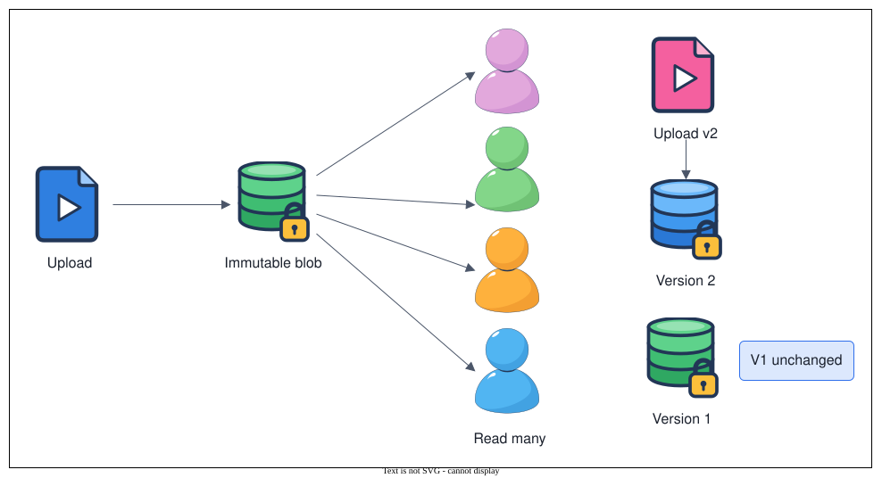

# System_Design_A_Blob_Store

Source: https://www.educative.io/courses/grokking-the-system-design-interview/system-design-a-blob-store

---

[Home](https://www.educative.io/)

[Courses](https://www.educative.io/search?tab=courses)

[Grokking Modern System Design Interview](https://www.educative.io/courses/grokking-the-system-design-interview)

# System Design: A Blob Store

Define a blob store, a core system design component for managing large volumes of unstructured data. Explain why applications such as YouTube rely on blob storage, and examine concepts such as access tiers and data life cycle management.

We'll cover the following...

- [What is a blob store?](https://www.educative.io/courses/grokking-the-system-design-interview/system-design-a-blob-store#What-is-a-blob-store)
- [Why do we use a blob store?](https://www.educative.io/courses/grokking-the-system-design-interview/system-design-a-blob-store#Why-do-we-use-a-blob-store)
- [Azure storage access tiers](https://www.educative.io/courses/grokking-the-system-design-interview/system-design-a-blob-store#Azure-storage-access-tiers)
- [Blob life cycle management rules](https://www.educative.io/courses/grokking-the-system-design-interview/system-design-a-blob-store#Blob-life-cycle-management-rules)
- [Use cases](https://www.educative.io/courses/grokking-the-system-design-interview/system-design-a-blob-store#Use-cases)
- [How do we design a blob store system?](https://www.educative.io/courses/grokking-the-system-design-interview/system-design-a-blob-store#How-do-we-design-a-blob-store-system)

## What is a blob store?[#](https://www.educative.io/courses/grokking-the-system-design-interview/system-design-a-blob-store#What-is-a-blob-store)

A **blob store** is a storage solution for unstructured data, such as photos, audio, video, and binaries.

Data is stored as a blob. Unlike hierarchical file systems with directories, **blob** stores use a flat organization pattern. Blob stores are ideal for applications that require **write-once, read-many (WORM)** storage. Data is written once, read frequently, and rarely modified.

For example, in systems like Microsoft Azure, blobs are immutable for a set interval to protect critical data.

Blobs are written once, read many times, and updated by adding a new version

**Note:** While not all applications require WORM, we assume blobs are immutable. Updates are handled by uploading a new version rather than modifying the existing object.

## Why do we use a blob store?[#](https://www.educative.io/courses/grokking-the-system-design-interview/system-design-a-blob-store#Why-do-we-use-a-blob-store)

Blob stores are essential for data-intensive platforms like YouTube, Netflix, and Facebook. These applications generate massive volumes of unstructured data daily and require scalable, reliable, and highly available storage.

As data grows, applications need unlimited storage capacity. For instance, YouTube adds over a petabyte of storage daily. Each video is stored in multiple resolutions and replicated across data centers for redundancy.

Consequently, the total storage footprint significantly exceeds the original upload size.

|  |  |
| --- | --- |
| **System** | **Blob Store** |
| Netflix | S3 |
| YouTube | Google Cloud Storage |
| Facebook | Tectonic |

Cloud providers like Azure optimize cost and performance using storage access tiers.

## Azure storage access tiers[#](https://www.educative.io/courses/grokking-the-system-design-interview/system-design-a-blob-store#Azure-storage-access-tiers)

Azure offers storage tiers tailored to specific usage patterns and access frequencies.

Azure storage access tiers

> **Note:** We can switch between access tiers at any time.

|  |  |  |
| --- | --- | --- |
| **Feature** | **Description** | **When to Use** |
| **Azure files** | - Provides a Server Message Block (SMB) interface - Provides client libraries - Includes a REST interface for remote file storage | - Cloud application migration (lift and shift) - Data sharing across several virtual machines - Keeping development and debugging tools available on many virtual computers |
| **Azure blobs** | - Provides client libraries - Provides a REST interface for massively storing and retrieving unstructured data in block blobs | - Remote access to application data - Support for streaming and random-access scenarios |

Azure Blob Storage life cycle management rules improve cost efficiency and compliance.

## Blob life cycle management rules[#](https://www.educative.io/courses/grokking-the-system-design-interview/system-design-a-blob-store#Blob-life-cycle-management-rules)

Key management rules include:

- **Tiering:** Move data to cooler storage tiers when access frequency drops to save costs.
- **Expiration:** Automatically delete obsolete blobs based on age or inactivity.
- **Filtering:** Apply rules to specific folders or containers to match data organization.

Let’s look at real-world scenarios for blob storage.

## Use cases[#](https://www.educative.io/courses/grokking-the-system-design-interview/system-design-a-blob-store#Use-cases)

Blob storage supports applications requiring efficient storage and delivery of unstructured data. Common scenarios include:

- Serving images and documents directly to browsers.
- Distributed file storage for multiple users.
- Streaming video and audio content.
- Backups, disaster recovery, and archiving.
- Data lakes for on-premises or cloud-based analysis.

These examples highlight the versatility of blob storage. Next, we will step-by-step design a blob store system.

## How do we design a blob store system?[#](https://www.educative.io/courses/grokking-the-system-design-interview/system-design-a-blob-store#How-do-we-design-a-blob-store-system)

This section is divided into five lessons:

1. [**Requirements:**](https://www.educative.io/courses/grokking-the-system-design-interview/requirements-of-a-blob-stores-design) Identify functional and non-functional requirements and estimate resource needs.
2. [**Design:**](https://www.educative.io/courses/grokking-the-system-design-interview/design-of-a-blob-store) Define the high-level architecture, API, and detailed component workflow.
3. [**Design considerations:**](https://www.educative.io/courses/grokking-the-system-design-interview/design-considerations-of-a-blob-store) Explore database schema, partitioning, indexing, pagination, and replication strategies.
4. [**Evaluation:**](https://www.educative.io/courses/grokking-the-system-design-interview/evaluation-of-a-blob-stores-design) Assess the design against the initial requirements.
5. [**Quiz:**](https://www.educative.io/courses/grokking-the-system-design-interview/quiz-on-the-blob-stores-design) Test your understanding of the material.

Let’s begin with the requirements.

Quiz on the Rate Limiter’s Design

Requirements of a Blob Store's Design

Ask

[What is a blob store?](https://www.educative.io/courses/grokking-the-system-design-interview/system-design-a-blob-store#What-is-a-blob-store)

[Why do we use a blob store?](https://www.educative.io/courses/grokking-the-system-design-interview/system-design-a-blob-store#Why-do-we-use-a-blob-store)

[Azure storage access tiers](https://www.educative.io/courses/grokking-the-system-design-interview/system-design-a-blob-store#Azure-storage-access-tiers)

[Blob life cycle management rules](https://www.educative.io/courses/grokking-the-system-design-interview/system-design-a-blob-store#Blob-life-cycle-management-rules)

[Use cases](https://www.educative.io/courses/grokking-the-system-design-interview/system-design-a-blob-store#Use-cases)

[How do we design a blob store system?](https://www.educative.io/courses/grokking-the-system-design-interview/system-design-a-blob-store#How-do-we-design-a-blob-store-system)