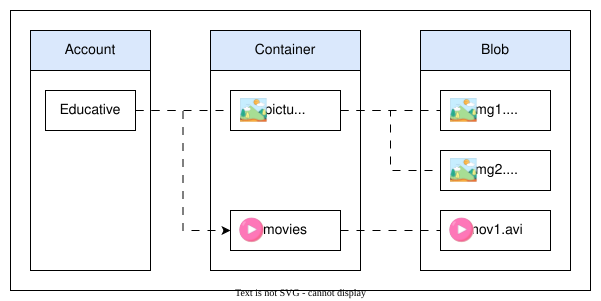
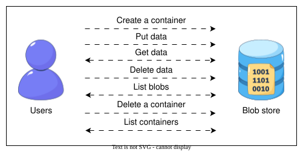

# Requirements_of_a_Blob_Store's_Design

Source: https://www.educative.io/courses/grokking-the-system-design-interview/requirements-of-a-blob-stores-design

---

[Home](https://www.educative.io/)

[Courses](https://www.educative.io/search?tab=courses)

[Grokking Modern System Design Interview](https://www.educative.io/courses/grokking-the-system-design-interview)

# Requirements of a Blob Store's Design

Define the functional and non-functional requirements essential for a scalable blob store, emphasizing durability and high availability. Calculate resource estimations for servers, storage, and bandwidth using real-world data modeling.

We'll cover the following...

- [Requirements](https://www.educative.io/courses/grokking-the-system-design-interview/requirements-of-a-blob-stores-design#Requirements)
  - [Functional requirements](https://www.educative.io/courses/grokking-the-system-design-interview/requirements-of-a-blob-stores-design#Functional-requirements)
  - [Non-functional requirements](https://www.educative.io/courses/grokking-the-system-design-interview/requirements-of-a-blob-stores-design#Non-functional-requirements)
- [Resource estimation](https://www.educative.io/courses/grokking-the-system-design-interview/requirements-of-a-blob-stores-design#Resource-estimation)
  - [Number of servers estimation](https://www.educative.io/courses/grokking-the-system-design-interview/requirements-of-a-blob-stores-design#Number-of-servers-estimation)
  - [Storage estimation](https://www.educative.io/courses/grokking-the-system-design-interview/requirements-of-a-blob-stores-design#Storage-estimation)
  - [Bandwidth estimation](https://www.educative.io/courses/grokking-the-system-design-interview/requirements-of-a-blob-stores-design#Bandwidth-estimation)
- [Building blocks](https://www.educative.io/courses/grokking-the-system-design-interview/requirements-of-a-blob-stores-design#Building-blocks)

## Requirements[#](https://www.educative.io/courses/grokking-the-system-design-interview/requirements-of-a-blob-stores-design#Requirements)

Let’s understand the functional and non-functional requirements:

### Functional requirements[#](https://www.educative.io/courses/grokking-the-system-design-interview/requirements-of-a-blob-stores-design#Functional-requirements)

- **Create a** **container****:** Users create containers to group blobs (e.g., separating user data or media types). A single user can own multiple containers, each holding many blobs. We assume containers cannot be nested.

Multiple containers associated with a single storage account, and multiple blobs inside a single container

- **Put data:** Upload blobs to a specific container.
- **Get data:** Access a blob via a system-generated URL.
- **Delete data:** The users should be able to delete a blob. The system should support retention periods before permanent deletion.
- **List blobs:** The user should be able to retrieve a list of blobs within a specific container.
- **Delete a container:** The user should be able to remove a container and all blobs inside it.
- **List containers:** List all containers associated with an account.

Functional requirements of a blob store

### Non-functional requirements[#](https://www.educative.io/courses/grokking-the-system-design-interview/requirements-of-a-blob-stores-design#Non-functional-requirements)

- **Availability:** Ensure high system availability.
- **Durability:** Data must persist until explicitly deleted.
- **Scalability:** Support storage of billions of blobs.
- **Throughput:** Maintain high throughput for large data transfers.
- **Reliability:** Detect and recover from failures promptly.
- **Consistency:** Enforce strong consistency so all users see the same view of a blob.

The non-functional requirements of a blob store

Let’s test your understanding with the help of an AI assessment.

AI Powered

Saved

5 attempts left

Reset

Eventual consistency

Explain the concept of eventual consistency in the context of blob stores. Provide a scenario where it might be acceptable.

You have 5 attempts to answer.

## Resource estimation[#](https://www.educative.io/courses/grokking-the-system-design-interview/requirements-of-a-blob-stores-design#Resource-estimation)

We will estimate server, storage, and bandwidth requirements. As blob types vary, we will use YouTube (video and thumbnail storage) as our reference model.

**Assumptions:**

- **Daily active users (DAU):** 5 million
- **Requests per second (RPS) per server:** 500
- **Average video size:** 50 MB
- **Average thumbnail size:** 20 KB
- **Daily video uploads:** 250,000
- **Daily read requests per user:** 20

### Number of servers estimation[#](https://www.educative.io/courses/grokking-the-system-design-interview/requirements-of-a-blob-stores-design#Number-of-servers-estimation)

Using [DAU as a proxy](https://www.educative.io/courses/grokking-the-system-design-interview/put-back-of-the-envelope-numbers-in-perspective) for peak RPS, we estimate 5 million requests per second. With a capacity of 500 RPS per server, the required server count is:

Servers needed at peak load=Number of requests/secondRPS of server\text{Servers needed at peak load} = \frac{\text{Number of requests/second}}{\text{RPS of server}}
Servers needed at peak load=RPS of serverNumber of requests/second​

Servers needed at peak load=5 million500=10K servers\text{Servers needed at peak load} = \frac{5 \ \text{million}}{500} = \text{10K} \ \text{servers}
Servers needed at peak load=5005 million​=10K servers

Number of servers required by a blob store system dedicated to storing YouTube data

> **Note:** We estimate 500 RPS per server (down from 64,000 RPS) to account for the I/O-intensive nature of blob operations.

### Storage estimation[#](https://www.educative.io/courses/grokking-the-system-design-interview/requirements-of-a-blob-stores-design#Storage-estimation)

Based on the assumptions above, we calculate the daily storage requirement for YouTube:

Totalstorage/day=No. of videos/day×(Storage/video+Storage/thumbnail)\text{Total}\_{\text{storage/day}} = \text{No. of videos}\_{\text{/day}} \times \left( \text{Storage}\_{\text{/video}} + \text{Storage}\_{\text{/thumbnail}} \right)
Totalstorage/day​=No. of videos/day​×(Storage/video​+Storage/thumbnail​)

This results in approximately 12.51 TB/day12.51\ \text{TB}\_{/ \text{day}}12.51 TB/day​ of daily storage for a single copy of uploaded videos in one resolution.

#### Total Storage Required to Store Videos and Thumbnails Uploaded Per Day on YouTube

|  |  |  |  |
| --- | --- | --- | --- |
| No. of videos per day | Storage per video (MB) | Storage per thumbnail (KB) | Total storage per day (TB) |
| 250000 | 50 | 20 | f12.51 |

### Bandwidth estimation[#](https://www.educative.io/courses/grokking-the-system-design-interview/requirements-of-a-blob-stores-design#Bandwidth-estimation)

**Incoming traffic:** Daily upload volume determines the required incoming bandwidth. We calculate data transfer per second as follows:

Totalbandwidth=Totalstorage/day24×60×60\text{Total}\_{\text{bandwidth}} = \frac{\text{Total}\_{\text{storage/day}}}{24 \times 60 \times 60}
Totalbandwidth​=24×60×60Totalstorage/day​​

#### Bandwidth Required for Uploading Videos on YouTube

|  |  |  |
| --- | --- | --- |
| Total storage per day (TB) | Seconds in a day | Bandwidth (Gb/s) |
| 12.51 | 86400 | f1.16 |

**Outgoing traffic:** Blob stores are read-intensive. We calculate outgoing bandwidth based on read request volume:

Totalbandwidth=No. of active users/day×No. of requests/user/day×Totaldata sizeSeconds in a day\text{Total}\_{\text{bandwidth}} = \frac{\text{No. of active users}\_{\text{/day}} \times \text{No. of requests}\_{\text{/user/day}} \times \text{Total}\_{\text{data size}}}{\text{Seconds in a day}}
Totalbandwidth​=Seconds in a dayNo. of active users/day​×No. of requests/user/day​×Totaldata size​​

#### Bandwidth Required for Downloading Videos on YouTube

|  |  |  |  |
| --- | --- | --- | --- |
| No. of active users per day | No. of requests per user | Data size (MB) | Bandwidth required (Gb/s) |
| 5000000 | 20 | 50 | f462.96 |

Summarizing the bandwidth requirements of a blob store system for YouTube videos only

## Building blocks[#](https://www.educative.io/courses/grokking-the-system-design-interview/requirements-of-a-blob-stores-design#Building-blocks)

We will use the following components in our design:

Building blocks for the design of a blob store

- [**Rate limiter:**](https://www.educative.io/courses/grokking-the-system-design-interview/system-design-the-rate-limiter) Controls user interaction rates.
- [**Load balancer:**](https://www.educative.io/courses/grokking-the-system-design-interview/introduction-to-load-balancers) Distributes request load across servers.
- [**Database:**](https://www.educative.io/courses/grokking-the-system-design-interview/introduction-to-databases) Stores blob metadata.
- [**Monitoring:**](https://www.educative.io/courses/grokking-the-system-design-interview/system-design-distributed-monitoring) Tracks storage usage and system health to trigger capacity expansion.

Next, we will design the blob store system based on these requirements and estimates.

System Design: A Blob Store

Design of a Blob Store

Ask

[Requirements](https://www.educative.io/courses/grokking-the-system-design-interview/requirements-of-a-blob-stores-design#Requirements)

[Functional requirements](https://www.educative.io/courses/grokking-the-system-design-interview/requirements-of-a-blob-stores-design#Functional-requirements)

[Non-functional requirements](https://www.educative.io/courses/grokking-the-system-design-interview/requirements-of-a-blob-stores-design#Non-functional-requirements)

[Resource estimation](https://www.educative.io/courses/grokking-the-system-design-interview/requirements-of-a-blob-stores-design#Resource-estimation)

[Number of servers estimation](https://www.educative.io/courses/grokking-the-system-design-interview/requirements-of-a-blob-stores-design#Number-of-servers-estimation)

[Storage estimation](https://www.educative.io/courses/grokking-the-system-design-interview/requirements-of-a-blob-stores-design#Storage-estimation)

[Bandwidth estimation](https://www.educative.io/courses/grokking-the-system-design-interview/requirements-of-a-blob-stores-design#Bandwidth-estimation)

[Building blocks](https://www.educative.io/courses/grokking-the-system-design-interview/requirements-of-a-blob-stores-design#Building-blocks)