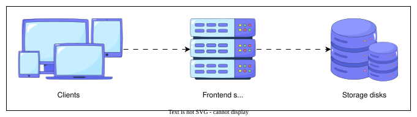

# Design_of_a_Blob_Store

Source: https://www.educative.io/courses/grokking-the-system-design-interview/design-of-a-blob-store

---

[Home](https://www.educative.io/)

[Courses](https://www.educative.io/search?tab=courses)

[Grokking Modern System Design Interview](https://www.educative.io/courses/grokking-the-system-design-interview)

# Design of a Blob Store

Define the high-level architecture and core APIs required for a scalable blob store service. Describe the detailed design components, such as the manager node and distributed metadata store, that enable horizontal scaling. Outline the end-to-end workflow for write, read, and delete operations in the blob store architecture.

We'll cover the following...

- [High-level design](https://www.educative.io/courses/grokking-the-system-design-interview/design-of-a-blob-store#High-level-design)
- [API design](https://www.educative.io/courses/grokking-the-system-design-interview/design-of-a-blob-store#API-design)
  - [Create container](https://www.educative.io/courses/grokking-the-system-design-interview/design-of-a-blob-store#Create-container)
  - [Upload blobs](https://www.educative.io/courses/grokking-the-system-design-interview/design-of-a-blob-store#Upload-blobs)
  - [Download blobs](https://www.educative.io/courses/grokking-the-system-design-interview/design-of-a-blob-store#Download-blobs)
  - [Delete blob](https://www.educative.io/courses/grokking-the-system-design-interview/design-of-a-blob-store#Delete-blob)
  - [List blobs](https://www.educative.io/courses/grokking-the-system-design-interview/design-of-a-blob-store#List-blobs)
  - [Delete container](https://www.educative.io/courses/grokking-the-system-design-interview/design-of-a-blob-store#Delete-container)
  - [List containers](https://www.educative.io/courses/grokking-the-system-design-interview/design-of-a-blob-store#List-containers)
- [Detailed design](https://www.educative.io/courses/grokking-the-system-design-interview/design-of-a-blob-store#Detailed-design)
  - [Components](https://www.educative.io/courses/grokking-the-system-design-interview/design-of-a-blob-store#Components)
  - [Workflow](https://www.educative.io/courses/grokking-the-system-design-interview/design-of-a-blob-store#Workflow)

## High-level design[#](https://www.educative.io/courses/grokking-the-system-design-interview/design-of-a-blob-store#High-level-design)

A blob store system consists of three core components: clients, frontend servers, and storage disks.

The high-level design of a blob store

Frontend servers receive client requests and store blobs on attached storage disks.

## API design[#](https://www.educative.io/courses/grokking-the-system-design-interview/design-of-a-blob-store#API-design)

The following operations require a registered and authenticated user. Registration and authentication steps are omitted for brevity.

### Create container[#](https://www.educative.io/courses/grokking-the-system-design-interview/design-of-a-blob-store#Create-container)

The `createContainer` operation creates a new container under the current user’s account.

Ace Editor

1

createContainer(containerName)

הההההההההההההההההההההההההההההההההההההההההההההההההההההההההההההההההההההההההההההההההההההההההההההההההההההההההההההההההההההההההההההההההההההההההההההההההההההההההההההההההההההההההההההההההההההההההההההההההההההההההההההההההההההההההההההההההההההההההההההההההההההההההההההההההההההההההההההההההההההההההההההההההההההההההההההההההההההההההההההההההההההההההההההההההההההההההההההההההההההההההההההההההההההההההההההההההההההההההההההההההההההההההההההההההההההההההההההההההההההההההההההההההההההההההההההההההההההההההההההההההההההההההההההההההההההההההההההההה

XXXXXXXXXXXXXXXXXXXXXXXXXXXXXXXXXXXXXXXXXXXXXXXXXXXXXXXXXXXXXXXXXXXXXXXXXXXXXXXXXXXXXXXXXXXXXXXXXXXXXXXXXXXXXXXXXXXXXXXXXXXXXXXXXXXXXXXXXXXXXXXXXXXXXXXXXXXXXXXXXXXXXXXXXXXXXXXXXXXXXXXXXXXXXXXXXXXXXXXXXXXXXXXXXXXXXXXXXXXXXXXXXXXXXXXXXXXXXXXXXXXXXXXXXXXXXXXXXXXXXXXXXXXXXXXXXXXXXXXXXXXXXXXXXXXXXXXXXXXXXXXXXXXXXXXXXXXXXXXXXXXXXXXXXXXXXXXXXXXXXXXXXXXXXXXXXXXXXXXXXXXXXXXXXXXXXXXXXXXXXXXXXXXXXXXXXXXXXXXXXXXXXXXXXXXXXXXXXXXXXXXXXXXXXXXXXXXXXXXXXXXXXXXXXXXXXXXXXXXXXXXXXXXXXXXXXXXXXXXXXXXXXXXXXXXXXXXXXXXXXXXXXXXXXXXX

|  |  |
| --- | --- |
| **Parameter** | **Description** |
| `containerName` | This is the name of the container. It should be unique within a storage account. |

### Upload blobs[#](https://www.educative.io/courses/grokking-the-system-design-interview/design-of-a-blob-store#Upload-blobs)

Clients upload data to the blob store as binary objects. Use the following code to upload data to a container:

Ace Editor

1

putBlob(containerPath, blobName, data)

הההההההההההההההההההההההההההההההההההההההההההההההההההההההההההההההההההההההההההההההההההההההההההההההההההההההההההההההההההההההההההההההההההההההההההההההההההההההההההההההההההההההההההההההההההההההההההההההההההההההההההההההההההההההההההההההההההההההההההההההההההההההההההההההההההההההההההההההההההההההההההההההההההההההההההההההההההההההההההההההההההההההההההההההההההההההההההההההההההההההההההההההההההההההההההההההההההההההההההההההההההההההההההההההההההההההההההההההההההההההההההההההההההההההההההההההההההההההההההההההההההההההההההההההההההההההההההההההה

XXXXXXXXXXXXXXXXXXXXXXXXXXXXXXXXXXXXXXXXXXXXXXXXXXXXXXXXXXXXXXXXXXXXXXXXXXXXXXXXXXXXXXXXXXXXXXXXXXXXXXXXXXXXXXXXXXXXXXXXXXXXXXXXXXXXXXXXXXXXXXXXXXXXXXXXXXXXXXXXXXXXXXXXXXXXXXXXXXXXXXXXXXXXXXXXXXXXXXXXXXXXXXXXXXXXXXXXXXXXXXXXXXXXXXXXXXXXXXXXXXXXXXXXXXXXXXXXXXXXXXXXXXXXXXXXXXXXXXXXXXXXXXXXXXXXXXXXXXXXXXXXXXXXXXXXXXXXXXXXXXXXXXXXXXXXXXXXXXXXXXXXXXXXXXXXXXXXXXXXXXXXXXXXXXXXXXXXXXXXXXXXXXXXXXXXXXXXXXXXXXXXXXXXXXXXXXXXXXXXXXXXXXXXXXXXXXXXXXXXXXXXXXXXXXXXXXXXXXXXXXXXXXXXXXXXXXXXXXXXXXXXXXXXXXXXXXXXXXXXXXXXXXXXXXXX

|  |  |
| --- | --- |
| **Parameter** | **Description** |
| `containerPath` | This is the path of the container in which we upload the blob. It consists of the `accountID` and `containerID`. |
| `blobName` | This is the name of the blob. It should be unique within a container, otherwise our system will give the blob that was uploaded later a version number. |
| `data` | This is a file that the user wants to upload to the blob store. |

> **Note:** This API definition is logical. In production, large data transfers may require multistep streaming.

### Download blobs[#](https://www.educative.io/courses/grokking-the-system-design-interview/design-of-a-blob-store#Download-blobs)

Blobs are identified by a unique name or ID.

Ace Editor

1

getBlob(blobPath)

הההההההההההההההההההההההההההההההההההההההההההההההההההההההההההההההההההההההההההההההההההההההההההההההההההההההההההההההההההההההההההההההההההההההההההההההההההההההההההההההההההההההההההההההההההההההההההההההההההההההההההההההההההההההההההההההההההההההההההההההההההההההההההההההההההההההההההההההההההההההההההההההההההההההההההההההההההההההההההההההההההההההההההההההההההההההההההההההההההההההההההההההההההההההההההההההההההההההההההההההההההההההההההההההההההההההההההההההההההההההההההההההההההההההההההההההההההההההההההההההההההההההההההההההההההההההההההההההה

XXXXXXXXXXXXXXXXXXXXXXXXXXXXXXXXXXXXXXXXXXXXXXXXXXXXXXXXXXXXXXXXXXXXXXXXXXXXXXXXXXXXXXXXXXXXXXXXXXXXXXXXXXXXXXXXXXXXXXXXXXXXXXXXXXXXXXXXXXXXXXXXXXXXXXXXXXXXXXXXXXXXXXXXXXXXXXXXXXXXXXXXXXXXXXXXXXXXXXXXXXXXXXXXXXXXXXXXXXXXXXXXXXXXXXXXXXXXXXXXXXXXXXXXXXXXXXXXXXXXXXXXXXXXXXXXXXXXXXXXXXXXXXXXXXXXXXXXXXXXXXXXXXXXXXXXXXXXXXXXXXXXXXXXXXXXXXXXXXXXXXXXXXXXXXXXXXXXXXXXXXXXXXXXXXXXXXXXXXXXXXXXXXXXXXXXXXXXXXXXXXXXXXXXXXXXXXXXXXXXXXXXXXXXXXXXXXXXXXXXXXXXXXXXXXXXXXXXXXXXXXXXXXXXXXXXXXXXXXXXXXXXXXXXXXXXXXXXXXXXXXXXXXXXXXXX

|  |  |
| --- | --- |
| **Parameter** | **Description** |
| `blobPath` | This is the fully qualified path of the data or file, including its unique ID. |

### Delete blob[#](https://www.educative.io/courses/grokking-the-system-design-interview/design-of-a-blob-store#Delete-blob)

The `deleteBlob` operation marks a blob for deletion. The system removes the actual data asynchronously during garbage collection.

Ace Editor

1

deleteBlob(blobPath)

הההההההההההההההההההההההההההההההההההההההההההההההההההההההההההההההההההההההההההההההההההההההההההההההההההההההההההההההההההההההההההההההההההההההההההההההההההההההההההההההההההההההההההההההההההההההההההההההההההההההההההההההההההההההההההההההההההההההההההההההההההההההההההההההההההההההההההההההההההההההההההההההההההההההההההההההההההההההההההההההההההההההההההההההההההההההההההההההההההההההההההההההההההההההההההההההההההההההההההההההההההההההההההההההההההההההההההההההההההההההההההההההההההההההההההההההההההההההההההההההההההההההההההההההההההההההההההההההה

XXXXXXXXXXXXXXXXXXXXXXXXXXXXXXXXXXXXXXXXXXXXXXXXXXXXXXXXXXXXXXXXXXXXXXXXXXXXXXXXXXXXXXXXXXXXXXXXXXXXXXXXXXXXXXXXXXXXXXXXXXXXXXXXXXXXXXXXXXXXXXXXXXXXXXXXXXXXXXXXXXXXXXXXXXXXXXXXXXXXXXXXXXXXXXXXXXXXXXXXXXXXXXXXXXXXXXXXXXXXXXXXXXXXXXXXXXXXXXXXXXXXXXXXXXXXXXXXXXXXXXXXXXXXXXXXXXXXXXXXXXXXXXXXXXXXXXXXXXXXXXXXXXXXXXXXXXXXXXXXXXXXXXXXXXXXXXXXXXXXXXXXXXXXXXXXXXXXXXXXXXXXXXXXXXXXXXXXXXXXXXXXXXXXXXXXXXXXXXXXXXXXXXXXXXXXXXXXXXXXXXXXXXXXXXXXXXXXXXXXXXXXXXXXXXXXXXXXXXXXXXXXXXXXXXXXXXXXXXXXXXXXXXXXXXXXXXXXXXXXXXXXXXXXXXXX

|  |  |
| --- | --- |
| **Parameter** | **Description** |
| `blobPath` | This is the path of the blob that the user wants to delete. |

### List blobs[#](https://www.educative.io/courses/grokking-the-system-design-interview/design-of-a-blob-store#List-blobs)

The `listBlobs` operation returns a list of blobs within a specific container or path.

Ace Editor

1

listBlobs(containerPath)

הההההההההההההההההההההההההההההההההההההההההההההההההההההההההההההההההההההההההההההההההההההההההההההההההההההההההההההההההההההההההההההההההההההההההההההההההההההההההההההההההההההההההההההההההההההההההההההההההההההההההההההההההההההההההההההההההההההההההההההההההההההההההההההההההההההההההההההההההההההההההההההההההההההההההההההההההההההההההההההההההההההההההההההההההההההההההההההההההההההההההההההההההההההההההההההההההההההההההההההההההההההההההההההההההההההההההההההההההההההההההההההההההההההההההההההההההההההההההההההההההההההההההההההההההההההההההההההההה

XXXXXXXXXXXXXXXXXXXXXXXXXXXXXXXXXXXXXXXXXXXXXXXXXXXXXXXXXXXXXXXXXXXXXXXXXXXXXXXXXXXXXXXXXXXXXXXXXXXXXXXXXXXXXXXXXXXXXXXXXXXXXXXXXXXXXXXXXXXXXXXXXXXXXXXXXXXXXXXXXXXXXXXXXXXXXXXXXXXXXXXXXXXXXXXXXXXXXXXXXXXXXXXXXXXXXXXXXXXXXXXXXXXXXXXXXXXXXXXXXXXXXXXXXXXXXXXXXXXXXXXXXXXXXXXXXXXXXXXXXXXXXXXXXXXXXXXXXXXXXXXXXXXXXXXXXXXXXXXXXXXXXXXXXXXXXXXXXXXXXXXXXXXXXXXXXXXXXXXXXXXXXXXXXXXXXXXXXXXXXXXXXXXXXXXXXXXXXXXXXXXXXXXXXXXXXXXXXXXXXXXXXXXXXXXXXXXXXXXXXXXXXXXXXXXXXXXXXXXXXXXXXXXXXXXXXXXXXXXXXXXXXXXXXXXXXXXXXXXXXXXXXXXXXXXX

|  |  |
| --- | --- |
| **Parameter** | **Description** |
| `containerPath` | This is the path to the container from which the user wants to get the list of blobs. |

### Delete container[#](https://www.educative.io/courses/grokking-the-system-design-interview/design-of-a-blob-store#Delete-container)

The `deleteContainer` operation marks a container for deletion. The container and its blobs are removed later during garbage collection.

Ace Editor

1

deleteContainer(containerPath)

הההההההההההההההההההההההההההההההההההההההההההההההההההההההההההההההההההההההההההההההההההההההההההההההההההההההההההההההההההההההההההההההההההההההההההההההההההההההההההההההההההההההההההההההההההההההההההההההההההההההההההההההההההההההההההההההההההההההההההההההההההההההההההההההההההההההההההההההההההההההההההההההההההההההההההההההההההההההההההההההההההההההההההההההההההההההההההההההההההההההההההההההההההההההההההההההההההההההההההההההההההההההההההההההההההההההההההההההההההההההההההההההההההההההההההההההההההההההההההההההההההההההההההההההההההההההההההההההה

XXXXXXXXXXXXXXXXXXXXXXXXXXXXXXXXXXXXXXXXXXXXXXXXXXXXXXXXXXXXXXXXXXXXXXXXXXXXXXXXXXXXXXXXXXXXXXXXXXXXXXXXXXXXXXXXXXXXXXXXXXXXXXXXXXXXXXXXXXXXXXXXXXXXXXXXXXXXXXXXXXXXXXXXXXXXXXXXXXXXXXXXXXXXXXXXXXXXXXXXXXXXXXXXXXXXXXXXXXXXXXXXXXXXXXXXXXXXXXXXXXXXXXXXXXXXXXXXXXXXXXXXXXXXXXXXXXXXXXXXXXXXXXXXXXXXXXXXXXXXXXXXXXXXXXXXXXXXXXXXXXXXXXXXXXXXXXXXXXXXXXXXXXXXXXXXXXXXXXXXXXXXXXXXXXXXXXXXXXXXXXXXXXXXXXXXXXXXXXXXXXXXXXXXXXXXXXXXXXXXXXXXXXXXXXXXXXXXXXXXXXXXXXXXXXXXXXXXXXXXXXXXXXXXXXXXXXXXXXXXXXXXXXXXXXXXXXXXXXXXXXXXXXXXXXXX

|  |  |
| --- | --- |
| **Parameter** | **Description** |
| `containerPath` | This is the path to the container that the user wants to delete. |

### List containers[#](https://www.educative.io/courses/grokking-the-system-design-interview/design-of-a-blob-store#List-containers)

The `listContainers` operation lists all containers associated with the user’s account.

Ace Editor

1

listContainers(accountID)

הההההההההההההההההההההההההההההההההההההההההההההההההההההההההההההההההההההההההההההההההההההההההההההההההההההההההההההההההההההההההההההההההההההההההההההההההההההההההההההההההההההההההההההההההההההההההההההההההההההההההההההההההההההההההההההההההההההההההההההההההההההההההההההההההההההההההההההההההההההההההההההההההההההההההההההההההההההההההההההההההההההההההההההההההההההההההההההההההההההההההההההההההההההההההההההההההההההההההההההההההההההההההההההההההההההההההההההההההההההההההההההההההההההההההההההההההההההההההההההההההההההההההההההההההההההההההההההההה

XXXXXXXXXXXXXXXXXXXXXXXXXXXXXXXXXXXXXXXXXXXXXXXXXXXXXXXXXXXXXXXXXXXXXXXXXXXXXXXXXXXXXXXXXXXXXXXXXXXXXXXXXXXXXXXXXXXXXXXXXXXXXXXXXXXXXXXXXXXXXXXXXXXXXXXXXXXXXXXXXXXXXXXXXXXXXXXXXXXXXXXXXXXXXXXXXXXXXXXXXXXXXXXXXXXXXXXXXXXXXXXXXXXXXXXXXXXXXXXXXXXXXXXXXXXXXXXXXXXXXXXXXXXXXXXXXXXXXXXXXXXXXXXXXXXXXXXXXXXXXXXXXXXXXXXXXXXXXXXXXXXXXXXXXXXXXXXXXXXXXXXXXXXXXXXXXXXXXXXXXXXXXXXXXXXXXXXXXXXXXXXXXXXXXXXXXXXXXXXXXXXXXXXXXXXXXXXXXXXXXXXXXXXXXXXXXXXXXXXXXXXXXXXXXXXXXXXXXXXXXXXXXXXXXXXXXXXXXXXXXXXXXXXXXXXXXXXXXXXXXXXXXXXXXXXX

|  |  |
| --- | --- |
| **Parameter** | **Description** |
| `accountID` | This is the ID of the user who wants to list their containers. |

> **Note:** Blob retrieval APIs provide metadata such as size, version number, access privileges, and name.

## Detailed design[#](https://www.educative.io/courses/grokking-the-system-design-interview/design-of-a-blob-store#Detailed-design)

This section identifies key components and details their interactions to fulfill functional requirements.

### Components[#](https://www.educative.io/courses/grokking-the-system-design-interview/design-of-a-blob-store#Components)

The blob store design utilizes the following components:

- **Client:** A user or program that initiates API requests.
- **Rate limiter:** Restricts the number of requests based on user subscription or IP address to prevent exceeding usage limits.
- **Load balancer:** Distributes incoming traffic across servers. It can route requests to different regions, data centers, or servers based on user location.DNS load balancing is often used for geographic routing.
- **Frontend servers:** Forward write and delete requests to the appropriate storage servers.
- **Data nodes:** Store the actual blob data. Blobs are split into fixed-size pieces called **chunks**. A data node may store all chunks of a blob or a subset of them.
- **Manager node:** The central coordinator that manages data nodes, storage paths, and access privileges. Access is either private (accessible only by the owner) or public (accessible by anyone).
- **Metadata storage:** A distributed database used by the manager node to store system metadata:

  - **Account metadata:** User account information and associated containers.
  - **Container metadata:** Lists of blobs within each container.
  - **Blob metadata:** Storage locations for each blob (discussed in the next lesson).
- **Monitoring service:** Monitors the health and disk usage of data nodes and the manager node. It alerts administrators to failures or low disk space.
- **Administrator:** Manages alerts from the monitoring service and performs routine maintenance to ensure reliability.

The diagram below illustrates the architectural connections between these components:

The detailed design of a blob store

### Workflow[#](https://www.educative.io/courses/grokking-the-system-design-interview/design-of-a-blob-store#Workflow)

We will describe the workflow for basic operations, assuming the user is logged in and has a valid container ID.

**Write a blob:**

1. The client sends an upload request. If it passes the rate limiter, the load balancer forwards it to a frontend server. The frontend server asks the manager node where to store the blob.
2. The manager node assigns a unique ID using a [unique ID generator system](https://www.educative.io/courses/grokking-the-system-design-interview/design-of-a-unique-id-generator). It splits the blob into fixed-size chunks and assigns them to data nodes using a free-space management system to ensure sufficient storage.
3. The frontend server writes the chunks to the assigned data nodes.
4. The manager node orchestrates chunk replication for redundancy, allocating storage and data nodes for the replicas.
5. The manager node records the blob metadata in the metadata storage.
6. The client receives the fully qualified path to the blob, including the user ID, container ID, blob ID, and access level.

1.

What does the manager node do if a user concurrently writes two blobs with the same name inside the same container?

Show Answer

Did you find this helpful?

**Reading a blob:**

1. The frontend server receives a read request and requests metadata for the blob from the manager node.
2. The manager node verifies whether the blob is public or private and checks if the user is authorized to access it.
3. If authorized, the manager node returns the chunk mappings (data node locations) to the client.
4. The client reads the chunk data directly from the data nodes.

> **Note:** Clients cache metadata to speed up future reads and reduce the load on the manager node.

1.

Suppose the manager node moves data from one data node to another because of an impending disk failure. The user will now have stale information if they use the cached metadata to access the data. How do we handle such situations?

Show Answer

Did you find this helpful?

**Deleting a blob:**  
Upon receiving a delete request, the manager node marks the blob as deleted in the metadata. The garbage collector frees the actual storage space asynchronously.

1.

Can the manager node be considered a single point of failure? If so, how can we address this problem?

Show Answer

Did you find this helpful?

The next lesson covers design considerations for a blob store.

Requirements of a Blob Store's Design

Design Considerations of a Blob Store

Ask

[High-level design](https://www.educative.io/courses/grokking-the-system-design-interview/design-of-a-blob-store#High-level-design)

[API design](https://www.educative.io/courses/grokking-the-system-design-interview/design-of-a-blob-store#API-design)

[Create container](https://www.educative.io/courses/grokking-the-system-design-interview/design-of-a-blob-store#Create-container)

[Upload blobs](https://www.educative.io/courses/grokking-the-system-design-interview/design-of-a-blob-store#Upload-blobs)

[Download blobs](https://www.educative.io/courses/grokking-the-system-design-interview/design-of-a-blob-store#Download-blobs)

[Delete blob](https://www.educative.io/courses/grokking-the-system-design-interview/design-of-a-blob-store#Delete-blob)

[List blobs](https://www.educative.io/courses/grokking-the-system-design-interview/design-of-a-blob-store#List-blobs)

[Delete container](https://www.educative.io/courses/grokking-the-system-design-interview/design-of-a-blob-store#Delete-container)

[List containers](https://www.educative.io/courses/grokking-the-system-design-interview/design-of-a-blob-store#List-containers)

[Detailed design](https://www.educative.io/courses/grokking-the-system-design-interview/design-of-a-blob-store#Detailed-design)

[Components](https://www.educative.io/courses/grokking-the-system-design-interview/design-of-a-blob-store#Components)

[Workflow](https://www.educative.io/courses/grokking-the-system-design-interview/design-of-a-blob-store#Workflow)