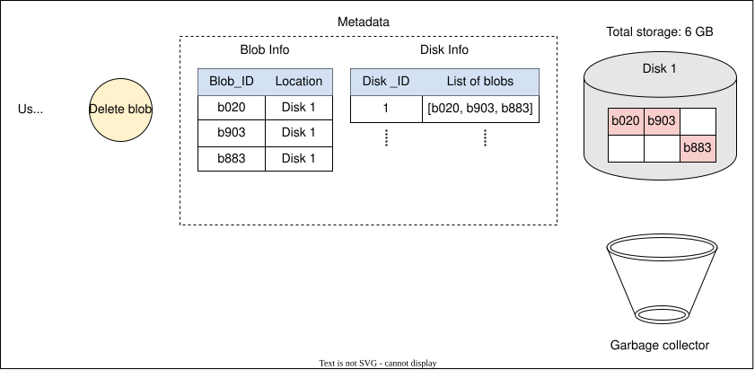
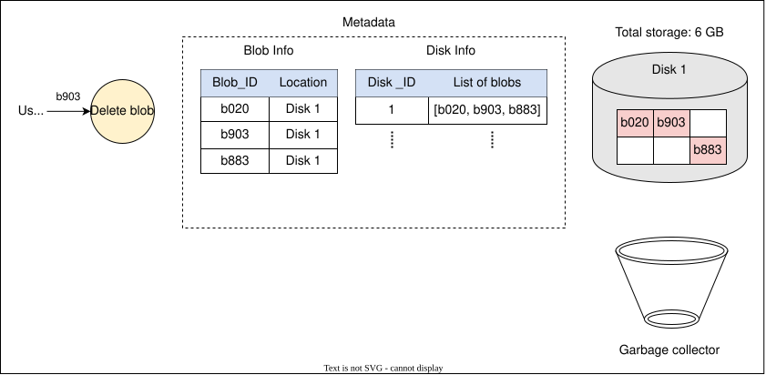
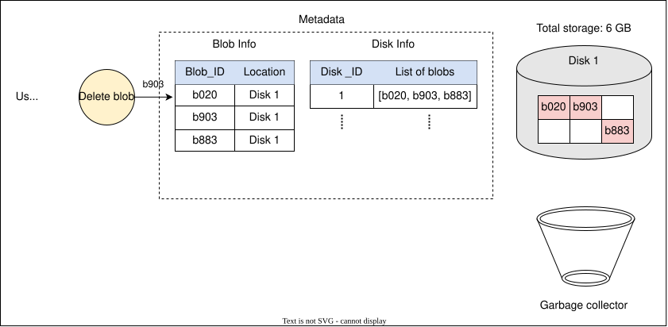
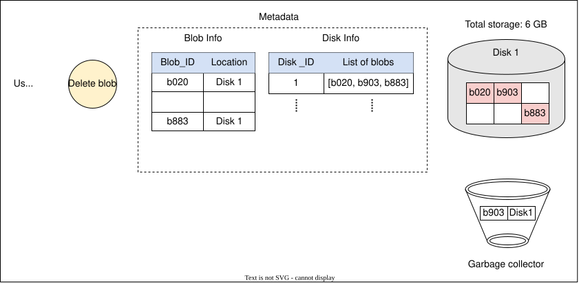
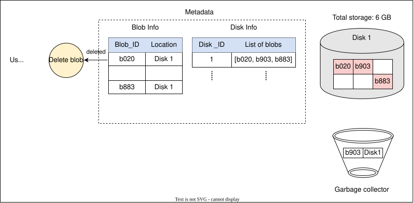

# Design_Considerations_of_a_Blob_Store

Source: https://www.educative.io/courses/grokking-the-system-design-interview/design-considerations-of-a-blob-store

---

[Home](https://www.educative.io/)

[Courses](https://www.educative.io/search?tab=courses)

[Grokking Modern System Design Interview](https://www.educative.io/courses/grokking-the-system-design-interview)

# Design Considerations of a Blob Store

Discover the essential System Design considerations for building a reliable blob store. Implement data chunking, metadata management, and user-account-based strategic partitioning. Learn to use multi-level replication and indexing to ensure high availability and fast querying performance.

We'll cover the following...

- [Introduction](https://www.educative.io/courses/grokking-the-system-design-interview/design-considerations-of-a-blob-store#Introduction)
- [Blob metadata](https://www.educative.io/courses/grokking-the-system-design-interview/design-considerations-of-a-blob-store#Blob-metadata)
- [Partition data](https://www.educative.io/courses/grokking-the-system-design-interview/design-considerations-of-a-blob-store#Partition-data)
- [Blob indexing](https://www.educative.io/courses/grokking-the-system-design-interview/design-considerations-of-a-blob-store#Blob-indexing)
- [Pagination for listing](https://www.educative.io/courses/grokking-the-system-design-interview/design-considerations-of-a-blob-store#Pagination-for-listing)
- [Garbage collection while deleting a blob](https://www.educative.io/courses/grokking-the-system-design-interview/design-considerations-of-a-blob-store#Garbage-collection-while-deleting-a-blob)
- [Stream a file](https://www.educative.io/courses/grokking-the-system-design-interview/design-considerations-of-a-blob-store#Stream-a-file)
- [Cache the blob store](https://www.educative.io/courses/grokking-the-system-design-interview/design-considerations-of-a-blob-store#Cache-the-blob-store)

## Introduction[#](https://www.educative.io/courses/grokking-the-system-design-interview/design-considerations-of-a-blob-store#Introduction)

The previous lesson outlined the major components of the blob store. This lesson examines implementation challenges, including storing large blobs, managing replicas, and optimizing retrieval latency. The following table summarizes the lesson objectives.

## Summary of the Lesson

|  |  |
| --- | --- |
| **Section** | **Purpose** |
| Blob metadata | This is the metadata that’s maintained to ensure efficient storage and retrieval of blobs. |
| Partitioning | This determines how blobs are partitioned among different data nodes. |
| Blob indexing | This shows us how to efficiently search for blobs. |
| Pagination | This teaches us how to conceive a method for the retrieval of a limited number of blobs to ensure improved readability and loading time. |
| Replication | This teaches us how to replicate blobs and tells us how many copies we should maintain to improve availability. |
| Garbage collection | This teaches us how to delete blobs without sacrificing performance. |
| Streaming | This teaches us how to stream large files chunk-by-chunk to facilitate interactivity for users. |
| Caching | This shows us how to improve response time and throughput. |

Abstraction layers hide internal complexity from users and guide design decisions for routing and sharding. There are three primary layers:

1. **User account:** Identifies users via an `account_ID`. It contains all user containers.
2. **Container:** Identifies a set of blobs via a `container_ID`.
3. **Blob:** Identifies specific files via a `blob_ID`. This layer maintains metadata vital for system availability and reliability.

The table below summarizes these layers.

## Layered Information

|  |  |  |  |  |
| --- | --- | --- | --- | --- |
| **Level** | **Uniquely identified by** | **Information** | **Sharded by** | **Mapping** |
| User’s blob store account | `account_ID` | list of `container_ID` values | `account_ID` | Account -> list of containers |
| Container | `container_ID` | List of `blob_ID` values | `container_ID` | Container -> list of blobs |
| Blob | `blob_ID` | {list of chunks, chunkInfo: data node ID's,.. } | `blob_ID` | Blob -> list of chunks |

> **Note:** We generate unique IDs for user accounts, containers, and blobs using a [unique ID generator](https://www.educative.io/courses/grokking-the-system-design-interview/design-of-a-unique-id-generator).

The system maintains metadata to manage storage. Let’s examine this data.

## Blob metadata[#](https://www.educative.io/courses/grokking-the-system-design-interview/design-considerations-of-a-blob-store#Blob-metadata)

When a user uploads a blob, it is split into small chunks. This supports large files that exceed the capacity of a single contiguous disk block or data node. The manager node tracks chunk locations and assigns IDs to facilitate retrieval.

Metadata includes chunk IDs, assigned data nodes, and replica IDs. Replicating chunks ensures reliability in case of node failure.

For example, a 128 MB blob split into two 64 MB chunks would have the following metadata:

## Blob Metadata

|  |  |  |  |  |
| --- | --- | --- | --- | --- |
| **Chunk** | **Datanode ID** | **Replica 1 ID** | **Replica 2 ID** | **Replica 3 ID** |
| 1 | d1b1 | r1b1 | r2b1 | r3b1 |
| 2 | d1b2 | r1b2 | r2b2 | r3b2 |

> **Note:** The system should use a fixed chunk size that balances metadata overhead and storage performance. Smaller chunks increase metadata volume and add load to the manager node. Larger chunks can increase fragmentation and degrade I/O performance. For rotating disks, the chunk size should align with the disk’s sector size.

The system maintains three replicas for each chunk. During a write, the manager node uses free space metadata to select the primary and replica nodes for the chunk. The replicas provide redundancy in case of node failure and can serve read requests to reduce load on the primary. Because the blob size is a multiple of the chunk size, the manager node can deterministically compute the byte range for each chunk.

1.

What if the blob size isn’t a multiple of our configured chunk size? How does the manager node know how many Bytes to read for the last chunk?

Show Answer

Did you find this helpful?

## Partition data[#](https://www.educative.io/courses/grokking-the-system-design-interview/design-considerations-of-a-blob-store#Partition-data)

Searching for specific blobs across billions of files and numerous data nodes is inefficient. To optimize this, we group data nodes into **partitions** and maintain a partition map. However, distributing blobs randomly (e.g., by Blob ID) creates performance bottlenecks, as shown below:

Partitioning by blob ID scatters data, increasing overhead when listing blobs for a specific account or container.

To resolve this, we partition based on the full path: `Account ID` + `Container ID` + `Blob ID`. This co-locates a user’s blobs on the same partition server, enhancing performance.

> **Note:** The manager node maintains partition mappings in distributed metadata storage.

Range partitioning based on blob IDs

## Blob indexing[#](https://www.educative.io/courses/grokking-the-system-design-interview/design-considerations-of-a-blob-store#Blob-indexing)

As storage grows, finding specific blobs becomes difficult. A **blob index** facilitates efficient management and querying.

Users define key-value tags (e.g., upload date, media type, container name) during upload. As shown below, an indexing engine reads these tags and populates a searchable index:

Indexing and searching blobs

Indexing also supports sorting and pagination.

## Pagination for listing[#](https://www.educative.io/courses/grokking-the-system-design-interview/design-considerations-of-a-blob-store#Pagination-for-listing)

**Listing** returns blobs matching a user-provided **prefix** (a string that the blob name must start with).

Users may want to list all blobs in an account or container. As a query might match thousands of blobs, the system cannot return the entire list in a single response. Instead, it uses **pagination** to return results in manageable parts (pages).

For example, if an account has 2,000 blobs, returning them all at once can degrade performance. Pagination returns the first five results and provides a `next` button to fetch the subsequent five.

The number of results per page depends on:

- Target query response time
- Payload size constraints

1.

How do we decide which five blobs to return first out of the 2,000 blobs total?

Show Answer

Did you find this helpful?

Pagination requires a **continuation token** to track the current position in the list. If a query’s results exceed the page limit, the response includes this token. The client sends the token in the subsequent request to fetch the next batch.

These are the regions and availability zones. Dark yellow is the primary data and light yellow are the replicas

We typically maintain three copies of a blob:

- **Local copy:** Stored in the primary region’s data center to handle rack/drive failures.
- **Second copy:** Stored in a different data center within the same region to handle facility-level disasters.
- **Third copy:** Stored in a different region to handle regional disasters.

## Garbage collection while deleting a blob[#](https://www.educative.io/courses/grokking-the-system-design-interview/design-considerations-of-a-blob-store#Garbage-collection-while-deleting-a-blob)

Because blob chunks are distributed across multiple data nodes, synchronously deleting all replicas would introduce high latency. To reduce request latency, the system does not immediately remove the blob when a delete request is received. Instead, the blob is marked as “DELETED” in metadata, making it inaccessible to the user. The actual deletion happens later, after the delete request has been acknowledged.

Marking a blob as deleted without immediately removing it introduces internal metadata inconsistencies, leaving storage space temporarily occupied. These inconsistencies are invisible to users. For example, although a blob is marked as deleted, its chunk metadata remains, and data nodes continue to store the chunks. To address this, a **garbage collector** later cleans up stale metadata and removes the associated chunks.

As a result, there can be a delay between a blob delete request and the reclamation of the associated storage space. This trade-off reduces delete request latency by deferring physical cleanup. The deletion workflow is illustrated below:

1 / 10

Three blobs are uploaded to the blob store. Disk 1 is holding all three blobs

1 / 10

A user makes a request to delete the blob with ID b903

1 / 10

The Delete Blob API looks into the Blob Table to delete b903

1 / 10

Entry for blob b903 is deleted from the blob table so that no one can access that blob anymore. The garbage collector collects the blob entry

1 / 10

After marking the blob as deleted, an acknowledgment is sent to the Delete Blob API

## Stream a file[#](https://www.educative.io/courses/grokking-the-system-design-interview/design-considerations-of-a-blob-store#Stream-a-file)

Streaming involves reading a file in sequential parts. If the read size is X\text{X}X bytes:

- **First request:** Bytes 000 to X−1\text{X}-1X−1.
- **Second request:** Bytes X\text{X}X to 2X−1\text{2X}-12X−1.

1.

How do we know which bytes we have read first and which bytes we have to read next?

Show Answer

Did you find this helpful?

## Cache the blob store[#](https://www.educative.io/courses/grokking-the-system-design-interview/design-considerations-of-a-blob-store#Cache-the-blob-store)

Caching improves performance at multiple levels:

- **Client-side:** Caches chunk metadata to access data nodes directly for subsequent reads.
- **Frontend servers:** Cache partition maps to quickly route requests.
- **Manager node:** Caches frequently accessed chunks to reduce disk I/O.

> **Note:** Public blobs are often cached using a CDN. The CDN serves content until the TTL (time-to-live) defined by the origin server's `Cache-Control` header expires.

We covered the design factors to consider when designing a blob store. Now, we’ll evaluate what we designed.

Design of a Blob Store

Evaluation of a Blob Store's Design

Ask

[Introduction](https://www.educative.io/courses/grokking-the-system-design-interview/design-considerations-of-a-blob-store#Introduction)

[Blob metadata](https://www.educative.io/courses/grokking-the-system-design-interview/design-considerations-of-a-blob-store#Blob-metadata)

[Partition data](https://www.educative.io/courses/grokking-the-system-design-interview/design-considerations-of-a-blob-store#Partition-data)

[Blob indexing](https://www.educative.io/courses/grokking-the-system-design-interview/design-considerations-of-a-blob-store#Blob-indexing)

[Pagination for listing](https://www.educative.io/courses/grokking-the-system-design-interview/design-considerations-of-a-blob-store#Pagination-for-listing)

[Garbage collection while deleting a blob](https://www.educative.io/courses/grokking-the-system-design-interview/design-considerations-of-a-blob-store#Garbage-collection-while-deleting-a-blob)

[Stream a file](https://www.educative.io/courses/grokking-the-system-design-interview/design-considerations-of-a-blob-store#Stream-a-file)

[Cache the blob store](https://www.educative.io/courses/grokking-the-system-design-interview/design-considerations-of-a-blob-store#Cache-the-blob-store)