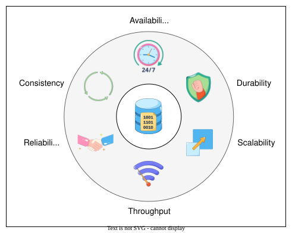

# Evaluation_of_a_Blob_Store's_Design

Source: https://www.educative.io/courses/grokking-the-system-design-interview/evaluation-of-a-blob-stores-design

---

[Home](https://www.educative.io/)

[Courses](https://www.educative.io/search?tab=courses)

[Grokking Modern System Design Interview](https://www.educative.io/courses/grokking-the-system-design-interview)

# Evaluation of a Blob Store's Design

Evaluate the blob store design by assessing its compliance with non-functional requirements. Define how replication and monitoring ensure availability and durability. Analyze how partitioning and parallel fetching achieve scalability, throughput, and strong consistency within the storage cluster.

We'll cover the following...

- [Availability](https://www.educative.io/courses/grokking-the-system-design-interview/evaluation-of-a-blob-stores-design#Availability)
- [Durability](https://www.educative.io/courses/grokking-the-system-design-interview/evaluation-of-a-blob-stores-design#Durability)
- [Scalability](https://www.educative.io/courses/grokking-the-system-design-interview/evaluation-of-a-blob-stores-design#Scalability)
- [Throughput](https://www.educative.io/courses/grokking-the-system-design-interview/evaluation-of-a-blob-stores-design#Throughput)
- [Reliability](https://www.educative.io/courses/grokking-the-system-design-interview/evaluation-of-a-blob-stores-design#Reliability)
- [Consistency](https://www.educative.io/courses/grokking-the-system-design-interview/evaluation-of-a-blob-stores-design#Consistency)
- [Conclusion](https://www.educative.io/courses/grokking-the-system-design-interview/evaluation-of-a-blob-stores-design#Conclusion)

We will now evaluate how the design meets our requirements.

## Availability[#](https://www.educative.io/courses/grokking-the-system-design-interview/evaluation-of-a-blob-stores-design#Availability)

Replication improves availability and fault tolerance. The system maintains four replicas per blob to distribute read traffic and tolerate node failures. The placement strategy spans multiple data centers and regions to reduce the impact of large-scale outages. A monitoring service tracks replica health and triggers re-replication when failures exceed configured thresholds.

For write requests, synchronous replication within the cluster provides strong consistency and improves fault tolerance. To maintain manager node availability, the system persists periodic state snapshots. If the active node fails, a standby instance can be brought up from the persisted state.

## Durability[#](https://www.educative.io/courses/grokking-the-system-design-interview/evaluation-of-a-blob-stores-design#Durability)

Synchronous replication within the storage cluster guarantees data durability. If a node loses data, it is recovered from peers. The monitoring service tracks disk health; upon failure, it alerts administrators and triggers the manager node to copy affected content to healthy disks, updating mappings accordingly.

Guarantees provided by the blob store

## Scalability[#](https://www.educative.io/courses/grokking-the-system-design-interview/evaluation-of-a-blob-stores-design#Scalability)

Splitting blobs into chunks and partitioning them by range allows the system to scale to billions of requests. Partition servers handle specific ranges, providing automatic load balancing. Storage scales horizontally by adding data nodes. However, the centralized manager node creates a potential bottleneck, with a capacity of approximately 10,000 QPS.

1.

How can we further scale when our manager server reaches its limits and we can’t improve its computational performance through vertical scaling?

Show Answer

Did you find this helpful?

## Throughput[#](https://www.educative.io/courses/grokking-the-system-design-interview/evaluation-of-a-blob-stores-design#Throughput)

Distributing chunks across multiple data nodes enables parallel fetching, significantly increasing throughput. Caching at the client, front-end, and manager node layers further improves performance and reduces latency.

## Reliability[#](https://www.educative.io/courses/grokking-the-system-design-interview/evaluation-of-a-blob-stores-design#Reliability)

Heartbeat protocols allow the manager node to monitor data node health and route requests only to healthy instances. When a node fails, the system triggers re-replication to restore the desired replica count. Monitoring services also alert operators to hardware failures, such as disk or switch issues, and to low disk space conditions.

## Consistency[#](https://www.educative.io/courses/grokking-the-system-design-interview/evaluation-of-a-blob-stores-design#Consistency)

We achieve strong consistency within the storage cluster by synchronously replicating data blocks during the write request (critical path). Subsequent reads are served from this cluster until the data is asynchronously replicated to remote data centers for regional availability.

To ensure regional availability, we asynchronously replicate blobs to distant data centers after the initial write completes.

AI Powered

Saved

1 attempt left

Reset

What techniques would you use to make the design secure?

We haven’t discussed security as a nonfunctional requirement for the blob store. Now, it’s your turn to think about how we can implement security to keep the data at rest and in transit safe.

This is your last attempt.

## Conclusion[#](https://www.educative.io/courses/grokking-the-system-design-interview/evaluation-of-a-blob-stores-design#Conclusion)

Blob stores manage large volumes of unstructured data, such as images, audio, and video, for large-scale content platforms. This chapter defined a blob store architecture supporting core operations such as upload, read, and delete, and evaluated it against key non-functional requirements.

Design Considerations of a Blob Store

Quiz on the Blob Store's Design

Ask

[Availability](https://www.educative.io/courses/grokking-the-system-design-interview/evaluation-of-a-blob-stores-design#Availability)

[Durability](https://www.educative.io/courses/grokking-the-system-design-interview/evaluation-of-a-blob-stores-design#Durability)

[Scalability](https://www.educative.io/courses/grokking-the-system-design-interview/evaluation-of-a-blob-stores-design#Scalability)

[Throughput](https://www.educative.io/courses/grokking-the-system-design-interview/evaluation-of-a-blob-stores-design#Throughput)

[Reliability](https://www.educative.io/courses/grokking-the-system-design-interview/evaluation-of-a-blob-stores-design#Reliability)

[Consistency](https://www.educative.io/courses/grokking-the-system-design-interview/evaluation-of-a-blob-stores-design#Consistency)

[Conclusion](https://www.educative.io/courses/grokking-the-system-design-interview/evaluation-of-a-blob-stores-design#Conclusion)