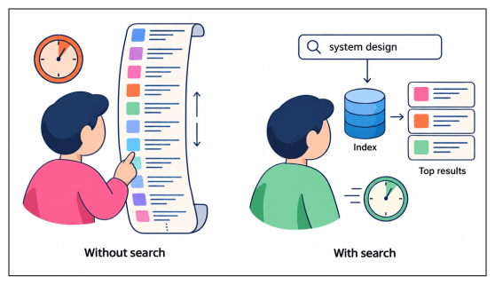
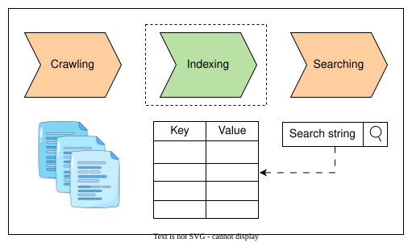

# Distributed_Search_System_Design

Source: https://www.educative.io/courses/grokking-the-system-design-interview/system-design-the-distributed-search

---

[Home](https://www.educative.io/)

[Courses](https://www.educative.io/search?tab=courses)

[Grokking Modern System Design Interview](https://www.educative.io/courses/grokking-the-system-design-interview)

# System Design: The Distributed Search

Discover why modern search systems are essential for navigating massive data volumes. Identify the key components: crawler, indexer, and searcher, that form the foundation of a search engine. Learn the structured, five-step approach for designing a scalable distributed search system.

We'll cover the following...

- [Why do we need a search system?](https://www.educative.io/courses/grokking-the-system-design-interview/system-design-the-distributed-search#Why-do-we-need-a-search-system)
- [What is a search system?](https://www.educative.io/courses/grokking-the-system-design-interview/system-design-the-distributed-search#What-is-a-search-system)
- [How will we design a distributed search system?](https://www.educative.io/courses/grokking-the-system-design-interview/system-design-the-distributed-search#How-will-we-design-a-distributed-search-system)

## Why do we need a search system?[#](https://www.educative.io/courses/grokking-the-system-design-interview/system-design-the-distributed-search#Why-do-we-need-a-search-system)

**Search bars** are standard on modern websites because they allow users to filter vast amounts of content instantly. Without search, users would have to manually scroll through paginated lists to find specific items, whether on an education platform or in a store. This manual discovery is inefficient and results in a poor user experience.

Search acts as a filter that finds relevant items in massive datasets instantly

Consider platforms like YouTube or Google. With billions of videos and web pages, manual navigation is impossible. Search engines solve this by acting as filters, retrieving relevant information from massive datasets in milliseconds. Behind every search interface lies a complex distributed system designed to handle this scale.

## What is a search system?[#](https://www.educative.io/courses/grokking-the-system-design-interview/system-design-the-distributed-search#What-is-a-search-system)

A **search system** accepts a user’s text query and returns relevant content within strict latency constraints. It typically consists of three main components:

- A **crawler**, which fetches content and creates documents.
- An **indexer**, which builds a searchable index `(typically an inverted index)` to organize data for efficient retrieval.
- A **searcher**, which executes queries against the index created by the *indexer* to return results.

The three phases of a search system

> **Note:** We have a separate chapter dedicated to the [crawler](https://www.educative.io/courses/grokking-the-system-design-interview/system-design-web-crawler) component. In this chapter, we focus on indexing.

## How will we design a distributed search system?[#](https://www.educative.io/courses/grokking-the-system-design-interview/system-design-the-distributed-search#How-will-we-design-a-distributed-search-system)

We divide the design process into five lessons:

1. [**Requirements:**](https://www.educative.io/courses/grokking-the-system-design-interview/requirements-of-a-distributed-search-systems-design) Define functional and non-functional requirements. We also estimate system resources, including servers, storage, and bandwidth.
2. [**Indexing:**](https://www.educative.io/courses/grokking-the-system-design-interview/indexing-in-a-distributed-search) Explore the fundamentals of indexing and examine a centralized architecture for distributed search.
3. [**Initial design:**](https://www.educative.io/courses/grokking-the-system-design-interview/design-of-a-distributed-search) Construct a high-level design, define the API, and detail the indexing and searching workflows.
4. [**Final design:**](https://www.educative.io/courses/grokking-the-system-design-interview/scaling-search-and-indexing) Evaluate the initial design and refine the architecture to improve scalability.
5. [**Evaluation:**](https://www.educative.io/courses/grokking-the-system-design-interview/evaluation-of-a-distributed-searchs-design) Assess how the final distributed search system meets the defined requirements.

Let’s start by understanding the requirements.

Blob Store System Design

Requirements of a Distributed Search System's Design

Ask

[Why do we need a search system?](https://www.educative.io/courses/grokking-the-system-design-interview/system-design-the-distributed-search#Why-do-we-need-a-search-system)

[What is a search system?](https://www.educative.io/courses/grokking-the-system-design-interview/system-design-the-distributed-search#What-is-a-search-system)

[How will we design a distributed search system?](https://www.educative.io/courses/grokking-the-system-design-interview/system-design-the-distributed-search#How-will-we-design-a-distributed-search-system)