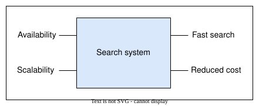

# Requirements_of_a_Distributed_Search_System's_Design

Source: https://www.educative.io/courses/grokking-the-system-design-interview/requirements-of-a-distributed-search-systems-design

---

[Home](https://www.educative.io/)

[Courses](https://www.educative.io/search?tab=courses)

[Grokking Modern System Design Interview](https://www.educative.io/courses/grokking-the-system-design-interview)

# Requirements of a Distributed Search System's Design

Define the core functional and non-functional requirements of a distributed search system. Calculate resource needs for servers, storage, and bandwidth through quantitative estimation.

We'll cover the following...

- [Requirements](https://www.educative.io/courses/grokking-the-system-design-interview/requirements-of-a-distributed-search-systems-design#Requirements)
  - [Functional requirements](https://www.educative.io/courses/grokking-the-system-design-interview/requirements-of-a-distributed-search-systems-design#Functional-requirements)
  - [Non-functional requirements](https://www.educative.io/courses/grokking-the-system-design-interview/requirements-of-a-distributed-search-systems-design#Non-functional-requirements)
- [Resource estimation](https://www.educative.io/courses/grokking-the-system-design-interview/requirements-of-a-distributed-search-systems-design#Resource-estimation)
  - [Number of servers estimation](https://www.educative.io/courses/grokking-the-system-design-interview/requirements-of-a-distributed-search-systems-design#Number-of-servers-estimation)
  - [Storage estimation](https://www.educative.io/courses/grokking-the-system-design-interview/requirements-of-a-distributed-search-systems-design#Storage-estimation)
  - [Bandwidth estimation](https://www.educative.io/courses/grokking-the-system-design-interview/requirements-of-a-distributed-search-systems-design#Bandwidth-estimation)
- [Building blocks](https://www.educative.io/courses/grokking-the-system-design-interview/requirements-of-a-distributed-search-systems-design#Building-blocks)

## Requirements[#](https://www.educative.io/courses/grokking-the-system-design-interview/requirements-of-a-distributed-search-systems-design#Requirements)

We will define the functional and non-functional requirements for a distributed search system.

### Functional requirements[#](https://www.educative.io/courses/grokking-the-system-design-interview/requirements-of-a-distributed-search-systems-design#Functional-requirements)

- **Search:** Users should receive relevant content matching their search queries.

The functional requirement of a distributed search system

### Non-functional requirements[#](https://www.educative.io/courses/grokking-the-system-design-interview/requirements-of-a-distributed-search-systems-design#Non-functional-requirements)

- **Availability:** The system must remain highly available to users.
- **Scalability:** The system must efficiently index and search increasing volumes of data.
- **Low latency:** Users must receive results quickly, regardless of the data volume.
- **Cost efficiency:** The system should minimize infrastructure and operational costs.

The non-functional requirement of a distributed search system

## Resource estimation[#](https://www.educative.io/courses/grokking-the-system-design-interview/requirements-of-a-distributed-search-systems-design#Resource-estimation)

We will estimate the servers, storage, and bandwidth required for a distributed search system, using YouTube search as a baseline.

### Number of servers estimation[#](https://www.educative.io/courses/grokking-the-system-design-interview/requirements-of-a-distributed-search-systems-design#Number-of-servers-estimation)

We assume 150 million daily active users (DAU). To estimate peak load, we use the heuristic of [DAU as a proxy for requests per second (RPS)](https://www.educative.io/courses/grokking-the-system-design-interview/put-back-of-the-envelope-numbers-in-perspective). This sets our design target at 150 million RPS. We calculate the required server count using the following formula:

Servers needed at peak load=Number of requests/secondRPS of server\text{Servers needed at peak load} = \frac{\text{Number of requests/second}}{\text{RPS of server}}
Servers needed at peak load=RPS of serverNumber of requests/second​

Based on a capacity of 64,000 RPS per server (derived in the [Back-of-the-envelope Calculations](https://www.educative.io/courses/grokking-the-system-design-interview/put-back-of-the-envelope-numbers-in-perspective) chapter), the estimation is:

Servers needed at peak load=150 million64,000=2343.75≈2350 servers\text{Servers needed at peak load} = \frac{150 \ \text{million}}{64,000} = 2343.75 \approx 2350 \ \text{servers}
Servers needed at peak load=64,000150 million​=2343.75≈2350 servers

The number of servers required for the YouTube search service

> **Note:** Concurrent requests (RPS) dictate server requirements more significantly than total daily volume.

### Storage estimation[#](https://www.educative.io/courses/grokking-the-system-design-interview/requirements-of-a-distributed-search-systems-design#Storage-estimation)

We store metadata (title, description, channel, transcript) in JSON documents keyed by Video ID. We use the following assumptions to estimate storage per video:

- **JSON document size:** 200 KB
- **Unique terms:** 1,000 keys per document
- **Index entry size:** 100 bytes per term

The formula for storage per video is:

Totalstorage/video=Storage/doc+(Terms/doc×Storage/term)\text{Total}\_{\text{storage/video}} = \text{Storage}\_{\text{/doc}} + \left( \text{Terms}\_{\text{/doc}} \times \text{Storage}\_{\text{/term}} \right)
Totalstorage/video​=Storage/doc​+(Terms/doc​×Storage/term​)

#### Total Storage Required to Index One Video on YouTube

|  |  |  |  |
| --- | --- | --- | --- |
| Storage per JSON doc (KB) | No. of terms per doc | Storage per term (Bytes) | Total storage per video (KB) |
| 200 | 1000 | 100 | f300 |

Total storage per video is 300 KB (200 KB metadata + 100 KB index). Assuming 6,000 videos are uploaded daily, we calculate the daily storage requirement as follows:

Totalstorage/day=No. of videos/day×Totalstorage/video\text{Total}\_{\text{storage/day}} = \text{No. of videos}\_{\text{/day}} \times \text{Total}\_{\text{storage/video}}
Totalstorage/day​=No. of videos/day​×Totalstorage/video​

#### Total Storage Required to Index Videos per Day on YouTube

|  |  |  |
| --- | --- | --- |
| No. of videos per day | Total storage per video (KB) | Total storage per day(GB) |
| 6000 | 300 | f1.8 |

Indexing 6,000 videos per day requires 1.8 GB of storage. This estimate is specific to YouTube’s upload rate; a multi-tenant service would require significantly more storage.

Summarizing the storage requirement of a distributed search system for videos uploaded to YouTube per day

### Bandwidth estimation[#](https://www.educative.io/courses/grokking-the-system-design-interview/requirements-of-a-distributed-search-systems-design#Bandwidth-estimation)

Bandwidth estimation accounts for both incoming search queries and outgoing results. The required bandwidth is calculated as follows:

Totalbandwidth=Totalrequests/second×Totalquery size\text{Total}\_{\text{bandwidth}} = \text{Total}\_{\text{requests/second}} \times \text{Total}\_{\text{query size}}
Totalbandwidth​=Totalrequests/second​×Totalquery size​

**Incoming traffic:**

We estimate incoming bandwidth using these metrics:

- **Daily search requests:** 150 million
- **Search query size:** 100 bytes

#### Bandwidth Required for Incoming Search Queries per Second

|  |  |  |
| --- | --- | --- |
| No. of requests per second | Query size (Bytes) | Bandwidth (Mb/s) |
| 1736.11 | 100 | f1.39 |

**Outgoing traffic:**

Outgoing traffic consists of the search results returned to the user. We assume each response contains a list of video IDs.

We estimate outgoing bandwidth using these metrics:

- **Daily search requests:** 150 million
- **Response size:** 4,000 bytes (80 suggestions × 50 bytes)

We apply the same bandwidth formula to these values.

#### Bandwidth Required for Outgoing Traffic per Second

|  |  |  |
| --- | --- | --- |
| No. of requests per second | Response size (Bytes) | Bandwidth (Mb/s) |
| 1736.11 | 4000 | f55.56 |

Summarizing the bandwidth requirements of a video search

> **Note:** These estimates assume text-only results. While many services include thumbnails, keeping the payload small ensures near real-time performance.

## Building blocks[#](https://www.educative.io/courses/grokking-the-system-design-interview/requirements-of-a-distributed-search-systems-design#Building-blocks)

We require a distributed storage system for the raw data and the index. We will use a [blob store](https://www.educative.io/courses/grokking-the-system-design-interview/system-design-a-blob-store) for this purpose.

A blob store holds both the raw data and the search index

In summary, we have defined the system requirements, estimated the necessary resources, and identified the blob store as a primary building block.

System Design: The Distributed Search

Indexing in a Distributed Search

Ask

[Requirements](https://www.educative.io/courses/grokking-the-system-design-interview/requirements-of-a-distributed-search-systems-design#Requirements)

[Functional requirements](https://www.educative.io/courses/grokking-the-system-design-interview/requirements-of-a-distributed-search-systems-design#Functional-requirements)

[Non-functional requirements](https://www.educative.io/courses/grokking-the-system-design-interview/requirements-of-a-distributed-search-systems-design#Non-functional-requirements)

[Resource estimation](https://www.educative.io/courses/grokking-the-system-design-interview/requirements-of-a-distributed-search-systems-design#Resource-estimation)

[Number of servers estimation](https://www.educative.io/courses/grokking-the-system-design-interview/requirements-of-a-distributed-search-systems-design#Number-of-servers-estimation)

[Storage estimation](https://www.educative.io/courses/grokking-the-system-design-interview/requirements-of-a-distributed-search-systems-design#Storage-estimation)

[Bandwidth estimation](https://www.educative.io/courses/grokking-the-system-design-interview/requirements-of-a-distributed-search-systems-design#Bandwidth-estimation)

[Building blocks](https://www.educative.io/courses/grokking-the-system-design-interview/requirements-of-a-distributed-search-systems-design#Building-blocks)