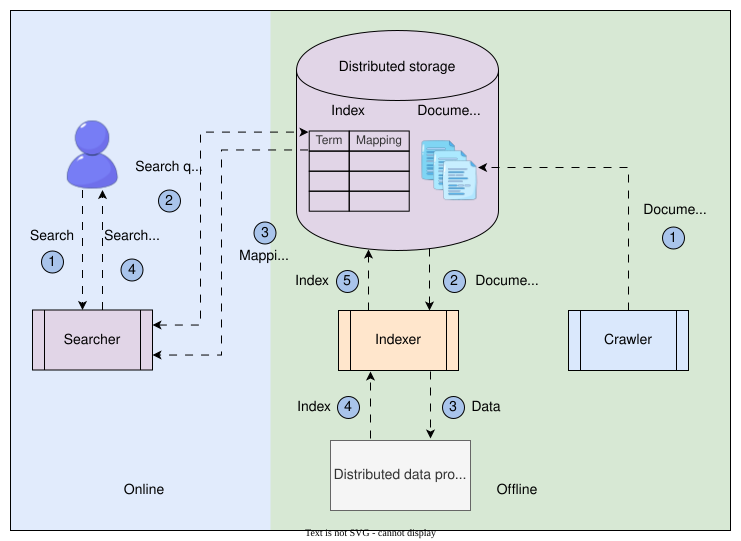

# Design_of_a_Distributed_Search

Source: https://www.educative.io/courses/grokking-the-system-design-interview/design-of-a-distributed-search

---

[Home](https://www.educative.io/)

[Courses](https://www.educative.io/search?tab=courses)

[Grokking Modern System Design Interview](https://www.educative.io/courses/grokking-the-system-design-interview)

# Design of a Distributed Search

Define the architecture of a high-volume distributed search system that separates offline indexing from online searching. Learn how document partitioning and MapReduce facilitate parallel index construction and query processing. Implement replication strategies to achieve fault tolerance and scale system availability globally.

We'll cover the following...

- [High-level design](https://www.educative.io/courses/grokking-the-system-design-interview/design-of-a-distributed-search#High-level-design)
- [API design](https://www.educative.io/courses/grokking-the-system-design-interview/design-of-a-distributed-search#API-design)
- [Detailed discussion](https://www.educative.io/courses/grokking-the-system-design-interview/design-of-a-distributed-search#Detailed-discussion)
  - [Distributed indexing and searching](https://www.educative.io/courses/grokking-the-system-design-interview/design-of-a-distributed-search#Distributed-indexing-and-searching)
  - [Replication](https://www.educative.io/courses/grokking-the-system-design-interview/design-of-a-distributed-search#Replication)
  - [Replication factor and replica distribution](https://www.educative.io/courses/grokking-the-system-design-interview/design-of-a-distributed-search#Replication-factor-and-replica-distribution)
- [Summary](https://www.educative.io/courses/grokking-the-system-design-interview/design-of-a-distributed-search#Summary)

## High-level design[#](https://www.educative.io/courses/grokking-the-system-design-interview/design-of-a-distributed-search#High-level-design)

A distributed search system operates in two phases. The **offline phase** handles data crawling and indexing in the background. The **online phase** serves user search queries.

High-level design of a distributed search system

- The **crawler** collects content from sources (e.g., YouTube videos), extracts text and metadata to enable intelligent search based on titles, descriptions, and video content, formats it as JSON, and stores it in a distributed storage system.
- The **indexer** fetches documents and builds indexes using **MapReduce** on a distributed cluster. The resulting index table is stored in a distributed storage system.
- **Distributed storage** holds the raw documents and the constructed index.
- The **user** submits a search string containing one or more words.
- The **searcher** parses the query, maps terms to the index, and returns ranked results. It also handles spell correction and relevance ranking.

## API design[#](https://www.educative.io/courses/grokking-the-system-design-interview/design-of-a-distributed-search#API-design)

The API is straightforward since users send string requests.

**Search:** The `search` function executes when a user queries the system.

Ace Editor

1

search(query)

הההההההההההההההההההההההההההההההההההההההההההההההההההההההההההההההההההההההההההההההההההההההההההההההההההההההההההההההההההההההההההההההההההההההההההההההההההההההההההההההההההההההההההההההההההההההההההההההההההההההההההההההההההההההההההההההההההההההההההההההההההההההההההההההההההההההההההההההההההההההההההההההההההההההההההההההההההההההההההההההההההההההההההההההההההההההההההההההההההההההההההההההההההההההההההההההההההההההההההההההההההההההההההההההההההההההההההההההההההההההההההההההההההההההההההההההההההההההההההההההההההההההההההההההההההההההההההההההה

XXXXXXXXXXXXXXXXXXXXXXXXXXXXXXXXXXXXXXXXXXXXXXXXXXXXXXXXXXXXXXXXXXXXXXXXXXXXXXXXXXXXXXXXXXXXXXXXXXXXXXXXXXXXXXXXXXXXXXXXXXXXXXXXXXXXXXXXXXXXXXXXXXXXXXXXXXXXXXXXXXXXXXXXXXXXXXXXXXXXXXXXXXXXXXXXXXXXXXXXXXXXXXXXXXXXXXXXXXXXXXXXXXXXXXXXXXXXXXXXXXXXXXXXXXXXXXXXXXXXXXXXXXXXXXXXXXXXXXXXXXXXXXXXXXXXXXXXXXXXXXXXXXXXXXXXXXXXXXXXXXXXXXXXXXXXXXXXXXXXXXXXXXXXXXXXXXXXXXXXXXXXXXXXXXXXXXXXXXXXXXXXXXXXXXXXXXXXXXXXXXXXXXXXXXXXXXXXXXXXXXXXXXXXXXXXXXXXXXXXXXXXXXXXXXXXXXXXXXXXXXXXXXXXXXXXXXXXXXXXXXXXXXXXXXXXXXXXXXXXXXXXXXXXXXXX

|  |  |
| --- | --- |
| **Parameter** | **Description** |
| `query` | This is the textual query entered by the user in the search bar, based on which the results are found. |

## Detailed discussion[#](https://www.educative.io/courses/grokking-the-system-design-interview/design-of-a-distributed-search#Detailed-discussion)

As the indexer is the core component of a search system, we discussed indexing techniques and the problems associated with centralized indexing in the previous lesson. Let’s now consider a distributed solution for indexing and searching.

### Distributed indexing and searching[#](https://www.educative.io/courses/grokking-the-system-design-interview/design-of-a-distributed-search#Distributed-indexing-and-searching)

The input to the indexing system consists of documents collected during crawling. To build the index at scale, the system uses a cluster of commodity nodes and partitions documents across them according to capacity and load.

To achieve cost efficiency, we split documents across many small nodes. We must decide how to partition this data. Two common techniques are:

- **Document partitioning:** Documents are split into subsets. Each node indexes its assigned subset.
- **Term partitioning:** The dictionary of terms is split. A single node handles a specific set of terms (e.g., all terms starting with “search”).

Types of data partitioning in a distributed search

*Term partitioning* sends queries only to nodes handling specific terms. While this increases concurrency, multi-word queries require expensive data transfer between nodes to merge results.

*Document partitioning* sends every query to all nodes, and results are merged centrally. This requires less inter-node communication. We will use document partitioning in our design.

The system uses a cluster that consists of a number of low-cost nodes managed by a cluster manager. The cluster manager uses a MapReduce model to parallelize index computation across partitions. MapReduce processes datasets that exceed the capacity of a single server, as shown below:

Distributed indexing and searching in a parallel fashion on multiple nodes in a cluster of commodity machines

The system operates as follows:

**Indexing**

- The crawler collects the document set.
- The **cluster manager** splits documents into N partitions based on data size and node availability. It monitors node health via **periodic heartbeats**. A **hashing function** assigns documents to partitions.
- The cluster manager runs indexing algorithms across all N partitions simultaneously on the N nodes in the cluster. It creates “tiny” inverted indexes, which are stored locally. This produces N smaller indexes rather than a single large index.

**Searching**

- The system executes parallel searches on all N nodes.
- Each node returns a list of mappings for the query terms. The **merger** aggregates these lists.
- The merger sorts the documents in the aggregated mapping list based on term frequency.
- The sorted results are returned to the user.

> **Note:** We use **colocation**, meaning both searching and indexing are performed on the same nodes. This handles large datasets by working on smaller partitions.

The proposed design can be replicated across multiple data centers worldwide to serve users globally. This provides the following benefits:

- Eliminates a single point of failure (SPOF).
- Keeps user latency low.
- Allows maintenance and upgrades at individual data centers.
- Improves scalability by serving more users per second.

### Replication[#](https://www.educative.io/courses/grokking-the-system-design-interview/design-of-a-distributed-search#Replication)

We replicate the indexing nodes that generate inverted indexes for assigned partitions. Queries can be served by multiple replicated node groups. The architecture remains the same, but instead of a single group of nodes, we maintain R groups, where **R** is the replication factor. Each group contains all partitions required to answer a query, and the number of groups can scale based on request volume.

> **Note:** A load balancer is required to distribute queries across node groups and retry on failures.

Each group is hosted in different Availability Zones to improve performance and ensure availability if a data center fails.

### Replication factor and replica distribution[#](https://www.educative.io/courses/grokking-the-system-design-interview/design-of-a-distributed-search#Replication-factor-and-replica-distribution)

A replication factor of three is commonly used in distributed indexing systems. Each partition is stored on three nodes. One node serves as the primary, and the other two serve as replicas. All nodes build indexes in the same order to reach a consistent state.

For example, consider a document set divided into four partitions. With a replication factor of 3, each partition is stored across 3 nodes. Assume two availability zones (AZ1AZ\_1AZ1​​ and AZ2AZ\_2AZ2​), each containing two nodes. Each node acts as the primary for one partition (for example, Node 1 in AZ1AZ\_1AZ1​​ is the primary for P1P1P1).

The three replicas of a partition are distributed across availability zones so that two copies reside in one zone and one in the other. Different colors represent the replicas. For partition P4:

- The first replica (orange) is placed on Node 2 in AZ2AZ2AZ2.
- The second replica (blue) is placed on Node 1 in AZ2AZ2AZ2.
- The third replica (purple) is placed on Node 2 in AZ1AZ1AZ1.

Each group in the illustration contains one replica from each partition (P1,P2,P3,P4P1, P2, P3, P4P1,P2,P3,P4).

The replica distribution: Each node contains one primary partition and two replicas

In the illustration, primary replicas are indicated by darker colors (e.g., dark purple for P1P\_1P1​​). Now, let’s examine operations with replicas:

**Indexing with replicas**

Each partition is forwarded to all three replicas across both availability zones. Nodes compute the index simultaneously. If the primary node fails, indexing continues on the replicas.

**Searching with replicas**

The load balancer selects one replica per partition for each query. This triples read capacity and improves availability.

## Summary[#](https://www.educative.io/courses/grokking-the-system-design-interview/design-of-a-distributed-search#Summary)

We designed a scalable system using:

- **Colocation:** Parallel indexing and searching on the same nodes.
- **Replication:** Duplicating partitions to improve availability and read throughput.

While colocation scales reads and writes, it introduces drawbacks discussed in the next lesson.

Indexing in a Distributed Search

Scaling Search and Indexing

Ask

[High-level design](https://www.educative.io/courses/grokking-the-system-design-interview/design-of-a-distributed-search#High-level-design)

[API design](https://www.educative.io/courses/grokking-the-system-design-interview/design-of-a-distributed-search#API-design)

[Detailed discussion](https://www.educative.io/courses/grokking-the-system-design-interview/design-of-a-distributed-search#Detailed-discussion)

[Distributed indexing and searching](https://www.educative.io/courses/grokking-the-system-design-interview/design-of-a-distributed-search#Distributed-indexing-and-searching)

[Replication](https://www.educative.io/courses/grokking-the-system-design-interview/design-of-a-distributed-search#Replication)

[Replication factor and replica distribution](https://www.educative.io/courses/grokking-the-system-design-interview/design-of-a-distributed-search#Replication-factor-and-replica-distribution)

[Summary](https://www.educative.io/courses/grokking-the-system-design-interview/design-of-a-distributed-search#Summary)