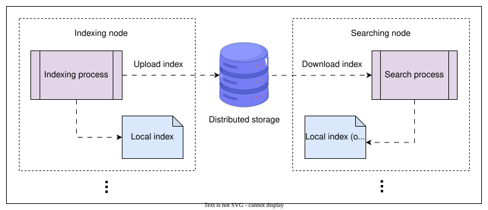
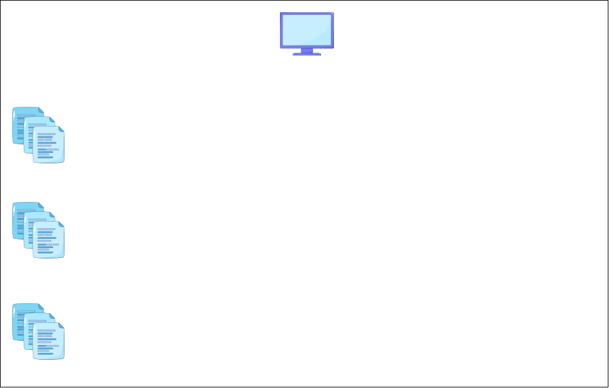
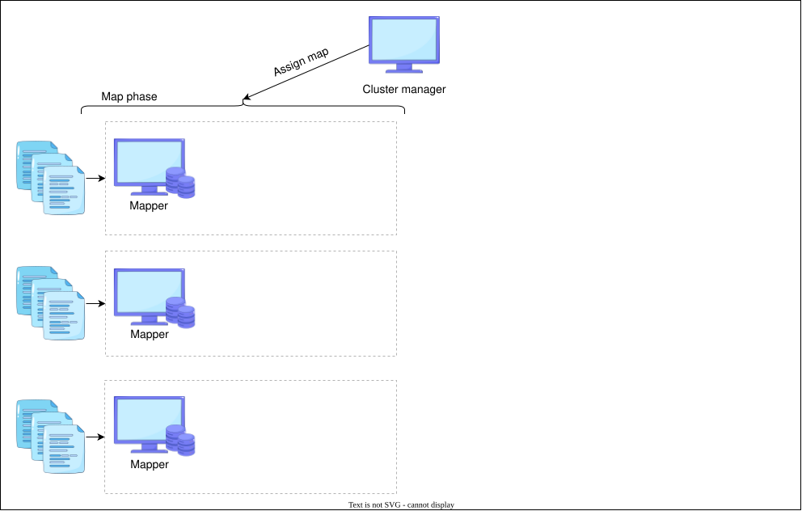
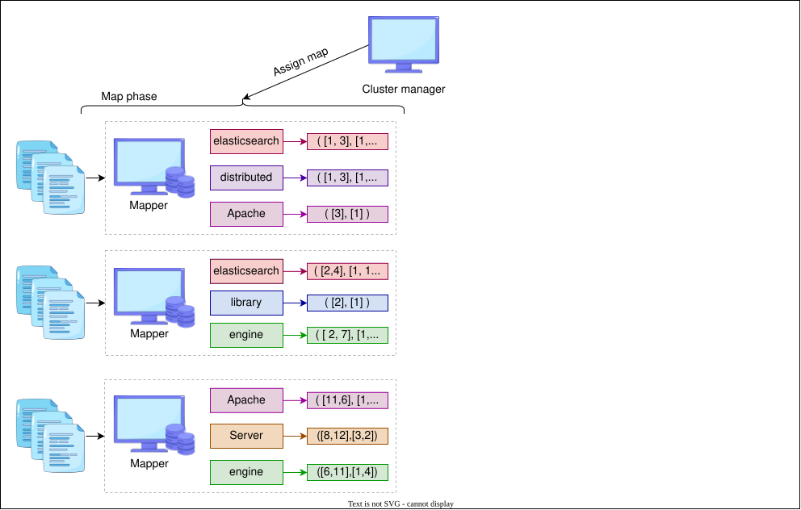
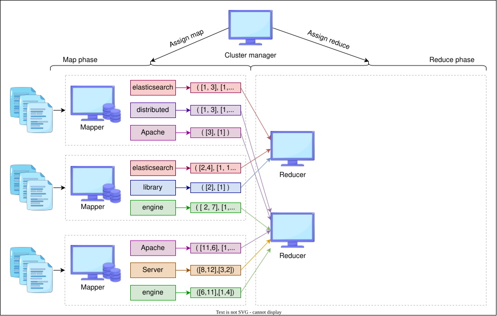
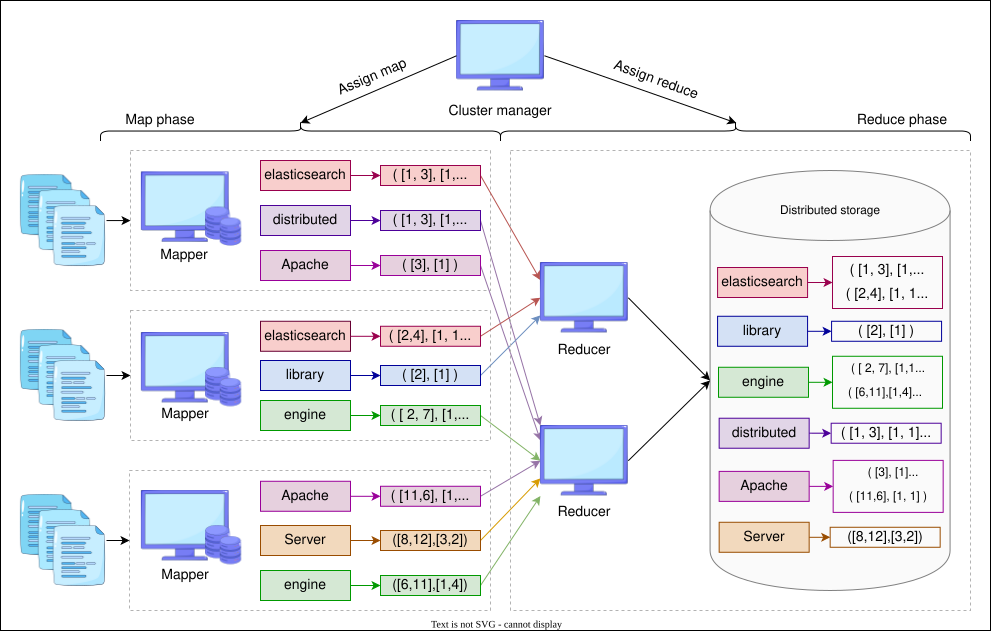

# Scaling_Search_and_Indexing

Source: https://www.educative.io/courses/grokking-the-system-design-interview/scaling-search-and-indexing

---

[Home](https://www.educative.io/)

[Courses](https://www.educative.io/search?tab=courses)

[Grokking Modern System Design Interview](https://www.educative.io/courses/grokking-the-system-design-interview)

# Scaling Search and Indexing

Explore how to resolve scalability and resource wastage issues caused by colocating indexing and searching. Implement a highly performant distributed search System Design by separating these roles and using distributed storage. Learn to apply the MapReduce framework to parallelize index generation efficiently.

We'll cover the following...

- [Problems with the proposed design](https://www.educative.io/courses/grokking-the-system-design-interview/scaling-search-and-indexing#Problems-with-the-proposed-design)
- [Solution](https://www.educative.io/courses/grokking-the-system-design-interview/scaling-search-and-indexing#Solution)
- [Separate the indexing and search](https://www.educative.io/courses/grokking-the-system-design-interview/scaling-search-and-indexing#Separate-the-indexing-and-search)
- [Indexing explained](https://www.educative.io/courses/grokking-the-system-design-interview/scaling-search-and-indexing#Indexing-explained)
- [Summary](https://www.educative.io/courses/grokking-the-system-design-interview/scaling-search-and-indexing#Summary)

## Problems with the proposed design[#](https://www.educative.io/courses/grokking-the-system-design-interview/scaling-search-and-indexing#Problems-with-the-proposed-design)

While the design from the previous lesson is functional, it has significant drawbacks regarding resource usage and scalability:

1. **Colocated indexing and searching:** Running both operations on the same node causes resource contention. Since both indexing and searching are resource-intensive, they degrade each other’s performance. This design also prevents independent scaling of search and indexing resources based on load.
2. **Index recomputation:** Computing the index independently on every replica wastes CPU. Index construction is a heavy pipeline involving hundreds of operations. Recomputing the same index on multiple machines is inefficient.

To address these issues, we need an alternative approach that decouples these operations.

## Solution[#](https://www.educative.io/courses/grokking-the-system-design-interview/scaling-search-and-indexing#Solution)

Instead of recomputing the index on every replica, the system computes the inverted index once on the primary node. The resulting index file is then distributed to the replicas. This approach reduces CPU and memory usage by avoiding redundant computation.

1.

What are the disadvantages of the above-proposed solution?

Show Answer

Did you find this helpful?

## Separate the indexing and search[#](https://www.educative.io/courses/grokking-the-system-design-interview/scaling-search-and-indexing#Separate-the-indexing-and-search)

Modern cloud infrastructure provides high network bandwidth and scalable distributed storage. This enables indexing and search to run on separate clusters without introducing substantial latency overhead. Isolation prevents indexing workloads from degrading search performance, and vice versa. Index files can be replicated across nodes, eliminating the need for recomputation.

The redesigned system consists of three main components:

1. **Indexer:** A cluster of nodes dedicated to computing the index.
2. **Distributed storage:** A system used to store raw document partitions and the computed index files.
3. **Searcher:** A cluster of nodes dedicated to executing search queries.

The illustration below depicts the transfer of an inverted index from an indexer to a searcher node:

The indices produced by the indexing nodes are stored on the distributed storage, and the nodes involved in the search reads indices from the distributed storage to produce a result for the user's query

In a production environment, the indexing phase utilizes NNN nodes, where each node processes a specific partition of documents. The workflow operates as follows:

- **Index generation:** Indexers produce inverted indexes stored as binary files on local storage.
- **Storage and backup:** These binary files are asynchronously pushed to a distributed storage system. If a hardware failure occurs, a replacement node can retrieve the data from this storage.
- **Distribution:** Searcher nodes download the index files. To optimize performance, they cache frequently queried data in RAM.

When a user submits a query, a **Merger** node broadcasts it to all searcher nodes. Each searcher generates a response based on its local index segment. The Merger then aggregates these results and presents them to the user.

As new documents are indexed, search nodes fetch the updated index files to keep search results up to date.

## Indexing explained[#](https://www.educative.io/courses/grokking-the-system-design-interview/scaling-search-and-indexing#Indexing-explained)

To handle massive scale efficiently, we use the **MapReduce framework** for indexing. This model distributes processing across a cluster of worker nodes managed by a cluster manager.

The process consists of two phases:

1. The *Map* phase
2. The *Reduction* phase

The input is a set of document partitions, and the output is an aggregated inverted index. The components function as follows:

- **Cluster manager:** Orchestrates the workflow. It assigns partitions to Mappers and routes Mapper output to Reducers. It also handles fault tolerance by rescheduling tasks if a node fails.
- **Mappers:** Extract and filter terms from their assigned partitions. They output intermediate inverted indexes in parallel.
- **Reducers:** Combine the intermediate mappings for various terms to generate the final summarized index.

Reducers typically wait for Mappers to finish before starting. This allows the cluster manager to reuse the same nodes for both roles, maximizing utilization.

AI Powered

Saved

1 attempt left

Reset

Reducers

Why can Reducers only start after Mappers finish, and how does this affect resource utilization?

This is your last attempt.

The slides below depict a simplified MapReduce workflow for generating an inverted index:

1 / 5

A cluster manager and document partitions

1 / 5

The Map phase starts and the cluster manager assigns documents partitions to the idle nodes in the cluster. We call these nodes Mappers

1 / 5

Mappers extract terms from the assigned documents and produce N smaller inverted indices

1 / 5

The Reduce phase starts, the cluster manager identifies the idle nodes for running the Reduce function, and assigns work to the Reducers

1 / 5

The reducers combine similar terms from the assigned terms from all the mappers and put all the entries for a term together on the distributed storage

For simplicity, the illustration shows two indicators per term: the list of documents containing the term and the term frequency within each document (see [Indexing](https://www.educative.io/courses/grokking-the-system-design-interview/indexing-in-a-distributed-search) for details).

> **Note:** This is a simplified view. Real-world search engines require complex pipelines to handle scale and edge cases, but the fundamental MapReduce principles remain the same.

AI Powered

Saved

3 attempts left

Reset

Index-search separation

How does separating indexing and searching improve the overall performance of a distributed search system?

You have 3 attempts to answer.

## Summary[#](https://www.educative.io/courses/grokking-the-system-design-interview/scaling-search-and-indexing#Summary)

This lesson addressed the scalability limitations of colocating indexing and search, and the inefficiency of recomputing indexes, by separating them into dedicated clusters. Both clusters use distributed storage to exchange index data. The MapReduce framework parallelizes the compute-intensive stages of index construction.

Design of a Distributed Search

Evaluation of a Distributed Search's Design

Ask

[Problems with the proposed design](https://www.educative.io/courses/grokking-the-system-design-interview/scaling-search-and-indexing#Problems-with-the-proposed-design)

[Solution](https://www.educative.io/courses/grokking-the-system-design-interview/scaling-search-and-indexing#Solution)

[Separate the indexing and search](https://www.educative.io/courses/grokking-the-system-design-interview/scaling-search-and-indexing#Separate-the-indexing-and-search)

[Indexing explained](https://www.educative.io/courses/grokking-the-system-design-interview/scaling-search-and-indexing#Indexing-explained)

[Summary](https://www.educative.io/courses/grokking-the-system-design-interview/scaling-search-and-indexing#Summary)