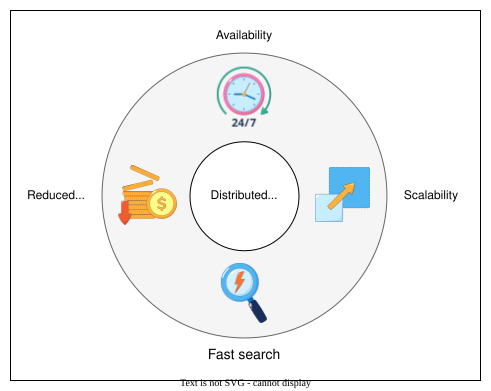

# Evaluation_of_a_Distributed_Search's_Design

Source: https://www.educative.io/courses/grokking-the-system-design-interview/evaluation-of-a-distributed-searchs-design

---

[Home](https://www.educative.io/)

[Courses](https://www.educative.io/search?tab=courses)

[Grokking Modern System Design Interview](https://www.educative.io/courses/grokking-the-system-design-interview)

# Evaluation of a Distributed Search's Design

Analyze how a distributed search architecture meets critical non-functional requirements, such as availability and scalability. Learn how partitioning, replication across availability zones, and isolating indexing processes ensure high performance and cost reduction in System Design.

We'll cover the following...

- [Requirements compliance](https://www.educative.io/courses/grokking-the-system-design-interview/evaluation-of-a-distributed-searchs-design#Requirements-compliance)
  - [Availability](https://www.educative.io/courses/grokking-the-system-design-interview/evaluation-of-a-distributed-searchs-design#Availability)
  - [Scalability](https://www.educative.io/courses/grokking-the-system-design-interview/evaluation-of-a-distributed-searchs-design#Scalability)
  - [Fast search on big data](https://www.educative.io/courses/grokking-the-system-design-interview/evaluation-of-a-distributed-searchs-design#Fast-search-on-big-data)
  - [Reduced cost](https://www.educative.io/courses/grokking-the-system-design-interview/evaluation-of-a-distributed-searchs-design#Reduced-cost)
- [Conclusion](https://www.educative.io/courses/grokking-the-system-design-interview/evaluation-of-a-distributed-searchs-design#Conclusion)

## Requirements compliance[#](https://www.educative.io/courses/grokking-the-system-design-interview/evaluation-of-a-distributed-searchs-design#Requirements-compliance)

Let’s evaluate how the distributed search design meets non-functional requirements.

### Availability[#](https://www.educative.io/courses/grokking-the-system-design-interview/evaluation-of-a-distributed-searchs-design#Availability)

We use distributed storage to persist:

- Documents crawled by the indexer.
- The indexing nodes generate inverted indexes.

Distributed storage replicates data across regions, which supports cross-region deployment and disaster recovery. Clusters of indexing and search nodes are deployed across multiple Availability Zones (AZs). If an Availability Zone fails, traffic is redirected to a healthy cluster. Within each cluster, redundant nodes provide failover capability.

Indexing occurs offline, outside the user’s critical path. Because search queries do not require synchronous access to the absolute latest data, we avoid replication delays. This decoupling ensures high availability for search operations.

> **Note:** Once the latest data replicates to all indexing groups and search nodes, download it, and queries reflect the updates.

Guarantees provided by the distributed search

### Scalability[#](https://www.educative.io/courses/grokking-the-system-design-interview/evaluation-of-a-distributed-searchs-design#Scalability)

Partitioning enables the system to scale. Increasing the number of partitions and adding nodes to clusters expands both indexing and querying capacity. Additionally, isolating indexing from search allows each process to scale independently based on load.

AI Powered

Saved

12 attempts left

Reset

Distributed Search

Hi, I’m Ed. In this session, we will focus on some questions related to the distributed search. Do you want to be mentored or evaluated?”

You have 12 attempts to answer.

### Fast search on big data[#](https://www.educative.io/courses/grokking-the-system-design-interview/evaluation-of-a-distributed-searchs-design#Fast-search-on-big-data)

Nodes execute search queries in parallel across smaller index partitions. The system aggregates results from these nodes to return the final response.

### Reduced cost[#](https://www.educative.io/courses/grokking-the-system-design-interview/evaluation-of-a-distributed-searchs-design#Reduced-cost)

The design uses commodity hardware for indexing and search. Node failures require re-indexing only the affected documents, not the entire dataset.

## Conclusion[#](https://www.educative.io/courses/grokking-the-system-design-interview/evaluation-of-a-distributed-searchs-design#Conclusion)

Single-node systems do not scale to meet the demands of modern search workloads. By using parallel computation on commodity hardware, the system achieves high availability, horizontal scalability, and low query latency.

Scaling Search and Indexing

System Design: Distributed Logging

Ask

[Requirements compliance](https://www.educative.io/courses/grokking-the-system-design-interview/evaluation-of-a-distributed-searchs-design#Requirements-compliance)

[Availability](https://www.educative.io/courses/grokking-the-system-design-interview/evaluation-of-a-distributed-searchs-design#Availability)

[Scalability](https://www.educative.io/courses/grokking-the-system-design-interview/evaluation-of-a-distributed-searchs-design#Scalability)

[Fast search on big data](https://www.educative.io/courses/grokking-the-system-design-interview/evaluation-of-a-distributed-searchs-design#Fast-search-on-big-data)

[Reduced cost](https://www.educative.io/courses/grokking-the-system-design-interview/evaluation-of-a-distributed-searchs-design#Reduced-cost)

[Conclusion](https://www.educative.io/courses/grokking-the-system-design-interview/evaluation-of-a-distributed-searchs-design#Conclusion)