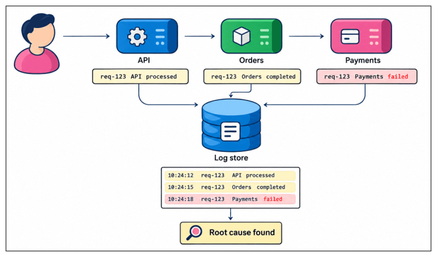
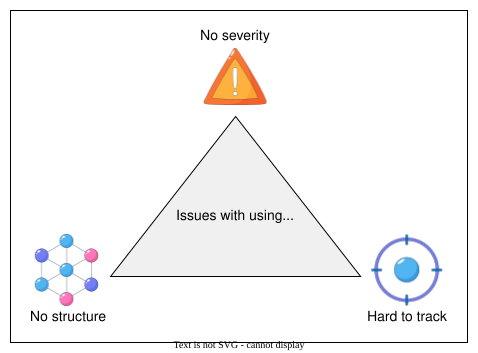

# Distributed_Logging_System_Design

Source: https://www.educative.io/courses/grokking-the-system-design-interview/system-design-distributed-logging

---

[Home](https://www.educative.io/)

[Courses](https://www.educative.io/search?tab=courses)

[Grokking Modern System Design Interview](https://www.educative.io/courses/grokking-the-system-design-interview)

# System Design: Distributed Logging

Explore the necessity of logging for monitoring and troubleshooting complex distributed systems. Learn why basic print statements fail to provide causality tracking and persistence. Define the foundational requirements for designing a robust distributed logging system.

We'll cover the following...

- [Logging](https://www.educative.io/courses/grokking-the-system-design-interview/system-design-distributed-logging#Logging)
- [Need for logging](https://www.educative.io/courses/grokking-the-system-design-interview/system-design-distributed-logging#Need-for-logging)
- [How will we design a distributed logging system?](https://www.educative.io/courses/grokking-the-system-design-interview/system-design-distributed-logging#How-will-we-design-a-distributed-logging-system)

## Logging[#](https://www.educative.io/courses/grokking-the-system-design-interview/system-design-distributed-logging#Logging)

A **log file** records specific events within a software application. These details, ranging from transaction data to service actions, are essential for debugging and monitoring the system’s flow.

Correlated logs across services help find the root cause and reduce time to repair

## Need for logging[#](https://www.educative.io/courses/grokking-the-system-design-interview/system-design-distributed-logging#Need-for-logging)

Logging is critical for understanding event flow in distributed systems. When failures or security breaches occur, logs help identify the root cause and reduce the mean time to repair.

Simple print statements are not suitable for production environments. They do not support severity levels (e.g., INFO or ERROR) and usually write to standard output rather than a persistent log store. Distributed systems generate high log volumes, so logs must be structured and aggregated centrally for efficient analysis.

Issues with using print statements as an alternative to logging

Services running concurrently across multiple nodes require causality information to stitch together the correct event flow. A logging service manages this diagnostic data, enabling engineers to visualize performance and trace requests. Effective logging provides visibility into production environments, helping teams locate unforeseen errors and understand system behavior.

Log analysis supports the following scenarios:

- Troubleshooting application, node, or network issues.
- Adhering to internal security policies and external compliance regulations.
- Detecting and responding to data breaches.
- Analyzing user actions to inform features like recommender systems.

AI Powered

Saved

3 attempts left

Reset

Security in Distributed Logging System

What are some security concerns to consider when designing a distributed logging system? How would you mitigate them?

You have 3 attempts to answer.

## How will we design a distributed logging system?[#](https://www.educative.io/courses/grokking-the-system-design-interview/system-design-distributed-logging#How-will-we-design-a-distributed-logging-system)

We will explore the design of a distributed logging system across the following lessons:

1. [**Introduction**](https://www.educative.io/courses/grokking-the-system-design-interview/introduction-to-distributed-logging)**:** Discuss how logging operates at a distributed level, including strategies for structuring logs and managing file size.
2. [**Design**](https://www.educative.io/courses/grokking-the-system-design-interview/design-of-a-distributed-logging-service)**:** Define the requirements, API design, and detailed architecture of the logging service.

Evaluation of a Distributed Search's Design

Introduction to Distributed Logging

Ask

[Logging](https://www.educative.io/courses/grokking-the-system-design-interview/system-design-distributed-logging#Logging)

[Need for logging](https://www.educative.io/courses/grokking-the-system-design-interview/system-design-distributed-logging#Need-for-logging)

[How will we design a distributed logging system?](https://www.educative.io/courses/grokking-the-system-design-interview/system-design-distributed-logging#How-will-we-design-a-distributed-logging-system)