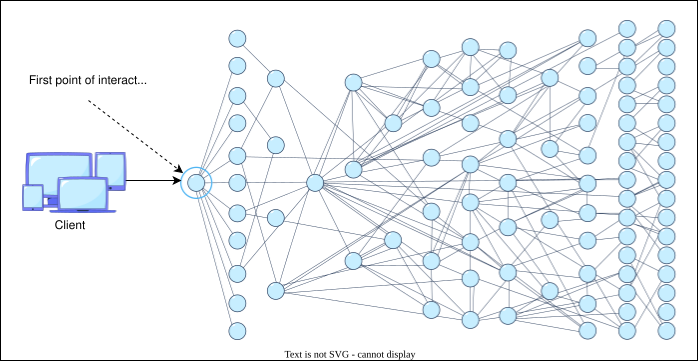

# Introduction_to_Distributed_Logging

Source: https://www.educative.io/courses/grokking-the-system-design-interview/introduction-to-distributed-logging

---

[Home](https://www.educative.io/)

[Courses](https://www.educative.io/search?tab=courses)

[Grokking Modern System Design Interview](https://www.educative.io/courses/grokking-the-system-design-interview)

# Introduction to Distributed Logging

Define the necessity of distributed logging to trace events across thousands of microservice nodes. Learn methods like sampling and categorization to structure logs efficiently and manage massive data volumes. Implement secure logging practices by avoiding Personally Identifiable Information and sensitive data.

We'll cover the following...

- [Logging in a distributed system](https://www.educative.io/courses/grokking-the-system-design-interview/introduction-to-distributed-logging#Logging-in-a-distributed-system)
- [Restrain the log size](https://www.educative.io/courses/grokking-the-system-design-interview/introduction-to-distributed-logging#Restrain-the-log-size)
  - [Use sampling](https://www.educative.io/courses/grokking-the-system-design-interview/introduction-to-distributed-logging#Use-sampling)
  - [Use categorization](https://www.educative.io/courses/grokking-the-system-design-interview/introduction-to-distributed-logging#Use-categorization)
- [Structure the logs](https://www.educative.io/courses/grokking-the-system-design-interview/introduction-to-distributed-logging#Structure-the-logs)
- [Points to consider while logging](https://www.educative.io/courses/grokking-the-system-design-interview/introduction-to-distributed-logging#Points-to-consider-while-logging)
  - [Vulnerability in logging infrastructure](https://www.educative.io/courses/grokking-the-system-design-interview/introduction-to-distributed-logging#Vulnerability-in-logging-infrastructure)

## Logging in a distributed system[#](https://www.educative.io/courses/grokking-the-system-design-interview/introduction-to-distributed-logging#Logging-in-a-distributed-system)

Modern system architectures often adopt microservices rather than monolithic architectures. In a microservices environment, logs are distributed across the nodes that run each service. This complicates debugging. When a request spans multiple services, tracing the execution path or correlating errors from individual nodes becomes difficult. A single microservice may run on thousands of instances. Because services are interdependent, a failure in one can cascade to others. Without centralized logging and end-to-end request tracing, identifying the root cause of failures becomes significantly harder.



1 / 7

First point of interaction for client in a distributed systems


1 / 7

A service fails in a distributed systems


1 / 7

Another service that was dependent on the previous service also failed because of it


1 / 7

Another service that was dependent on the previous service also failed because of it


1 / 7

Similarly, other dependent services also fail

## Restrain the log size[#](https://www.educative.io/courses/grokking-the-system-design-interview/introduction-to-distributed-logging#Restrain-the-log-size)

Log volume grows rapidly with traffic. A system handling hundreds of concurrent messages generates massive amounts of data. To manage this, you must structure logs effectively and determine which events are critical enough to record.

### Use sampling[#](https://www.educative.io/courses/grokking-the-system-design-interview/introduction-to-distributed-logging#Use-sampling)

Sampling reduces log volume by recording a representative subset of events. For example, in a social network where users generate high volumes of comments, logging every interaction is impractical. Instead, a sampling service captures a configurable percentage of these events. This enables monitoring of system health and trends without overwhelming storage or processing resources.

> **Note:** For hyperscale systems like Facebook, logging billions of events per second is not viable. An appropriate sampling threshold and strategy are necessary to selectively pick a representative data set.

You can also categorize message types and apply filters to log only high-priority events.

1.

What is a scenario where the sampling approach will not work?

Show Answer

Did you find this helpful?

### Use categorization[#](https://www.educative.io/courses/grokking-the-system-design-interview/introduction-to-distributed-logging#Use-categorization)

Standard logging libraries (such as `Log4j` for Java or the `logging` module in Python) use severity levels to categorize messages. Common levels include:

- **`DEBUG`****:** Detailed information for diagnosing problems.
- **`INFO`****:** Confirmation that things are working as expected.
- **`WARNING`****:** Indication of a potential problem or unexpected situation.
- **`ERROR`****:** A serious issue preventing a specific function from executing.
- **`FATAL/CRITICAL`****:** A severe error causing the program to crash.

In production, logs are typically filtered to capture `WARNING` levels and above to reduce noise. However, `DEBUG` and `INFO` levels are essential during development or when troubleshooting complex flows.

Click the “Run” button to execute the Python example and observe how different log levels are printed.

Python 3.5

```
import logging as log

# set the logging level to DEBUG

log.basicConfig(level=log.DEBUG)

for i in range(6):

if i == 0:

log.debug("Debug level")

elif i == 1:

log.info("Info level")

elif i == 2:

log.warning("Warning level")

elif i == 3:

log.error("Error level")

elif i == 4:

log.critical("Critical level")

elif i == 5:

print("Uncomment the following to view a system generated error:")

#print(3/0)
```

⋯

> The output will be similar to:
>
> ```
> DEBUG:root:Debug level
>
>
>
> INFO:root:Info level
>
>
>
> WARNING:root:Warning level
>
>
>
> ERROR:root:Error level
>
>
>
> CRITICAL:root:Critical level
> ```

Let’s uncomment **line 17** to view a system-generated error over the division of an integer by zero. Python itself logs the error to the console:

## Structure the logs[#](https://www.educative.io/courses/grokking-the-system-design-interview/introduction-to-distributed-logging#Structure-the-logs)

While applications can log data as raw text or binary, enforcing a consistent structure such as JSON improves reliability and downstream processing. Structured logs improve interoperability between producers and consumers and allow log processing systems to parse and query data efficiently.

> **Note:** The structuring of logs is a dense topic in itself. We refer the interested learners to the PhD thesis by Ryan Braud titled “Query-based debugging of distributed systems.”

## Points to consider while logging[#](https://www.educative.io/courses/grokking-the-system-design-interview/introduction-to-distributed-logging#Points-to-consider-while-logging)

Logging must balance utility, security, and performance. Logs should contain relevant context without exposing sensitive data. Consider the following best practices:

- **Protect PII:** Do not log Personally Identifiable Information (PII) such as names, addresses, or email addresses.
- **Secure secrets:** Never log sensitive credentials, such as credit card numbers or passwords. If necessary, log only encrypted data.
- **Optimize performance:** Logging is an I/O-heavy operation. Avoid excessive logging to prevent storage bloat and performance degradation.
- **Ensure security:** Logs reveal application flow and internal logic. Ensure the logging mechanism is secure to prevent exploitation by attackers.

AI Powered

Saved

3 attempts left

Reset

Challenges in using traditional logging

What are the challenges in using traditional logging in a distributed system?

You have 3 attempts to answer.

### Vulnerability in logging infrastructure[#](https://www.educative.io/courses/grokking-the-system-design-interview/introduction-to-distributed-logging#Vulnerability-in-logging-infrastructure)

In November 2021, a zero-day vulnerability known as Log4Shell (CVE-2021-44228) was disclosed in Log4j, a widely used Java logging framework. The vulnerability received a CVSS severity score of 10.0, the highest possible rating. It allowed remote code execution, enabling attackers to compromise affected systems. This incident underscores the need to secure logging infrastructure and manage third-party dependencies carefully.

System Design: Distributed Logging

Design of a Distributed Logging Service

Ask

[Logging in a distributed system](https://www.educative.io/courses/grokking-the-system-design-interview/introduction-to-distributed-logging#Logging-in-a-distributed-system)

[Restrain the log size](https://www.educative.io/courses/grokking-the-system-design-interview/introduction-to-distributed-logging#Restrain-the-log-size)

[Use sampling](https://www.educative.io/courses/grokking-the-system-design-interview/introduction-to-distributed-logging#Use-sampling)

[Use categorization](https://www.educative.io/courses/grokking-the-system-design-interview/introduction-to-distributed-logging#Use-categorization)

[Structure the logs](https://www.educative.io/courses/grokking-the-system-design-interview/introduction-to-distributed-logging#Structure-the-logs)

[Points to consider while logging](https://www.educative.io/courses/grokking-the-system-design-interview/introduction-to-distributed-logging#Points-to-consider-while-logging)

[Vulnerability in logging infrastructure](https://www.educative.io/courses/grokking-the-system-design-interview/introduction-to-distributed-logging#Vulnerability-in-logging-infrastructure)