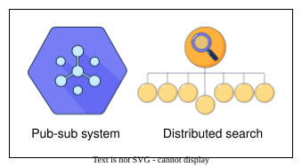
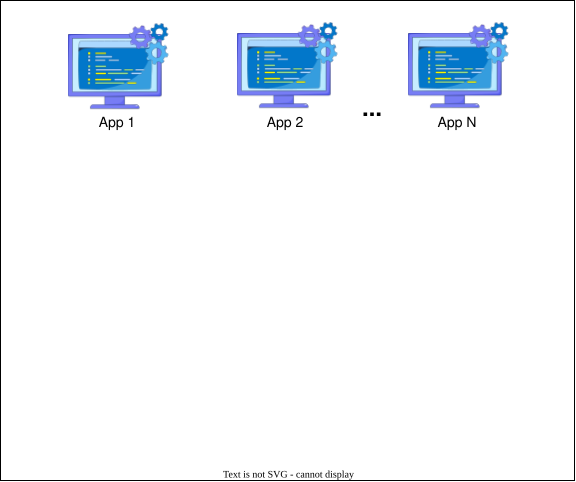
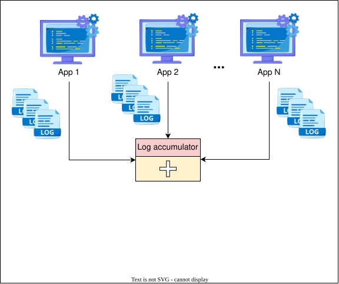
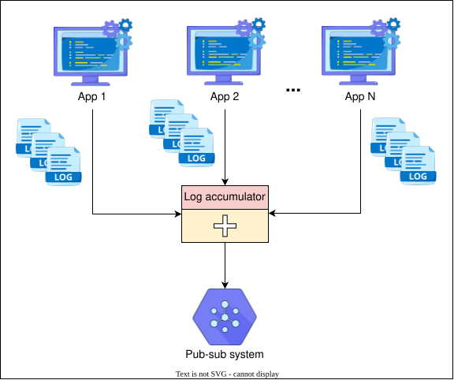

# Design_of_a_Distributed_Logging_Service

Source: https://www.educative.io/courses/grokking-the-system-design-interview/design-of-a-distributed-logging-service

---

[Home](https://www.educative.io/)

[Courses](https://www.educative.io/search?tab=courses)

[Grokking Modern System Design Interview](https://www.educative.io/courses/grokking-the-system-design-interview)

# Design of a Distributed Logging Service

Design a distributed logging service that meets strict requirements for scalability, availability, and low latency. Learn to use asynchronous log accumulators and a pub-sub architecture to handle massive log volumes without affecting application performance.

We'll cover the following...

- [Requirements](https://www.educative.io/courses/grokking-the-system-design-interview/design-of-a-distributed-logging-service#Requirements)
  - [Functional requirements](https://www.educative.io/courses/grokking-the-system-design-interview/design-of-a-distributed-logging-service#Functional-requirements)
  - [Non-functional requirements](https://www.educative.io/courses/grokking-the-system-design-interview/design-of-a-distributed-logging-service#Non-functional-requirements)
- [Building blocks we will use](https://www.educative.io/courses/grokking-the-system-design-interview/design-of-a-distributed-logging-service#Building-blocks-we-will-use)
- [API design](https://www.educative.io/courses/grokking-the-system-design-interview/design-of-a-distributed-logging-service#API-design)
  - [Write a message](https://www.educative.io/courses/grokking-the-system-design-interview/design-of-a-distributed-logging-service#Write-a-message)
  - [Search log](https://www.educative.io/courses/grokking-the-system-design-interview/design-of-a-distributed-logging-service#Search-log)
- [Initial design](https://www.educative.io/courses/grokking-the-system-design-interview/design-of-a-distributed-logging-service#Initial-design)
- [Logging at various levels](https://www.educative.io/courses/grokking-the-system-design-interview/design-of-a-distributed-logging-service#Logging-at-various-levels)
  - [In a server](https://www.educative.io/courses/grokking-the-system-design-interview/design-of-a-distributed-logging-service#In-a-server)
  - [At the data center level](https://www.educative.io/courses/grokking-the-system-design-interview/design-of-a-distributed-logging-service#At-the-data-center-level)
- [Conclusion](https://www.educative.io/courses/grokking-the-system-design-interview/design-of-a-distributed-logging-service#Conclusion)

We will design a distributed logging system to capture all activities and messages. We will not incorporate sampling in this design.

## Requirements[#](https://www.educative.io/courses/grokking-the-system-design-interview/design-of-a-distributed-logging-service#Requirements)

Let’s list the requirements for designing a distributed logging system:

### Functional requirements[#](https://www.educative.io/courses/grokking-the-system-design-interview/design-of-a-distributed-logging-service#Functional-requirements)

- **Writing logs:** Services within the distributed system must be able to write to the logging system.
- **Searchable logs:** Users must be able to search logs effortlessly and track the application flow end to end.
- **Storing logs:** Logs must reside in distributed storage for easy access.
- **Centralized logging visualizer:** The system must provide a unified view of globally distributed services.

### Non-functional requirements[#](https://www.educative.io/courses/grokking-the-system-design-interview/design-of-a-distributed-logging-service#Non-functional-requirements)

- **Low latency:** Logging is an I/O-intensive operation. It must not block the application’s critical path.
- **Scalability:** The system must handle increasing log volumes and a growing number of concurrent users.
- **Availability:** The logging system must be highly available.

## Building blocks we will use[#](https://www.educative.io/courses/grokking-the-system-design-interview/design-of-a-distributed-logging-service#Building-blocks-we-will-use)

The design utilizes the following building blocks:

- [**Pub-sub system**](https://www.educative.io/courses/grokking-the-system-design-interview/system-design-the-pub-sub-abstraction)**:** Handles the massive volume of logs.
- [**Distributed search**](https://www.educative.io/courses/grokking-the-system-design-interview/system-design-the-distributed-search)**:** Enables efficient log querying.

Building blocks we will use

## API design[#](https://www.educative.io/courses/grokking-the-system-design-interview/design-of-a-distributed-logging-service#API-design)

The API design includes the following endpoints:

### Write a message[#](https://www.educative.io/courses/grokking-the-system-design-interview/design-of-a-distributed-logging-service#Write-a-message)

The API call to write a log entry is as follows:

Ace Editor

1

write(unique\_ID, message\_to\_be\_logged)

הההההההההההההההההההההההההההההההההההההההההההההההההההההההההההההההההההההההההההההההההההההההההההההההההההההההההההההההההההההההההההההההההההההההההההההההההההההההההההההההההההההההההההההההההההההההההההההההההההההההההההההההההההההההההההההההההההההההההההההההההההההההההההההההההההההההההההההההההההההההההההההההההההההההההההההההההההההההההההההההההההההההההההההההההההההההההההההההההההההההההההההההההההההההההההההההההההההההההההההההההההההההההההההההההההההההההההההההההההההההההההההההההההההההההההההההההההההההההההההההההההההההההההההההההההההההההההההההה

XXXXXXXXXXXXXXXXXXXXXXXXXXXXXXXXXXXXXXXXXXXXXXXXXXXXXXXXXXXXXXXXXXXXXXXXXXXXXXXXXXXXXXXXXXXXXXXXXXXXXXXXXXXXXXXXXXXXXXXXXXXXXXXXXXXXXXXXXXXXXXXXXXXXXXXXXXXXXXXXXXXXXXXXXXXXXXXXXXXXXXXXXXXXXXXXXXXXXXXXXXXXXXXXXXXXXXXXXXXXXXXXXXXXXXXXXXXXXXXXXXXXXXXXXXXXXXXXXXXXXXXXXXXXXXXXXXXXXXXXXXXXXXXXXXXXXXXXXXXXXXXXXXXXXXXXXXXXXXXXXXXXXXXXXXXXXXXXXXXXXXXXXXXXXXXXXXXXXXXXXXXXXXXXXXXXXXXXXXXXXXXXXXXXXXXXXXXXXXXXXXXXXXXXXXXXXXXXXXXXXXXXXXXXXXXXXXXXXXXXXXXXXXXXXXXXXXXXXXXXXXXXXXXXXXXXXXXXXXXXXXXXXXXXXXXXXXXXXXXXXXXXXXXXXXXX

|  |  |
| --- | --- |
| **Parameter** | **Description** |
| `unique_ID` | It is a numeric ID containing `application-id`, `service-id,` and a time stamp. |
| `message_to_be_logged` | It is the log message stored against a unique key. |

### Search log[#](https://www.educative.io/courses/grokking-the-system-design-interview/design-of-a-distributed-logging-service#Search-log)

The API call to search logs is as follows:

Ace Editor

1

searching(keyword)

הההההההההההההההההההההההההההההההההההההההההההההההההההההההההההההההההההההההההההההההההההההההההההההההההההההההההההההההההההההההההההההההההההההההההההההההההההההההההההההההההההההההההההההההההההההההההההההההההההההההההההההההההההההההההההההההההההההההההההההההההההההההההההההההההההההההההההההההההההההההההההההההההההההההההההההההההההההההההההההההההההההההההההההההההההההההההההההההההההההההההההההההההההההההההההההההההההההההההההההההההההההההההההההההההההההההההההההההההההההההההההההההההההההההההההההההההההההההההההההההההההההההההההההההההההההההההההההההה

XXXXXXXXXXXXXXXXXXXXXXXXXXXXXXXXXXXXXXXXXXXXXXXXXXXXXXXXXXXXXXXXXXXXXXXXXXXXXXXXXXXXXXXXXXXXXXXXXXXXXXXXXXXXXXXXXXXXXXXXXXXXXXXXXXXXXXXXXXXXXXXXXXXXXXXXXXXXXXXXXXXXXXXXXXXXXXXXXXXXXXXXXXXXXXXXXXXXXXXXXXXXXXXXXXXXXXXXXXXXXXXXXXXXXXXXXXXXXXXXXXXXXXXXXXXXXXXXXXXXXXXXXXXXXXXXXXXXXXXXXXXXXXXXXXXXXXXXXXXXXXXXXXXXXXXXXXXXXXXXXXXXXXXXXXXXXXXXXXXXXXXXXXXXXXXXXXXXXXXXXXXXXXXXXXXXXXXXXXXXXXXXXXXXXXXXXXXXXXXXXXXXXXXXXXXXXXXXXXXXXXXXXXXXXXXXXXXXXXXXXXXXXXXXXXXXXXXXXXXXXXXXXXXXXXXXXXXXXXXXXXXXXXXXXXXXXXXXXXXXXXXXXXXXXXXX

Returns a list of logs containing the specified keyword.

|  |  |
| --- | --- |
| **Parameter** | **Description** |
| `keyword` | It is used for finding the logs containing the `keyword`. |

## Initial design[#](https://www.educative.io/courses/grokking-the-system-design-interview/design-of-a-distributed-logging-service#Initial-design)

In a distributed system, clients generate events by requesting services from various nodes. These nodes generate logs while handling requests. Logs accumulate on the respective nodes.

The major components of the system include:

- **Log accumulator:** An agent that collects logs from each node and dumps them into storage. This allows us to fetch logs from central storage rather than visiting individual nodes.
- **Storage:** We use blob storage to save accumulated logs.
- **Log indexer:** Indexes log files to enable efficient distributed search.
- **Visualizer:** Provides a unified view of all logs.

The initial design is illustrated below:

High-level design

In a distributed system with millions of servers, a single log accumulator creates a scalability bottleneck. We must design the system to scale effectively.

## Logging at various levels[#](https://www.educative.io/courses/grokking-the-system-design-interview/design-of-a-distributed-logging-service#Logging-at-various-levels)

Let’s explore how the logging system works at various levels.

### In a server[#](https://www.educative.io/courses/grokking-the-system-design-interview/design-of-a-distributed-logging-service#In-a-server)

A single server often hosts multiple applications and microservices. For example, an e-commerce application may run authentication and cart services simultaneously. Each service produces logs. We use a unique ID comprising the `application-id`, `service-id`, and a timestamp to identify events and determine causality.

Each service pushes data to a **log accumulator** service, which performs the following actions:

- Receives the logs.
- Stores the logs locally.
- Pushes the logs to a [pub-sub system](https://www.educative.io/courses/grokking-the-system-design-interview/system-design-the-pub-sub-abstraction).

A pub–sub system is used to support high log throughput. Each server’s log accumulator publishes events to the pub-sub system, which processes high log volumes. To minimize latency impact, logs are sent asynchronously using a background worker. This prevents logging from degrading application performance or availability.

1 / 3

Multiple applications running on a server, and each application has various microservices.

1 / 3

Each service produces logs and sends them to the log accumulator

1 / 3

Log accumulator pushes logs to a pub-sub system.

Logging massive volumes of messages involves a trade-off between latency and guarantees of persistence. To minimize latency, services often buffer data in RAM and asynchronously persist it. We can minimize data loss by adding redundant log accumulators to handle the growing number of concurrent users.

1.

How does logging differ when we host our service on a multi-tenant cloud (e.g., AWS) vs. when an organization has exclusive control of the infrastructure (e.g., Facebook), specifically in terms of logs?

Show Answer

Did you find this helpful?

> **Note:** Sensitive applications, such as banking or financial services, require strict security to prevent data theft. A common practice is to encrypt data before logging it, ensuring unauthorized parties cannot decrypt the information.

### At the data center level[#](https://www.educative.io/courses/grokking-the-system-design-interview/design-of-a-distributed-logging-service#At-the-data-center-level)

All servers in a data center push logs to a horizontally scalable pub-sub system. We may use multiple pub-sub instances per data center to avoid bottlenecks. The pub-sub system then pushes data to blob storage.

Log accumulator sending data to the pub-sub system

Data in the pub-sub system is transient and is eventually moved to archival storage. While data is available in the pub-sub system, the following services process it:

- **Filterer:** Identifies the application and stores logs in the specific blob storage reserved for that application.
- **Error aggregator:** Identifies error messages from the pub-sub system and notifies the client immediately.
- **Alert aggregator:** Identifies alerts and notifies stakeholders or monitoring tools of fatal errors.

The updated design follows:

Adding a filterer, error aggregator, and alert aggregator

We introduce an **expiration checker** component responsible for:

- Verifying logs for deletion.
- Moving logs to cold storage.

1.

Do we store the logs permanently?

Show Answer

Did you find this helpful?

The log indexer and visualizer operate on blob storage to enable efficient searching and visualization. The final design of the logging service is shown below:

Logging service design

1.

We learned earlier that a simple user-level API call to a large service might involve hundreds of internal microservices and thousands of nodes. How can we stitch together logs end-to-end for a single request while preserving causality?

Show Answer

Did you find this helpful?

> **Note:** Windows Azure Storage (WAS) uses an extensive logging infrastructure. Instead of pushing massive volumes of logs to distributed storage, they store logs on local disks and use a grep-like utility for distributed search. This provides a unified view of globally distributed log data without the overhead of centralizing all raw logs.

There can be various ways to design a distributed logging service, but it solely depends on specific application requirements.

AI Powered

Saved

12 attempts left

Reset

Distributed logging system for a high-traffic

Hi, I’m Ed. In this session, we will focus on some questions related to the distributed logging system for a high-traffic. Do you want to be mentored or evaluated?

You have 12 attempts to answer.

## Conclusion[#](https://www.educative.io/courses/grokking-the-system-design-interview/design-of-a-distributed-logging-service#Conclusion)

Logging helps trace event flow in a distributed system and reduces mean time to repair (MTTR) by supporting root cause analysis. Because logging is I/O-intensive, it should be handled asynchronously to avoid blocking the critical request path. Logs feed alerting systems and error aggregation pipelines to monitor application health.

Introduction to Distributed Logging

System Design: The Distributed Task Scheduler

Ask

[Requirements](https://www.educative.io/courses/grokking-the-system-design-interview/design-of-a-distributed-logging-service#Requirements)

[Functional requirements](https://www.educative.io/courses/grokking-the-system-design-interview/design-of-a-distributed-logging-service#Functional-requirements)

[Non-functional requirements](https://www.educative.io/courses/grokking-the-system-design-interview/design-of-a-distributed-logging-service#Non-functional-requirements)

[Building blocks we will use](https://www.educative.io/courses/grokking-the-system-design-interview/design-of-a-distributed-logging-service#Building-blocks-we-will-use)

[API design](https://www.educative.io/courses/grokking-the-system-design-interview/design-of-a-distributed-logging-service#API-design)

[Write a message](https://www.educative.io/courses/grokking-the-system-design-interview/design-of-a-distributed-logging-service#Write-a-message)

[Search log](https://www.educative.io/courses/grokking-the-system-design-interview/design-of-a-distributed-logging-service#Search-log)

[Initial design](https://www.educative.io/courses/grokking-the-system-design-interview/design-of-a-distributed-logging-service#Initial-design)

[Logging at various levels](https://www.educative.io/courses/grokking-the-system-design-interview/design-of-a-distributed-logging-service#Logging-at-various-levels)

[In a server](https://www.educative.io/courses/grokking-the-system-design-interview/design-of-a-distributed-logging-service#In-a-server)

[At the data center level](https://www.educative.io/courses/grokking-the-system-design-interview/design-of-a-distributed-logging-service#At-the-data-center-level)

[Conclusion](https://www.educative.io/courses/grokking-the-system-design-interview/design-of-a-distributed-logging-service#Conclusion)