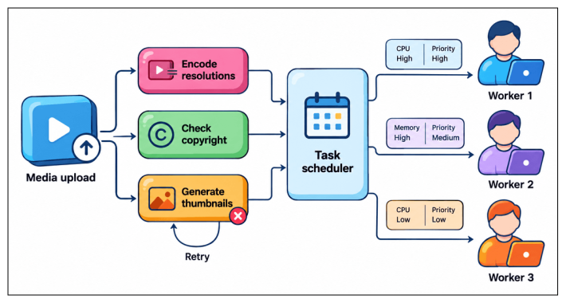

# System_Design_The_Distributed_Task_Scheduler

Source: https://www.educative.io/courses/grokking-the-system-design-interview/system-design-the-distributed-task-scheduler

---

[Home](https://www.educative.io/)

[Courses](https://www.educative.io/search?tab=courses)

[Grokking Modern System Design Interview](https://www.educative.io/courses/grokking-the-system-design-interview)

# System Design: The Distributed Task Scheduler

Define the core function of a task scheduler in allocating resources for background tasks. Discover why large distributed systems require a dedicated, scalable scheduler to manage billions of tasks from multiple sources.

We'll cover the following...

- [What is a task scheduler?](https://www.educative.io/courses/grokking-the-system-design-interview/system-design-the-distributed-task-scheduler#What-is-a-task-scheduler)
- [When to use a task scheduler](https://www.educative.io/courses/grokking-the-system-design-interview/system-design-the-distributed-task-scheduler#When-to-use-a-task-scheduler)
- [Distributed task scheduling](https://www.educative.io/courses/grokking-the-system-design-interview/system-design-the-distributed-task-scheduler#Distributed-task-scheduling)
- [How will we design a task scheduling system?](https://www.educative.io/courses/grokking-the-system-design-interview/system-design-the-distributed-task-scheduler#How-will-we-design-a-task-scheduling-system)

## What is a task scheduler?[#](https://www.educative.io/courses/grokking-the-system-design-interview/system-design-the-distributed-task-scheduler#What-is-a-task-scheduler)

A **task** is a unit of computational work requiring resources (CPU, memory, storage, or bandwidth) for a specific duration. For example, uploading media to Facebook or Instagram triggers several background tasks:

A task scheduler assigns background tasks to available resources

1. Encoding the photo or video into multiple resolutions.
2. Validating the media for content monetization, copyrights, and other policies.

Although these tasks are required to fully process and distribute the content, the upload request returns immediately. Compute-intensive processing runs asynchronously in the background, keeping the user-facing workflow responsive. When a user posts a comment on Facebook, the UI updates optimistically before backend confirmation completes. The distribution of that comment to followers is handled asynchronously by background workers coordinated through a task scheduler.

In any system, tasks compete for limited resources. A **task scheduler** mediates this competition by intelligently allocating resources to ensure both task-level and system-level goals are met.

## When to use a task scheduler[#](https://www.educative.io/courses/grokking-the-system-design-interview/system-design-the-distributed-task-scheduler#When-to-use-a-task-scheduler)

Task schedulers are critical for efficiency. They enable systems to handle high workloads with limited resources, ensuring optimal utilization and uninterrupted execution. Common use cases include:

- **Single-OS nodes:** Local OS schedulers use multi-feedback queues to allocate CPU time to competing processes on a single machine.
- **Cloud computing services:** Cloud environments manage billions of tasks from multiple tenants across distributed resources. A local OS scheduler cannot scale to this level; a distributed solution is required to efficiently manage resources across many machines.
- **Large distributed systems:** Platforms like Facebook or Instagram generate billions of asynchronous requests from user interactions. These systems rely on distributed schedulers to process tasks, such as notifications or feed updates, without blocking the user experience.

> **Note:** Facebook uses its own distributed task scheduler, called **Async**. It prioritizes tasks based on urgency. For example, live stream notifications require low-latency execution, while friend suggestion jobs can run with lower priority and relaxed scheduling constraints.

## Distributed task scheduling[#](https://www.educative.io/courses/grokking-the-system-design-interview/system-design-the-distributed-task-scheduler#Distributed-task-scheduling)

**Task scheduling** is the process of assigning resources to tasks promptly. The illustration below contrasts an OS-level scheduler with a data center-level scheduler:

An OS-level task scheduler vs. a data center-level task scheduler

An **OS scheduler** manages local processes on a single node. In contrast, a **data center scheduler** manages billions of tasks from multiple tenants across distributed resources.

We will design a distributed task scheduler that addresses two main challenges:

- Tasks originate from diverse sources, tenants, and sub-systems.
- Resources are dispersed across one or more data centers.

To handle these complexities, our design must be scalable, reliable, and fault-tolerant.

AI Powered

Saved

3 attempts left

Reset

The need for Distributed Task Scheduler

Why does a system with many tenants and resources spread across multiple data centers require a distributed scheduler? How does such a scheduler support scalability and coordination across locations?

You have 3 attempts to answer.

## How will we design a task scheduling system?[#](https://www.educative.io/courses/grokking-the-system-design-interview/system-design-the-distributed-task-scheduler#How-will-we-design-a-task-scheduling-system)

This chapter explores the design in four parts:

1. [**Requirements:**](https://www.educative.io/courses/grokking-the-system-design-interview/requirements-of-a-distributed-task-schedulers-design) Identify the functional and non-functional requirements of the system.
2. [**Design:**](https://www.educative.io/courses/grokking-the-system-design-interview/design-of-a-distributed-task-scheduler) Define the system components and database schema.
3. [**Design considerations:**](https://www.educative.io/courses/grokking-the-system-design-interview/design-considerations-of-a-distributed-task-scheduler) Discuss key factors like task prioritization and resource optimization.
4. [**Evaluation:**](https://www.educative.io/courses/grokking-the-system-design-interview/evaluation-of-a-distributed-task-schedulers-design) Assess the design against the initial requirements.

We begin by defining the requirements of a task scheduling system.

Design of a Distributed Logging Service

Requirements of a Distributed Task Scheduler's Design

Ask

[What is a task scheduler?](https://www.educative.io/courses/grokking-the-system-design-interview/system-design-the-distributed-task-scheduler#What-is-a-task-scheduler)

[When to use a task scheduler](https://www.educative.io/courses/grokking-the-system-design-interview/system-design-the-distributed-task-scheduler#When-to-use-a-task-scheduler)

[Distributed task scheduling](https://www.educative.io/courses/grokking-the-system-design-interview/system-design-the-distributed-task-scheduler#Distributed-task-scheduling)

[How will we design a task scheduling system?](https://www.educative.io/courses/grokking-the-system-design-interview/system-design-the-distributed-task-scheduler#How-will-we-design-a-task-scheduling-system)